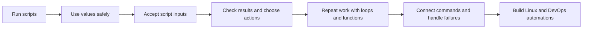

# 🐚 Bash Scripting Learning Path

[[DevOps/NaNa/Linux/0. Linux Learning Path|📚 Linux Learning Path]]

Learn Bash one practical skill at a time, from running a first script to automating Linux and DevOps operations. Each Markdown lesson has a real command-line task, a short recall check, and a prompt to continue the practice through conversation.

> [!toc]- 📑 Contents
>
> - [[#📚 Source Books|📚 Source Books]]
> - [[#🧭 Start Here|🧭 Start Here]]
> - [[#🗺️ Learning Sequence|🗺️ Learning Sequence]]

## 📚 Source Books

| Book | Chapter | Role |
|---|---|---|
| *The Software Developer’s Guide to Linux* | 12 — Automating Tasks with Shell Scripts | Main sequence and developer-focused examples. |
| *Linux Bible*, 11th edition | 7 — Writing Simple Shell Scripts | Adds administration examples and shell practice. |
| *CompTIA Linux+ Guide to Linux Certification* | 7 — Working with the BASH Shell | Reinforces Bash fundamentals. |

## 🧭 Start Here

The lesson notes are being rebuilt to match the course’s teaching style. Use the mission and curated sources above to guide the next lesson sequence.

## 🗺️ Learning Sequence

Future topics include arithmetic, functions, pipelines, debugging, and small operational projects.
