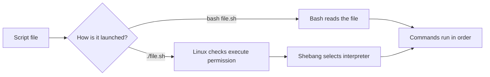

# 🐚 1. First Script, Shebang, and Execution

[[DevOps/NaNa/Linux/Bash Scripting/0. Bash Scripting Learning Path|📚 Bash Scripting Learning Path]]

### 📖 Chapter Summary

A Bash script is a text file containing commands that Bash runs in order. The shebang selects the interpreter when you execute the file directly; the execute bit grants permission to launch it that way.

SDGL Ch. 12 leads with Bash scripting for software developers. *Linux Bible* Ch. 7 adds practical administrator examples, while CompTIA Linux+ Ch. 7 reinforces shell and script fundamentals.

| Reference | Coverage |
|---|---|
| *The Software Developer’s Guide to Linux*, Ch. 12 | Bash scripts, execution, and developer workflows. |
| *Linux Bible*, 11th ed., Ch. 7 | Script creation, execution, and administration examples. |
| *CompTIA Linux+ Guide to Linux Certification*, Ch. 7 | Bash shell and foundational scripting practice. |

## 📝 Create a Small Script

Save commands in a `.sh` file when you want to repeat a task consistently. This report is useful when checking which account and host a local shell or CI job is using:

```bash
#!/usr/bin/env bash

printf 'Current user: '
id -un
printf 'Current host: '
hostname
printf 'Kernel details: '
uname -srm
```

The first line is the **shebang**. `env` locates Bash using the current `PATH`, which is convenient across Linux installations. The commands below it run in order. Lesson 2 will show how to capture a command’s output when you need to combine it with other text.

> 💡 **Real-world use:** A short host report helps make CI logs easier to diagnose when a job runs on an unexpected machine or account.

## ▶️ Choose How to Run It

Run the same file through Bash, or make it directly executable:

```bash
bash host-report.sh
chmod u+x host-report.sh
./host-report.sh
```

- `bash host-report.sh` asks Bash to read the file. The execute bit and shebang are not needed for this form.
- `chmod u+x` gives the file’s owner execute permission.
- `./host-report.sh` asks Linux to launch the file using its shebang. `./` means “from the current directory.”

Both launch forms run from the **current working directory**. A script’s relative paths therefore refer to where you launched it, not automatically to the directory containing the script.



## 🔎 Check Before Running

`bash -n` parses a script without executing its commands. It is a quick syntax check before trying a new automation:

```bash
bash -n host-report.sh
```

No output means Bash found no syntax error. It does not prove the script behaves correctly, and it does not check whether external commands will succeed.

Use `command -v` to see which Bash your environment finds, then inspect the first line of the file:

```bash
command -v bash
head -n 1 host-report.sh
```

Example output:

```text
/usr/bin/bash
#!/usr/bin/env bash
```

On Linux, `/usr/bin/env bash` resolves Bash through `PATH`. For tightly controlled systems, an explicit interpreter path such as `#!/bin/bash` can be preferable.

A short pipeline can add context to the lookup result:

```bash
command -v bash | sed 's|^|Bash found at: |'
```

Example output:

```text
Bash found at: /usr/bin/bash
```

### 🧪 Interview Q&A

**Q1:** What does a shebang do when a script is launched directly?

**Q2:** Why can `bash script.sh` work when `./script.sh` fails?

**Q3:** What does `bash -n script.sh` verify?

**Q4:** If a script uses `./config.yml`, what determines where Bash looks for it?

> [!answer]- 📋 Answers
>
> **A1:** It tells the operating system which interpreter should run the file.
>
> **A2:** Direct execution needs execute permission and a valid shebang; invoking Bash by name needs neither.
>
> **A3:** Bash checks syntax without running the script’s commands.
>
> **A4:** The current working directory of the process that launched the script.

### 🔨 Hands-On Tasks

#### Task 1: Run a Script Both Ways

**Goal:** Observe the difference between interpreter invocation and direct execution.

**Commands:**

```bash
mkdir -p "$HOME/bash-labs/lesson-1"
cd "$HOME/bash-labs/lesson-1"
cat > hello.sh <<'SCRIPT'
#!/usr/bin/env bash
printf 'Hello from Bash.\n'
SCRIPT
bash -n hello.sh
bash hello.sh
chmod u+x hello.sh
./hello.sh
```

**Steps:** Create the file, check its syntax, run it with Bash, then add execute permission and run it directly.

**Done when:** Both runs print `Hello from Bash.`

#### Task 2: Make a Host Report

**Goal:** Record useful host details in a repeatable script.

**Commands:** Use the `host-report.sh` listing from “Create a Small Script,” then run:

```bash
bash -n host-report.sh
bash host-report.sh
```

**Steps:** Save the listing as `host-report.sh`, check its syntax, and inspect the report.

**Done when:** It prints the current user, host, and kernel information.

### 📋 Quick Reference

| Need | Command or syntax |
|---|---|
| Select Bash using `PATH` | `#!/usr/bin/env bash` |
| Run with Bash | `bash script.sh` |
| Grant owner execute permission | `chmod u+x script.sh` |
| Run from the current directory | `./script.sh` |
| Check syntax without running | `bash -n script.sh` |
| Find Bash in `PATH` | `command -v bash` |

### 🧠 Things to Remember

- The shebang is used for direct execution; `bash script.sh` explicitly chooses Bash.
- Direct execution needs execute permission.
- Relative paths use the caller’s current working directory.
- Syntax checks and behavior checks answer different questions.

### 💡 Pro Tips

- Use `printf` for predictable formatted output.
- Keep scripts explicit about their interpreter.
- Check launch context when a script works in your terminal but fails in CI or a service.
- Avoid printing credentials or tokens in diagnostic reports.

### 🔗 Related Topics

- [[DevOps/NaNa/Linux/3. Environment Variables|Environment variables]]
- [[DevOps/NaNa/Linux/1. Linux Pipes, `grep`, `less`, and Output Redirection|Pipes and output redirection]]
- [GNU Bash Manual: Shell Scripts](https://www.gnu.org/software/bash/manual/html_node/Shell-Scripts.html)
- [GNU Bash Manual: Bash Startup Files](https://www.gnu.org/software/bash/manual/html_node/Bash-Startup-Files.html)
