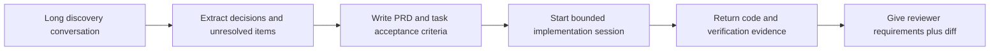
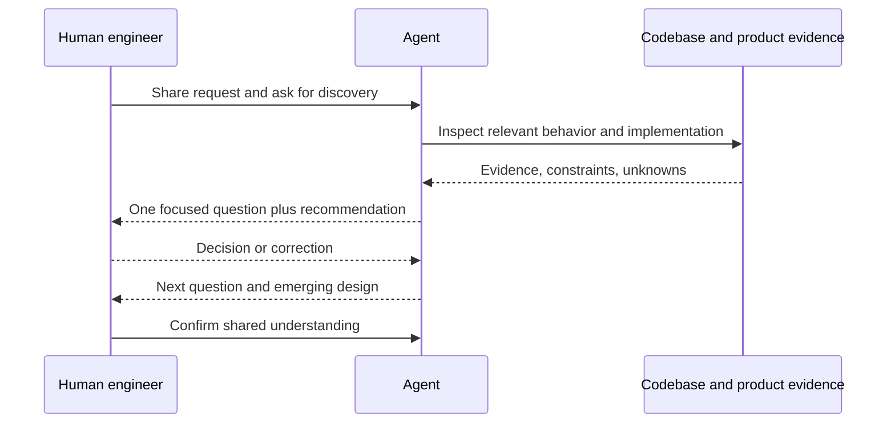
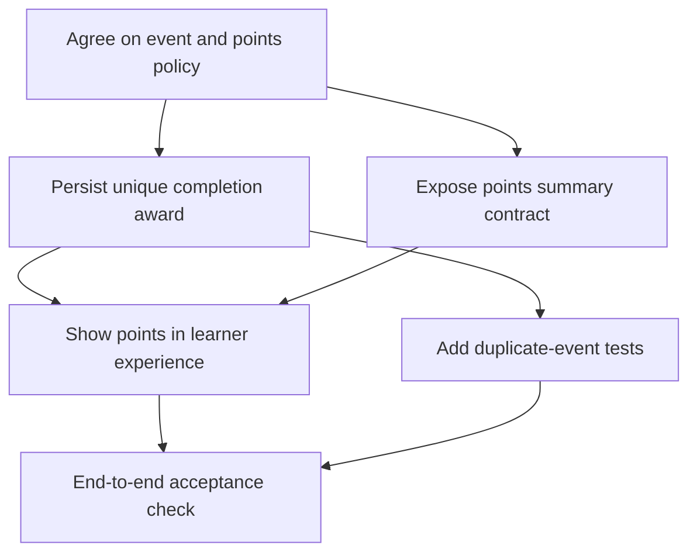
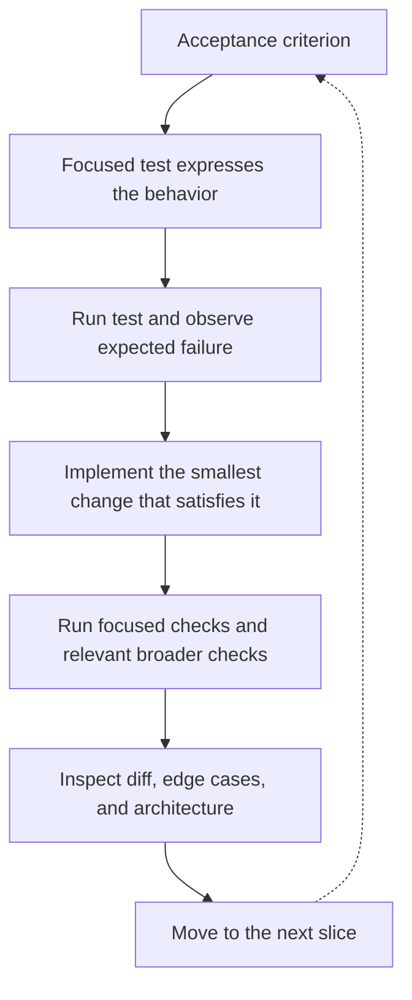
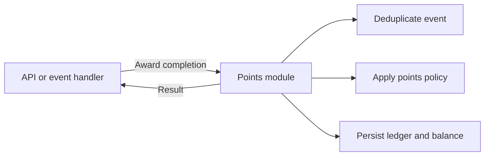
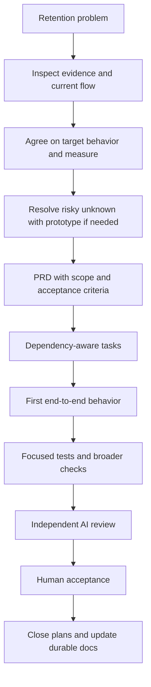

# Agentic Development: Complete Workflow — Detailed Guide

### 📖 Chapter Summary

This guide explains a disciplined way to use coding agents from the first vague feature request through implementation and review. Its central lesson is that successful agentic development is not “give AI a spec and accept the code.” The engineer and agent build shared understanding, work in short feedback loops, and keep the code itself visible as the place where design is tested.

The workshop’s example begins with a stakeholder asking for gamification because students start lessons and then leave. That request is intentionally underspecified. The workflow turns it into clarified product decisions, a PRD, dependency-aware tasks, incremental implementation, and independent review.

| Source | Focus |
|---|---|
| Matt Pocock, *AI Coding For Real Engineers* workshop transcript | Context management, alignment through questioning, feature workflow, implementation and review practices |
| Rough companion notes | Smart/dumb-zone shorthand, PRD, Kanban, vertical slices, TDD, deep modules, documentation lifecycle, push/pull collaboration |

#### 🆕 Key Concepts

| Concept | Meaning in this workflow |
|---|---|
| Shared understanding | Engineer and agent agree on the problem and design choices before implementation |
| PRD | Durable description of the desired product outcome and acceptance criteria |
| Vertical slice | A small behavior implemented across the layers it needs, so it can be exercised end to end |
| Kanban | A visible way to track task status, dependencies, and parallel work |
| Smart/dumb zone | Workshop metaphor for the tendency of long contexts to degrade attention and judgment |
| Push/pull | Explicit direction versus eliciting missing information through questions |
| Deep module | A cohesive unit that offers a small interface while hiding meaningful internal work |

#### 📊 Comparison at a Glance

| Choice | Weaker default | More useful practice |
|---|---|---|
| Starting work | Ask for a plan from a vague request | Interview, research, and resolve key decisions first |
| Planning | One giant plan or a flat checklist | PRD plus small dependency-aware tasks |
| Implementation | Complete all work in one layer before integration | Complete and verify vertical behaviors incrementally |
| Long sessions | Keep adding context and compact repeatedly | Bound tasks and start focused sessions with curated context |
| Review | Ask the implementation agent if its own work is correct | Use automated checks, independent review, and human judgment |
| Documentation | Leave every plan looking current forever | Keep durable docs accurate; close or archive transient plans |

## Part 1: The engineer stays responsible

### 📌 Concepts Explained

- The agent can explore, propose, implement, and review, but the engineer owns the product decision and the resulting code.
- Specifications are useful for alignment, but specifications-to-code is not a replacement for understanding the implementation.
- The code is where architectural choices, edge cases, and integration realities become concrete.

### 🔧 Why “spec to code” is not enough

An agent can produce code that appears to satisfy a document while misunderstanding its intent. If the response is simply to rewrite the document and generate again, the engineer can lose sight of the actual system. The workshop argues for keeping a handle on the code: inspect it, shape it, run it, and use what implementation reveals to refine the design.

For example, “add gamification” does not decide whether points are awarded for lesson completion, streaks, quizzes, or all three. Nor does it settle duplicate events, reversed completions, or whether points can be spent. Code written before answering such questions silently chooses product policy.

### 🧪 Questions

**Q1:** Why is a specification not a substitute for reviewing the implementation?

**Q2:** What can go wrong when an ambiguous request is sent directly to an implementation agent?

> [!answer]- 📋 Answers
>
> **A1:** The specification may omit constraints or edge cases, and the implementation may encode assumptions. Engineers need to validate behavior and design in the code.
>
> **A2:** The agent makes hidden product and architectural decisions, which may be expensive to discover after large amounts of code are written.

## Part 2: Context, attention, and task boundaries

### 📌 Concepts Explained

- A context window can hold instructions, conversation, code excerpts, and tool results, but more context is not automatically better.
- The workshop’s “smart zone / dumb zone” metaphor describes declining reliability as a session accumulates material.
- Small, well-scoped tasks reduce the amount of old context the agent must reconcile and make human review easier too.
- Compaction summarizes or compresses conversation; important nuance can be lost in that process.

### 🔧 The smart-zone heuristic

The presenter describes a practical threshold around 40% of context capacity, and mentions roughly 100k tokens as a personal marker. These are not guaranteed thresholds or universal model behavior. Models, tools, task types, and context composition differ. Treat token usage as one signal to consider a fresh, focused session—not as a precise measure of intelligence.

The more important mechanism is task quality. A focused request with relevant files, constraints, and acceptance criteria is easier to execute than a broad request surrounded by unrelated history. Repeatedly continuing and compacting a sprawling session risks turning decisions into lossy summaries and carrying stale assumptions forward.

### 💡 Example: context handoff

For an independent review, provide:

```text
Goal: Add lesson completion points.
Acceptance criteria: A completed lesson awards points once; duplicate completion events do not award twice.
Constraints: Follow the existing event and persistence patterns.
Review scope: Inspect the diff and relevant callers. Report concrete correctness risks and missing tests.
Evidence: Focused tests pass; full suite not run.
```

This gives the reviewer a clean starting point and the context needed to make a useful judgment. “Review this” with no requirement or evidence is too little; copying the entire prior chat is often too much.

### 📊 Context handoff flow



### 🧪 Questions

**Q1:** Is the workshop’s 40% context marker a universal limit?

**Q2:** What information should survive a handoff to a new coding or review session?

**Q3:** Why can compaction harm a long-running task?

> [!answer]- 📋 Answers
>
> **A1:** No. It is a heuristic from the presenter’s experience, not a fixed threshold for all models and tasks.
>
> **A2:** The goal, acceptance criteria, relevant constraints and code paths, decisions, open questions, and verification evidence.
>
> **A3:** Summaries can omit nuance or preserve obsolete assumptions, making later work less grounded in the original requirements.

## Part 3: Discover before deciding

### 📌 Concepts Explained

- Begin with the stakeholder’s problem, not a predetermined implementation.
- Explore relevant code and product behavior before proposing changes.
- Ask questions until decisions that affect behavior are clear enough to proceed.
- A lightweight “Grill Me” instruction can direct an agent to interview the engineer one question at a time and offer recommended answers.

### 🔧 From vague request to design concept

In the workshop example, the brief says retention is poor and asks for gamification. That is a signal about a problem, not a complete feature design. Discovery should establish what retention means, which users are affected, what data exists, what behaviors could improve the outcome, and how success might be measured.

Questioning is useful because AI assistants often rush to produce a plan. A plan can look complete while leaving important branches unexplored. A deliberate interview makes hidden product decisions visible and gives the engineer a chance to accept, reject, or adjust recommended answers.



### 💡 Practical discovery questions

- Which user experiences the problem, and when?
- What should change for that user?
- What evidence would indicate improvement?
- What behaviors are explicitly out of scope?
- What existing data or interfaces can support the feature?
- What failure, abuse, privacy, or accessibility cases matter?
- Which product choices require stakeholder confirmation?

The agent’s codebase exploration should support this conversation. Ask it to cite relevant files or behavior, then verify consequential claims. A subagent can explore a bounded area and return a summary, keeping raw exploration out of the main conversation; the summary still needs checking.

### 🧪 Questions

**Q1:** What is the difference between a stakeholder request and a requirement?

**Q2:** Why ask one focused question at a time?

**Q3:** What should you do with a recommendation from the agent?

> [!answer]- 📋 Answers
>
> **A1:** A request expresses a desired direction or problem; requirements specify the behavior and constraints needed to address it.
>
> **A2:** It isolates a decision, makes tradeoffs easier to discuss, and avoids burying unresolved choices in a large generated plan.
>
> **A3:** Evaluate it against user needs and evidence, then accept, modify, or reject it explicitly.

## Part 4: Research and optional prototyping

### 📌 Concepts Explained

- Research reduces uncertainty about users, the current system, constraints, and possible approaches.
- A prototype is useful when an important question is cheaper to test than to debate.
- A prototype should answer a specific question; it need not become production code.

### 🔧 Choosing whether to prototype

Research can include inspecting existing flows, tracing data, reading relevant tests, and checking the interfaces a feature must use. Avoid broad repository tours without a question; exploration should produce evidence that informs a decision.

Prototype when feasibility or interaction remains uncertain—for example, whether an event stream can reliably identify unique lesson completions, or whether a proposed progress display fits the existing UI. Keep the experiment small and label disposable work clearly. If the prototype is adopted, deliberately carry its validated decisions into the PRD and implement production behavior with the project’s conventions.

| Situation | Useful next move |
|---|---|
| Requirements are vague | Continue stakeholder discovery |
| Existing behavior is unclear | Inspect code, tests, and product flows |
| Technical feasibility is uncertain | Build a focused prototype or spike |
| Several solutions are viable but tradeoffs matter | Compare options against goals and constraints |
| Decision is already clear and low-risk | Record it and proceed to requirements |

### 🧪 Questions

**Q1:** When is a prototype a poor use of time?

**Q2:** What should happen to prototype code after it answers its question?

> [!answer]- 📋 Answers
>
> **A1:** When it does not resolve a meaningful uncertainty or when the decision is already clear and inexpensive to implement safely.
>
> **A2:** Either discard it or deliberately promote and refactor it; do not let experimental code become production by accident.

## Part 5: Write the PRD as the destination

### 📌 Concepts Explained

- A PRD records the intended product outcome so implementation choices point toward the same destination.
- It should be concise enough to use and specific enough to verify.
- It supports task breakdown and review, but it does not freeze design against evidence.

### 🔧 Useful PRD structure

```markdown
# Feature name

## Problem
Who has what problem, and in what situation?

## Goals and measures
What user or business outcome should improve?

## Scope
What behavior is included?

## Non-goals
What related work is intentionally excluded?

## User behavior and edge cases
What happens on normal, repeated, delayed, or invalid actions?

## Constraints and dependencies
What existing systems, policies, or interfaces must be respected?

## Acceptance criteria
What observable behavior demonstrates completion?

## Open questions and decisions
What remains undecided, and who decides it?
```

For a lesson-points feature, “award points once per completed lesson” is closer to testable behavior than “make learning fun.” A success measure might track a defined retention cohort over a defined time period, but the measure and target must come from product evidence rather than invention by the implementation agent.

### ⚠️ PRD failure modes

- **Solution disguised as a goal:** The requested feature may not address the underlying problem.
- **Missing non-goals:** The agent may expand into leaderboards, badges, or social sharing without agreement.
- **Unmeasurable acceptance:** “Works well” cannot guide a test or review.
- **Stale plan:** Once behavior changes, an old PRD can mislead later work unless updated or clearly closed.

### 🧪 Questions

**Q1:** How does a PRD help an implementation agent?

**Q2:** Why include non-goals?

**Q3:** Should the PRD remain unchanged if implementation reveals a wrong assumption?

> [!answer]- 📋 Answers
>
> **A1:** It communicates the intended outcome, constraints, and observable behavior, reducing the number of decisions the agent must invent.
>
> **A2:** They constrain scope and prevent plausible adjacent features from being added without agreement.
>
> **A3:** No. Revisit the decision with evidence and update the requirement or design before proceeding.

## Part 6: Build a dependency-aware Kanban plan

### 📌 Concepts Explained

- A task board shows work state and makes blockers visible.
- Dependencies distinguish work that can start now from work that must wait for an interface or decision.
- Parallel agents are useful only when their work is genuinely independent and integration boundaries are clear.

### 🔧 Kanban versus a simple sequence

A sequence says what comes next. A Kanban board also makes it easier to see what is in progress, blocked, ready, and done. For a feature with several services, independent work may proceed in parallel after shared contracts are defined. If two agents edit the same boundary based on different assumptions, parallelism creates merge and design costs rather than speed.

A task card should include:

1. One concrete user or system behavior.
2. Acceptance criteria and edge cases.
3. Dependencies and interface assumptions.
4. Likely ownership or relevant code area.
5. Verification steps and expected evidence.



The diagram illustrates dependencies, not a required architecture. The exact cards should reflect the actual codebase and PRD.

### 🧪 Questions

**Q1:** Why is a Kanban board helpful when some work can happen in parallel?

**Q2:** When is parallel agent work unsafe or inefficient?

**Q3:** What makes a task card independently reviewable?

> [!answer]- 📋 Answers
>
> **A1:** It shows state and blockers, helping the team identify independent work after prerequisites are complete.
>
> **A2:** When interfaces, decisions, or files overlap and are not yet stable, or when integration coordination costs exceed the saved time.
>
> **A3:** It has a bounded outcome, explicit acceptance criteria, understood dependencies, and a way to verify completion.

## Part 7: Implement vertical slices with tests

### 📌 Concepts Explained

- A vertical slice delivers a small coherent behavior across the necessary layers.
- It creates early integration feedback and limits the amount of code built on an incorrect assumption.
- TDD can make acceptance criteria executable: test the behavior, observe failure, implement, then refactor.

### 🔧 Horizontal layers versus vertical behavior

Suppose a feature touches a database, repository, service, and API. A horizontal approach might build every database change first, then every repository, then every service, and only later connect the API. That can leave the team with many individually plausible pieces but no working flow.

A vertical slice could implement one policy end to end: record one completion award, expose it through the API, and verify duplicate events do not award twice. The next slice can add another behavior. This does not mean every slice must touch every layer; it means each increment should prove useful behavior at the right boundary.

### 💻 A feedback loop



Tests can prevent an agent from merely writing code and then inventing a passing test around it, but only if the test is grounded in the requirement and reviewed. A passing suite is evidence, not proof: tests can omit behavior, assert the wrong thing, or fail to cover integration.

### 🧪 Questions

**Q1:** Why does a vertical slice usually provide earlier feedback than a horizontal batch?

**Q2:** What does the red phase in TDD tell you?

**Q3:** How can an agent “cheat” with a test even when the test passes?

> [!answer]- 📋 Answers
>
> **A1:** It connects the relevant layers for one behavior, surfacing integration and requirement problems before many layers are built.
>
> **A2:** That the test can detect the behavior is not yet implemented, assuming the test itself is valid.
>
> **A3:** It can encode the implementation’s behavior instead of the requirement, use weak assertions, or omit important cases.

## Part 8: Design modules for comprehension

### 📌 Concepts Explained

- A deep module hides substantial cohesive behavior behind a small interface.
- Many shallow modules can multiply navigation and coordination without creating useful boundaries.
- The goal is not fewer files; it is a clear seam with strong cohesion and limited coupling.

### 🔧 Example

Imagine callers must coordinate five low-level steps to award points: load completion state, check duplication, calculate points, write a ledger entry, and update a balance. If every caller repeats that sequence, the policy is scattered and difficult to verify.

A cohesive `AwardLessonCompletion` operation could expose a narrow contract while owning the transaction and duplicate handling internally. The exact name and interface depend on the language and architecture. The key is that callers express intent, while the module protects its invariants.



Improve architecture when change is difficult because responsibilities are tangled or interfaces expose unnecessary details. Preserve behavior with tests while refactoring. Avoid refactoring unrelated areas just because an agent can generate code quickly.

### 🧪 Questions

**Q1:** Why can a small interface hide a large implementation?

**Q2:** What is the risk of splitting every helper into its own module?

**Q3:** What evidence suggests a module boundary should change?

> [!answer]- 📋 Answers
>
> **A1:** Callers need only a stable operation; cohesive internal steps can remain encapsulated behind it.
>
> **A2:** It can create shallow abstractions, more indirection, and increased coordination without hiding meaningful complexity.
>
> **A3:** Repeated cross-boundary coordination, duplicated policy, difficult testing, or callers depending on internal implementation details.

## Part 9: QA, independent review, and human judgment

### 📌 Concepts Explained

- Automated checks provide repeatable evidence about defined properties.
- AI review can find overlooked problems, especially when it receives the requirements and reviews independently.
- Human review remains responsible for correctness, design, security, and product acceptance.

### 🔧 A useful review sequence

1. Run focused tests for the changed behavior.
2. Run the project’s relevant broader checks.
3. Inspect the complete diff, including generated or configuration changes.
4. Ask an independent reviewer to compare the diff with acceptance criteria and identify concrete risks.
5. Validate review findings against code and evidence.
6. Have a human decide whether the feature is acceptable and ready to merge.

Starting the reviewer in a new conversation can reduce anchoring to the implementer’s reasoning. It does not mean the reviewer should be context-free. Give it the requirement, constraints, relevant surrounding design, diff, and check results. The review should point to specific behavior or code and explain impact, not produce vague style preferences.

### 🔀 Push and pull collaboration

| Interaction | Meaning | Example |
|---|---|---|
| Pull | Let the agent elicit missing decisions | Ask it to interview you about ambiguous product behavior |
| Push | Supply a known constraint or rubric | Tell the reviewer to check duplicate-event handling and authorization |

Pull is strongest during exploration and alignment. Push is useful for explicit standards and review criteria. Coding itself may use both: the agent asks about an unresolved policy, then receives a clear decision to implement.

### 🧪 Questions

**Q1:** Why should review be independent of implementation?

**Q2:** What belongs in an AI review request?

**Q3:** What is the human reviewer’s responsibility if tests and AI review pass?

> [!answer]- 📋 Answers
>
> **A1:** A separate perspective is less likely to inherit the implementer’s assumptions and can compare behavior to requirements afresh.
>
> **A2:** The goal, acceptance criteria, constraints, diff or scope, relevant design context, and test/check evidence.
>
> **A3:** Inspect whether the behavior and design are correct, evaluate evidence and risks, and make the acceptance decision.

## Part 10: Documentation and revisiting earlier stages

### 📌 Concepts Explained

- Requirements and plans are valuable during active work, but can become stale.
- Durable documentation should describe current behavior or lasting decisions.
- Transient plans should be closed, archived, or clearly marked complete in the team’s normal system.
- A meaningful design change should reopen the affected research and requirement decisions.

### 🔧 Keep the source of truth clear

The rough notes suggest removing implementation documents after completion so a future agent does not mistake them for current truth. The safer general rule is to manage lifecycle and authority explicitly: close or archive temporary plans, keep durable architecture and user documentation current, and link completed planning material to the change when it provides useful history.

Deleting all documentation can also remove valuable context. The goal is to prevent stale instructions from masquerading as current behavior, not to erase decision history. Make it obvious which files are authoritative and when a plan was completed.

If research reveals that the user problem was misunderstood, return to discovery. If an acceptance criterion changes, update the PRD and task plan. If only an implementation detail changes while the outcome remains stable, record the decision and continue with an appropriate slice.

### 🧪 Questions

**Q1:** Why can a completed plan mislead a future agent?

**Q2:** What documentation should remain after a feature ships?

**Q3:** When should earlier workflow stages be revisited?

> [!answer]- 📋 Answers
>
> **A1:** It may describe superseded behavior yet appear to be the current specification.
>
> **A2:** Accurate user and operational guidance, durable architectural decisions, and useful history with a clear status and source of truth.
>
> **A3:** When new evidence changes the user problem, constraints, design, or acceptance criteria enough to invalidate current tasks.

## Part 11: Worked example — lesson completion points

### 📌 Concepts Explained

The example below shows how the workflow progresses without pretending the transcript defines a final gamification design. Each item is a question or possible task to confirm against the actual product.

1. **Idea:** Students start courses but do not continue; a stakeholder proposes gamification.
2. **Research:** Inspect lesson completion events, retention data, existing learner screens, and relevant persistence patterns.
3. **Discovery:** Ask which users, actions, and outcomes matter; clarify whether points are motivational feedback, rewards, or both.
4. **Prototype if needed:** Test a risky event flow or progress interaction in isolation.
5. **PRD:** State the chosen points policy, duplicate behavior, user-facing display, success measure, and non-goals.
6. **Kanban:** Separate policy/storage, user display, and verification work according to actual dependencies.
7. **Vertical slice:** Implement one award behavior through persistence and a user-visible or testable interface.
8. **QA/review:** Verify criteria, duplicate handling, relevant edge cases, and integration; obtain independent and human review.
9. **Closeout:** Update lasting documentation and close transient planning items.



### 🧪 Questions

**Q1:** Why should the team not jump from “retention is low” straight to points implementation?

**Q2:** How would you test the rule that one lesson completion earns points only once?

**Q3:** What should happen if discovery shows points are unlikely to address the retention problem?

> [!answer]- 📋 Answers
>
> **A1:** The request does not establish the cause, desired behavior, or measure of success; implementation would encode unvalidated assumptions.
>
> **A2:** Write behavior tests for the first completion and repeated delivery of the same completion event, asserting the balance or ledger changes once.
>
> **A3:** Revisit the product approach with the stakeholder and choose a more evidence-based response before committing to implementation.

## 🔨 Hands-On Practice

Choose a small feature you understand and practice the process:

1. Write a three-sentence stakeholder brief without proposing a solution.
2. Ask an agent to interview you one question at a time; record decisions and remaining unknowns.
3. Inspect the code paths that support the relevant behavior and verify the agent’s findings.
4. Draft a one-page PRD with goals, non-goals, and observable acceptance criteria.
5. Draw task dependencies and identify one safe vertical slice.
6. Write a test from an acceptance criterion before asking for implementation.
7. Request an independent review with the PRD, diff, and verification evidence.
8. Compare the reviewer’s findings with your own inspection and record the final decision.

## 📋 Quick Reference

```text
Idea → Research → Align through questions → (Prototype) → PRD → Kanban → Vertical slices → QA → Independent AI review → Human review → Close out
```

| If you see… | Consider… |
|---|---|
| A vague feature request | Discovery questions and evidence gathering |
| A giant implementation task | Smaller behavior slices and focused context |
| Many blocked cards | Revisit dependencies and shared interfaces |
| Tests that pass immediately | Check whether they were derived independently from requirements |
| A reviewer with no context | Supply acceptance criteria, constraints, and evidence |
| Old plans beside current code | Mark status, archive, or update the source of truth |

## 🧠 Things to Remember

- Alignment comes before implementation; generated plans can conceal unresolved choices.
- Context size is a heuristic concern; task boundaries and relevant evidence matter more than a magic token threshold.
- Vertical slices shorten the distance between decision and feedback.
- Tests, AI review, and human review serve different roles and should reinforce one another.
- Small interfaces are valuable when they hide cohesive behavior, not merely because they reduce visible code.
- Keep documentation useful and its authority clear.

## 💡 Pro Tips

1. Ask an agent to expose assumptions instead of silently filling gaps.
2. Ask for evidence from the codebase when discovery claims existing behavior.
3. Put acceptance criteria directly on task cards.
4. Use subagents for bounded exploration and independent review; inspect their summaries.
5. Track only meaningful unresolved questions, and name who can decide them.
6. Keep prototypes disposable until you deliberately promote their design.
7. Have tests assert outcomes and invariants, not implementation details without reason.
8. Ask reviewers for prioritized findings with concrete impact and locations.
9. Report which checks ran and which did not.
10. Reopen requirements when evidence changes the product direction.

## 🔗 Related Topics

- [[Agentic Development/Matt Pocock/1.Complete Workflow]]
- [[Agentic Development/Matt Pocock/1.Complete Workflow - Reference]]
- [[Test-Driven Development]]
- [[Code Review]]
- [[Software Architecture]]
- [[Product Requirements Document]]

### 📚 Further Reading

| Resource | Topic |
|---|---|
| *AI Coding For Real Engineers* workshop transcript in this directory | Primary source for this guide |
| [[Agentic Development/Matt Pocock/1.Complete Workflow]] | Original rough notes |
| [[Agentic Development/Matt Pocock/1.Complete Workflow - Reference]] | Concise workflow reference |

*Detailed learning guide for Matt Pocock’s Complete Workflow workshop, 2026.*
