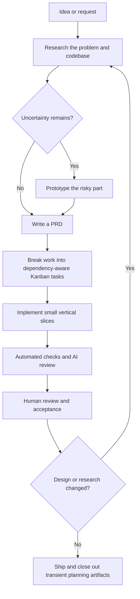
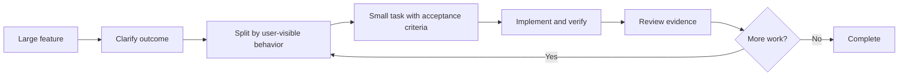
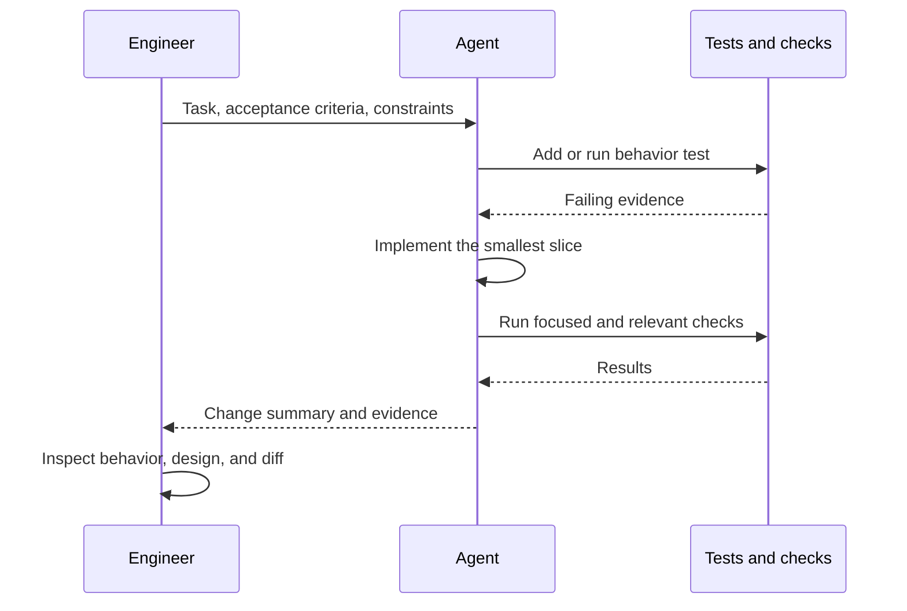

# Complete Workflow for Agentic Development

This reference turns a feature idea into reviewed, working software with an AI coding agent. The central idea is to keep human and agent aligned, keep each implementation loop small enough to reason about, and keep the engineer responsible for the code.

> [!info] Source
> Based on Matt Pocock’s workshop transcript, **[FULL WORKSHOP] AI Coding For Real Engineers**, and the accompanying notes. Tool names and specific context-window estimates reflect the workshop; treat them as heuristics, not universal limits.

## 🧭 The workflow at a glance



| Stage | Main question | Useful output |
|---|---|---|
| Idea | What problem are we solving? | Brief or issue |
| Research | What exists, and what constraints matter? | Findings and open questions |
| Prototype (optional) | Can the uncertain or risky part work? | Small disposable experiment |
| PRD | What outcome and behavior do we agree on? | Product requirements document |
| Kanban | What work depends on what? | Small, ordered, parallelizable tasks |
| Implementation | Does each slice work end to end? | Code, tests, reviewable increments |
| QA and review | Does it meet requirements and hold up technically? | Automated results and human approval |

## 1. Start with shared understanding

An idea is rarely a complete specification. A request such as “add gamification to improve retention” leaves important decisions open: who earns points, for which actions, how progress is shown, what can be abused, and how success is measured.

Start with a focused conversation. Matt’s **Grill Me** approach asks the agent to interview the engineer one question at a time, explore branches of the design, and offer a recommended answer. The purpose is not to get an impressive plan quickly; it is to reach a shared understanding of the problem and decisions.

Research the existing product and codebase as part of that conversation. Ask the agent to inspect relevant paths and summarize what it found, while you verify important claims. Keep discovery separate from implementation so exploration does not consume the same working context as a long coding session.

> 💡 A useful brief records the user, problem, desired outcome, constraints, assumptions, unresolved questions, and evidence. Do not turn assumptions into requirements without confirming them.

### From conversation to PRD

Once the design concept is clear, capture the destination in a PRD. A useful PRD explains:

- The user problem and why it matters.
- Goals and measurable success signals.
- Scope and explicit non-goals.
- User-visible behavior and important edge cases.
- Constraints, dependencies, and acceptance criteria.
- Decisions made and questions still open.

The PRD is a guide for implementation and review, not a substitute for reading or understanding the code. Update it when the product decision changes; do not use it to excuse code that no longer matches reality.

Tools such as Spec Kit, OpenSpec, or Taskmaster can support parts of this process. They are options, not required steps; choose one only when its structure helps the team.

## 2. Manage context and task size

The workshop describes a “smart zone” and a “dumb zone”: as a conversation accumulates context, an agent may become less reliable at keeping all the relevant relationships in view. The transcript gives rough markers around 40% of a context window and about 100k tokens, but these are personal heuristics rather than a fixed property of every model. Token count is a useful warning signal, not a quality guarantee.

Long sessions also accumulate stale decisions, irrelevant exploration, and summaries of summaries. Compaction can preserve key facts, but it can lose nuance. Prefer small tasks with clear inputs and outputs. When starting a new session or reviewer, pass the PRD, task, relevant code paths, constraints, and verification evidence—not a dump of the entire conversation.



> ⚠️ A clean chat does not automatically make an agent smart. It helps only when the new context includes the right source material and the task is bounded.

## 3. Plan with dependencies, then build vertical slices

A sequential checklist can hide which tasks depend on each other and which can safely run in parallel. A Kanban board makes task state and dependencies visible. Identify blocking work first; parallelize independent tasks only after shared interfaces and assumptions are stable.

Avoid implementing a feature in purely horizontal layers—for example, finishing every schema change, then every repository, then all services, then all APIs. That delays end-to-end feedback. Prefer a vertical slice that carries one behavior through the relevant layers: a small data change, persistence, domain behavior, API/UI, and a test. The exact layers depend on the architecture.

| Horizontal batch | Vertical slice |
|---|---|
| Completes one technical layer across the whole feature | Completes one useful behavior across the needed layers |
| Feedback arrives late | Feedback arrives after each small behavior |
| Integration assumptions can drift | Interfaces and integration are exercised early |
| Harder to show working progress | Each slice can be demonstrated and reviewed |

Each card should name one outcome, dependencies, acceptance criteria, likely files or boundaries, and how to verify it. Keep cards small enough to implement and review in a focused session. A finished card should leave the code in a coherent state.

## 4. Use tests and feedback as guardrails

TDD can anchor implementation to behavior: derive a failing test from an acceptance criterion, implement the smallest change that makes it pass, then refactor while keeping the test green. The test should express intended behavior independently; inspect it to ensure it does not merely encode the implementation’s assumptions.

The loop is:



Tests are feedback, not proof of correctness. Review coverage, meaningful assertions, edge cases, and whether the chosen test level matches the behavior. Run the project’s relevant checks and report what was and was not run.

## 5. Shape code for human and agent comprehension

The workshop warns against creating many tiny, fragmented modules. Prefer **deep modules**: a small, stable interface that hides substantial cohesive behavior. A module with a narrow contract is easier to understand, test, and change than a collection of shallow wrappers that expose internal details.

Do not optimize for fewer files or larger modules by itself. Look for cohesion, clear ownership, limited coupling, and an interface that makes invalid or confusing use difficult. When architecture becomes hard to test or navigate, use a deliberate architecture-improvement pass and preserve behavior with tests.

## 6. Review in a fresh context, then review as a human

Code review remains necessary. A reviewer should receive the PRD or task criteria, relevant design constraints, and the diff. A fresh agent context can reduce the chance that the reviewer simply repeats the implementation agent’s assumptions. Ask it to look for correctness, security, regressions, edge cases, maintainability, and missing tests, and to cite concrete locations and reasoning.

Treat AI review as a second set of eyes, not approval. The engineer checks findings against the code, inspects the diff, runs or verifies appropriate checks, and decides whether the behavior meets the requirement. Resolve findings or document why they do not apply.

The workshop’s **push / pull** distinction helps choose how to collaborate:

| Mode | What happens | Good fit |
|---|---|---|
| Push | Engineer supplies instructions, standards, or a proposed approach | Review criteria, required conventions, explicit constraints |
| Pull | Agent asks for missing decisions and the engineer answers | Discovery, ambiguous requirements, design alignment |

Use pull to uncover ambiguity during discovery. Use push when the agent needs clear constraints or when a reviewer needs a focused checklist. Neither replaces judgment.

## 7. Keep project truth current

Planning documents help while a feature is being designed and built, but code and behavior can change. After implementation, close or archive transient plans in the project’s normal issue or planning system, and keep durable documentation that remains accurate and useful. Do not leave a stale “current” spec beside the code: a later agent may treat it as authoritative.

Retain lasting architectural decisions, operational instructions, and user-facing documentation where maintainers expect to find them. Mark completed plans clearly and link them to the change when useful. If the design changes materially, revisit research and requirements rather than layering contradictory instructions onto the old plan.

## 🔨 A practical end-to-end checklist

1. Write down the user problem and source brief.
2. Ask the agent to investigate the relevant code and interview you about unresolved choices.
3. Confirm assumptions, constraints, success signals, and non-goals.
4. Prototype only where a meaningful technical or product uncertainty remains.
5. Write a concise PRD with testable acceptance criteria.
6. Create dependency-aware Kanban tasks and identify safe parallel work.
7. Implement one vertical slice at a time, using tests and focused checks for feedback.
8. Keep modules cohesive with narrow interfaces; inspect architecture as it evolves.
9. Run automated checks, request an independent AI review, then perform human review.
10. Update durable docs and close or archive transient planning artifacts.
11. If research or design changes, return to the relevant discovery and requirements steps.

## 🧪 Questions to check understanding

**Q1:** Why interview the engineer before asking an agent to produce an implementation plan?

**Q2:** When is a prototype worth the extra step?

**Q3:** What is the difference between a vertical slice and a horizontal implementation batch?

**Q4:** Why can a new chat improve a code review, and what context must it still receive?

**Q5:** What does TDD contribute, and why does a passing test suite not prove the feature is correct?

**Q6:** What makes a module “deep,” and why can that help maintainability?

**Q7:** When should a changed design send the workflow back to research or requirements?

> [!answer]- 📋 Answers
>
> **A1:** It reveals missing decisions and aligns the engineer and agent on the problem before plans harden around assumptions.
>
> **A2:** When an important uncertainty—such as feasibility, an API, or a user interaction—can be resolved cheaply by a disposable experiment.
>
> **A3:** A vertical slice delivers one behavior through the necessary layers; a horizontal batch completes one layer across many behaviors before integration feedback.
>
> **A4:** A fresh context reduces shared bias from implementation, but the reviewer still needs the requirements, constraints, relevant code, and diff.
>
> **A5:** TDD ties implementation to expected behavior and creates fast feedback. Tests can still miss cases, encode wrong assumptions, or omit requirements.
>
> **A6:** A deep module offers a small interface while encapsulating substantial cohesive behavior, reducing the amount of internal detail callers must understand.
>
> **A7:** When the change affects user outcomes, constraints, architecture, or acceptance criteria enough that prior tasks may no longer be valid.

## 📋 Quick Reference

```text
Idea → Research and alignment → (Prototype) → PRD → Kanban → Vertical slices → QA and AI review → Human review → Close out
```

- Keep work bounded; token counts and context percentages are rough signals.
- Use conversation to reach shared understanding before planning.
- Make each task demonstrable and verifiable.
- Parallelize only work with understood dependencies and interfaces.
- Review the code and tests; do not outsource responsibility.
- Keep durable documentation accurate and transient plans clearly closed.

## 🧠 Things to Remember

- The PRD records the intended outcome; tests and code provide evidence of behavior.
- Frequent end-to-end feedback catches integration problems early.
- A fresh reviewer helps, but cannot replace a human who understands the change.
- Reopen discovery when the design changes materially.

## 💡 Pro Tips

- Ask for one clarification at a time on ambiguous product choices.
- Put acceptance criteria on the task card so implementation and review share a target.
- Ask agents to state assumptions and verification results explicitly.
- Use subagents for bounded exploration or independent review, then inspect their summaries.
- Keep prototype code disposable unless you intentionally promote it into production design.
- Separate completed implementation plans from current source-of-truth documentation.

## 🔗 Related Topics

- [[Agentic Development/Matt Pocock/1.Complete Workflow]]
- [[TDD]]
- [[Code Review]]
- [[Software Architecture]]
- [[Product Requirements Document]]
