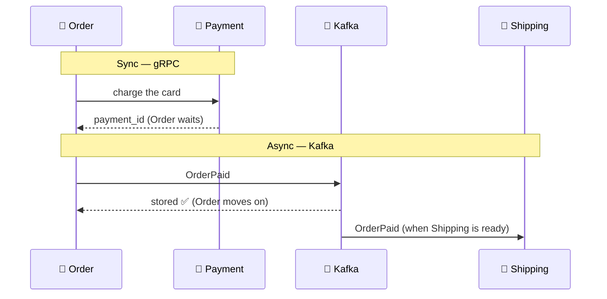
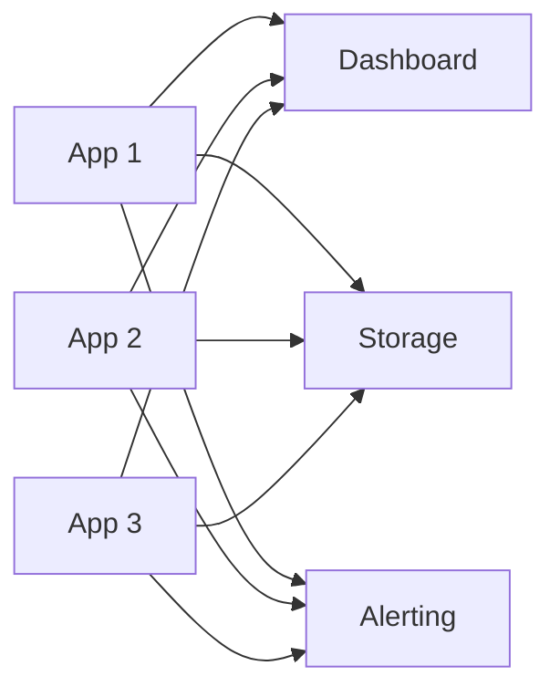
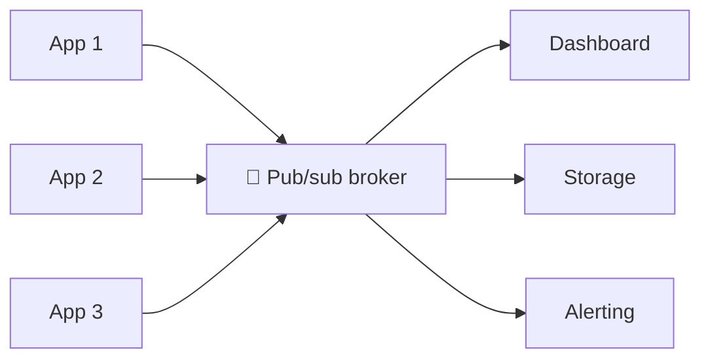
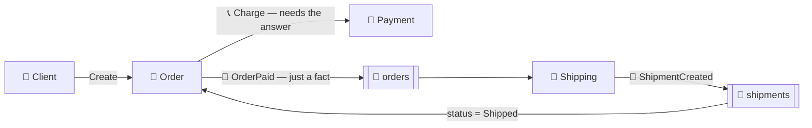

# 📞 Sync vs Async and Publish-Subscribe

[[Brokers/Kafka/Kafka The Definitive Guide/README|📬 Kafka: The Definitive Guide]] · Book Ch.1 + Shuiskov Ch.6

> [!toc]- 📑 Contents
>
> - [[#📞 Two Ways to Talk|📞 Two Ways to Talk]]
> - [[#⚖️ What Async Buys and Costs|⚖️ What Async Buys and Costs]]
> - [[#🕸️ From Direct Connections to Pub/Sub|🕸️ From Direct Connections to Pub/Sub]]
> - [[#📣 Events and Commands|📣 Events and Commands]]
> - [[#🛒 In the Project|🛒 In the Project]]
> - [[#🔨 Hands-On Practice|🔨 Hands-On Practice]]
> - [[#📋 Quick Reference|📋 Quick Reference]]
> - [[#🧠 Things to Remember|🧠 Things to Remember]]
> - [[#💡 Pro Tips|💡 Pro Tips]]
> - [[#🔗 Related Topics|🔗 Related Topics]]

When should one service **call** another and wait, and when should it **publish** a message and move on? This lesson answers that, and shows why a central publish-subscribe system like Kafka beats wiring every service to every other.

---

## 📞 Two Ways to Talk

**Synchronous** communication is a phone call: you ask and wait on the line. **Asynchronous** communication is a letter: you send it and carry on, and any reply comes later.



- ⏳ **Async isn't slower.** Answering 10 emails one by one beats juggling 10 phone calls; the receiver works at its own pace without interruptions.

- 📦 **The sender only waits for "stored".** It doesn't wait for the receiver to process the message, or even to be running.

| | gRPC (sync) | Kafka (async) |
|---|---|---|
| **Caller waits** | For the reply | Only for the broker's acknowledgement |
| **Receiver must be up** | Yes | No; messages wait in the topic |
| **Receivers per message** | One | Any number of consumer groups |
| **Replay old messages** | No | Yes, within retention |
| **Best for** | Queries, commands that need an answer now | Events, fan-out, background work, data pipelines |

Call when the caller needs the answer to continue; publish when others only need to find out.

---

## ⚖️ What Async Buys and Costs

**What you gain**

- 📨 **Fire and continue** — a service reporting status doesn't wait for each report to be processed.

- 🎬 **Long tasks** — video conversion or report building runs in the background; the caller is notified when it's done.

- 📢 **One message, many readers** — publish once; every interested service consumes it.

- 🌊 **Smoothed spikes** — a burst of 10,000 messages waits in the broker, and consumers work through it instead of being overloaded.

**What you pay**

- ❓ **Harder error handling** — no reply could mean lost, slow, or failed. You need retries, duplicate handling, and dead letters (lessons 10, 15, 17).

- 🧱 **Another system to run** — the broker must be operated, monitored, and secured.

- 🧠 **Harder to follow** — there's no request → response pair in the code; the flow lives in events and topics. Tracing helps (lesson 17).

---

## 🕸️ From Direct Connections to Pub/Sub

The book tells a story that most companies live through.

**1. One direct connection.** An app pushes metrics straight to a dashboard. Simple and fine.

**2. A tangle.** More apps, more destinations (long-term storage, alerting, analysis), and each app connects to each destination:



With *N* sources and *M* destinations, that's *N × M* connections: 3 × 3 = 9 here, 20 × 10 = 200 in a real company.

**3. Publish-subscribe.** One central service receives everything; anyone interested subscribes to it. Now it's *N + M* connections.



- 📮 **Publish-subscribe (pub/sub):** the **publisher** doesn't address a receiver; it classifies the message (by topic), and **subscribers** ask for the classes they want.

- 🏢 **Broker:** the central point where messages are published.

**4. Many pub/sub systems.** Meanwhile, other teams built separate systems for logs and user-activity tracking. Each has its own bugs, limits, and operations work.

**5. One platform.** The fix is a **single, central, generic** system for any kind of data that scales with the business. That's what Kafka was built for at LinkedIn: a **distributed commit log** where data is stored durably, in order, and can be read again deterministically.

---

## 📣 Events and Commands

Messages come in two flavors, and mixing them up couples services again.

| | 📣 Event | 📝 Command |
|---|---|---|
| **Meaning** | "This happened" (past tense) | "Please do this" |
| **Example** | `OrderPaid`, `ShipmentCreated` | `ShipOrder`, `RefundPayment` |
| **Sender knows receivers?** | No; anyone may react | Yes; one target |
| **Can be refused?** | No; it's a fact | Yes |

- 💃 **Events give choreography:** each service reacts on its own; nobody is in charge.

- 🎼 **Commands give orchestration:** one service tells the others what to do.

Both saga styles are in [[Go/gRPC Microservices in Go - Refactored/2. gRPC Meets Microservices|gRPC Ch.2]]. This project uses events.

### 🧪 Interview Q&A

**Q1:** Order needs to know whether the card was charged before replying to the user. Sync or async?

**Q2:** Why does a central pub/sub system reduce connections from *N × M* to *N + M*?

**Q3:** Is `OrderPaid` an event or a command, and why does that matter?

**Q4:** Name two costs of async communication.

> [!answer]- 📋 Answers
>
> **A1:** Sync. The reply depends on the answer, so Order calls Payment over gRPC and waits.
>
> **A2:** Each source connects only to the broker, and each destination only to the broker, instead of every source to every destination.
>
> **A3:** An event: it states a fact. Order doesn't know or care who reacts, so new consumers can be added without changing Order.
>
> **A4:** Harder error handling (lost, duplicate, or late messages) and an extra system to operate. The flow is also harder to follow in code.

---

## 🛒 In the Project

The codebase uses both styles, each where it fits:



- 📞 **Payment is sync** because the user is waiting to hear whether the card was charged.

- 📣 **Shipping is async** because nobody waits for it. If Shipping is down for a minute, orders still succeed; `OrderPaid` waits in Kafka until Shipping is back.

- 🔁 **Order hears back asynchronously too:** `ShipmentCreated` moves the order to `Shipped`.

```go
// order/internal/application/core/api/api.go
if paymentErr := a.payment.Charge(ctx, &order); paymentErr != nil { // 📞 sync
    // ...
}
order.Status = domain.StatusPaid
if err := a.db.MarkPaid(ctx, &order); err != nil { // 📣 queues OrderPaid for Kafka
    return domain.Order{}, err
}
```

`MarkPaid` doesn't talk to Kafka directly; it writes the event to an outbox table in the same transaction (lesson 17 explains why).

---

## 🔨 Hands-On Practice

1. **Watch both halves.** In `Go/gRPC Microservices in Go - Refactored/microservices`:

    ```bash
    make up
    make create-order && make get-order
    sleep 2 && make get-order
    ```

    ✅ The order is `"Paid"` as soon as `Create` returns (the sync part). The async part takes about a second, so the second `get-order` shows `"Shipped"`; the first may already show it too.

2. **Prove Shipping is decoupled.** Run `docker compose stop shipping`, create an order, then `docker compose start shipping` and `make get-order` again after a few seconds.

    ✅ Creating the order still works while Shipping is down, and the order becomes `Shipped` once Shipping is back. The event waited in Kafka.

---

### 📋 Quick Reference

| Question | Sync (gRPC) | Async (Kafka) |
|---|---|---|
| Caller needs the answer now? | ✅ | ❌ |
| Many services react? | ❌ | ✅ |
| Receiver may be down? | ❌ | ✅ |
| Message type | Request, query, command | Event |

### 🧠 Things to Remember

- Call (sync) when the caller needs the answer to continue; publish (async) when others only need to know.

- Pub/sub decouples senders from receivers: publishers name a topic, not a receiver.

- One central platform beats many ad-hoc queues: fewer connections, one thing to operate.

- Kafka is a distributed commit log: durable, ordered, and replayable.

- Events state facts; commands ask for actions.

### 💡 Pro Tips

- **Name events in the past tense** (`OrderPaid`) → it keeps them facts, not hidden commands.

- **Don't replace every gRPC call with events** → a query that needs an answer gets slower and harder to reason about over a broker.

- **Start with one topic per business stream** (`orders`, `shipments`) → consumers subscribe to what happened, not to who sent it.

### 🔗 Related Topics

- ➡️ Next: [[2. Messages, Topics, and Partitions]]

- 🗺️ Series map: [[Brokers/Kafka/Kafka The Definitive Guide/README|Kafka lessons]]

- 📞 The sync side: [[Go/gRPC Microservices in Go - Refactored/5. Interservice Communication|gRPC Ch.5: Interservice Communication]]

- 💻 Codebase: [[Go/gRPC Microservices in Go - Refactored/microservices/README|Order + Payment + Shipping]]

- 📡 Pub/sub in MQTT: [[Brokers/MQTT/HiveMQ 3.1.1/2. PUB SUB]]
