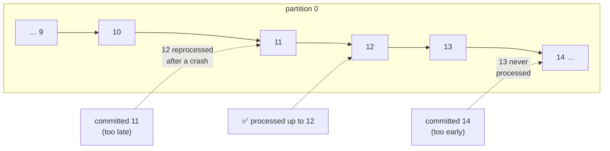

# 📍 Offsets and Commits

[[Brokers/Kafka/Kafka The Definitive Guide/README|📬 Kafka: The Definitive Guide]] · Book Ch.4

> [!toc]- 📑 Contents
>
> - [[#📍 What a Commit Is|📍 What a Commit Is]]
> - [[#⚖️ Too Early or Too Late|⚖️ Too Early or Too Late]]
> - [[#⏲️ Automatic Commit|⏲️ Automatic Commit]]
> - [[#✋ Committing Yourself|✋ Committing Yourself]]
> - [[#🎯 Committing Specific Offsets|🎯 Committing Specific Offsets]]
> - [[#🗑️ When Committed Offsets Disappear|🗑️ When Committed Offsets Disappear]]
> - [[#🛒 In the Project|🛒 In the Project]]
> - [[#🔨 Hands-On Practice|🔨 Hands-On Practice]]
> - [[#📋 Quick Reference|📋 Quick Reference]]
> - [[#🧠 Things to Remember|🧠 Things to Remember]]
> - [[#💡 Pro Tips|💡 Pro Tips]]
> - [[#🔗 Related Topics|🔗 Related Topics]]

A consumer group remembers how far it has read by **committing offsets**. *When* you commit decides whether a crash loses messages or repeats them. This lesson covers automatic, synchronous, asynchronous, and specific commits, and why the project commits only after processing.

---

## 📍 What a Commit Is

Kafka doesn't track acknowledgements per message like a classic queue. Instead, a consumer **commits a position** for each partition: "everything before this offset is done".

- 📝 **What's stored:** the **next** offset to read, which is last processed + 1. (The book says "commit the last offset" for short.)

- 🗄️ **Where:** a special internal topic, `__consumer_offsets`.

- 🔁 **When it's read:** after a rebalance or restart, the new owner of a partition continues from its committed offset.

---

## ⚖️ Too Early or Too Late



| Committed offset vs processed | After a crash or rebalance | Guarantee |
|---|---|---|
| **Behind** what you processed | Some records processed **twice** | At-least-once |
| **Ahead of** what you processed | Some records **never** processed | At-most-once (data loss) |

Duplicates can be handled with idempotent processing (lesson 17); lost records can't be recovered. So **commit after processing**.

---

## ⏲️ Automatic Commit

With **`enable.auto.commit=true`** (the default in Java and franz-go), the client commits **every 5 seconds** (`auto.commit.interval.ms`), driven by the poll loop: each poll checks whether it's time and commits what earlier polls returned.

- 🔁 **Crash 3 s after a commit** → those 3 s of records are processed again by whoever takes over. Commit more often and the window shrinks, but never to zero.

- ⚠️ **Only safe if you finish every polled record before the next poll.** The client commits what it handed you, not what you finished. Exiting the loop early, or handing records to background workers, can commit work that was never done.

- 🧭 **franz-go's twist:** by default it commits only records from **previous** polls, not the latest one, which makes "finish before the next poll" automatic. `kgo.GreedyAutoCommit()` restores Java's riskier behavior.

---

## ✋ Committing Yourself

Turn auto-commit off with `kgo.DisableAutoCommit()` (`enable.auto.commit=false`) and commit when *you* decide something is done.

### ⏳ Synchronous

```go
fetches := client.PollFetches(ctx)
fetches.EachRecord(process)
if err := client.CommitUncommittedOffsets(ctx); err != nil { // commitSync()
    slog.Error("commit failed", "error", err)
}
```

- ✅ Waits for the broker and retries retriable errors.

- 🐢 Blocks the loop on every commit; committing less often raises throughput but means more duplicates after a rebalance.

### ⚡ Asynchronous

```go
client.CommitOffsets(ctx, client.UncommittedOffsets(), func(_ *kgo.Client, _ *kmsg.OffsetCommitRequest, _ *kmsg.OffsetCommitResponse, err error) {
    if err != nil {
        slog.Error("async commit failed", "error", err)
    }
})
```

- ⚡ Doesn't wait; the loop continues.

- 🔀 **The ordering trap (Java):** commit 2000 fails silently while commit 3000 succeeds; retrying 2000 now would move the group *backwards*. So Java's `commitAsync()` never retries, and the book suggests a sequence number before any manual retry.

- 🧭 **franz-go** orders all commits itself: a new commit waits for the previous one, so a late retry can't overwrite a newer offset.

### 🔗 Combining Them

The book's pattern: **async commits while running**, one **sync commit before closing** (or before losing partitions in a rebalance), so the final position is definitely saved.

---

## 🎯 Committing Specific Offsets

Committing "everything polled" only happens between batches. To checkpoint **mid-batch** (say, every 1,000 records of a big batch), commit an explicit position per partition:

```go
// Commit through this record: Kafka stores record.Offset + 1 as the next to read.
err := client.CommitRecords(ctx, record)
```

franz-go also offers `kgo.AutoCommitMarks()` + `client.MarkCommitRecords(rs...)`: you **mark** what's finished, and auto-commit saves only marked records, a middle ground between automatic and manual.

---

## 🗑️ When Committed Offsets Disappear

Committed offsets of an **empty** group are deleted after **`offsets.retention.minutes`**, 7 days by default. A group that comes back after that behaves like a brand-new group and starts wherever **`auto.offset.reset`** says (lesson 11).

### 🧪 Interview Q&A

**Q1:** What exactly is stored when a consumer commits offset 42 for partition 0?

**Q2:** A consumer auto-commits every 5 s and crashes 3 s after the last commit. What happens?

**Q3:** Why doesn't Java's `commitAsync()` retry failed commits?

**Q4:** When would you commit specific offsets instead of "everything polled"?

> [!answer]- 📋 Answers
>
> **A1:** That the group's next record to read in partition 0 is offset 42, meaning 0–41 are done. It's written to `__consumer_offsets`.
>
> **A2:** The new owner restarts from the last commit, so the last ~3 s of records are processed again.
>
> **A3:** A late retry of an older offset could succeed after a newer commit and move the group backwards, causing more duplicates.
>
> **A4:** When a single poll returns a large batch that takes a long time, to checkpoint progress partway through and limit reprocessing.

---

## 🛒 In the Project

Both services commit manually, once per poll, **after** every record was handled or parked in a dead-letter topic:

```go
// order/internal/adapters/events/consumer.go (same in shipping)
fetches.EachRecord(func(record *kgo.Record) {
    if err := c.processWithRetry(ctx, record); err != nil && ctx.Err() == nil {
        c.deadLetter(ctx, record, err)
    }
})

if ctx.Err() == nil {
    if err := c.client.CommitUncommittedOffsets(ctx); err != nil {
        slog.Error("commit failed", "error", err)
    }
}
c.client.AllowRebalance()
```

- ✅ **At-least-once:** a crash between processing and committing repeats records, never skips them. Shipping's `processed_events` table turns those repeats into no-ops.

- 🛑 **Shutdown doesn't commit unfinished work:** when `ctx` is cancelled mid-batch, the loop skips the commit, so unfinished records are redelivered after restart.

- 🚧 **`BlockRebalanceOnPoll` + `AllowRebalance`:** partitions can't move between "processed" and "committed", which would otherwise let another member start before this commit lands.

---

## 🔨 Hands-On Practice

1. **No commit, no progress.** With `make up` running and a few orders shipped, read 2 records twice with auto-commit off:

    ```bash
    for i in 1 2; do
      docker compose exec kafka /opt/kafka/bin/kafka-console-consumer.sh --bootstrap-server localhost:9092 \
        --topic shipments --group demo-nocommit --from-beginning --max-messages 2 \
        --command-property enable.auto.commit=false \
        --formatter-property print.partition=true --formatter-property print.offset=true \
        --formatter-property print.value=false
    done
    ```

    ✅ Both runs print the **same** two offsets. `kafka-consumer-groups.sh --describe --group demo-nocommit` reports `Group demo-nocommit not found`: nothing was ever committed.

2. **With commits.** Repeat with `--group demo-commit` and without the `--command-property` line, then describe the group.

    ✅ The second run prints **different** records, continuing where the first stopped, and `CURRENT-OFFSET` shows the saved positions.

---

### 📋 Quick Reference

| Need | franz-go | Java |
|---|---|---|
| Auto commit every 5 s | default | `enable.auto.commit=true` |
| Turn it off | `kgo.DisableAutoCommit()` | `enable.auto.commit=false` |
| Sync commit of everything polled | `client.CommitUncommittedOffsets(ctx)` | `commitSync()` |
| Async commit | `client.CommitOffsets(ctx, offsets, onDone)` | `commitAsync(callback)` |
| Commit specific records | `client.CommitRecords(ctx, rs...)` | `commitSync(map)` |
| Commit only finished work | `kgo.AutoCommitMarks()` + `client.MarkCommitRecords(...)` | — |

### 🧠 Things to Remember

- A commit stores the next offset to read, per partition, in `__consumer_offsets`.

- Commit after processing: duplicates are fixable, losses aren't.

- Auto-commit is safe only if every polled record is finished before the next poll.

- Async commits must never move a group backwards; franz-go orders them for you.

- An empty group's offsets expire after 7 days.

### 💡 Pro Tips

- **Commit after side effects, not before** → write to the database, then commit.

- **Make handlers idempotent anyway** → even perfect commits repeat records after crashes and rebalances.

- **Don't commit from many goroutines independently** → a slow worker's record can be committed past by a fast one; mark or track what's actually finished.

### 🔗 Related Topics

- ⬅️ Previous: [[9. Consumers and Consumer Groups]]

- ➡️ Next: [[11. Consumer Configuration and Rebalance Handling]]

- 🧰 Resetting offsets: [[12. Managing Kafka with Code and CLI]]

- 🛡️ Reliable consumers: [[15. Reliable Data Delivery]]

- 💻 Codebase: [[Go/gRPC Microservices in Go - Refactored/microservices/README|Order + Payment + Shipping]]
