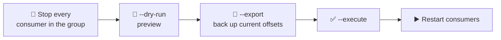

# 🧰 Managing Kafka with Code and CLI

[[Brokers/Kafka/Kafka The Definitive Guide/README|📬 Kafka: The Definitive Guide]] · Book Ch.5 + Ch.12

> [!toc]- 📑 Contents
>
> - [[#🧑‍💼 The Admin API|🧑‍💼 The Admin API]]
> - [[#🗂️ Topics|🗂️ Topics]]
> - [[#⚙️ Configuration|⚙️ Configuration]]
> - [[#👥 Consumer Groups|👥 Consumer Groups]]
> - [[#⏪ Resetting Offsets|⏪ Resetting Offsets]]
> - [[#🧪 Other Tools|🧪 Other Tools]]
> - [[#🛒 In the Project|🛒 In the Project]]
> - [[#🔨 Hands-On Practice|🔨 Hands-On Practice]]
> - [[#📋 Quick Reference|📋 Quick Reference]]
> - [[#🧠 Things to Remember|🧠 Things to Remember]]
> - [[#💡 Pro Tips|💡 Pro Tips]]
> - [[#🔗 Related Topics|🔗 Related Topics]]

Creating topics, changing settings, inspecting groups, and replaying data: this lesson does it two ways, with the **Admin API** from Go (`kadm`) and with the **CLI tools** shipped with Kafka.

---

## 🧑‍💼 The Admin API

Since Kafka 0.11, clients can do admin work in code: create and delete topics, describe the cluster, manage configs, consumer groups, and ACLs. In franz-go that's **`kadm`**, a wrapper around a normal `kgo.Client`.

```go
client, err := kgo.NewClient(kgo.SeedBrokers("localhost:9092"))
adm := kadm.NewClient(client)
```

Three design points from the book:

- ⏳ **Asynchronous and eventually consistent.** A call finishes when the **controller** has applied it; other brokers learn about it a moment later. A describe sent right away may still show the old state.

- ⏱️ **Every call has a timeout.** In Go, that's the `ctx` you pass.

- 📚 **One flat API.** If an admin operation exists, it's on the one client.

> 🧪 **Measured:** after changing `retention.ms` to 1 day, an immediate describe still returned 7 days. Two seconds later it returned the new value.

---

## 🗂️ Topics

### 💻 In Go

The book's motivating example: make sure a topic exists before producing to it.

```go
// ensureTopic creates topic if it doesn't exist yet.
func ensureTopic(ctx context.Context, adm *kadm.Client, topic string, partitions int32) error {
    topics, err := adm.ListTopics(ctx, topic)
    if err != nil {
        return err
    }
    if topics.Has(topic) {
        return nil
    }
    retention := "604800000" // 7 days
    resp, err := adm.CreateTopic(ctx, partitions, 1, map[string]*string{"retention.ms": &retention}, topic)
    if err != nil {
        return err
    }
    return resp.Err
}
```

```text
exists: orders
created: lesson12 err: <nil>
```

### 🖥️ With the CLI

```bash
kafka-topics.sh --bootstrap-server localhost:9092 --create --topic my-topic --partitions 8 --replication-factor 2
kafka-topics.sh --bootstrap-server localhost:9092 --list
kafka-topics.sh --bootstrap-server localhost:9092 --describe --topic my-topic
kafka-topics.sh --bootstrap-server localhost:9092 --alter --topic my-topic --partitions 16
kafka-topics.sh --bootstrap-server localhost:9092 --delete --topic my-topic
```

- 🔎 **Useful filters on `--describe`:** `--under-replicated-partitions` (a replica fell behind), `--unavailable-partitions` (no leader), `--topics-with-overrides`.

- ➕ **Partitions can only grow.** To reduce them, create a new topic (say `my-topic-v2`) and move producers to it. Adding partitions to a keyed topic remaps keys (lesson 8).

- 🗑️ **Deletion is asynchronous and irreversible.** It needs `delete.topic.enable=true` (the default) and gives no feedback; check with `--list`. Delete one or two topics at a time on large clusters.

---

## ⚙️ Configuration

Many settings can change **at runtime**, without restarting brokers, for these entity types:

| Entity | Examples |
|---|---|
| `topics` | `retention.ms`, `cleanup.policy`, `min.insync.replicas`, `max.message.bytes` |
| `clients` / `users` | Quotas: `producer_byte_rate`, `consumer_byte_rate`, `request_percentage` |
| `brokers` | Some broker settings, per broker or cluster-wide default |

```bash
kafka-configs.sh --bootstrap-server localhost:9092 --alter --entity-type topics --entity-name shipments \
  --add-config retention.ms=1209600000
kafka-configs.sh --bootstrap-server localhost:9092 --describe --entity-type topics --entity-name shipments
kafka-configs.sh --bootstrap-server localhost:9092 --alter --entity-type topics --entity-name shipments \
  --delete-config retention.ms
```

In Go:

```go
ms := "86400000"
_, err := adm.AlterTopicConfigs(ctx, []kadm.AlterConfig{
    {Op: kadm.SetConfig, Name: "retention.ms", Value: &ms},
}, "lesson12")
```

```text
lesson12 retention.ms=86400000 (source DYNAMIC_TOPIC_CONFIG)
```

`DYNAMIC_TOPIC_CONFIG` means a per-topic override; removing it falls back to the broker default.

---

## 👥 Consumer Groups

```bash
kafka-consumer-groups.sh --bootstrap-server localhost:9092 --list
kafka-consumer-groups.sh --bootstrap-server localhost:9092 --describe --group shipping
kafka-consumer-groups.sh --bootstrap-server localhost:9092 --describe --group shipping --members --verbose
kafka-consumer-groups.sh --bootstrap-server localhost:9092 --delete --group demo-commit
```

- 📊 **`--describe`** shows per partition: committed offset, log-end offset, **lag**, and the owning member.

- 🗑️ **`--delete`** removes a group and **all its committed offsets**. The group must be **empty**; otherwise it fails with "The group is not empty".

In Go, `adm.Lag(ctx, "shipping", "order")` returns the same information:

```text
group shipping state=Stable members=1 total lag=0
group order state=Stable members=1 total lag=0
```

---

## ⏪ Resetting Offsets

Move a group's committed offsets to **replay** data (a bug was fixed) or to **skip** past a problem.

| Option | Moves to |
|---|---|
| `--to-earliest` / `--to-latest` | Start / end of each partition |
| `--to-current` | Where the group is now (useful with `--export`) |
| `--to-offset N` / `--shift-by -N` | An exact offset / relative to now |
| `--to-datetime 2026-11-01T12:00:00.000` | First offset at or after that time |
| `--from-file offsets.csv` | Values from an exported CSV |



> ⚠️ **Stop the consumers first.** A running group overwrites new offsets with its own commits, and the tool refuses anyway:
> `Error: Assignments can only be reset if the group 'order' is inactive, but the current state is Stable.`

**Export / import** for a safe rollback:

```bash
kafka-consumer-groups.sh --bootstrap-server localhost:9092 --group order --topic shipments \
  --reset-offsets --to-current --dry-run --export > offsets.csv     # topic,partition,offset
kafka-consumer-groups.sh --bootstrap-server localhost:9092 --group order \
  --reset-offsets --from-file offsets.csv --execute
```

### 🧪 Interview Q&A

**Q1:** You create a topic in code and immediately list topics through another broker. Why might the topic be missing?

**Q2:** How do you "reduce" a topic's partition count?

**Q3:** Why must a group be stopped before resetting its offsets?

**Q4:** A bug in Shipping mis-handled yesterday's events. How do you reprocess them?

> [!answer]- 📋 Answers
>
> **A1:** The admin API is eventually consistent: the controller has the topic, but that broker's metadata hasn't been updated yet.
>
> **A2:** You can't. Create a new topic with fewer partitions and move producers (and then consumers) to it.
>
> **A3:** Active members would keep committing their own positions and overwrite the reset; the tool also refuses unless the group is inactive.
>
> **A4:** Deploy the fix, stop Shipping, reset group `shipping` on `orders` with `--to-datetime` (yesterday's start), and restart. Shipping's idempotent handler skips events it already handled correctly.

---

## 🧪 Other Tools

| Tool | Purpose |
|---|---|
| `kafka-console-producer.sh` / `kafka-console-consumer.sh` | Send and read records by hand (lessons 2, 10) |
| `kafka-leader-election.sh` | Move leadership back to **preferred** replicas after a broker returns |
| `kafka-reassign-partitions.sh` | Move replicas between brokers (new brokers, decommissioning) |
| `kafka-dump-log.sh` | Print the records in a segment file (lesson 14) |
| `kafka-producer-perf-test.sh` | Benchmark producers (lesson 6) |
| `kafka-get-offsets.sh` | Offsets per partition, optionally at a time |

The book also lists **unsafe operations**, such as editing cluster metadata by hand or deleting topic files from disk. Treat them as emergency-only, with expert help.

---

## 🛒 In the Project

- 🗂️ **Topics** come from `deploy/kafka/create-topics.sh` (Compose) or a Kubernetes Job (`deploy/k8s/kafka.yaml`), using the CLI with `--if-not-exists`. A Go service could do the same with `ensureTopic` at startup; a separate script keeps topic settings out of service code.

- 📊 **`make topics`** = `kafka-topics.sh --describe --exclude-internal`.

- 📈 **`make lag`** = `kafka-consumer-groups.sh --describe --all-groups`.

- ⏪ **Replays are safe.** Order's `MarkShipped` and Shipping's `processed_events` make reprocessing harmless, so a reset is a real recovery tool here, not a risk.

---

## 🔨 Hands-On Practice

1. **Replay `shipments` into Order.** With `make up` running:

    ```bash
    docker compose stop order
    docker compose exec kafka /opt/kafka/bin/kafka-consumer-groups.sh --bootstrap-server localhost:9092 \
      --group order --topic shipments --reset-offsets --to-earliest --execute
    docker compose start order
    sleep 8 && make lag
    ```

    ✅ The reset prints `NEW-OFFSET 0` for each partition; after the restart, the `order` group is back at the log end with `LAG 0`, and every order is still `Shipped`.

2. **Clean up demo groups.** List groups and delete the ones from earlier lessons:

    ```bash
    docker compose exec kafka /opt/kafka/bin/kafka-consumer-groups.sh --bootstrap-server localhost:9092 --list
    docker compose exec kafka /opt/kafka/bin/kafka-consumer-groups.sh --bootstrap-server localhost:9092 \
      --delete --group demo-commit
    ```

    ✅ `Deletion of requested consumer groups ('demo-commit') was successful.`

---

### 📋 Quick Reference

| Task | CLI | Go (`kadm`) |
|---|---|---|
| Create topic | `kafka-topics.sh --create` | `adm.CreateTopic(...)` |
| List topics | `kafka-topics.sh --list` | `adm.ListTopics(ctx)` |
| Add partitions | `kafka-topics.sh --alter --partitions N` | `adm.CreatePartitions(ctx, add, topic)` |
| Change config | `kafka-configs.sh --alter --add-config` | `adm.AlterTopicConfigs(...)` |
| Group lag | `kafka-consumer-groups.sh --describe` | `adm.Lag(ctx, group)` |
| Reset offsets | `kafka-consumer-groups.sh --reset-offsets … --execute` | `adm.CommitOffsets(ctx, group, offsets)` |
| Delete records | `kafka-delete-records.sh` | `adm.DeleteRecords(ctx, offsets)` |

### 🧠 Things to Remember

- Admin calls are eventually consistent; brokers catch up shortly after the controller.

- Partitions can only be added; deletion is irreversible.

- Many configs change at runtime with `kafka-configs.sh`.

- Reset offsets only with the group stopped, after `--dry-run` and `--export`.

- Idempotent consumers turn replays into a safe recovery tool.

### 💡 Pro Tips

- **Keep topic definitions in version control** → a script or Terraform module beats ad-hoc CLI commands nobody remembers.

- **Always export offsets before a reset** → the CSV is your undo button.

- **Prefer `--to-datetime` for replays** → "since the bad deploy" is easier to reason about than offsets per partition.

### 🔗 Related Topics

- ⬅️ Previous: [[11. Consumer Configuration and Rebalance Handling]]

- ➡️ Next: [[13. Inside a Kafka Cluster]]

- 📍 What a reset changes: [[10. Offsets and Commits]]

- 📈 Lag in depth: [[19. Monitoring Kafka]]

- 💻 Codebase: [[Go/gRPC Microservices in Go - Refactored/microservices/README|Order + Payment + Shipping]]
