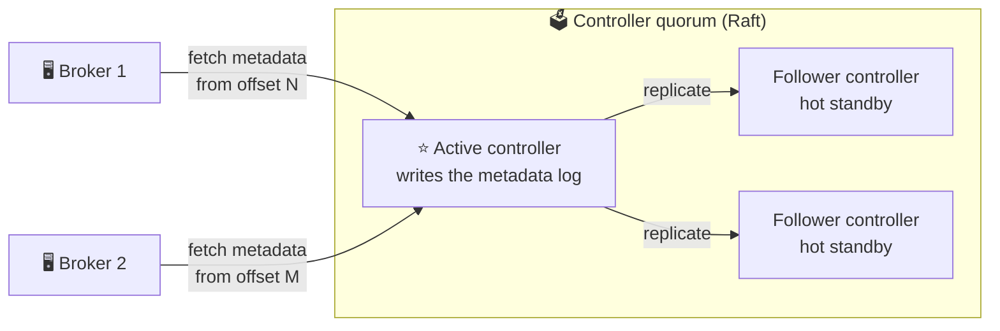
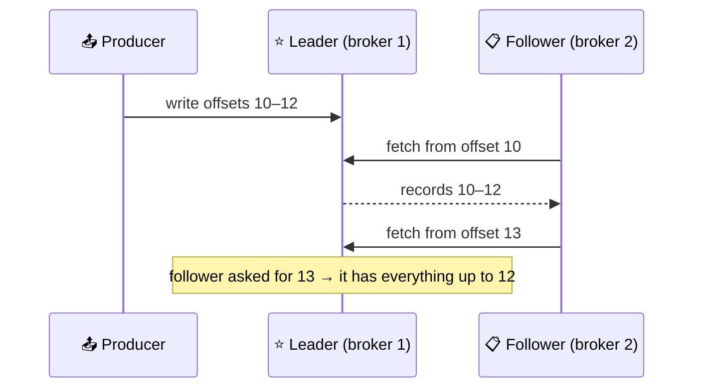
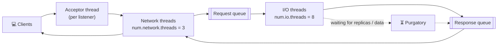
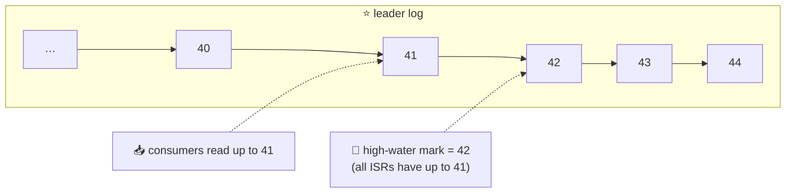

# 🔬 Inside a Kafka Cluster

[[Brokers/Kafka/Kafka The Definitive Guide/README|📬 Kafka: The Definitive Guide]] · Book Ch.6

> [!toc]- 📑 Contents
>
> - [[#🧠 The Controller|🧠 The Controller]]
> - [[#🗳️ KRaft: Metadata as a Log|🗳️ KRaft: Metadata as a Log]]
> - [[#📋 Replication: Leaders, Followers, ISR|📋 Replication: Leaders, Followers, ISR]]
> - [[#⭐ Preferred Leaders|⭐ Preferred Leaders]]
> - [[#📨 How a Broker Handles Requests|📨 How a Broker Handles Requests]]
> - [[#📤 Produce Requests|📤 Produce Requests]]
> - [[#📥 Fetch Requests and the High-Water Mark|📥 Fetch Requests and the High-Water Mark]]
> - [[#🛒 In the Project|🛒 In the Project]]
> - [[#🔨 Hands-On Practice|🔨 Hands-On Practice]]
> - [[#📋 Quick Reference|📋 Quick Reference]]
> - [[#🧠 Things to Remember|🧠 Things to Remember]]
> - [[#💡 Pro Tips|💡 Pro Tips]]
> - [[#🔗 Related Topics|🔗 Related Topics]]

What actually happens inside the brokers when a producer writes and a consumer reads? This lesson covers the controller and KRaft, replication and in-sync replicas, and the path of produce and fetch requests. These explain *why* settings like `acks` and `min.insync.replicas` behave the way they do.

---

## 🧠 The Controller

One part of the cluster acts as the **controller**: it manages cluster metadata and makes the decisions brokers can't make alone.

- 🗳️ **Leader election:** when a broker leaves, the controller picks new leaders for every partition it led, from the replicas that are in sync.

- 🗂️ **Topic and partition changes:** creating, deleting, and reassigning.

- 📣 **Telling brokers:** every broker must learn the new leaders and replicas.

- 🛡️ **Fencing with epochs:** every new controller (and every new partition leader) gets a higher **epoch** number. A message from a stale controller or leader with an older epoch is ignored, so a "zombie" that comes back after a network partition can't cause damage.

---

## 🗳️ KRaft: Metadata as a Log

The book describes the ZooKeeper-based controller and the then-new **KRaft** replacement (preview in 2.8, production in 3.x). ZooKeeper caused real problems:

- 🔀 **Inconsistency:** metadata was written to ZooKeeper synchronously but sent to brokers asynchronously, creating hard-to-detect edge cases.

- 🐢 **Slow failover:** a new controller had to read *all* metadata from ZooKeeper and push it to every broker; with many partitions that took long.

- 🧱 **Two systems to run:** operating Kafka meant operating ZooKeeper too.

KRaft applies Kafka's own idea to its metadata: **metadata is an ordered log of events.**



- ⭐ **Active controller** — the Raft leader among controllers; handles all metadata changes.

- 🔥 **Follower controllers** — keep a full copy of the log, so failover is near-instant instead of a long reload.

- 📥 **Brokers pull** metadata changes like consumers reading a topic, tracking their own offset, and store it on disk for fast restarts.

- 🚧 **Fenced brokers** — a broker that falls behind on metadata is **fenced** and can't serve clients, so it can't accept writes for a partition it no longer leads.

> 🆕 **Current Kafka:** KRaft is the only mode since Kafka 4.0. Inspect the quorum with `kafka-metadata-quorum.sh`.

---

## 📋 Replication: Leaders, Followers, ISR

Kafka is *"a distributed, partitioned, replicated commit log"*. Each partition has several **replicas** on different brokers:

- ⭐ **Leader replica** — all writes go through it, which keeps them consistent.

- 📋 **Follower replicas** — copy from the leader by sending it **fetch requests**, the same kind consumers send. One takes over if the leader fails.



Because followers ask for offsets in order, the leader knows exactly how far each follower is.

- ✅ **In-sync replica (ISR):** a follower that keeps asking for the latest records and has caught up within **`replica.lag.time.max.ms`** (30 s).

- ⚠️ **Out of sync:** it stopped fetching or fell behind for longer. It can't become leader, because it's missing records.

> 🆕 **Changed default:** the book gives 10 s for `replica.lag.time.max.ms`; Kafka raised it to 30 s.

---

## ⭐ Preferred Leaders

The **first replica in a partition's replica list** is its **preferred leader**. At topic creation, preferred leaders are spread across brokers, so when they all lead, load is balanced.

- 🔁 After a broker restarts, its partitions are led by others for a while. With `auto.leader.rebalance.enable=true` (the default), Kafka moves leadership back to preferred leaders that are in sync.

- 🖐️ When reassigning replicas by hand, the replica you list first becomes preferred, so spread first positions across brokers.

**Read from a follower (KIP-392):** with `client.rack` on consumers and `RackAwareReplicaSelector` on brokers, consumers read from a replica in their own zone (lesson 11). Followers only expose records the leader has marked as committed, so data shows up there slightly later than on the leader.

---

## 📨 How a Broker Handles Requests

Clients talk to brokers over a binary TCP protocol. Every request carries a header with its **type** (API key), **version**, a **correlation ID** (matches the response and appears in logs), and the **client ID**. Requests from one connection are processed **in order**, which is part of how Kafka keeps ordering.



- 🧭 **Metadata first:** clients send a **metadata request** to any broker to learn each partition's leader, cache it, and refresh it periodically (`metadata.max.age.ms`, 5 min).

- ❌ **"Not leader" errors:** if leadership moved, the broker answers `NOT_LEADER_OR_FOLLOWER`; the client refreshes metadata and retries against the new leader. That's why it's a retriable error (lesson 5).

---

## 📤 Produce Requests

When a partition's leader receives a write, it:

1. 🔐 **Validates:** may this client write to the topic? Is `acks` valid (0, 1, all)? With `acks=all`, are there enough in-sync replicas (`min.insync.replicas`, lesson 15)?

2. 💾 **Writes to the local log.** On Linux this lands in the **page cache**; Kafka doesn't wait for `fsync`. **Durability comes from replication**, not from disk flushes.

3. ✉️ **Replies:** at once for `acks=0`/`1`; for `acks=all`, the request waits in **purgatory** until every in-sync follower has fetched the records.

---

## 📥 Fetch Requests and the High-Water Mark

A fetch says "from partition 0 of `orders`, starting at offset 53, up to N bytes". The leader checks the offset exists (too old or not yet written → error), then sends the data using **zero-copy**: straight from the file system cache to the network, with no extra buffers.

- ⏱️ **Min bytes + max wait** let a consumer say "only answer when you have 10 KB, or after 500 ms" (lesson 11), which cuts empty round trips on quiet topics.

- 🌊 **High-water mark:** consumers only see records that **all in-sync replicas** have. Newer records are "unsafe": if the leader crashed now, they could disappear, and two consumers would disagree about what exists.



- 🐢 **Slow replication delays consumers**, up to `replica.lag.time.max.ms`, because the high-water mark only moves once followers catch up.

- 🗃️ **Fetch sessions:** consumers with many partitions keep a broker-side session, so each fetch sends only what changed instead of the full partition list.

### 🧪 Interview Q&A

**Q1:** What problems did KRaft solve compared with ZooKeeper?

**Q2:** How does the leader know how far a follower is behind?

**Q3:** Why doesn't Kafka wait for `fsync` before acknowledging a write?

**Q4:** A record was written to the leader but a follower hasn't copied it yet. Can a consumer read it?

> [!answer]- 📋 Answers
>
> **A1:** Metadata inconsistencies between ZooKeeper, controller, and brokers; slow controller failover with many partitions; and having to run a second distributed system.
>
> **A2:** Followers fetch offsets in order, so the offset a follower requests next means it has everything before it.
>
> **A3:** It relies on replication for durability: a record acknowledged with `acks=all` exists on several brokers, which survives a single machine losing its page cache.
>
> **A4:** No. Consumers only see records below the high-water mark, which advances once all in-sync replicas have them.

---

## 🛒 In the Project

The Compose stack runs **one node** that is both broker and controller (`process.roles=broker,controller`). `kafka-metadata-quorum.sh` shows a quorum of one:

```text
ClusterId:              5L6g3nShT-eMCtK--X86sw
LeaderId:               1
LeaderEpoch:            1
HighWatermark:          3235
MaxFollowerLag:         0
CurrentVoters:          [{"id": 1, "endpoints": ["CONTROLLER://kafka:9093"]}]
```

- 🧮 **`HighWatermark: 3235`** is the offset of the **metadata log**: thousands of metadata events (topics, partitions, group changes, broker heartbeats) already happened in this small stack.

- 📋 **`Replicas: 1  Isr: 1`** in `make topics`: one copy, so the leader is always the whole ISR. Any write is "fully replicated" at once, and a broker loss loses data. Fine for a laptop, never for production.

- ⚙️ The broker runs the defaults `num.network.threads=3` and `num.io.threads=8`.

---

## 🔨 Hands-On Practice

1. **Inspect the controller quorum.**

    ```bash
    docker compose exec kafka /opt/kafka/bin/kafka-metadata-quorum.sh --bootstrap-server localhost:9092 describe --status
    docker compose exec kafka /opt/kafka/bin/kafka-metadata-quorum.sh --bootstrap-server localhost:9092 describe --replication
    ```

    ✅ `LeaderId: 1`, one entry in `CurrentVoters`, and one replication row with `Status Leader` and `Lag 0`.

2. **Watch the metadata log grow.** Note `HighWatermark`, create a topic (`kafka-topics.sh --create --topic hw-test --partitions 3 --replication-factor 1`), then describe the status again.

    ✅ `HighWatermark` has increased: creating a topic is a few new events in the metadata log.

---

### 📋 Quick Reference

| Term | Meaning |
|---|---|
| **Active controller** | Raft leader of the controller quorum; owns metadata changes |
| **Epoch** | Increasing number that fences stale controllers and leaders |
| **ISR** | Replicas caught up within `replica.lag.time.max.ms` (30 s) |
| **Preferred leader** | First replica in the list; Kafka moves leadership back to it |
| **High-water mark** | Highest offset all ISRs have; consumers read below it |
| **Purgatory** | Where requests wait (acks=all, fetch min bytes) |

```bash
kafka-metadata-quorum.sh --bootstrap-server localhost:9092 describe --status
kafka-leader-election.sh --bootstrap-server localhost:9092 --election-type PREFERRED --all-topic-partitions
```

### 🧠 Things to Remember

- KRaft stores cluster metadata in a Raft-replicated log; brokers pull it.

- Leaders take all writes; followers replicate by fetching.

- Only in-sync replicas can become leader.

- Durability comes from replication, not from `fsync`.

- Consumers only see records every in-sync replica has.

### 💡 Pro Tips

- **Run 3 (or 5) dedicated controllers in production** → a quorum survives 1 (or 2) controller failures.

- **Watch for shrinking ISRs** → a follower dropping out often precedes data-loss risk or a slow broker.

- **Keep leadership balanced** → if preferred leaders aren't leading, one broker carries more load than planned.

### 🔗 Related Topics

- ⬅️ Previous: [[12. Managing Kafka with Code and CLI]]

- ➡️ Next: [[14. Storage, Retention, and Compaction]]

- ✅ How `acks` relies on the ISR: [[6. Producer Configuration]]

- 🛡️ Configuring for reliability: [[15. Reliable Data Delivery]]

- 💻 Codebase: [[Go/gRPC Microservices in Go - Refactored/microservices/README|Order + Payment + Shipping]]
