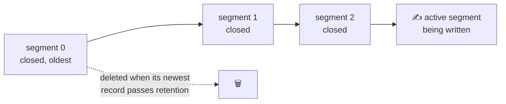
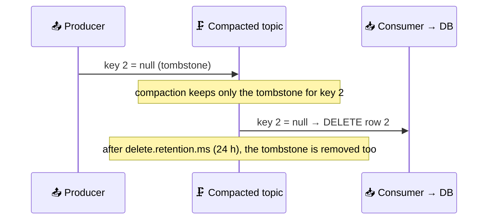

# 💾 Storage, Retention, and Compaction

[[Brokers/Kafka/Kafka The Definitive Guide/README|📬 Kafka: The Definitive Guide]] · Book Ch.6

> [!toc]- 📑 Contents
>
> - [[#🗄️ Partitions on Disk|🗄️ Partitions on Disk]]
> - [[#🧮 How Replicas Are Placed|🧮 How Replicas Are Placed]]
> - [[#📁 Segments and Retention|📁 Segments and Retention]]
> - [[#🧾 The File Format|🧾 The File Format]]
> - [[#🔎 Indexes|🔎 Indexes]]
> - [[#🗜️ Log Compaction|🗜️ Log Compaction]]
> - [[#🪦 Tombstones and Deleting Data|🪦 Tombstones and Deleting Data]]
> - [[#☁️ Tiered Storage|☁️ Tiered Storage]]
> - [[#🛒 In the Project|🛒 In the Project]]
> - [[#🔨 Hands-On Practice|🔨 Hands-On Practice]]
> - [[#📋 Quick Reference|📋 Quick Reference]]
> - [[#🧠 Things to Remember|🧠 Things to Remember]]
> - [[#💡 Pro Tips|💡 Pro Tips]]
> - [[#🔗 Related Topics|🔗 Related Topics]]

How does Kafka store partitions on disk, how does it delete old data, and how can a topic keep "the latest value per key" forever? This lesson covers segments, the record format, indexes, log compaction, tombstones, and tiered storage, with real files from the project's broker.

---

## 🗄️ Partitions on Disk

The basic storage unit is a **partition replica**. A partition can't be split across brokers, or even across disks of one broker, so **one partition is limited by one mount point's size**.

Partitions live in the directories listed in **`log.dirs`**, one folder per partition, named `<topic>-<partition>`:

```text
/tmp/kafka-logs/orders-0/
    00000000000000000000.log        491 bytes  ← the records
    00000000000000000000.index      10 MB      ← offset → file position
    00000000000000000000.timeindex  10 MB      ← timestamp → offset
    leader-epoch-checkpoint
    partition.metadata
```

The index files are **pre-allocated** at 10 MB and trimmed when the segment closes.

---

## 🧮 How Replicas Are Placed

Example: **6 brokers**, a topic with **10 partitions** and **replication factor 3** → 30 replicas to place. The goals:

- ⚖️ **Even spread:** 30 ÷ 6 = 5 replicas per broker.

- 🧩 **Different brokers per partition:** a partition's 3 replicas never share a broker.

- 🏢 **Different racks** when brokers have `broker.rack` set, so losing a whole rack doesn't take a partition offline.

Kafka picks a random starting broker for partition 0's leader, goes round-robin for the other leaders, and puts followers on the next brokers. With racks, it orders brokers to **alternate racks** (0, 2, 1, 3 when brokers 0–1 share one rack and 2–3 another), so consecutive replicas land on different racks.

Within a broker, a new partition goes to the `log.dirs` directory with the **fewest partitions** (lesson 4).

---

## 📁 Segments and Retention

Deleting old messages from the middle of one huge file would be slow and error-prone, so each partition is split into **segments**: files of up to 1 GiB **or** 7 days of data, whichever is reached first.



- ✍️ **The active segment is never deleted**, whatever the retention.

- 📅 **Retention 1 day with 5-day segments** → you keep about 5 days, because a segment can't go until it's closed.

- 📅 **Retention 7 days, segments rolled daily** → about 7 segments; each day one rolls and the oldest is deleted.

- 🗂️ **Open files:** brokers keep a handle open for **every** segment of every partition, so operating systems need high file-handle limits.

---

## 🧾 The File Format

The **same format** is used on disk and on the wire. That's what makes zero-copy possible, and lets brokers store compressed batches without decompressing them.

Since message format v2 (Kafka 0.11), producers always send **batches**. The batch header carries most of the metadata, and each record stores only small differences from it:

| Batch header | Per record |
|---|---|
| Magic byte (format version 2) | Size |
| Base offset + offset delta of the last record | Offset delta from the batch's base offset |
| First and max timestamp | Timestamp delta |
| Leader epoch | Key, value, headers |
| CRC checksum, size | |
| Attributes: compression, timestamp type, transactional, control | |
| **Producer ID, producer epoch, base sequence** (for idempotence and transactions) | |

**Control batches** (transaction commit/abort markers, lesson 16) also live in the log but are never handed to your code.

A real batch from the project's `orders-0`, printed with `kafka-dump-log.sh`:

```text
baseOffset: 1 lastOffset: 1 count: 1 baseSequence: 0 lastSequence: 0 producerId: 10 producerEpoch: 0
partitionLeaderEpoch: 0 isTransactional: false isControl: false position: 247
CreateTime: 1793542651443 size: 244 magic: 2 compresscodec: none crc: 3803155414 isvalid: true
```

- 🆔 **`producerId: 10`, `baseSequence: 0`** — the idempotent producer's identity and sequence (lesson 16).

- 📦 **`count: 1`** — one record per batch here, because the project's events are rare. With more traffic, a batch holds many records and the per-record overhead becomes tiny.

---

## 🔎 Indexes

Consumers can start reading at **any** offset, so the broker needs to find offset 100 quickly:

- 📇 **Offset index** — offset → segment file and byte position.

- 🕐 **Time index** — timestamp → offset; used for "start reading at 09:00" (`--to-datetime`, `offsetsForTimes`) and by Kafka Streams.

Indexes are split per segment, so they're deleted along with their segment. They have no checksum: a corrupt index is simply **rebuilt** from the log file.

---

## 🗜️ Log Compaction

Some data only matters in its **latest** version: a customer's current shipping address, an order's current status, an application's last saved state. For these, set **`cleanup.policy=compact`**: Kafka keeps **at least the latest record for each key** and removes older ones.

| `cleanup.policy` | Keeps |
|---|---|
| `delete` (default) | Everything newer than retention |
| `compact` | The latest value per key, forever |
| `compact,delete` | Latest per key, but nothing older than retention |

Compaction needs **keys**: records with a null key can't be compacted, and are rejected on a compacted topic.

### ⚙️ How It Works

- 🧹 **Clean vs dirty:** the part compacted before has one value per key; records written since are **dirty**.

- 🧵 **Cleaner threads** pick the partition with the highest dirty ratio. Compaction starts at **`min.cleanable.dirty.ratio`** = 0.5 (half dirty) by default.

- 🗺️ **Offset map:** for the dirty part, the cleaner builds a map of `16-byte key hash → 8-byte latest offset`, 24 bytes per entry. A 1 GB segment of 1 KB records (about 1 million records) needs a map of about 24 MB.

- ♻️ **Copy:** it rewrites older segments, dropping each record whose key has a newer offset in the map, then swaps in the new segment.

- ⏳ **The active segment is never compacted.** `min.compaction.lag.ms` guarantees a minimum time before compacting a record; `max.compaction.lag.ms` guarantees a maximum (useful for GDPR-style deadlines).

**Offsets don't change**, they just get gaps. Measured on a compacted `order-status` topic:

```text
before compaction            after compaction
Offset:0  1  Pending          Offset:4  1  Shipped
Offset:1  2  Pending          Offset:5  3  Pending
Offset:2  1  Paid             Offset:6  2  null      ← tombstone
Offset:3  2  Paid             Offset:7  4  Pending
Offset:4  1  Shipped
Offset:5  3  Pending
Offset:6  2  null
```

---

## 🪦 Tombstones and Deleting Data

To delete a key completely (say, a user asks to be forgotten), produce a record with that key and a **null value**: a **tombstone**.



- ⏰ **`delete.retention.ms`** (24 h default) is how long the tombstone stays. A consumer offline longer than that misses it and never learns the key was deleted.

- ✂️ **`deleteRecords`** is a different tool: it moves a partition's **start offset** forward, making everything before it unreadable right away (`kafka-delete-records.sh`, `kadm.DeleteRecords`).

---

## ☁️ Tiered Storage

Local disks limit how much a partition can hold, make clusters bigger (and costlier) than throughput needs, and slow down moving partitions between brokers. **Tiered storage** adds a second tier:

| Tier | Holds | Typical retention |
|---|---|---|
| 🖥️ Local disks | Recent, actively read segments | Hours |
| ☁️ Remote (S3, HDFS, …) | Closed segments | Days to months |

Consumers read old data from the remote tier transparently, and those historical reads no longer compete with real-time ones for the page cache.

> 🆕 **Current Kafka:** the book describes tiered storage (KIP-405) as work in progress; it's production-ready since Kafka 3.9 (`remote.log.storage.system.enable` plus a storage plugin).

### 🧪 Interview Q&A

**Q1:** Retention is 1 day, but a low-traffic topic keeps 6 days of data. Why?

**Q2:** What happens to offsets when a topic is compacted?

**Q3:** How do you delete a key from a compacted topic, and what's the risk?

**Q4:** About how much memory does compacting a 1 GB segment of 1 KB records need?

> [!answer]- 📋 Answers
>
> **A1:** Retention deletes whole closed segments. With little traffic, a segment stays active (and undeletable) until it reaches 1 GiB or 7 days, so old data waits inside it.
>
> **A2:** Nothing is renumbered; removed records leave gaps, and the surviving records keep their original offsets.
>
> **A3:** Produce a tombstone (key + null value). A consumer offline for longer than `delete.retention.ms` never sees it and keeps the deleted data downstream.
>
> **A4:** About 24 MB: 1 million records × 24 bytes per offset-map entry, less if keys repeat.

---

## 🛒 In the Project

- 🗑️ **`orders` and `shipments` use `delete` with 7 days**: they're event streams, and every event matters for the length of the retention, not just the latest per order.

- 🗜️ **A compacted topic would fit an "order status" table:** key `order_id`, value the current status. A new service could read it from the beginning and know every order's current state without asking Order. The project doesn't need it yet; Order's gRPC `Get` serves that role.

- 📁 **Storage location:** the Compose broker writes to `/tmp/kafka-logs` inside the container, which is fine for development because `make down` throws everything away anyway.

---

## 🔨 Hands-On Practice

1. **Look at real segments.**

    ```bash
    docker compose exec kafka ls -la /tmp/kafka-logs/orders-0/
    docker compose exec kafka /opt/kafka/bin/kafka-dump-log.sh \
      --files /tmp/kafka-logs/orders-0/00000000000000000000.log
    ```

    ✅ You see `.log`, `.index`, and `.timeindex` files, and one line per batch with `magic: 2`, `producerId`, and `baseSequence`.

2. **Compact a topic.** Create a topic that compacts almost immediately, write statuses, wait, and read it again:

    ```bash
    docker compose exec kafka /opt/kafka/bin/kafka-topics.sh --bootstrap-server localhost:9092 --create \
      --topic order-status --partitions 1 --replication-factor 1 --config cleanup.policy=compact \
      --config segment.ms=100 --config min.cleanable.dirty.ratio=0.01 --config delete.retention.ms=100
    printf '1:Pending\n2:Pending\n1:Paid\n2:Paid\n1:Shipped\n3:Pending\n' | docker compose exec -T kafka \
      /opt/kafka/bin/kafka-console-producer.sh --bootstrap-server localhost:9092 --topic order-status \
      --reader-property parse.key=true --reader-property key.separator=:
    ```

    Wait about a minute, produce one more record (so the previous segment closes), wait again, then read with `kafka-console-consumer.sh … --from-beginning --formatter-property print.key=true --formatter-property print.offset=true`.

    ✅ Only the latest status per key remains (`1 Shipped`, `2 Paid`, `3 Pending`), at their original offsets with gaps before them.

---

### 📋 Quick Reference

| Setting | Default | Meaning |
|---|---|---|
| `segment.bytes` / `segment.ms` | 1 GiB / 7 days | When a segment closes |
| `retention.ms` / `retention.bytes` | 7 days / unlimited | When closed segments are deleted |
| `cleanup.policy` | `delete` | `delete`, `compact`, or `compact,delete` |
| `min.cleanable.dirty.ratio` | 0.5 | Dirty share that triggers compaction |
| `min.compaction.lag.ms` / `max.compaction.lag.ms` | 0 / unlimited | Bounds on when a record may / must be compacted |
| `delete.retention.ms` | 24 h | How long tombstones survive |

### 🧠 Things to Remember

- A partition lives on one disk of one broker, split into segments.

- Retention deletes whole closed segments; the active one is never deleted.

- Same format on disk and on the wire; metadata is per batch.

- Compaction keeps the latest value per key; offsets keep gaps.

- Tombstones delete keys, but only consumers that read them in time notice.

### 💡 Pro Tips

- **Lower `segment.ms` on low-traffic topics with short retention** → otherwise data lives far longer than the retention suggests.

- **Use `compact,delete` for state with a legal deadline** → compaction keeps it small, retention guarantees removal.

- **Keep tombstones longer than your longest consumer outage** → a missed tombstone means data that never gets deleted downstream.

### 🔗 Related Topics

- ⬅️ Previous: [[13. Inside a Kafka Cluster]]

- ➡️ Next: [[15. Reliable Data Delivery]]

- 🗂️ Retention settings: [[4. Running Kafka with KRaft]]

- 🔑 Why keys matter for compaction: [[8. Partitioning and Ordering]]

- 💻 Codebase: [[Go/gRPC Microservices in Go - Refactored/microservices/README|Order + Payment + Shipping]]
