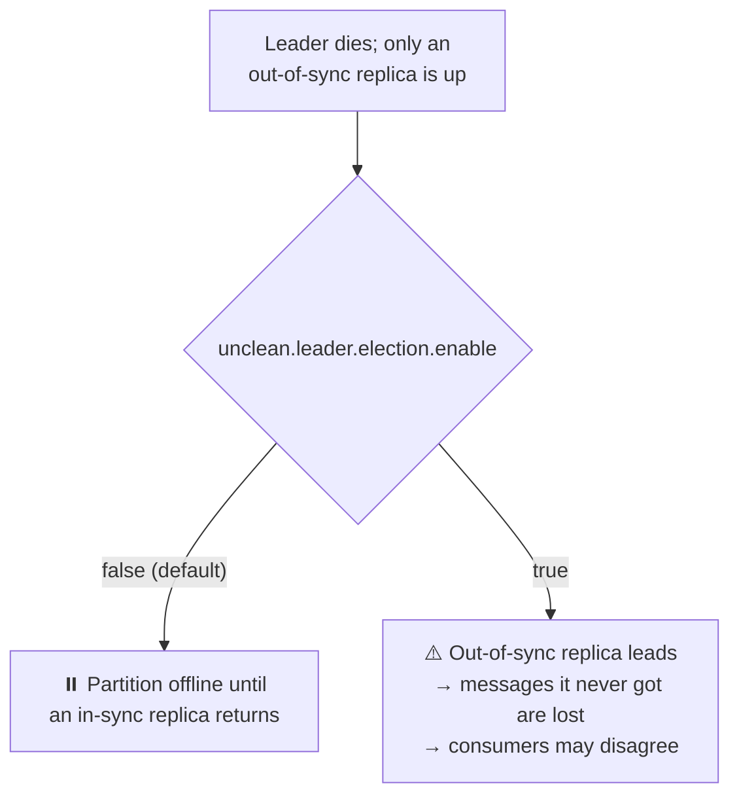
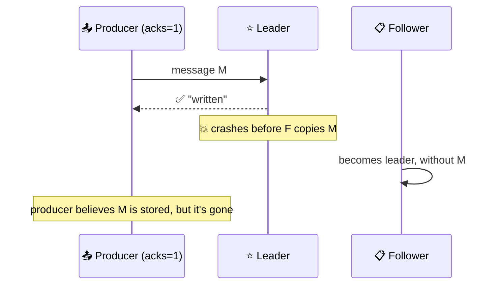

# 🛡️ Reliable Data Delivery

[[Brokers/Kafka/Kafka The Definitive Guide/README|📬 Kafka: The Definitive Guide]] · Book Ch.7

> [!toc]- 📑 Contents
>
> - [[#📜 What Kafka Guarantees|📜 What Kafka Guarantees]]
> - [[#🔢 Replication Factor|🔢 Replication Factor]]
> - [[#🚫 Unclean Leader Election|🚫 Unclean Leader Election]]
> - [[#✅ Minimum In-Sync Replicas|✅ Minimum In-Sync Replicas]]
> - [[#💾 Keeping Replicas In Sync and Persisting to Disk|💾 Keeping Replicas In Sync and Persisting to Disk]]
> - [[#📤 Reliable Producers|📤 Reliable Producers]]
> - [[#📥 Reliable Consumers|📥 Reliable Consumers]]
> - [[#🧪 Validating Reliability|🧪 Validating Reliability]]
> - [[#🛒 In the Project|🛒 In the Project]]
> - [[#🔨 Hands-On Practice|🔨 Hands-On Practice]]
> - [[#📋 Quick Reference|📋 Quick Reference]]
> - [[#🧠 Things to Remember|🧠 Things to Remember]]
> - [[#💡 Pro Tips|💡 Pro Tips]]
> - [[#🔗 Related Topics|🔗 Related Topics]]

Reliability isn't a single switch: brokers, producers, and consumers each have to be configured for it. This lesson covers what Kafka guarantees, the three broker settings that matter most, and how producers and consumers can still lose data despite a reliable cluster.

---

## 📜 What Kafka Guarantees

Kafka's guarantees, like a database's ACID, are the promises you build on:

1. 🔀 **Order within a partition:** if the same producer writes B after A to a partition, B gets a higher offset and every consumer reads A first.

2. ✅ **"Committed" means on all in-sync replicas** (not necessarily flushed to disk). Producers choose whether to wait for that, for the leader only, or for nothing (`acks`).

3. 🛟 **Committed messages aren't lost while at least one replica stays alive.**

4. 👀 **Consumers only read committed messages.**

> ⚠️ **Two different "committed"s:** a *committed message* is on all in-sync replicas; a *committed offset* is a consumer's saved position (lesson 10).

Everything else is a trade-off you configure: reliability vs **availability**, **throughput**, **latency**, and **cost**. Settings can differ per topic, so one cluster can hold a bank's transactions *and* its complaint forms with different levels of care.

---

## 🔢 Replication Factor

`replication.factor` per topic (`default.replication.factor` for auto-created ones). With **N** replicas you can lose **N − 1** brokers and still read and write.

| Consideration | More replicas… |
|---|---|
| 🟢 Availability | Survive more broker restarts and failures; with 1 replica, a routine restart takes the partition offline |
| 💾 Durability | More copies, less chance of losing all of them |
| 🌐 Throughput | More inter-broker traffic: at 10 MB/s, RF 2 adds 10 MB/s, RF 3 adds 20 MB/s, RF 5 adds 40 MB/s |
| 🐢 End-to-end latency | Consumers wait for every in-sync replica; one slow broker slows everyone |
| 💸 Cost | N times the disk and network |

- 🏆 **RF 3 is the usual choice** for important data. Some teams use RF 2 on storage that already replicates blocks, accepting lower availability.

- 🏢 **Spread across racks / availability zones** with `broker.rack`, so one switch or zone failure can't take all replicas.

---

## 🚫 Unclean Leader Election

When a leader dies, a new one is chosen from the **in-sync replicas**: a "clean" election that loses no committed data. But what if **no in-sync replica is left**?



The book's example: replicas 0 and 1 fall out of sync; replica 2 (leader) takes offsets 100–200 and crashes; replica 0 returns with only 0–100. If it becomes leader, **new** records 100–200 are written; some consumers saw the old 100–200, some the new ones; when replica 2 returns, it discards its old 100–200.

- 🔒 **Default `false`:** consistency over availability.

- 🧯 **In an emergency** an operator may enable it to bring partitions back, accepting the loss, and must switch it off again afterwards.

---

## ✅ Minimum In-Sync Replicas

Even with RF 3, the ISR can shrink to **just the leader**. "Committed on all in-sync replicas" then means "on one machine". **`min.insync.replicas`** sets a floor:

| RF | `min.insync.replicas` | In sync | Writes with `acks=all` |
|---|---|---|---|
| 3 | 2 | 3 | ✅ |
| 3 | 2 | 2 | ✅ |
| 3 | 2 | 1 | ❌ `NOT_ENOUGH_REPLICAS`: the partition is read-only |

- 📖 **Consumers can still read** existing data while writes are refused.

- 🔁 **Recovery:** restart the missing brokers and let them catch up.

- 🔗 **It only applies to `acks=all`.** Producers with `acks=1` keep writing to the lone leader.

> 🧪 **Measured on the project's single broker:** a topic with RF 1 and `min.insync.replicas=2` still accepted `acks=all` writes. Kafka 4.x caps the requirement at the replication factor (KIP-966), so testing this needs a real multi-broker cluster.

**The common production combination:** RF 3, `min.insync.replicas=2`, producers with `acks=all` → every acknowledged write is on at least 2 brokers, and one broker can be down without stopping writes.

---

## 💾 Keeping Replicas In Sync and Persisting to Disk

- ⏱️ **`replica.lag.time.max.ms`** (30 s): a follower that hasn't caught up for this long leaves the ISR. Higher = fewer flapping replicas, but up to 30 s before slow replicas let new records reach consumers.

- 💾 **Disk flushes:** Kafka acknowledges records that are only in the page cache, trusting replicas on separate machines over `fsync`. It flushes when segments roll and on clean shutdown. `flush.messages` / `flush.ms` force more frequent flushes, at a large throughput cost; rarely worth it with RF ≥ 3.

---

## 📤 Reliable Producers

A reliable cluster can still "lose" messages if producers are careless. The book's two scenarios:



1. 🔁 **`acks=1`:** the leader acknowledges and crashes before followers copy the record → lost, though the producer saw success. **Fix:** `acks=all`.

2. 🚧 **`acks=all`, but the leader is mid-election:** the broker answers `LEADER_NOT_AVAILABLE`; a producer that doesn't retry drops the record. **Fix:** rely on built-in retries.

Rules:

- ✅ **`acks=all`** (with `min.insync.replicas` ≥ 2 on the topic).

- 🔁 **Unlimited retries, bounded by `delivery.timeout.ms`** (lesson 6), and **idempotence** so retries don't duplicate.

- 🧯 **Handle what retries can't fix:** non-retriable errors (record too large, authorization), serialization errors, exhausted delivery time, a full buffer. Decide per application: log, park, stop reading the source, or apply back-pressure.

---

## 📥 Reliable Consumers

Consumers only see committed data, so their job is **tracking what's done**. The main way they lose messages is **committing offsets for records not yet processed**.

| Setting | Reliable choice |
|---|---|
| `group.id` | Unique per application that must see every message |
| `auto.offset.reset` | `earliest` (duplicates over gaps) |
| `enable.auto.commit` | Off when processing is asynchronous or stateful; commit explicitly |
| `auto.commit.interval.ms` | If auto: lower = fewer duplicates, more overhead |

Patterns from the book:

- ✅ **Commit after processing**, never before.

- ⚖️ **Commit frequency is a trade-off:** commits go to one broker per group like `acks=all` writes; committing after every message only suits very low traffic.

- 🔄 **Handle rebalances:** commit before partitions are revoked; reset per-partition state on assignment.

- 🔁 **Retrying a failed record:** don't commit past it. Either **pause** the partition and retry in place, or **send it to a retry / dead-letter topic** and continue. Kafka commits positions, not individual acknowledgements, so committing #31 implicitly marks #30 done too.

- 🧠 **State across polls** (running averages) must be saved together with offsets, ideally in a transaction (lesson 16) or with a stream-processing library.

---

## 🧪 Validating Reliability

The book recommends three layers:

1. ⚙️ **Validate configuration** with `kafka-verifiable-producer.sh` and `kafka-verifiable-consumer.sh`: produce a numbered sequence, consume it, kill leaders or restart brokers mid-run, and check the counts match.

2. 🧩 **Validate the application** under failures: lost broker connections, high latency, full or hanging disks, leader elections, and rolling restarts of brokers, consumers, and producers.

3. 📈 **Monitor in production:** producer error rates, consumer lag, and end-to-end checks that every produced event was consumed (lesson 19).

### 🧪 Interview Q&A

**Q1:** With RF 3 and `min.insync.replicas=2`, two brokers go down. What happens to producers and consumers?

**Q2:** Why can `acks=1` lose a message the producer was told was written?

**Q3:** What does `unclean.leader.election.enable=true` trade away?

**Q4:** A consumer fails on record #30 but succeeds on #31. Why must it not commit 32?

> [!answer]- 📋 Answers
>
> **A1:** The ISR has 1 replica, below the minimum, so `acks=all` producers get `NOT_ENOUGH_REPLICAS`; consumers keep reading existing data.
>
> **A2:** The leader acknowledges before followers copy the record; if it crashes, an in-sync follower without the record becomes leader.
>
> **A3:** Consistency: an out-of-sync replica becomes leader, losing records it never had and letting consumers see different data at the same offsets.
>
> **A4:** Offsets are positions: committing 32 marks everything before it, including #30, as done, so #30 would never be processed.

---

## 🛒 In the Project

| Guarantee | How the project gets it |
|---|---|
| No lost events at the source | **Outbox**: `OrderPaid` is stored in MySQL with the order, and published until Kafka acknowledges it |
| Durable writes | `acks=all` + idempotence (franz-go defaults) with a 30 s delivery timeout |
| No skipped events | Manual commits after processing; `ConsumeResetOffset(AtStart())` for new groups |
| Retries without blocking | 3 attempts, then the record goes to `shipping.dlq` / `order.dlq` and the partition moves on |
| Duplicates are harmless | Shipping's `processed_events` table; Order's status update is idempotent |
| ⚠️ Broker durability | **Not** in development: RF 1 on a single broker. Production needs RF 3 and `min.insync.replicas=2` |

---

## 🔨 Hands-On Practice

1. **Verify a producer and consumer pair.** With `make up` running:

    ```bash
    docker compose exec kafka /opt/kafka/bin/kafka-topics.sh --bootstrap-server localhost:9092 \
      --create --topic verify --partitions 3 --replication-factor 1
    docker compose exec kafka /opt/kafka/bin/kafka-verifiable-producer.sh --bootstrap-server localhost:9092 \
      --topic verify --max-messages 1000 --acks -1 | tail -1
    docker compose exec kafka /opt/kafka/bin/kafka-verifiable-consumer.sh --bootstrap-server localhost:9092 \
      --topic verify --group-id verify --max-messages 1000
    ```

    ✅ The producer's last JSON line reports `"sent":1000,"acked":1000`. The consumer prints JSON events (`partitions_assigned`, `records_consumed`, `offsets_committed`) and exits with `shutdown_complete` after 1,000 records.

2. **Survive a Kafka outage without losing an order.** `docker compose stop kafka`, create an order, wait a minute, `docker compose start kafka`.

    ✅ `Create` still succeeds and the order is `Paid` (the event waits in the outbox; Order logs `outbox relay failed` after the 30 s delivery timeout). Within about 25 s of Kafka returning, the order is `Shipped`.

---

### 📋 Quick Reference

```text
# Broker / topic
replication.factor=3
min.insync.replicas=2
unclean.leader.election.enable=false
broker.rack=<zone>

# Producer
acks=all   enable.idempotence=true   delivery.timeout.ms=120000

# Consumer
enable.auto.commit=false (commit after processing)   auto.offset.reset=earliest
```

### 🧠 Things to Remember

- Committed messages are on all in-sync replicas and survive while one replica lives.

- RF 3 + `min.insync.replicas=2` + `acks=all` is the standard durable setup.

- Unclean election trades consistency for availability; keep it off.

- Producers must use `acks=all` and let retries work.

- Consumers must commit only processed records.

### 💡 Pro Tips

- **Set `min.insync.replicas` per topic, not just per cluster** → critical topics get 2, throwaway telemetry can stay at 1.

- **Test failure scenarios before production** → kill a leader during a verifiable-producer run and compare counts.

- **Alert on under-replicated partitions** → a shrinking ISR is the warning before writes stop or data is at risk.

### 🔗 Related Topics

- ⬅️ Previous: [[14. Storage, Retention, and Compaction]]

- ➡️ Next: [[16. Exactly-Once Semantics]]

- 🔬 ISR and high-water mark: [[13. Inside a Kafka Cluster]]

- 📍 Commit strategies: [[10. Offsets and Commits]]

- 💻 Codebase: [[Go/gRPC Microservices in Go - Refactored/microservices/README|Order + Payment + Shipping]]
