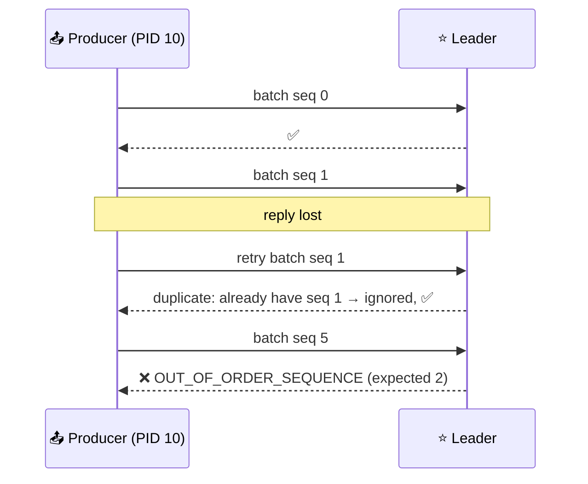
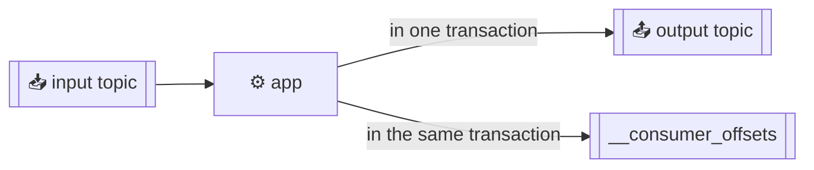
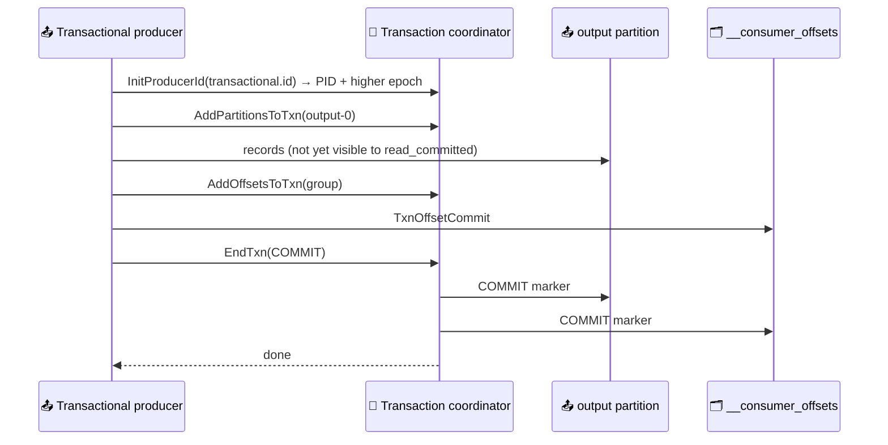

# 🎯 Exactly-Once Semantics

[[Brokers/Kafka/Kafka The Definitive Guide/README|📬 Kafka: The Definitive Guide]] · Book Ch.8

> [!toc]- 📑 Contents
>
> - [[#🔁 Idempotent Producer|🔁 Idempotent Producer]]
> - [[#⚠️ What Idempotence Doesn't Cover|⚠️ What Idempotence Doesn't Cover]]
> - [[#🧾 Transactions: The Problem|🧾 Transactions: The Problem]]
> - [[#⚛️ How Transactions Work|⚛️ How Transactions Work]]
> - [[#🧟 Fencing Zombies|🧟 Fencing Zombies]]
> - [[#👀 Reading Transactions: isolation.level|👀 Reading Transactions: isolation.level]]
> - [[#🚫 What Transactions Don't Solve|🚫 What Transactions Don't Solve]]
> - [[#💻 Transactions in Go|💻 Transactions in Go]]
> - [[#🛒 In the Project|🛒 In the Project]]
> - [[#🔨 Hands-On Practice|🔨 Hands-On Practice]]
> - [[#📋 Quick Reference|📋 Quick Reference]]
> - [[#🧠 Things to Remember|🧠 Things to Remember]]
> - [[#💡 Pro Tips|💡 Pro Tips]]
> - [[#🔗 Related Topics|🔗 Related Topics]]

At-least-once is enough when duplicates are harmless. When a duplicate means a wrong total, an inventory miscount, or two umbrellas instead of one, you need **exactly-once**. Kafka builds it from two features: the **idempotent producer** and **transactions**. This lesson covers both, and their limits.

---

## 🔁 Idempotent Producer

**Idempotent** means doing something twice has the same effect as doing it once: `SET x = 18` is idempotent, `SET x = x + 1` isn't.

The duplicate it prevents: the leader writes and replicates a record, crashes before replying, and the producer's retry lands on the new leader, which already has it.



- 🆔 **Producer ID (PID) + sequence number** per partition identify each batch. Brokers remember the last **5** batches per producer and partition, which is why `max.in.flight.requests.per.connection` must be ≤ 5.

- 🔁 **Duplicate** → rejected quietly (counted in metrics, not an error you need to handle).

- 🕳️ **Out-of-order sequence** → suggests messages were lost between producer and broker; worth checking producer config and unclean elections.

- 🖥️ **Broker failover:** followers track producer state as they replicate, and brokers snapshot it to disk, so a new leader can keep rejecting duplicates.

- 🪶 **Cost:** one extra request at startup and 96 bits per batch. Free with `acks=all`.

It's on by default in Java since 3.0 and in franz-go. The project's records show it: `producerId: 10 … baseSequence: 0` (lesson 14).

---

## ⚠️ What Idempotence Doesn't Cover

It only removes duplicates from the **producer's own internal retries**.

- 🔄 **A restarted producer gets a new PID**, so a message it re-sends is a new message to the broker.

- 📞 **Your code calling `Produce` twice** with the same data creates two records.

- 👯 **Two instances** reading the same source and producing it both create copies.

> 💡 Let the client retry for you; don't catch errors and re-send yourself.

---

## 🧾 Transactions: The Problem

Transactions were built for **consume → process → produce** applications, the core of stream processing (Kafka Streams). Two failures cause duplicate results:

1. 💥 **Crash between producing the result and committing the input offset** → after the rebalance, the input is processed again and the result is written twice.

2. 🧟 **A zombie:** an instance freezes after polling, gets replaced, then wakes up and writes results for records the new owner already handled.

The idea: **write the output records and the input offsets in one atomic step.** Offsets are records too (in `__consumer_offsets`), so this is an **atomic write across partitions**: all become visible, or none.



---

## ⚛️ How Transactions Work



- 🧾 **Transaction coordinator** — a broker that owns the transaction's state, stored in the internal topic `__transaction_state`.

- ✍️ **Two-phase commit:** the coordinator first records "preparing to commit", then writes **commit markers** (control records) into every partition involved, then marks the transaction complete. A coordinator crash in between resumes from the log.

- 📌 **Markers take offsets:** a committed transaction leaves a gap in the offsets the application sees (measured below).

- ⏱️ **`transaction.timeout.ms`** — an open transaction older than this is aborted by the coordinator, so a dead producer can't block consumers forever.

---

## 🧟 Fencing Zombies

A transactional producer has a **`transactional.id`** that **stays the same across restarts** (unlike the PID, which is random).

- 🔢 **Each `InitProducerId` bumps an epoch** for that ID. Requests from the same ID with an older epoch fail with `PRODUCER_FENCED`, so a zombie can no longer write.

- 👥 **Since Kafka 2.5 (KIP-447)**, the consumer group's metadata is attached to the transaction and used for fencing too, so transactional apps can use normal group subscriptions and rebalances.

---

## 👀 Reading Transactions: isolation.level

Transactional records are written to partitions immediately, even ones later aborted. **Consumers decide** what they see:

| `isolation.level` | Returns |
|---|---|
| `read_uncommitted` (default) | Everything, including open and aborted transactions |
| `read_committed` | Non-transactional records and committed transactions only |

- 🧱 **Last stable offset (LSO):** a `read_committed` consumer can't read past the first still-open transaction, so a long transaction delays every reader of that partition.

- 🧩 **No transaction boundaries:** `read_committed` doesn't tell you where a transaction starts or ends, and a consumer subscribed to some of its topics sees only part of it.

**Measured** after one committed transaction (3 records), then one aborted transaction (1 record), on a 1-partition topic:

```text
read_uncommitted sees: [a!@0 b!@1 c!@2 ABORTED@4]
read_committed sees:   [a!@0 b!@1 c!@2]
```

Offset 3 is the commit marker and offset 5 the abort marker: control records your code never sees.

---

## 🚫 What Transactions Don't Solve

Kafka's exactly-once covers records and offsets **inside Kafka**. It doesn't extend to the rest of the world:

| Scenario | Why not |
|---|---|
| 📧 **Side effects while processing** (sending an email, calling an API) | A retried transaction repeats the side effect |
| 🗄️ **Reading from Kafka, writing to a database** | The DB write and the offset commit aren't in one transaction |
| 🗄️➡️📮 **Writing to a database and Kafka** | Two systems, no shared transaction: the **outbox pattern** exists for this |
| 🗄️➡️📮➡️🗄️ **DB → Kafka → DB, keeping source transactions** | Consumers can't see transaction boundaries |
| 🌍 **Copying between clusters** | Transactional grouping is lost in the copy |
| 📢 **Pub/sub** | `read_committed` hides aborted records, but consumers can still process twice through their own commits |

> ⚠️ **Never publish in a transaction and wait for another service's reply before committing.** The other service can't see the request until you commit, so both wait forever.

The book describes the outbox pattern for this: one direction uses Kafka as the outbox and an idempotent DB update; the **inverse**, a database table as outbox with a relay to Kafka, is what this project uses.

---

## 💻 Transactions in Go

The book recommends Kafka Streams with `processing.guarantee=exactly_once_v2` for most cases. In Go, franz-go's **`GroupTransactSession`** packages the consume-transform-produce loop:

```go
sess, err := kgo.NewGroupTransactSession(
    kgo.SeedBrokers("localhost:9092"),
    kgo.TransactionalID("uppercaser-1"),          // stable across restarts
    kgo.ConsumerGroup("uppercaser"),
    kgo.ConsumeTopics("tx-in"),
    kgo.FetchIsolationLevel(kgo.ReadCommitted()), // skip aborted input
    kgo.RequireStableFetchOffsets(),
)

for {
    fetches := sess.PollFetches(ctx)
    if err := sess.Begin(); err != nil {
        return err
    }
    fetches.EachRecord(func(r *kgo.Record) {
        sess.Produce(ctx, &kgo.Record{Topic: "tx-out", Value: transform(r.Value)}, nil)
    })
    // Commits the produced records and the consumed offsets together,
    // or aborts if anything failed (including a rebalance mid-transaction).
    committed, err := sess.End(ctx, kgo.TryCommit)
    if err != nil {
        return err
    }
    _ = committed // false means aborted; the records will be polled again
}
```

```text
round 0: 3 records, committed=true err=<nil>
```

> 🆕 **Kafka Streams:** the book's `exactly_once` and `exactly_once_beta` values were replaced by `exactly_once_v2`; the old ones are gone in Kafka 4.0.

### ⚡ Performance

- ⏱️ **Overhead is per transaction, not per record:** a few extra requests to start and commit. Bigger transactions (more records each) amortize it.

- 🐢 **But longer transactions delay `read_committed` consumers** until the commit marker arrives, which adds end-to-end latency. Commit every 100 ms – few seconds, depending on the latency you can accept.

### 🧪 Interview Q&A

**Q1:** What exactly does the idempotent producer deduplicate, and what not?

**Q2:** Which two failures do transactions protect a consume-process-produce app from?

**Q3:** How does Kafka stop a zombie instance from writing after it was replaced?

**Q4:** Shipping consumes `OrderPaid` and inserts into MySQL. Would Kafka transactions make that exactly-once?

> [!answer]- 📋 Answers
>
> **A1:** Duplicates from the producer's own retries within one producer session. Not records re-sent by your code, by a restarted producer (new PID), or by another instance.
>
> **A2:** A crash between writing results and committing input offsets (reprocessing), and zombie instances writing results after being replaced.
>
> **A3:** `transactional.id` keeps the same identity across restarts; each initialization bumps the epoch, and requests with an older epoch get `PRODUCER_FENCED`.
>
> **A4:** No. The MySQL insert isn't part of a Kafka transaction. Shipping uses at-least-once delivery plus an idempotent write (`processed_events` with a unique event ID) in the same MySQL transaction as the shipment.

---

## 🛒 In the Project

The project **doesn't use Kafka transactions**, on purpose: every consumer's output goes to **MySQL**, outside Kafka.

| Need | Project solution | Why not Kafka transactions |
|---|---|---|
| No lost or duplicated **writes to Kafka** | Idempotent producer (default) | Already enough for single records |
| Event written **with** a DB change | Transactional **outbox** in MySQL | Kafka can't join a MySQL transaction |
| Each event's **effect** applied once | `processed_events` / idempotent status updates | Kafka transactions can't cover MySQL |

Transactions would fit a **Kafka-to-Kafka** step, for example an "order stats" service that reads `orders` and writes per-customer totals to an `order-stats` topic. A double count there can't be fixed afterwards, so exactly-once is worth it.

---

## 🔨 Hands-On Practice

1. **See commit and abort markers.** In a scratch Go module (franz-go v1.22), run a `GroupTransactSession` that copies 3 records from `tx-in` to `tx-out`, then a plain transactional client that writes one record and calls `EndTransaction(ctx, kgo.TryAbort)`. Read `tx-out` twice, with `kgo.ReadUncommitted()` and `kgo.ReadCommitted()`.

    ✅ Only the uncommitted reader sees the aborted record, and offsets 3 and 5 never show up: they're the markers.

2. **Find the transaction state topic.** After step 1, run `kafka-topics.sh --bootstrap-server localhost:9092 --list` (without `--exclude-internal`).

    ✅ `__transaction_state` appears next to `__consumer_offsets`.

---

### 📋 Quick Reference

| Property | franz-go | Purpose |
|---|---|---|
| `enable.idempotence=true` | default | No duplicates from retries |
| `transactional.id` | `kgo.TransactionalID("app-1")` | Stable identity + fencing |
| `isolation.level=read_committed` | `kgo.FetchIsolationLevel(kgo.ReadCommitted())` | Hide aborted/open transactions |
| `transaction.timeout.ms` | `kgo.TransactionTimeout(...)` | Abort stuck transactions |
| Begin / commit / abort | `cl.BeginTransaction()`, `cl.EndTransaction(ctx, kgo.TryCommit / kgo.TryAbort)` | Manual transactions |
| Consume-transform-produce | `kgo.NewGroupTransactSession(...)`, `Begin`, `End` | Atomic output + offsets |

### 🧠 Things to Remember

- Idempotence removes duplicates from internal retries only.

- Transactions make output records and input offsets atomic, within Kafka.

- `transactional.id` + epochs fence zombies.

- Consumers must use `read_committed` to hide aborted data.

- Writes to databases or APIs need the outbox pattern and idempotent handlers instead.

### 💡 Pro Tips

- **Don't reach for transactions first** → most microservice flows end in a database, where idempotent handlers are simpler and actually work.

- **Keep transactions short but not tiny** → long ones delay readers; tiny ones multiply overhead.

- **Give each instance a stable, unique `transactional.id`** → for example the pod name in a StatefulSet.

### 🔗 Related Topics

- ⬅️ Previous: [[15. Reliable Data Delivery]]

- ➡️ Next: [[17. Event-Driven Order, Payment, and Shipping]]

- 🛡️ The producer settings behind it: [[6. Producer Configuration]]

- 🧮 Where exactly-once matters most: [[20. Stream Processing Concepts]]

- 💻 Codebase: [[Go/gRPC Microservices in Go - Refactored/microservices/README|Order + Payment + Shipping]]
