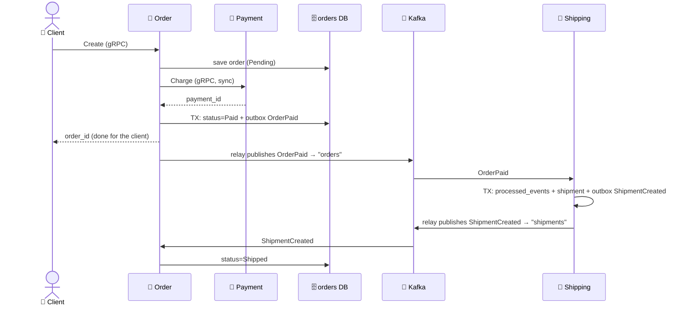
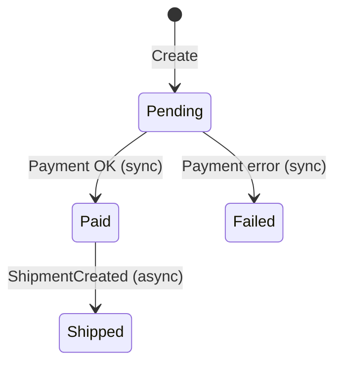
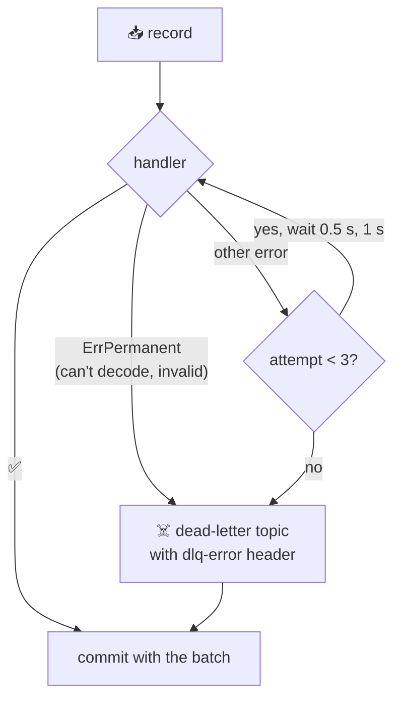

# 🛒 Event-Driven Order, Payment, and Shipping

[[Brokers/Kafka/Kafka The Definitive Guide/README|📬 Kafka: The Definitive Guide]] · Project lesson · Book Ch.7–8 + Shuiskov Ch.6

> [!toc]- 📑 Contents
>
> - [[#🗺️ The Whole Flow|🗺️ The Whole Flow]]
> - [[#📦 Step 1: Paid + Event in One Transaction|📦 Step 1: Paid + Event in One Transaction]]
> - [[#🔁 Step 2: The Outbox Relay|🔁 Step 2: The Outbox Relay]]
> - [[#📥 Step 3: Shipping Consumes Once|📥 Step 3: Shipping Consumes Once]]
> - [[#☠️ Step 4: Failures and Dead Letters|☠️ Step 4: Failures and Dead Letters]]
> - [[#🔙 Step 5: Order Hears Back|🔙 Step 5: Order Hears Back]]
> - [[#🧵 One Trace Across Kafka|🧵 One Trace Across Kafka]]
> - [[#🧪 What Happens When Things Break|🧪 What Happens When Things Break]]
> - [[#🔨 Hands-On Practice|🔨 Hands-On Practice]]
> - [[#📋 Quick Reference|📋 Quick Reference]]
> - [[#🧠 Things to Remember|🧠 Things to Remember]]
> - [[#💡 Pro Tips|💡 Pro Tips]]
> - [[#🔗 Related Topics|🔗 Related Topics]]

This lesson walks through the codebase's complete flow, where Babal's synchronous Order → Payment call meets Kafka. It puts lessons 5–16 to work: keys, manual commits, idempotence, retries, dead letters, and tracing.

---

## 🗺️ The Whole Flow





| Part | Style | Why |
|---|---|---|
| Order → Payment | 📞 gRPC | The client is waiting for "paid or not" |
| Order → Shipping | 📬 `OrderPaid` on `orders` | Nobody waits; Shipping may be down for a while |
| Shipping → Order | 📬 `ShipmentCreated` on `shipments` | Order learns about it whenever it arrives |

Both topics: 3 partitions, keyed by `order_id`, Protobuf values, an `event-type` header.

---

## 📦 Step 1: Paid + Event in One Transaction

### ❌ The Problem

```go
_ = a.db.UpdateStatus(ctx, order.ID, "Paid")
_ = producer.ProduceSync(ctx, orderPaidRecord).FirstErr() // 💥 Kafka down, or a crash right here
```

Two systems, no shared transaction. A crash between the lines leaves an order that is `Paid` but never shipped. Publishing first is worse: Shipping could ship an order whose status update then fails.

### ✅ The Fix: Transactional Outbox

The order update and the event go into **the same MySQL transaction**; a relay publishes the event afterwards.

```go
// order/internal/adapters/db/outbox.go
return a.db.WithContext(ctx).Transaction(func(tx *gorm.DB) error {
    res := tx.Model(&Order{}).Where("id = ?", order.ID).Update("status", domain.StatusPaid)
    if res.Error != nil {
        return res.Error
    }
    if res.RowsAffected == 0 {
        return domain.ErrNotFound
    }
    return tx.Create(&OutboxEvent{
        Topic:     TopicOrders,
        Key:       strconv.FormatInt(order.ID, 10),
        EventType: "order.v1.OrderPaid",
        Payload:   payload, // proto.Marshal(&orderv1.OrderPaid{EventId: uuid.NewString(), …})
        Headers:   headers, // the request's trace context
    }).Error
})
```

- 🔒 **Atomic intent:** "Paid" and "OrderPaid must be published" commit together, or not at all.

- 🆔 **`EventId`** is a UUID, so every consumer can recognize repeats.

- 🧵 **`Headers`** stores the trace context of the gRPC request that caused the event.

---

## 🔁 Step 2: The Outbox Relay

A goroutine in each service polls its outbox every 500 ms:

```go
// order/internal/adapters/db/outbox.go
err := a.db.WithContext(ctx).Transaction(func(tx *gorm.DB) error {
    var events []OutboxEvent
    if err := tx.Clauses(clause.Locking{Strength: "UPDATE", Options: "SKIP LOCKED"}).
        Where("published_at IS NULL").Order("id").Limit(limit).
        Find(&events).Error; err != nil {
        return err
    }
    // ...
    if err := publish(ctx, events); err != nil {
        return err // rollback: the rows stay unpublished and are retried
    }
    return tx.Model(&OutboxEvent{}).Where("id IN ?", ids).Update("published_at", time.Now()).Error
})
```

```go
// order/internal/adapters/events/relay.go
records = append(records, &kgo.Record{
    Context: parentContext(ctx, e.Headers), // continue the original trace
    Topic:   e.Topic,
    Key:     []byte(e.Key),
    Value:   e.Payload,
    Headers: []kgo.RecordHeader{{Key: "event-type", Value: []byte(e.EventType)}},
})
return r.producer.ProduceSync(ctx, records...).FirstErr()
```

- 🔐 **`SKIP LOCKED`** lets several Order replicas run relays without publishing the same rows.

- 🧵 **Ordered by `id`**, keyed by `order_id` → per-order order is kept.

- 🔁 **At-least-once:** a crash after `ProduceSync` but before `published_at` is set republishes the batch. Duplicates are expected, and handled in step 3.

- ⏳ **Bounded wait:** the producer's 30 s delivery timeout (lesson 6) limits how long the relay holds row locks while Kafka is down.

> 💡 **Alternative:** change data capture (Debezium) reads the outbox table from MySQL's binlog and publishes it, with no polling relay (lesson 18).

---

## 📥 Step 3: Shipping Consumes Once

The consumer loop (lessons 9–11): group `shipping`, manual commits after processing, rebalances blocked between poll and commit.

```go
// shipping/internal/adapters/events/handlers.go
func OrderPaidHandler(api ports.APIPort) Handler {
    return func(ctx context.Context, record *kgo.Record) error {
        var event orderv1.OrderPaid
        if err := proto.Unmarshal(record.Value, &event); err != nil {
            return fmt.Errorf("%w: decode OrderPaid: %v", ErrPermanent, err)
        }
        if event.GetEventId() == "" || event.GetOrderId() < 1 {
            return fmt.Errorf("%w: invalid OrderPaid: …", ErrPermanent, …)
        }
        _, err := api.CreateShipment(ctx, event.GetEventId(), event.GetOrderId())
        return err
    }
}
```

The **idempotent write**: three changes, one MySQL transaction.

```go
// shipping/internal/adapters/db/db.go
err = a.db.WithContext(ctx).Transaction(func(tx *gorm.DB) error {
    res := tx.Clauses(clause.OnConflict{DoNothing: true}).Create(&ProcessedEvent{EventID: eventID})
    if res.Error != nil {
        return res.Error
    }
    if res.RowsAffected == 0 {
        return nil // seen before
    }
    // 1. remember the event  2. create the shipment  3. queue ShipmentCreated in the outbox
    // ...
})
```

- 🆔 **`processed_events`** has `event_id` as primary key. A repeat inserts nothing (`RowsAffected == 0`), so nothing else happens.

- 🧪 **Tested against real MySQL:** delivering the same event three times creates one shipment and one `ShipmentCreated` (`Test_Same_Event_Creates_One_Shipment_And_One_Event`).

- 📦 **Shipping has its own outbox** for `ShipmentCreated`, for the same reason as Order.

---

## ☠️ Step 4: Failures and Dead Letters



```go
// order/internal/adapters/events/consumer.go (same in shipping)
func (c *Consumer) processWithRetry(ctx context.Context, record *kgo.Record) error {
    var err error
    for attempt := 1; attempt <= c.attempts; attempt++ {
        err = c.process(record)
        if err == nil || errors.Is(err, ErrPermanent) {
            return err
        }
        select {
        case <-ctx.Done():
            return ctx.Err()
        case <-time.After(time.Duration(attempt) * 500 * time.Millisecond):
        }
    }
    return err
}
```

- ☠️ **Permanent errors skip retries.** Retrying bytes that can't be decoded only blocks the partition.

- 🔁 **Transient errors** (database blip) get 3 attempts with growing pauses.

- 🏷️ **Dead letters keep the original key and value** plus `dlq-error` and `dlq-source` (`topic/partition/offset`), so they can be inspected and replayed.

`make poison` sends `not-protobuf` to `orders`; `make dlq` then shows:

```text
shipping.dlq p0@0 key=999 DEAD LETTER (permanent failure: decode OrderPaid: proto: cannot parse invalid wire-format data) value="not-protobuf"
```

---

## 🔙 Step 5: Order Hears Back

```go
// order/internal/adapters/events/handlers.go
err := api.MarkShipped(ctx, event.GetOrderId())
if errors.Is(err, domain.ErrNotFound) {
    return fmt.Errorf("%w: order %d: %v", ErrPermanent, event.GetOrderId(), err)
}
return err
```

- 🔁 **Naturally idempotent:** setting `status = Shipped` twice is the same as once, so Order needs no `processed_events` table.

- ☠️ **Unknown order → permanent**, straight to `order.dlq`.

---

## 🧵 One Trace Across Kafka

The outbox stores the trace context, the relay restores it on each record, and franz-go's `kotel` hooks carry it in headers. One `Create` call, from Jaeger:

```text
     0 ms  order     order.v1.OrderService/Create
   243 ms  order     payment.v1.PaymentService/Create        ← sync gRPC
   244 ms  payment   payment.v1.PaymentService/Create
   254 ms  order     gorm.Update                             ← status=Paid
   255 ms  order     gorm.Create                             ← outbox row
   578 ms  order     orders publish                          ← relay
   903 ms  shipping  orders process
   904 ms  shipping  gorm.Create                             ← processed_events, shipment, outbox
  1136 ms  shipping  shipments publish
  1154 ms  order     shipments process
  1154 ms  order     gorm.Update                             ← status=Shipped
```

From the client's request to `Shipped` took about **1.2 s**, of which the client waited only for the first ~260 ms.

---

## 🧪 What Happens When Things Break

All of these were run against the Compose stack:

| Failure | What happens |
|---|---|
| **Shipping down** | Orders still succeed (`Paid`); `OrderPaid` waits in Kafka; `Shipped` follows once Shipping restarts |
| **Kafka down** | Orders still succeed; events wait in the outbox; the relay logs `outbox relay failed` after 30 s and retries; `Shipped` follows once Kafka is back |
| **Same event twice** | One shipment, one `ShipmentCreated` |
| **Undecodable record** | Parked in `shipping.dlq`; the partition keeps flowing; lag returns to 0 |
| **Payment down** | Sync path fails: after retries and the 10 s budget, `Create` returns an error (`DeadlineExceeded` with Payment's container stopped); the order is `Failed`; no event is published |
| **Second Shipping instance** | The `shipping` group splits the 3 partitions; a clean stop moves them back within seconds |

The e2e test (`make e2e`) checks the async path by polling until the order is `Shipped`:

```go
// e2e/create_order_e2e_test.go
c.Require().Eventually(func() bool {
    order, err := c.orderClient.Get(ctx, &orderv1.GetRequest{OrderId: orderID})
    return err == nil && order.GetStatus() == "Shipped"
}, 20*time.Second, 200*time.Millisecond, "order never became Shipped")
```

### 🧪 Interview Q&A

**Q1:** Why does Order write `OrderPaid` to MySQL instead of publishing it directly?

**Q2:** The relay can publish the same event twice. Where is that handled?

**Q3:** Why does Order not need a `processed_events` table for `ShipmentCreated`?

**Q4:** Why are decode errors sent to the dead-letter topic without retrying?

> [!answer]- 📋 Answers
>
> **A1:** To make "status = Paid" and "event must be published" one atomic MySQL transaction; publishing directly is a dual write that can lose or invent events on a crash.
>
> **A2:** In Shipping: the `processed_events` insert finds the `event_id` already there and skips the whole change.
>
> **A3:** Its effect, setting the status to `Shipped`, is idempotent: applying it again changes nothing.
>
> **A4:** The same bytes fail the same way every time; retrying only delays every record behind it in the partition.

---

## 🔨 Hands-On Practice

1. **Follow one order.** With `make up` running:

    ```bash
    make create-order && make get-order
    make get-shipment
    make events
    ```

    Open **http://localhost:16686**, service `order`, operation `order.v1.OrderService/Create`.

    ✅ `get-order` shows `Shipped`, `get-shipment` shows the shipment, `make events` shows one `OrderPaid` and one `ShipmentCreated` with the same key, and Jaeger shows one trace through all three services.

2. **Break and recover.** Run `make poison && sleep 5 && make dlq && make lag`.

    ✅ The bad record is in `shipping.dlq` with its decode error, and both groups show `LAG 0`: the bad record didn't block anything.

---

### 📋 Quick Reference

| Piece | File |
|---|---|
| Event contracts | `proto/order/v1/events.proto`, `proto/shipping/v1/events.proto` |
| Outbox write + relay query | `*/internal/adapters/db/outbox.go` (Order), `shipping/internal/adapters/db/db.go` |
| Relay | `*/internal/adapters/events/relay.go` |
| Consumer, retries, DLQ | `*/internal/adapters/events/consumer.go` |
| Handlers | `*/internal/adapters/events/handlers.go` |
| Topics | `deploy/kafka/create-topics.sh` |

```bash
make events  make lag  make dlq  make poison  make topics  make e2e
```

### 🧠 Things to Remember

- Call synchronously when the caller needs the answer; publish when others only need to know.

- Outbox = the business change and the event in one database transaction.

- Every hop is at-least-once; every handler is idempotent.

- Permanent errors go straight to a dead-letter topic; transient ones are retried first.

- Store the trace context with the event to keep one trace across async hops.

### 💡 Pro Tips

- **Delete old outbox rows** → a nightly job removing rows published more than a few days ago keeps the table small.

- **Alert on the oldest unpublished outbox row** → if it grows, the relay is stuck even though no error reaches users.

- **Build a replay command for dead letters** → parking is only half of the job; after a fix, records must flow back.

### 🔗 Related Topics

- ⬅️ Previous: [[16. Exactly-Once Semantics]]

- ➡️ Next: [[18. Data Pipelines and Kafka Connect]]

- 📞 The sync half: [[Go/gRPC Microservices in Go - Refactored/5. Interservice Communication|gRPC Ch.5]] and [[Go/gRPC Microservices in Go - Refactored/6. Resilient Communication|gRPC Ch.6]]

- 🔄 Choreography and sagas: [[Go/gRPC Microservices in Go - Refactored/2. gRPC Meets Microservices|gRPC Ch.2]]

- 🔭 Tracing: [[Go/gRPC Microservices in Go - Refactored/9. Observability|gRPC Ch.9]]

- 💻 Codebase: [[Go/gRPC Microservices in Go - Refactored/microservices/README|Order + Payment + Shipping]]
