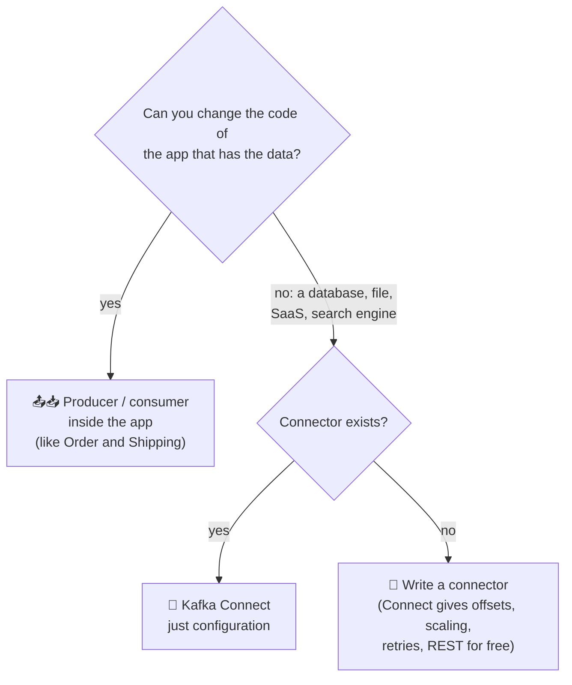
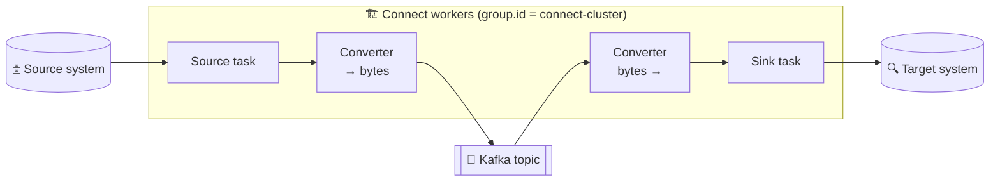
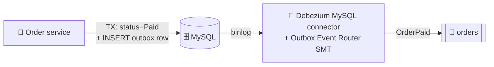

# 🔌 Data Pipelines and Kafka Connect

[[Brokers/Kafka/Kafka The Definitive Guide/README|📬 Kafka: The Definitive Guide]] · Book Ch.9

> [!toc]- 📑 Contents
>
> - [[#🧭 What a Pipeline Must Handle|🧭 What a Pipeline Must Handle]]
> - [[#🔄 ETL or ELT|🔄 ETL or ELT]]
> - [[#🔗 Avoiding Coupling|🔗 Avoiding Coupling]]
> - [[#⚖️ Connect or Your Own Client?|⚖️ Connect or Your Own Client?]]
> - [[#🏗️ How Kafka Connect Works|🏗️ How Kafka Connect Works]]
> - [[#📄 A File Connector, Running|📄 A File Connector, Running]]
> - [[#🪄 Single Message Transformations|🪄 Single Message Transformations]]
> - [[#🗄️ Change Data Capture with Debezium|🗄️ Change Data Capture with Debezium]]
> - [[#🧰 Alternatives|🧰 Alternatives]]
> - [[#🛒 In the Project|🛒 In the Project]]
> - [[#🔨 Hands-On Practice|🔨 Hands-On Practice]]
> - [[#📋 Quick Reference|📋 Quick Reference]]
> - [[#🧠 Things to Remember|🧠 Things to Remember]]
> - [[#💡 Pro Tips|💡 Pro Tips]]
> - [[#🔗 Related Topics|🔗 Related Topics]]

Microservices aren't the only Kafka users: data also flows from databases into Kafka and from Kafka into search engines, warehouses, and object storage. This lesson covers what a good data pipeline needs, and **Kafka Connect**, Kafka's built-in framework for moving data between Kafka and other systems.

---

## 🧭 What a Pipeline Must Handle

| Concern | What it means | How Kafka helps |
|---|---|---|
| ⏱️ **Timeliness** | Some targets want data in milliseconds, others once an hour | Kafka is a buffer: producers write in real time, consumers read when they like; slow consumers apply back-pressure naturally |
| 🛡️ **Reliability** | No single point of failure; usually at-least-once, sometimes exactly-once | Durable, replicated storage; exactly-once when the target has transactions or unique keys |
| 📈 **High, varying throughput** | Bursts must not break anything | Producers and consumers scale independently; Kafka absorbs spikes |
| 🧾 **Data formats** | XML in, Avro/Protobuf inside, JSON/Parquet/CSV out; schemas evolve | Format-agnostic; Connect uses pluggable converters |
| 🔄 **Transformations** | How much to change data in flight | ETL vs ELT (below) |
| 🔐 **Security** | Who can read, encryption, credentials, audit | ACLs and TLS on Kafka; Connect manages connector secrets |
| 🧯 **Failure handling** | Bad records, outages, reprocessing | Data is retained, so a fixed pipeline can replay |
| 🔗 **Coupling and agility** | Can sources and targets change independently? | One hub instead of point-to-point jobs |

---

## 🔄 ETL or ELT

| | 🧪 ETL (Extract-Transform-Load) | 📦 ELT (Extract-Load-Transform) |
|---|---|---|
| **Where data changes** | In the pipeline | In the target system |
| **Pro** | Saves storage and target compute | Target users get all raw data; easier to debug |
| **Con** | Filtered or dropped fields are gone for everyone downstream | Costs CPU and storage at the target |

> ⚠️ **Kafka pipelines are one-to-many:** data written once is read by many applications. Do the cleanup everyone benefits from (standard timestamps, lineage, removing personal data), but don't prematurely trim data that another consumer may need.

---

## 🔗 Avoiding Coupling

The book names three ways pipelines accidentally tie systems together:

- 🕸️ **Ad-hoc pipelines** — a different tool for every pair (Logstash to Elasticsearch, Flume to HDFS, GoldenGate from Oracle…). Every new system needs new pipelines.

- 🏷️ **Lost metadata** — without schemas and evolution, adding a column at the source breaks every reader at the target.

- 🧮 **Extreme processing** — heavy logic inside the pipeline ties every downstream system to its decisions. Keep data raw and let consumers process it their way.

---

## ⚖️ Connect or Your Own Client?



- 📤📥 **Clients** when the data lives in **your** application.

- 🔌 **Connect** for systems you didn't write and can't change. Its offset storage, parallelism, error handling, type conversions, and REST management are what make a "simple little pipeline app" deceptively hard to write yourself.

---

## 🏗️ How Kafka Connect Works

Connect ships with Kafka. It runs as a cluster of **workers**; you install connector **plug-ins** and manage them through a **REST API**.



| Piece | Job |
|---|---|
| **Connector** | Decides how many **tasks** to run (≤ `tasks.max`) and splits the work, e.g. tables among tasks |
| **Task** | Moves the data: source tasks poll the external system; sink tasks write to it |
| **Worker** | Runs connectors and tasks, serves the REST API, stores configs, offsets, and status in internal Kafka topics; rebalances tasks when a worker fails |
| **Converter** | Turns Connect's schema + value objects into bytes in Kafka and back: JSON (built in), Avro, Protobuf, JSON Schema (via a schema registry) |

Key worker settings:

- 🔌 **`bootstrap.servers`**, **`group.id`** (workers with the same ID form one Connect cluster).

- 📁 **`plugin.path`** — directories (or jars) with connector plug-ins. Keep each connector and its dependencies in its own subdirectory.

- 🔄 **`key.converter` / `value.converter`**, plus converter options such as `value.converter.schemas.enable`.

- 🌐 **`rest.port`** (8083 by default).

**Modes:** **distributed** (`connect-distributed.sh`, many workers, configured over REST) for production; **standalone** (`connect-standalone.sh`, one worker, config files on the command line) for connectors tied to one machine, or for quick experiments.

---

## 📄 A File Connector, Running

Kafka includes `FileStreamSourceConnector` and `FileStreamSinkConnector` as examples. This ran inside the project's Kafka container (Kafka 4.4):

```properties
# /tmp/worker.properties
bootstrap.servers=localhost:9092
key.converter=org.apache.kafka.connect.storage.StringConverter
value.converter=org.apache.kafka.connect.storage.StringConverter
offset.storage.file.filename=/tmp/connect.offsets
plugin.path=/opt/kafka/libs/connect-file-4.4.0.jar
rest.port=8083
```

```properties
# /tmp/file-source.properties
name=returns-file-source
connector.class=org.apache.kafka.connect.file.FileStreamSourceConnector
tasks.max=1
file=/tmp/returns.txt
topic=returns
```

```bash
/opt/kafka/bin/connect-standalone.sh /tmp/worker.properties /tmp/file-source.properties
```

Each line of the file became a record, including one appended while the worker ran:

```text
order 1 returned
order 4 returned
order 6 returned
```

And the REST API:

```text
GET /                                     → {"version":"4.4.0","commit":"1156b2752aaa28ea","kafka_cluster_id":"5L6g…"}
GET /connectors/returns-file-source/status → {"connector":{"state":"RUNNING",…},"tasks":[{"id":0,"state":"RUNNING",…}],"type":"source"}
GET /connector-plugins                    → FileStreamSink, FileStreamSource, MirrorCheckpoint, MirrorHeartbeat, MirrorSource
```

> 🆕 **Current Kafka:** the file connectors are no longer on Connect's default classpath; add `connect-file-<version>.jar` to `plugin.path`, as above.

---

## 🪄 Single Message Transformations

**SMTs** are small, **stateless** changes applied to each record while Connect copies it, configured without code. Built-ins include:

| SMT | Does |
|---|---|
| `Cast` | Change a field's type |
| `MaskField` | Replace a field's value with null, e.g. for personal data |
| `Filter` | Drop or keep records matching a condition (topic, header, tombstone) |
| `Flatten` | Turn nested structures into flat fields |
| `HeaderFrom` / `InsertHeader` | Move fields into headers, or add headers |
| `InsertField` | Add a field (topic, partition, offset, timestamp, static value) |
| `RegexRouter` / `TimestampRouter` | Change the target topic name |
| `ReplaceField` / `ExtractField` / `ValueToKey` | Rename, keep, or drop fields; build keys from values |

Anything **stateful** (joins, aggregations, windows) belongs in stream processing instead (lesson 20).

---

## 🗄️ Change Data Capture with Debezium

The JDBC source connector finds new rows by polling with a timestamp or increasing ID, which is slow and can miss changes. **Change data capture (CDC)** reads the database's own **transaction log** (MySQL's binlog, PostgreSQL's WAL) instead: every insert, update, and delete, in order, with low latency. The book recommends **Debezium** connectors whenever one exists for your database.



For microservices this matters because of the **outbox**: Debezium can read the outbox table's inserts from the binlog and publish them (its **Outbox Event Router** turns each row into a record on the right topic, with the right key), replacing a polling relay.

| | 🔁 Polling relay (this project) | 🔌 Debezium CDC |
|---|---|---|
| **Moving parts** | A goroutine in each service | A Connect cluster + Debezium plug-in |
| **Latency** | Poll interval (500 ms) | Near real-time from the binlog |
| **DB load** | A query every poll | Reads the binlog; no table polling |
| **Ordering** | By outbox `id` | By binlog position |
| **Best for** | Few services, simple ops | Many services/tables, a platform team running Connect |

---

## 🧰 Alternatives

- 🗃️ **Ingest tools of other platforms** (Flume for Hadoop, Logstash or Fluentd for Elasticsearch) — when that system, not Kafka, is the center.

- 🖱️ **GUI ETL tools** (Informatica, Talend, NiFi, StreamSets) — if you already use them; heavy if you only need to move data in and out of Kafka.

- 🌊 **Stream processing frameworks** (Flink, Spark, Kafka Streams) — if you're already processing the stream, they can often write to the target too.

### 🧪 Interview Q&A

**Q1:** When would you use Kafka Connect instead of adding a producer to the application?

**Q2:** What do a connector, a task, and a converter each do?

**Q3:** Why is CDC better than polling a table with a timestamp column?

**Q4:** What's the risk of doing heavy ETL inside a Kafka pipeline?

> [!answer]- 📋 Answers
>
> **A1:** When the data lives in a system whose code you don't own or can't change (a database, SaaS, files), and especially when a connector already exists.
>
> **A2:** The connector plans the work and splits it into tasks; tasks actually move the data; converters translate between Connect's records and the bytes stored in Kafka.
>
> **A3:** It reads every change, including deletes and intermediate updates, in commit order with low latency, without repeatedly querying the tables.
>
> **A4:** Every downstream consumer is stuck with the pipeline's choices: dropped fields or filtered events are gone for everyone, and changing that means rebuilding the pipeline and reprocessing.

---

## 🛒 In the Project

- 📤📥 **Order and Shipping use clients**, because the data starts inside their own code.

- 🔁 **The outbox relay is a hand-written version of what Debezium does.** At more services or higher volume, swapping it for Debezium removes the polling and the relay code; the outbox tables stay the same idea.

- 🔌 **Natural Connect additions:** a sink from `orders` and `shipments` into Elasticsearch for searching order history, or into S3/Parquet for analytics, all by configuration, with no change to the Go services.

---

## 🔨 Hands-On Practice

1. **Run the file source connector.** With `make up` running, open a shell in the broker (`docker compose exec kafka sh`), write the two properties files above to `/tmp`, create the `returns` topic, and start `connect-standalone.sh` in the background. Append a line to `/tmp/returns.txt`.

    ✅ `kafka-console-consumer.sh --topic returns --from-beginning` prints every line of the file, including the appended one.

2. **Ask the REST API.** The image has no `curl`; borrow one that shares the broker's network:

    ```bash
    docker run --rm --network container:$(docker compose ps -q kafka) curlimages/curl:8.11.1 \
      -s localhost:8083/connectors/returns-file-source/status
    ```

    ✅ The connector and its single task report `"state":"RUNNING"`.

---

### 📋 Quick Reference

```bash
connect-distributed.sh config/connect-distributed.properties     # production
connect-standalone.sh worker.properties connector.properties     # one worker
curl localhost:8083/connector-plugins                            # installed plug-ins
curl -X POST -H 'Content-Type: application/json' -d @conn.json localhost:8083/connectors
curl localhost:8083/connectors/<name>/status
curl -X DELETE localhost:8083/connectors/<name>
```

### 🧠 Things to Remember

- Kafka decouples timing, throughput, and formats between sources and targets.

- Prefer ELT-style pipelines: keep data raw, clean only what everyone needs.

- Clients for your own apps; Connect for everything else.

- Connectors plan, tasks move data, converters handle formats, workers run it all.

- CDC (Debezium) beats polling, and can publish an outbox table.

### 💡 Pro Tips

- **Run Connect on its own machines in production** → heavy connectors shouldn't steal CPU and memory from brokers.

- **Configure a dead-letter topic for sink connectors** (`errors.tolerance=all` + `errors.deadletterqueue.topic.name`) → one bad record shouldn't stop the whole pipeline.

- **Version connector configs in Git** and apply them via the REST API from CI.

### 🔗 Related Topics

- ⬅️ Previous: [[17. Event-Driven Order, Payment, and Shipping]]

- ➡️ Next: [[19. Monitoring Kafka]]

- 📦 The outbox the project uses: [[17. Event-Driven Order, Payment, and Shipping]]

- 📜 Schemas and converters: [[7. Serialization and Event Contracts]]

- 🔍 A common sink target: [[Search Engines/Meilisearch/1.Interview|Meilisearch]]
