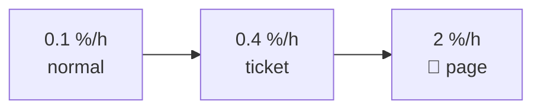
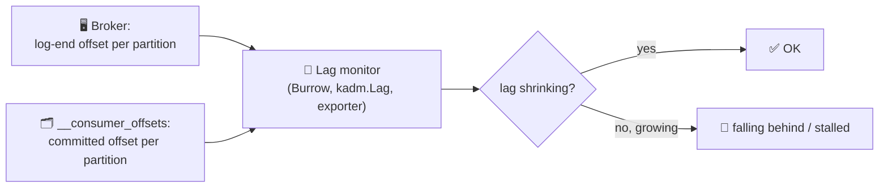

# 📈 Monitoring Kafka

[[Brokers/Kafka/Kafka The Definitive Guide/README|📬 Kafka: The Definitive Guide]] · Book Ch.13

> [!toc]- 📑 Contents
>
> - [[#📊 Where Metrics Come From|📊 Where Metrics Come From]]
> - [[#🎯 SLIs, SLOs, and SLAs|🎯 SLIs, SLOs, and SLAs]]
> - [[#🔥 Alerting on Burn Rate|🔥 Alerting on Burn Rate]]
> - [[#🖥️ Broker Metrics That Matter|🖥️ Broker Metrics That Matter]]
> - [[#💻 Client Metrics|💻 Client Metrics]]
> - [[#📉 Consumer Lag|📉 Consumer Lag]]
> - [[#🔁 End-to-End Monitoring|🔁 End-to-End Monitoring]]
> - [[#🛒 In the Project|🛒 In the Project]]
> - [[#🔨 Hands-On Practice|🔨 Hands-On Practice]]
> - [[#📋 Quick Reference|📋 Quick Reference]]
> - [[#🧠 Things to Remember|🧠 Things to Remember]]
> - [[#💡 Pro Tips|💡 Pro Tips]]
> - [[#🔗 Related Topics|🔗 Related Topics]]

How do you know Kafka and its clients are healthy, and what should wake someone up at night? This lesson covers SLOs and burn-rate alerting, the broker and client metrics that matter, consumer lag, and end-to-end checks.

---

## 📊 Where Metrics Come From

- ☕ **JMX** — brokers and Java clients expose metrics as JMX MBeans, usually scraped by an agent (Prometheus JMX exporter, Jolokia) into your monitoring system.

- 🐹 **Go clients** — franz-go exposes client metrics through hooks; the `kprom` plugin turns them into Prometheus metrics.

- 🩺 **Health checks** — is the process up, and does it answer? Best done **from outside** (a synthetic client), because a broker can't report its own death.

Before collecting everything, decide what each metric is for:

| Purpose | Needs |
|---|---|
| 🚨 **Alerting** | Few, reliable signals tied to user impact |
| 🔍 **Debugging** | Many detailed metrics, kept for a short time |
| 📅 **Capacity planning** | Long-term trends: bytes in/out, partition counts, disk |

---

## 🎯 SLIs, SLOs, and SLAs

| Term | Meaning | Example |
|---|---|---|
| **SLI** (indicator) | A measurement of one aspect of reliability, best as **good events ÷ total events** | Share of produce requests acknowledged within 10 ms |
| **SLO** (objective) | An SLI + a target + a time window | 99.9% within 10 ms, over 7 days |
| **SLA** (agreement) | A contract with clients: SLOs, reporting, penalties | Refund fees for time outside the SLO |
| **OLA** (operational) | Agreements between internal teams that together deliver an SLA | Platform team ↔ product team |

**Good SLIs are measured from the client's side**, because clients only care about their experience. Typical kinds:

- 🟢 **Availability** — can the client make a request and get a response?

- ⏱️ **Latency** — how quickly?

- ✅ **Quality** — is the response correct?

- 🔐 **Security** — is the exchange properly authorized and encrypted?

- 📈 **Throughput** — can the client move enough data, fast enough?

Count events against the threshold ("how many under 10 ms?") rather than using percentiles, which don't let you choose the threshold. Histogram buckets (< 10 ms, 10–50 ms, …) help while you're still finding the right value.

> ⚠️ **Don't sign up for SLOs you can't control**, like the freshness or correctness of data producers write. Kafka's operators own Kafka's behavior, not the content.

---

## 🔥 Alerting on Burn Rate

SLOs describe problems the way clients see them, so they should drive the main alerts. But a weekly SLO alert fires too late. Instead, alert on how fast you're **burning the error budget**.

> 🧮 **The book's example:** 1,000,000 requests a week, SLO = 99.9% within 10 ms.
>
> - Error budget: 0.1% × 1,000,000 = **1,000 slow requests** per week.
>
> - Normal: 1 slow request per hour = 1/1,000 = **0.1% of the budget per hour** (168 per week, fine).
>
> - Tuesday: 0.4% per hour. Not an emergency; open a ticket.
>
> - Wednesday: **2% per hour** = 20 slow requests per hour. At that rate the remaining budget is gone by Friday → alert, fix it now.



---

## 🖥️ Broker Metrics That Matter

| Metric (JMX MBean, abbreviated) | Healthy | Warning sign |
|---|---|---|
| **Under-replicated partitions** `ReplicaManager,UnderReplicatedPartitions` | 0 | Followers not keeping up: broker down, slow disk, network, overload |
| **Offline partitions** `KafkaController,OfflinePartitionsCount` | 0 | Partitions with no leader: unavailable for reads and writes |
| **Active controller count** `KafkaController,ActiveControllerCount` | 1 across the cluster | 0: nobody manages metadata; 2: a stuck controller |
| **Request handler idle ratio** `KafkaRequestHandlerPool,RequestHandlerAvgIdlePercent` | High | < 20%: potential problem; < 10%: active performance problem |
| **Bytes in / bytes out / messages in** `BrokerTopicMetrics` | Trend | Capacity planning; uneven brokers |
| **Partition count / leader count** | Even across brokers | Leadership imbalance after restarts |
| **Request metrics** `RequestMetrics` (total time, queue time per request type) | Stable | Where time is spent: queue vs local vs remote |

- 🪤 **The URP trap:** the book's previous edition made under-replicated partitions *the* alert. The authors now advise against it: it's often non-zero for harmless reasons (a broker restarting, a partition move), so people learn to ignore it. Use it for **diagnosis** and SLOs for **alerting**.

- 🧵 **Request handler threads ≈ number of CPU cores**; more threads don't help.

- 🖥️ **Also watch the platform:** JVM garbage collection pauses, CPU, disk usage and latency, network throughput, and open file handles.

---

## 💻 Client Metrics

**Producer** (`kafka.producer:type=producer-metrics,client-id=…`):

| Metric | Why |
|---|---|
| `record-error-rate` | **Alert on it:** should always be 0. Records were dropped after retries |
| `request-latency-avg` | How long produce requests take |
| `record-queue-time-avg` | Time records wait in the buffer before sending |
| `outgoing-byte-rate`, `record-send-rate` | Throughput |
| `produce-throttle-time-avg` | Throttled by quotas (lesson 8) |

**Consumer** (`kafka.consumer:type=consumer-fetch-manager-metrics,…`):

| Metric | Why |
|---|---|
| `fetch-latency-avg` | Fetch time, but shaped by `fetch.min.bytes` / `fetch.max.wait.ms`, so poor for alerts |
| `bytes-consumed-rate`, `records-consumed-rate` | Throughput |
| `records-lag-max` | Lag of the single worst partition only, and only while the consumer works |
| `commit-latency-avg`, `assigned-partitions` (coordinator) | Commits and assignment health |
| `fetch-throttle-time-avg` | Throttled by quotas |

Client IDs appear in every metric name, another reason to set `client.id` (lesson 6).

---

## 📉 Consumer Lag

**Lag** = log-end offset − committed offset, per partition: how far a group is behind. It's the most important consumer metric.

- ❌ **Don't rely on the client's own `records-lag-max`:** it only shows the worst partition, and stops updating exactly when the consumer is broken or offline.

- ✅ **Measure from outside:** compare each partition's log-end offset (from the broker) with the group's committed offset. `kafka-consumer-groups.sh --describe` does it by hand; **Burrow** (from LinkedIn) does it continuously and rates each group as OK, falling behind, stalled, or stopped, judging **progress** rather than fixed thresholds.

- 📏 **Thresholds depend on traffic:** 100 messages lag means nothing on a topic with 100,000 per second, and a lot on one with 100 per hour. Prefer "is lag shrinking?" to "is lag > N?".



In Go, `kadm` computes it the same external way:

```go
lags, err := adm.Lag(ctx, "shipping", "order")
lags.Each(func(l kadm.DescribedGroupLag) {
    fmt.Printf("group %s state=%s members=%d total lag=%d\n", l.Group, l.State, len(l.Members), l.Lag.Total())
})
```

```text
group shipping state=Stable members=1 total lag=0
group order state=Stable members=1 total lag=0
```

---

## 🔁 End-to-End Monitoring

Per-component metrics can all look fine while data isn't flowing. **End-to-end monitoring** produces test records and consumes them back, measuring whether they arrive and how long it takes. **Xinfra Monitor** (formerly Kafka Monitor, from LinkedIn) does this continuously across brokers.

### 🧪 Interview Q&A

**Q1:** Why measure SLIs from the client side?

**Q2:** Your SLO budget is 1,000 bad requests a week and you're seeing 20 per hour. What does that mean?

**Q3:** Why is under-replicated partitions a poor primary alert?

**Q4:** Why is an external lag monitor better than the consumer's `records-lag-max`?

> [!answer]- 📋 Answers
>
> **A1:** SLOs describe whether users are happy; only their side sees the full path (network, client, broker) the way they experience it.
>
> **A2:** A burn rate of 2% of the weekly budget per hour; at that pace the whole budget lasts 50 hours, so act before the week's SLO is breached.
>
> **A3:** It's frequently non-zero for harmless reasons such as restarts and partition moves, so alerts become noise and get ignored.
>
> **A4:** It covers every partition and keeps working when the consumer is down; the client metric shows only the worst partition and disappears exactly when the consumer is broken.

---

## 🛒 In the Project

| Signal | Where | Alert when |
|---|---|---|
| **Consumer lag**, groups `shipping` and `order` | `make lag` / `kadm.Lag` | Lag keeps growing for minutes |
| **Dead letters** | `shipping.dlq`, `order.dlq` (`make dlq`) | Any new record: something couldn't be processed |
| **Outbox backlog** | Oldest row with `published_at IS NULL` | Older than a minute: the relay is stuck |
| **Relay errors** | Logs: `outbox relay failed` | Repeating |
| **End-to-end latency** | Jaeger: `Create` → `shipments process` | Paid → Shipped slower than your target |
| **End-to-end check** | `make e2e` polls until `Shipped` | Fails |

The single-broker stack doesn't expose JMX; in Kubernetes you'd add the Prometheus JMX exporter to brokers and `kprom` to the Go clients.

---

## 🔨 Hands-On Practice

1. **Make lag visible.** With `make up` running, stop Shipping, create five orders, check lag, then restart:

    ```bash
    docker compose stop shipping
    for i in 1 2 3 4 5; do make create-order >/dev/null; done
    make lag
    docker compose start shipping && sleep 10 && make lag
    ```

    ✅ The `shipping` group shows `LAG` > 0 on some `orders` partitions while stopped (and no consumer IDs); after the restart, lag returns to 0.

2. **Find the outbox backlog query.** Stop Kafka (`docker compose stop kafka`), create an order, and run:

    ```bash
    docker compose exec mysql mysql -uroot -ps3cr3t -e \
      "SELECT COUNT(*), TIMESTAMPDIFF(SECOND, MIN(created_at), NOW()) AS oldest_s FROM orders.outbox_events WHERE published_at IS NULL"
    ```

    ✅ One unpublished row with a growing age; after `docker compose start kafka`, the count drops to 0.

---

### 📋 Quick Reference

| Watch | Alert? |
|---|---|
| SLO burn rate (client-side latency/availability) | ✅ Primary |
| Producer `record-error-rate` | ✅ |
| Consumer lag trend (external) | ✅ |
| Offline partitions, active controller ≠ 1 | ✅ |
| Under-replicated partitions | 🔍 Diagnose |
| Request handler idle ratio | 🔍 < 20% investigate |
| Bytes in/out, partition and leader counts | 📅 Capacity |

### 🧠 Things to Remember

- SLIs measured on the client side; SLOs drive alerts; burn rate makes them timely.

- Under-replicated partitions are for diagnosis, not paging.

- Alert on producer `record-error-rate` > 0.

- Monitor lag from outside the consumer, as a trend.

- End-to-end checks catch failures that per-component metrics miss.

### 💡 Pro Tips

- **Alert on every dead letter** → a record in a DLQ is a business event that didn't happen.

- **Track the outbox's oldest unpublished row** → it's the only signal that events are stuck *before* Kafka.

- **Graph lag next to produce rate** → growing lag during a traffic spike is expected; growing lag at normal traffic is not.

### 🔗 Related Topics

- ⬅️ Previous: [[18. Data Pipelines and Kafka Connect]]

- ➡️ Next: [[20. Stream Processing Concepts]]

- 🧰 Lag by hand: [[12. Managing Kafka with Code and CLI]]

- 🔭 Traces, metrics, and SLOs for the services: [[Go/gRPC Microservices in Go - Refactored/9. Observability|gRPC Ch.9: Observability]]

- 💻 Codebase: [[Go/gRPC Microservices in Go - Refactored/microservices/README|Order + Payment + Shipping]]
