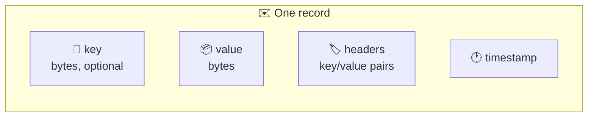
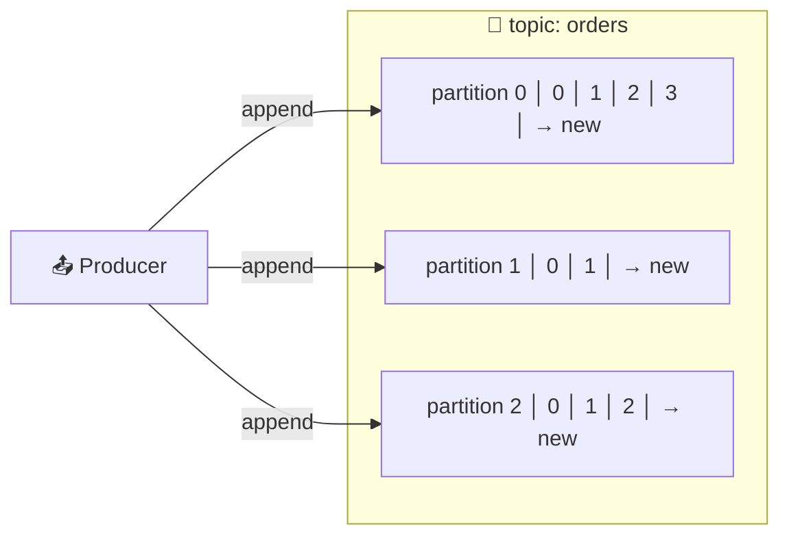
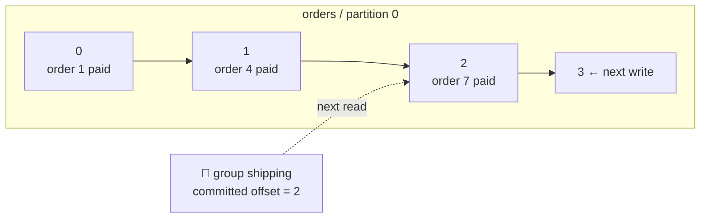

# 🧱 Messages, Topics, and Partitions

[[Brokers/Kafka/Kafka The Definitive Guide/README|📬 Kafka: The Definitive Guide]] · Book Ch.1

> [!toc]- 📑 Contents
>
> - [[#✉️ Messages and Keys|✉️ Messages and Keys]]
> - [[#📦 Batches|📦 Batches]]
> - [[#📜 Schemas|📜 Schemas]]
> - [[#🗂️ Topics and Partitions|🗂️ Topics and Partitions]]
> - [[#🔢 Offsets|🔢 Offsets]]
> - [[#🛒 In the Project|🛒 In the Project]]
> - [[#🔨 Hands-On Practice|🔨 Hands-On Practice]]
> - [[#📋 Quick Reference|📋 Quick Reference]]
> - [[#🧠 Things to Remember|🧠 Things to Remember]]
> - [[#💡 Pro Tips|💡 Pro Tips]]
> - [[#🔗 Related Topics|🔗 Related Topics]]

What exactly goes into Kafka, and how is it organized? This lesson covers the data model: **messages**, **keys**, **batches**, **schemas**, **topics**, **partitions**, and **offsets**.

---

## ✉️ Messages and Keys

A **message** (also called a **record**) is Kafka's unit of data, like a row in a database table. To Kafka it's just **an array of bytes**: Kafka never looks inside.



- 📦 **Value** — the payload. JSON, Protobuf, Avro: Kafka doesn't care.

- 🔑 **Key** — optional bytes used to choose the partition. The simplest scheme: `hash(key) mod number_of_partitions`. Same key → same partition, as long as the partition count doesn't change.

- 🏷️ **Headers** — metadata such as the event type or a trace ID (lesson 7).

---

## 📦 Batches

Sending each message in its own network round trip would waste most of the time on overhead. Producers instead collect messages for the **same topic and partition** into a **batch** and send it at once. Batches are usually **compressed** too.

| Bigger batches | Smaller batches |
|---|---|
| ✅ More messages per second (throughput) | ✅ Each message arrives sooner (latency) |
| ✅ Better compression | ❌ More requests, more overhead |
| ❌ A message waits longer to be sent | ❌ Lower throughput |

It's a trade-off between **latency** and **throughput**; lesson 6 shows the settings that control it.

---

## 📜 Schemas

Bytes alone don't tell a consumer what's inside. A **schema** gives messages a structure everyone agrees on.

- 📝 **JSON / XML** — easy to read, but weak typing and no rules for changing the format safely.

- 🗜️ **Apache Avro** — the book's choice: compact, strongly typed, schemas kept separate from the data, and rules for compatible evolution.

- 📜 **Protocol Buffers** — the same benefits; this project uses it, because the services already share `.proto` contracts and Buf (lesson 7).

A consistent format **decouples writers from readers**. Without one, every consumer must be updated in lockstep whenever a producer changes its format. With well-defined schemas kept in a shared place, producers and consumers can evolve without coordinating.

---

## 🗂️ Topics and Partitions

A **topic** is a named category of messages, like a database table or a folder. Each topic is split into **partitions**, and each partition is **one ordered, append-only log**.



- ➕ **Append-only:** new messages go to the end; reads go from beginning to end.

- 🔀 **Order only within a partition.** Across a topic's partitions, there is **no global order**.

- 📈 **Scaling:** each partition can live on a different server, so one topic can handle far more than one machine could.

- 🛡️ **Redundancy:** partitions are **replicated**, so other servers hold copies if one fails (lesson 13).

A **stream** usually means one topic's data, whatever its partition count, flowing from producers to consumers. **Stream processing** works on that data as it arrives (lesson 20).

---

## 🔢 Offsets

Kafka gives every message an **offset** when it's written: an integer position within its partition.

- ⬆️ **Always increasing** within a partition: each new message gets a larger offset than the one before. They don't always go up by exactly 1 (for example, transaction markers use offsets too, lesson 16).

- 🔁 **Per partition:** offset 0 exists in every partition. "Offset 5" means nothing without the topic and partition.

- 📍 **The consumer's bookmark:** a consumer stores the **next** offset to read for each partition, usually in Kafka itself. After a restart it continues from there (lesson 10).



### 🧪 Interview Q&A

**Q1:** Why does Kafka treat the message value as plain bytes?

**Q2:** A topic has 3 partitions. Are its messages ordered?

**Q3:** What decides which partition a keyed message goes to?

**Q4:** What does a consumer need to remember to resume after a restart?

> [!answer]- 📋 Answers
>
> **A1:** So Kafka stays format-agnostic and fast. Structure is the job of the serializer and schema (JSON, Avro, Protobuf), agreed between producer and consumer.
>
> **A2:** Only within each partition. Messages in different partitions have no defined order relative to each other.
>
> **A3:** A hash of the key modulo the number of partitions, so the same key always maps to the same partition while the partition count stays the same.
>
> **A4:** The next offset to read in each partition it owns, normally stored in Kafka.

---

## 🛒 In the Project

The project has two event topics and two dead-letter topics, created by `deploy/kafka/create-topics.sh`:

| Topic | Partitions | Key | Value |
|---|---|---|---|
| `orders` | 3 | `order_id` | Protobuf `order.v1.OrderPaid` |
| `shipments` | 3 | `order_id` | Protobuf `shipping.v1.ShipmentCreated` |
| `shipping.dlq`, `order.dlq` | 1 | original key | original bytes + error header |

Every record also carries an **`event-type`** header, such as `order.v1.OrderPaid`, so tools and consumers know how to decode the bytes. `make events` uses it to print records as JSON. After three orders:

```text
orders p2@0 key=2 order.v1.OrderPaid {"eventId":"b2d8b7c7-…", "orderId":"2", "userId":"22", "totalPrice":25, …}
orders p2@1 key=3 order.v1.OrderPaid {"eventId":"b90bf5be-…", "orderId":"3", "userId":"23", "totalPrice":37.5, …}
orders p0@0 key=1 order.v1.OrderPaid {"eventId":"ca25a912-…", "orderId":"1", "userId":"21", "totalPrice":12.5, …}
```

- 🔢 **`p2@1`** = partition 2, offset 1. Orders 2 and 3 hashed to partition 2; order 1 to partition 0.

- 🔀 **Printed order isn't creation order.** The tool reads partitions independently, so order 1 shows up after orders 2 and 3. That's the "no global order" rule in action.

---

## 🔨 Hands-On Practice

1. **See partitions and offsets.** With `make up` running, place a few orders and print the events:

    ```bash
    for i in 1 2 3 4 5; do make create-order >/dev/null; done
    make events
    ```

    ✅ Each line shows `pN@offset`. Offsets count up separately in each partition, and the same `key` always appears with the same partition.

2. **Inspect the topics.**

    ```bash
    make topics
    ```

    ✅ `orders` shows `PartitionCount: 3` and `retention.ms=604800000` (7 days).

---

### 📋 Quick Reference

| Term | Meaning |
|---|---|
| **Record / message** | key + value + headers + timestamp; bytes to Kafka |
| **Key** | Chooses the partition: `hash(key) mod partitions` |
| **Batch** | Messages for one partition sent together |
| **Topic** | Named stream of records |
| **Partition** | One ordered, append-only log; unit of order and scaling |
| **Offset** | A record's position in its partition |

### 🧠 Things to Remember

- Kafka stores bytes; the schema is a contract between producers and consumers.

- Order is guaranteed only within a partition.

- The same key goes to the same partition while the partition count is unchanged.

- Offsets are per partition and only increase.

- Batching trades a little latency for much more throughput.

### 💡 Pro Tips

- **Put the event type in a header** → consumers and tools can route or skip a record without decoding it.

- **Choose the key for ordering, not for spreading load** → the key decides which messages must stay in order.

- **Use a real schema from day one** → retrofitting one onto months of free-form JSON is painful.

### 🔗 Related Topics

- ⬅️ Previous: [[1. Sync vs Async and Publish-Subscribe]]

- ➡️ Next: [[3. Producers, Consumers, Brokers, and Clusters]]

- 📜 Schemas in this project: [[7. Serialization and Event Contracts]]

- 🔑 Keys in depth: [[8. Partitioning and Ordering]]

- 💻 Codebase: [[Go/gRPC Microservices in Go - Refactored/microservices/README|Order + Payment + Shipping]]
