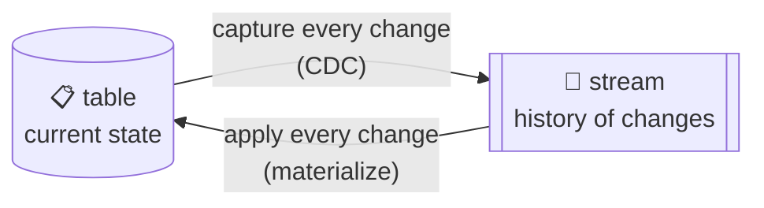
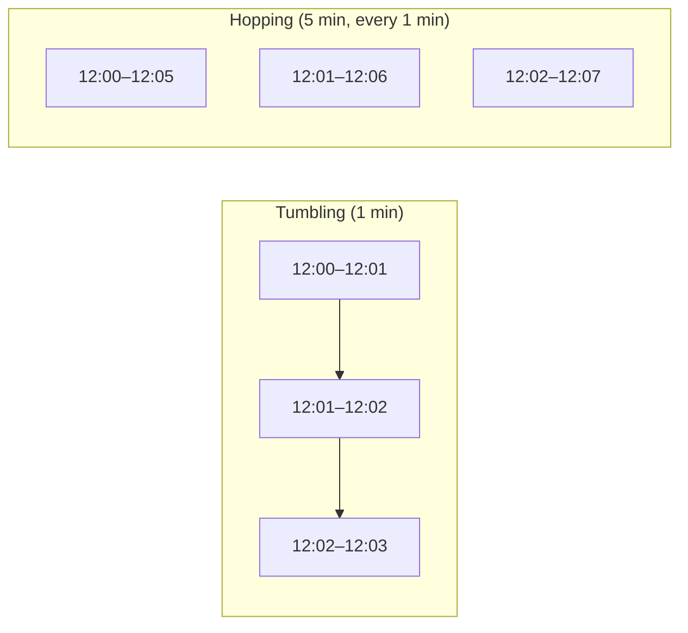
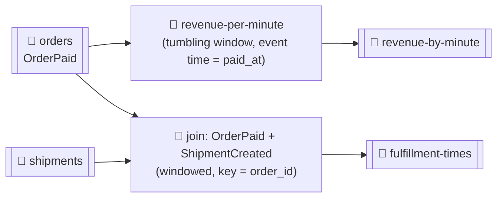

# 🌊 Stream Processing Concepts

[[Brokers/Kafka/Kafka The Definitive Guide/README|📬 Kafka: The Definitive Guide]] · Book Ch.14

> [!toc]- 📑 Contents
>
> - [[#🌊 What a Stream Is|🌊 What a Stream Is]]
> - [[#⚖️ Request-Response, Batch, Stream|⚖️ Request-Response, Batch, Stream]]
> - [[#🕐 Time|🕐 Time]]
> - [[#🧠 State|🧠 State]]
> - [[#🔁 Streams and Tables|🔁 Streams and Tables]]
> - [[#🪟 Time Windows|🪟 Time Windows]]
> - [[#🧩 Design Patterns|🧩 Design Patterns]]
> - [[#🐢 Out-of-Sequence Events|🐢 Out-of-Sequence Events]]
> - [[#⏪ Reprocessing and Interactive Queries|⏪ Reprocessing and Interactive Queries]]
> - [[#🛠️ Frameworks, and Go|🛠️ Frameworks, and Go]]
> - [[#🛒 In the Project|🛒 In the Project]]
> - [[#🔨 Hands-On Practice|🔨 Hands-On Practice]]
> - [[#📋 Quick Reference|📋 Quick Reference]]
> - [[#🧠 Things to Remember|🧠 Things to Remember]]
> - [[#💡 Pro Tips|💡 Pro Tips]]
> - [[#🔗 Related Topics|🔗 Related Topics]]

Consumers that react to one event at a time are only the start. **Stream processing** computes over streams continuously: counts, averages, joins, and windows. This lesson covers its core ideas (time, state, the stream–table duality, windows, and common patterns), with Go examples from the project's events.

---

## 🌊 What a Stream Is

A **data stream** (event stream) represents an **unbounded dataset**: new records keep arriving forever. Almost any business activity fits: payments, trades, deliveries, sensor readings, game moves, orders.

Streams are also:

- 🔢 **Ordered** — paying then shipping differs from shipping then paying (a database table has no such order; its redo log does).

- 🔒 **Immutable** — an event that happened can't be changed; a correction is a new event.

- ⏪ **Replayable** — you can reread months-old events to fix bugs, try new analyses, or audit. Kafka's retention is what makes stream processing practical.

Size doesn't define it: the same techniques work for a few events per minute as for millions per second.

---

## ⚖️ Request-Response, Batch, Stream

| Paradigm | Latency | Style | Example |
|---|---|---|---|
| 📞 **Request-response** | Sub-ms to ms | Blocking: ask and wait | Order → Payment over gRPC; OLTP |
| 🗓️ **Batch** | Minutes to hours | Wakes up on schedule, reads everything, writes, exits | Nightly reports; data warehouse |
| 🌊 **Stream** | Seconds-ish | Continuous, non-blocking | "Revenue this minute", updated as orders arrive |

Most business processes don't need millisecond answers but can't wait until tomorrow either. Stream processing fills that gap.

A stream processing program is a **topology**: a graph of **source** processors (read topics), **stream processors** (filter, map, aggregate, join), and **sink** processors (write results).

---

## 🕐 Time

Most stream operations work on **windows of time**, so "which time?" matters:

| Time | Meaning | Use |
|---|---|---|
| ⏰ **Event time** | When it happened: the sale, the measurement | Usually what you want |
| 📥 **Log append time** | When the broker stored it | A stable stand-in if event time wasn't recorded |
| ⚙️ **Processing time** | When your app happened to read it | Avoid: differs per run, per instance, even per thread |

- 🧾 **Kafka records carry a timestamp**, set by the producer at creation (or by the broker with `message.timestamp.type=LogAppendTime`). When a record is created *later* than the event (say, from a database row), put the real event time **in the payload**. The project's `OrderPaid` has `paid_at` for exactly this.

- 🌍 **Use one time zone** across the pipeline (UTC), or window results become meaningless.

---

## 🧠 State

Handling each event alone is easy. Counting, averaging, and joining need to remember things across events: **state**.

| | 🏠 Local (internal) state | 🌐 External state |
|---|---|---|
| **Where** | Inside each instance (memory, embedded store such as RocksDB) | A database such as Cassandra |
| **Speed** | Very fast | Network latency per lookup |
| **Size** | Limited by the instance | Practically unlimited |
| **Shared** | No, per partition | Yes, across instances and apps |

> ⚠️ A plain in-memory map is **lost on restart**, and results change. Real frameworks also write every state change to a **compacted changelog topic** (lesson 14), so a restarted or rebalanced instance rebuilds its state by reading it back.

---

## 🔁 Streams and Tables

A **table** holds the *current* state; a **stream** holds the *history of changes*. They're two views of the same thing:



The book's shoe store:

| Stream (events) | Table (inventory) |
|---|---|
| Shipment arrived: red, blue, green | red 300 · blue 300 · green 300 |
| Blue shoes sold | blue 299 |
| Red shoes sold | red 299 |
| Blue shoes returned | blue 300 |
| Green shoes sold | green 299 |

The table answers "how many red shoes now?" (299); the stream answers "how busy were we?" (4 customer events) and "why were blue shoes returned?".

In the project: the `orders` + `shipments` streams, applied in order, *are* each order's current status table, which is what Order's database holds.

---

## 🪟 Time Windows

Three questions define a window:

- 📏 **Size** — 5 minutes? A day? Bigger windows are smoother but react later.

- ⏩ **Advance** — how often it moves. **Hopping**: size 5 min, advancing every minute (windows overlap). **Tumbling**: advance = size (no overlap). **Session**: closed by a gap of inactivity rather than a fixed size.

- ⏳ **Grace period** — how long a window still accepts **late** events.



Windows can be **aligned** to the clock (12:00–12:05, 12:01–12:06) or start whenever the app did (03:17–03:22).

**Example:** revenue per user in 1-minute tumbling windows by **event time**, with 30 s grace.

```go
type windowKey struct {
    UserID int64
    Start  time.Time // tumbling window start
}

type RevenueByUser struct {
    size, grace time.Duration
    totals      map[windowKey]float32
    maxSeen     time.Time // highest event time seen ("stream time")
}

func (r *RevenueByUser) Add(userID int64, total float32, eventTime time.Time) bool {
    if eventTime.After(r.maxSeen) {
        r.maxSeen = eventTime
    }
    start := eventTime.Truncate(r.size)
    if r.maxSeen.Sub(start.Add(r.size)) > r.grace {
        return false // too late: its window is closed
    }
    r.totals[windowKey{userID, start}] += total
    return true
}
```

```text
user 23 +25.0 at 12:00:10 accepted=true
user 23 +12.5 at 12:00:50 accepted=true
user 7  +30.0 at 12:01:10 accepted=true
user 23 +5.0  at 12:00:40 accepted=true    ← 10 s after its window ended: within grace
user 23 +9.0  at 12:02:20 accepted=true
user 23 +1.0  at 12:00:20 accepted=false   ← 80 s late: dropped

window 12:00 user 23 total 42.5            ← 25 + 12.5 + 5
window 12:01 user 7  total 30.0
window 12:02 user 23 total 9.0
```

This keeps state in a map, so it's lost on restart; a real implementation stores it in a changelog-backed store.

---

## 🧩 Design Patterns

| Pattern | What it does | State |
|---|---|---|
| 🔀 **Single-event** (map/filter) | Transform or route each event: errors to a high-priority topic, JSON → Protobuf | None; easy to scale and recover |
| 🏠 **Local state** (group-by aggregate) | Per-key aggregates: daily min/max price per stock symbol | Local, per partition; **partition by the aggregation key** so one instance sees all of a key's events |
| 🔁 **Multiphase / repartition** | Global results, e.g. the top 10 stocks: first per-partition top 10, then **repartition** to one partition for the final merge | Local, in two steps |
| 🔗 **Stream-table join** | Enrich clicks with user profiles **from a local copy** of the profile table, kept up to date by CDC events | Local table |
| 📋 **Table-table join** | Join two current states on the same key (or a foreign key) | Two local tables |
| 🔀 **Stream-stream (windowed) join** | Match a search with clicks on its results within a time window | Windowed buffers of both streams |

Why stream-table joins avoid the database: an external lookup adds **5–15 ms per event**, and a database handling about **10K lookups/s** can't keep up with a processor doing **100K–500K events/s**. Caching the table locally, fed by its change stream, removes both problems.

For local state to work across instances, **co-partition** the inputs: same key, same partition count, same partitioner (lesson 8).

---

## 🐢 Out-of-Sequence Events

A phone loses signal and sends hours of events at once; a factory network is down for a day. The application must:

1. 🔎 **Notice** an event is older than the current stream time.

2. ⏳ **Decide how late is acceptable** (reconcile 3 hours late, drop 3 weeks late): the grace period.

3. 🔄 **Update earlier results in place**. There's no "rerun yesterday's batch"; the same continuous process handles old and new events.

4. ✍️ **Make results updatable**: an upsert into a database is easy; an email already sent is not.

---

## ⏪ Reprocessing and Interactive Queries

- ⏪ **Reprocessing** a new version of an app: run it as a **new consumer group** from the start of the input, writing to a **new** output topic, compare, then switch clients over. Safer than resetting the old app, which mixes old and new results.

- 🔎 **Interactive queries:** the app's local state is already a table; let clients query it directly instead of reading the output topic into another database.

---

## 🛠️ Frameworks, and Go

| Option | Notes |
|---|---|
| **Kafka Streams** (Java/Kotlin) | The book's framework: a library, no cluster; state stores + changelogs; exactly-once with `processing.guarantee=exactly_once_v2` |
| **ksqlDB** | SQL on top of Kafka Streams |
| **Apache Flink** | Separate cluster; strong event-time and state handling |
| **Spark Structured Streaming** | Micro-batches; fits Spark shops |
| **goka** (Go) | Go library in the Kafka Streams style: group tables backed by compacted topics, processors, views |
| **franz-go by hand** | Fine for stateless map/filter and simple keyed aggregates, especially with `GroupTransactSession` for exactly-once (lesson 16) |

How to choose, per the book: fit to the use case (ingest, low-latency actions, analytics, ML), its time and state support, operations (library vs cluster), APIs that are easy to test, and community.

### 🧪 Interview Q&A

**Q1:** Why is processing time a poor basis for windows?

**Q2:** What is the stream–table duality?

**Q3:** Why partition by the aggregation key when keeping local state?

**Q4:** An event for 12:00:20 arrives when stream time is 12:02:20, with 1-minute windows and 30 s grace. What happens?

> [!answer]- 📋 Answers
>
> **A1:** It's when the app read the event, which varies between runs, instances, and threads, so results aren't reproducible; event time describes what actually happened.
>
> **A2:** A table is the current state; a stream is the history of changes. Capturing changes turns a table into a stream (CDC); applying a stream's changes materializes a table.
>
> **A3:** So all events for a key land on one partition, and therefore one instance, whose local state then holds the complete aggregate for that key.
>
> **A4:** Its window (12:00–12:01) ended 80 s before stream time, beyond the 30 s grace, so it's dropped (or sent to a late-events topic).

---

## 🛒 In the Project

The services are **consumers with side effects**, not stream processors: each event triggers a database change. Stream processing would add **new outputs** from the same events, without touching Order or Shipping:



- 🧮 **Revenue per minute** — tumbling window over `OrderPaid`, by `paid_at`.

- ⏱️ **Time to ship** — a windowed stream-stream join of `OrderPaid` and `ShipmentCreated` on `order_id`. It works because both topics are **co-partitioned**: same key, 3 partitions each.

- 🎯 **Exactly-once matters here:** a double-counted order makes revenue wrong forever, so such a processor would use transactions (lesson 16).

---

## 🔨 Hands-On Practice

1. **Window by event time.** In a scratch Go module, implement `RevenueByUser` above and feed it the six events shown.

    ✅ The totals are 42.5 for user 23 at 12:00, 30.0 for user 7 at 12:01, 9.0 for user 23 at 12:02, and the event at 12:00:20 is rejected.

2. **Materialize a table from a stream.** Write a standalone franz-go consumer (no group, like `tools/eventtail`) that reads `orders` and `shipments` from the start and builds `map[orderID]status` (`Paid` on `OrderPaid`, `Shipped` on `ShipmentCreated`).

    ✅ After reading both topics, the map matches what `make get-order` reports for each order: you've rebuilt Order's status table from its event streams.

---

### 📋 Quick Reference

| Concept | One line |
|---|---|
| Stream | Unbounded, ordered, immutable, replayable |
| Event / append / processing time | Happened / stored / read |
| Local vs external state | Fast and partitioned / shared and slow |
| Stream ↔ table | History of changes ↔ current state |
| Tumbling / hopping / session | Non-overlapping / overlapping / gap-closed windows |
| Grace period | How long a window accepts late events |
| Co-partitioning | Same key, partitions, partitioner → joinable per partition |

### 🧠 Things to Remember

- Prefer event time; store it in the payload when records are created later.

- State must survive restarts: changelog topics or external stores.

- Streams and tables convert into each other.

- Windows need a size, an advance, and a grace period.

- Local-state patterns depend on partitioning by key.

### 💡 Pro Tips

- **Start stateless** → map/filter needs only a consumer and a producer; add a framework when you need state.

- **Put event time in every event** → it's impossible to add after the fact for historical data.

- **Reprocess into a new output topic** → compare before switching, instead of overwriting results in place.

### 🔗 Related Topics

- ⬅️ Previous: [[19. Monitoring Kafka]]

- 🗺️ Back to the series map: [[Brokers/Kafka/Kafka The Definitive Guide/README|Kafka lessons]]

- 🎯 Exactly-once for processors: [[16. Exactly-Once Semantics]]

- 🗜️ Changelog topics: [[14. Storage, Retention, and Compaction]]

- 💻 Codebase: [[Go/gRPC Microservices in Go - Refactored/microservices/README|Order + Payment + Shipping]]
