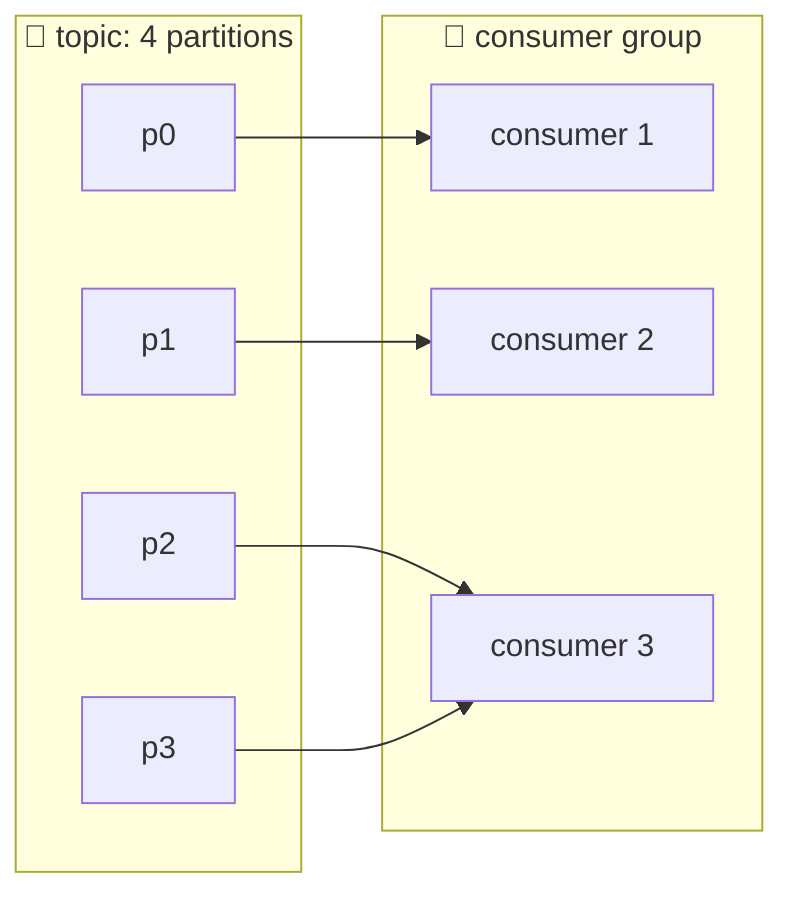
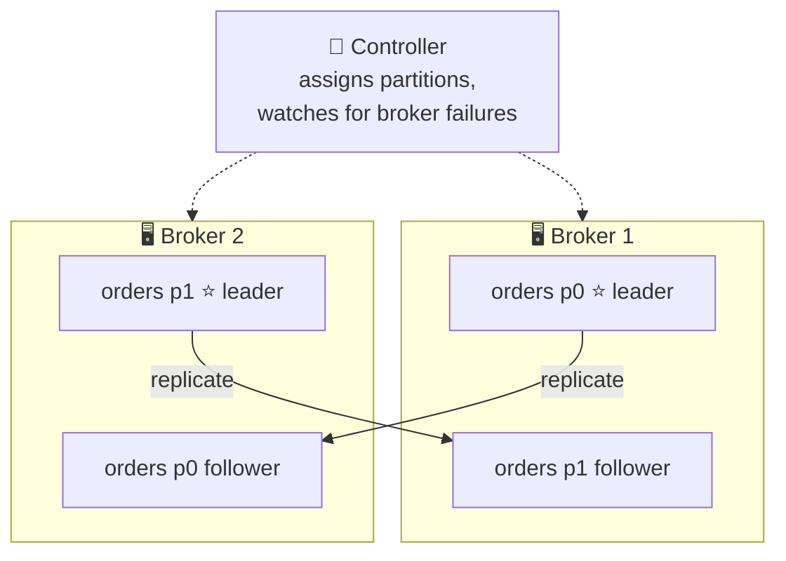

# 🏢 Producers, Consumers, Brokers, and Clusters

[[Brokers/Kafka/Kafka The Definitive Guide/README|📬 Kafka: The Definitive Guide]] · Book Ch.1

> [!toc]- 📑 Contents
>
> - [[#📤 Producers|📤 Producers]]
> - [[#📥 Consumers and Consumer Groups|📥 Consumers and Consumer Groups]]
> - [[#🖥️ Brokers and Clusters|🖥️ Brokers and Clusters]]
> - [[#🗓️ Retention|🗓️ Retention]]
> - [[#🌍 Multiple Clusters|🌍 Multiple Clusters]]
> - [[#✅ Why Kafka|✅ Why Kafka]]
> - [[#🛒 In the Project|🛒 In the Project]]
> - [[#🔨 Hands-On Practice|🔨 Hands-On Practice]]
> - [[#📋 Quick Reference|📋 Quick Reference]]
> - [[#🧠 Things to Remember|🧠 Things to Remember]]
> - [[#💡 Pro Tips|💡 Pro Tips]]
> - [[#🔗 Related Topics|🔗 Related Topics]]

Who writes, who reads, and where does the data live? This lesson covers Kafka's roles (producers, consumers, brokers) and what makes Kafka different from a plain message queue.

---

## 📤 Producers

A **producer** writes messages to a topic. Other systems call it a publisher or writer.

- ⚖️ **No key** → the producer spreads messages over all partitions.

- 🔑 **With a key** → a **partitioner** hashes the key to pick the partition, so all messages with that key land together.

- 🧩 **Custom partitioner** → your own rule, such as a dedicated partition for one huge customer (lesson 8).

---

## 📥 Consumers and Consumer Groups

A **consumer** reads messages from one or more topics, in order within each partition, and tracks its position by **offset**.

Consumers work in a **consumer group**: one or more instances that share the work of reading a topic. **Each partition is read by exactly one member** of the group; that member **owns** the partition.



- 📈 **Scale out** by adding members, up to one per partition.

- 🛟 **Failover:** if a member dies, its partitions are reassigned to the others.

- 👥👥 **Many groups, same data:** every group gets every message. Shipping and an analytics service can both read `orders` without affecting each other.

Kafka also has two higher-level client APIs built on producers and consumers: **Kafka Connect** for moving data in and out of other systems (lesson 18), and **Kafka Streams** for stream processing (lesson 20).

---

## 🖥️ Brokers and Clusters

A **broker** is one Kafka server. It receives messages from producers, assigns offsets, writes them to disk, and serves consumers' fetch requests. A single broker can handle thousands of partitions and millions of messages per second.

Brokers run together as a **cluster**:



- 🧠 **Controller** — elected automatically; handles administrative work such as assigning partitions to brokers and reacting to broker failures.

- ⭐ **Leader** — the one broker that owns a partition. **Producers always write to the leader.**

- 📋 **Followers** — other brokers holding **replicas** of the partition. If the leader fails, a follower takes over. Consumers usually read from the leader, but can be configured to read from a nearby follower.

> 🆕 **Current Kafka:** the book describes the controller with ZooKeeper storing cluster metadata. Since Kafka 4.0 there is no ZooKeeper; controllers form a Raft quorum (**KRaft**) and keep the metadata themselves (lesson 13).

---

## 🗓️ Retention

Kafka **keeps messages** after they're read, for a configured period. That's the biggest difference from a classic queue.

- ⏳ **By time** — for example, 7 days (`retention.ms`).

- 💾 **By size** — for example, 1 GB per partition (`retention.bytes`).

- 🗜️ **Compacted** — keep only the **latest message per key**, for changelog data where only the current value matters (lesson 14).

Retention is set per topic: tracking data may be kept for days, application metrics for hours. Because data stays, a consumer can fall behind, go offline for maintenance, or start fresh and **replay** history.

---

## 🌍 Multiple Clusters

Larger setups run several clusters:

- 🗂️ **Separating kinds of data**

- 🔐 **Isolating for security requirements**

- 🏢 **Several datacenters**, for disaster recovery

Replication inside Kafka works **within one cluster**. Copying between clusters uses **MirrorMaker**, which is essentially a consumer on one cluster linked to a producer on another. (Cross-cluster mirroring is the book's Chapter 10 and is beyond this series.)

---

## ✅ Why Kafka

| Feature | What it gives you |
|---|---|
| **Multiple producers** | Many services write one topic in a common format, e.g., page views from every frontend |
| **Multiple consumers** | Many groups read the same stream without interfering; a classic queue removes a message once read |
| **Disk-based retention** | Consumers can lag, restart, or replay without losing data |
| **Scalable** | Start with one broker, grow to hundreds while online; replication survives broker failures |
| **High performance** | Sub-second latency from produce to consume, at very large volumes |
| **Platform features** | Connect for data integration, Streams for processing |

**Common uses:** user activity tracking (Kafka's original use at LinkedIn), messaging and notifications, metrics and logs, database change logs, and stream processing.

> 💡 **Origin:** LinkedIn built Kafka for its data-pipeline problem: monitoring and user-activity data flowing between many systems. It was open-sourced and became an Apache project; it's named after the writer Franz Kafka, because it's "a system optimized for writing".

### 🧪 Interview Q&A

**Q1:** A group has 3 consumers and the topic has 4 partitions. How is the work split?

**Q2:** Why must producers write to the partition leader?

**Q3:** What's the main difference between Kafka and a classic message queue?

**Q4:** Shipping and Analytics both need every `OrderPaid`. One group or two?

> [!answer]- 📋 Answers
>
> **A1:** Each partition goes to one consumer: two consumers get one partition each and the third gets two.
>
> **A2:** The leader is the single owner that orders writes and assigns offsets; followers copy from it.
>
> **A3:** Kafka keeps messages for a retention period regardless of reads, so many consumer groups can read the same data and replay it. A classic queue removes a message once it's consumed.
>
> **A4:** Two groups. Inside one group each message goes to only one member; separate groups each receive every message.

---

## 🛒 In the Project

- 📤 **Producers:** Order (publishes `OrderPaid`) and Shipping (publishes `ShipmentCreated`), each through its outbox relay.

- 📥 **Consumer groups:** `shipping` reads `orders`; `order` reads `shipments`. Each service uses its own name as its group ID:

    ```go
    // shipping/cmd/main.go
    consumer, err := events.NewConsumer(events.ConsumerConfig{
        Brokers:  brokers,
        Group:    service, // "shipping"
        Topic:    events.TopicOrders,
        DLQTopic: "shipping.dlq",
    }, events.OrderPaidHandler(application), producer, tracer)
    ```

- 🖥️ **One broker:** Compose runs a single KRaft node that is broker *and* controller. `make topics` shows it as leader of everything:

    ```text
    Topic: orders	Partition: 0	Leader: 1	Replicas: 1	Isr: 1
    Topic: orders	Partition: 1	Leader: 1	Replicas: 1	Isr: 1
    Topic: orders	Partition: 2	Leader: 1	Replicas: 1	Isr: 1
    ```

    `Replicas: 1` means no copies: fine for a laptop, never for production (lesson 15).

- 🗓️ **Retention:** 7 days for `orders` and `shipments`, 14 days for dead-letter topics, so there's time to inspect and replay failures.

---

## 🔨 Hands-On Practice

1. **See the groups.** With `make up` running and a few orders placed:

    ```bash
    make lag
    ```

    ✅ Two groups appear: `shipping` on topic `orders`, and `order` on topic `shipments`, each with a `CONSUMER-ID` per assigned partition and `LAG` 0.

2. **Add a second reader.** Read `orders` with `make events` (it uses no group) while Shipping is running.

    ✅ You see every event, and Shipping's committed offsets in `make lag` don't change. Reading doesn't remove data or disturb other readers.

---

### 📋 Quick Reference

| Role | Job |
|---|---|
| **Producer** | Writes to a topic; key → partition |
| **Consumer** | Reads partitions in order; tracks offsets |
| **Consumer group** | Shares partitions: one owner per partition |
| **Broker** | Stores partitions, serves reads and writes |
| **Controller** | Assigns partitions, handles broker failures |
| **Leader / follower** | Owner of a partition / its replicas |

### 🧠 Things to Remember

- Each partition is owned by one consumer per group; every group gets all messages.

- More consumers than partitions means idle consumers.

- Producers write to the partition leader; followers replicate it.

- Retention keeps data after it's read, so consumers can replay.

- Since Kafka 4.0, KRaft replaces ZooKeeper.

### 💡 Pro Tips

- **Use the service name as the group ID** → it's stable across deployments, so offsets survive restarts and new versions.

- **Plan partitions for your peak consumer count** → consumers can't exceed partitions usefully.

- **Set retention from the slowest recovery you must survive** → if a consumer may be down over a long weekend, 1 day of retention loses data.

### 🔗 Related Topics

- ⬅️ Previous: [[2. Messages, Topics, and Partitions]]

- ➡️ Next: [[4. Running Kafka with KRaft]]

- 👥 Groups in depth: [[9. Consumers and Consumer Groups]]

- 🔬 Controller and replication: [[13. Inside a Kafka Cluster]]

- 💻 Codebase: [[Go/gRPC Microservices in Go - Refactored/microservices/README|Order + Payment + Shipping]]
