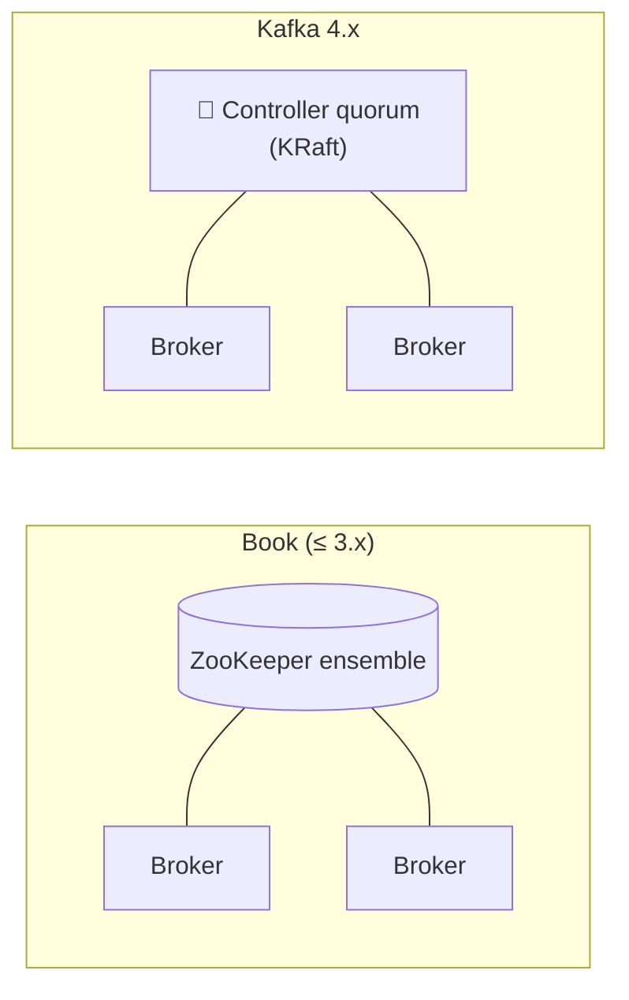
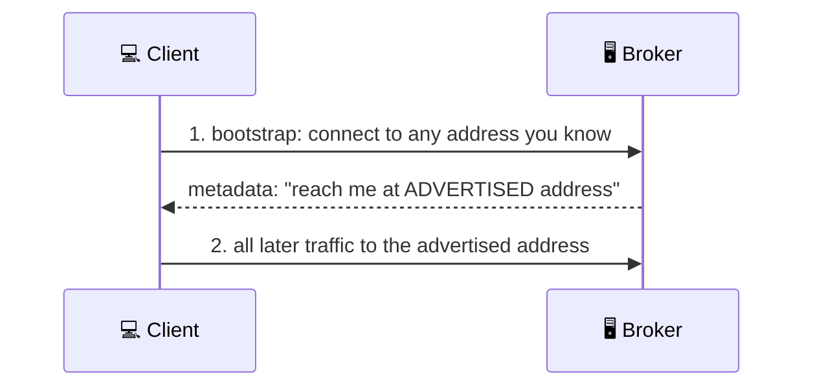

# 🐳 Running Kafka with KRaft

[[Brokers/Kafka/Kafka The Definitive Guide/README|📬 Kafka: The Definitive Guide]] · Book Ch.2

> [!toc]- 📑 Contents
>
> - [[#🧠 KRaft in One Picture|🧠 KRaft in One Picture]]
> - [[#🐳 A Single-Node Broker in Docker|🐳 A Single-Node Broker in Docker]]
> - [[#⚙️ General Broker Settings|⚙️ General Broker Settings]]
> - [[#🗂️ Topic Defaults|🗂️ Topic Defaults]]
> - [[#🔢 How Many Partitions|🔢 How Many Partitions]]
> - [[#🖥️ How Many Brokers|🖥️ How Many Brokers]]
> - [[#🛒 In the Project|🛒 In the Project]]
> - [[#🔨 Hands-On Practice|🔨 Hands-On Practice]]
> - [[#📋 Quick Reference|📋 Quick Reference]]
> - [[#🧠 Things to Remember|🧠 Things to Remember]]
> - [[#💡 Pro Tips|💡 Pro Tips]]
> - [[#🔗 Related Topics|🔗 Related Topics]]

How do you start a Kafka broker, and which settings matter on day one? This lesson runs Kafka 4.x in KRaft mode with Docker and walks through the broker and topic settings the book highlights, plus how to size partitions and brokers.

---

## 🧠 KRaft in One Picture

The book installs Java, then **ZooKeeper**, then Kafka, because older Kafka kept its cluster metadata in ZooKeeper. Kafka 4.0 removed ZooKeeper: a few nodes act as **controllers** and keep the metadata in a Raft-replicated log (**KRaft**).



- 🧩 **`process.roles`** — what a node does: `broker`, `controller`, or both. Small and local setups run both in one process.

- 🆔 **`node.id`** — the node's unique ID; it replaces the book's `broker.id`.

- 🗳️ **`controller.quorum.voters`** — the controllers that vote, as `id@host:port`.

> 🆕 **Current Kafka:** `zookeeper.connect` and the ZooKeeper installation steps no longer apply. Every CLI tool takes `--bootstrap-server host:port`, never `--zookeeper`.

---

## 🐳 A Single-Node Broker in Docker

This is the broker from the project's `docker-compose.yml`:

```yaml
kafka:
  image: apache/kafka:4.4.0
  ports:
    - "9092:9092" # clients on your machine: localhost:9092
  environment:
    KAFKA_NODE_ID: 1
    KAFKA_PROCESS_ROLES: broker,controller # KRaft: no ZooKeeper
    KAFKA_CONTROLLER_QUORUM_VOTERS: 1@kafka:9093
    KAFKA_LISTENERS: HOST://:9092,DOCKER://:19092,CONTROLLER://:9093
    KAFKA_ADVERTISED_LISTENERS: HOST://localhost:9092,DOCKER://kafka:19092
    KAFKA_LISTENER_SECURITY_PROTOCOL_MAP: HOST:PLAINTEXT,DOCKER:PLAINTEXT,CONTROLLER:PLAINTEXT
    KAFKA_INTER_BROKER_LISTENER_NAME: DOCKER
    KAFKA_CONTROLLER_LISTENER_NAMES: CONTROLLER
    KAFKA_OFFSETS_TOPIC_REPLICATION_FACTOR: 1 # single broker
    KAFKA_AUTO_CREATE_TOPICS_ENABLE: "false"
```

Each `KAFKA_*` variable becomes a broker property: `KAFKA_NODE_ID` → `node.id`, `KAFKA_AUTO_CREATE_TOPICS_ENABLE` → `auto.create.topics.enable`.

### 🔌 Listeners

A **listener** is `NAME://host:port` that the broker binds to. Clients connect in two steps, which is why there are two lists:



- 🔌 **`listeners`** — where the broker **binds**.

- 📣 **`advertised.listeners`** — the address the broker **tells clients** to use. It must be reachable *from the client*.

- 🗺️ **`listener.security.protocol.map`** — maps custom names (`HOST`, `DOCKER`) to protocols (`PLAINTEXT`, `SSL`, …).

That's why the project has two client listeners: apps on your laptop must reach `localhost:9092`, and containers must reach `kafka:19092`. One advertised address can't serve both.

---

## ⚙️ General Broker Settings

| Setting | Kafka 4.4 default | What it does |
|---|---|---|
| `node.id` | — (required) | Unique per node; pick something tied to the host |
| `listeners` | — | Bind addresses (above); ports below 1024 need root, so avoid them |
| `log.dirs` | — | Comma-separated data directories; new partitions go to the dir with the **fewest partitions**, not the most free space |
| `num.recovery.threads.per.data.dir` | `2` | Threads that open, check, and close segments at startup and shutdown; raise it to cut restart time after a crash (it's *per directory*: 8 × 3 dirs = 24 threads) |
| `auto.create.topics.enable` | `true` | Creates a topic when a producer writes to it, a consumer reads it, or anyone asks for its metadata |
| `auto.leader.rebalance.enable` | `true` | Moves leadership back to each partition's preferred broker so one broker doesn't lead everything |
| `delete.topic.enable` | `true` | Allows deleting topics; set `false` to lock a cluster down |

> ⚠️ **Turn off auto-creation in real systems.** A typo in a topic name silently creates a new, empty topic with default settings. The project sets it to `false` and creates topics explicitly.

---

## 🗂️ Topic Defaults

Brokers hold **defaults for new topics**. Override them per topic with the admin tools (lesson 12).

| Setting | Default | Notes |
|---|---|---|
| `num.partitions` | `1` | Partitions for auto-created topics. Partitions can be **increased, never decreased** |
| `default.replication.factor` | `1` | Copies of each partition for auto-created topics; production uses 3 |
| `log.retention.ms` / `.hours` | 168 h (7 days) | Keep data this long; prefer `log.retention.ms` (the smallest unit wins if several are set) |
| `log.retention.bytes` | `-1` (no limit) | Size limit **per partition** |
| `log.segment.bytes` | 1 GiB | Size at which the current segment file is closed |
| `log.roll.ms` / `.hours` | 168 h | Age at which a segment is closed, even if not full |
| `min.insync.replicas` | `1` | Replicas that must have a write before `acks=all` succeeds (lesson 15) |
| `message.max.bytes` | 1048588 (~1 MiB) | Largest record batch the broker accepts, measured **after compression** |

**Retention works on whole segments.** Only a **closed** segment can be deleted, and only when its **newest** message is past retention.

> 🧮 **Example:** a topic gets 100 MB/day with 1 GiB segments and 7-day retention. A segment takes about 10 days to fill, then must wait 7 more days → up to **17 days** of data on disk. Here the 7-day roll time closes segments sooner, so it's at most about 7 + 7 = **14 days**.

**Time and size limits combine with "whichever comes first".** With 1 day and 1 GB set, a busy day deletes data younger than a day, and a quiet day deletes data under 1 GB. Use one or the other unless you need both.

**Size limits multiply.** `log.retention.bytes` = 1 GB on an 8-partition topic keeps up to **8 GB**, and adding partitions raises it further.

**Message size has to match end to end.** If the broker accepts larger messages than consumers (`max.partition.fetch.bytes`, `fetch.max.bytes`) or replicas (`replica.fetch.max.bytes`) can fetch, they get stuck on the big message.

---

## 🔢 How Many Partitions

Partitions are Kafka's unit of parallelism: **a partition is read by one consumer per group**. So:

> **partitions ≥ target throughput ÷ throughput of one consumer**

> 🧮 **Example:** you need 1 GB/s, and one consumer can write 50 MB/s to its database. 1000 ÷ 50 = **at least 20 partitions**, read by 20 consumers.

Also consider:

- 🔑 **Keyed topics are hard to grow later.** Adding partitions remaps keys (lesson 8), so size for *future* load.

- 💾 **Each partition costs** memory, file handles, and time during leader elections and metadata updates. Don't overshoot.

- ☁️ **Cloud disk IOPS limits** can be hit by many busy partitions.

- 📏 **Rule of thumb without measurements:** keep each partition under about **6 GB per day of retention**, start small, and grow.

---

## 🖥️ How Many Brokers

| Limit | Example |
|---|---|
| 💾 **Disk** | Keep 10 TB, each broker holds 2 TB → 5 brokers; with replication factor 2 → **10 brokers** |
| 📋 **Replicas per broker** | Stay under about **14,000 partition replicas per broker** and **1 million per cluster** |
| 🌐 **Network** | A broker at 80% NIC use with *two* consumer groups can't serve both at peak; replication is another reader |
| 🧮 **CPU** | Rarely the bottleneck; grows with client connections and requests |

All brokers in one cluster need a **unique `node.id`** and the **same controller quorum**. Production clusters start at 3 brokers so a partition can have 3 replicas.

### 🧪 Interview Q&A

**Q1:** Why does the project's broker need two advertised listeners?

**Q2:** A topic's `log.retention.bytes` is 2 GB and it has 6 partitions. How much data can it keep?

**Q3:** Why can a 7-day retention keep more than 7 days of data?

**Q4:** Why is `auto.create.topics.enable=true` risky?

> [!answer]- 📋 Answers
>
> **A1:** Clients reconnect to the advertised address. Laptop apps can reach `localhost:9092` but not `kafka:19092`; containers are the opposite.
>
> **A2:** 12 GB: the limit is per partition (6 × 2 GB).
>
> **A3:** Retention deletes whole closed segments only once their newest message is too old, so data waits for its segment to fill (or roll) and then for the newest message to expire.
>
> **A4:** Any typo or metadata request creates a topic with default partitions and replication, and nothing reports the mistake.

---

## 🛒 In the Project

Topics are never auto-created; `deploy/kafka/create-topics.sh` makes them when the stack starts (the `kafka-init` service):

```bash
# deploy/kafka/create-topics.sh
for topic in orders shipments; do
  $TOPICS --bootstrap-server "$BOOTSTRAP" --create --if-not-exists \
    --topic "$topic" --partitions 3 --replication-factor 1 \
    --config retention.ms=604800000 # 7 days
done
```

- 🔁 **`--if-not-exists`** makes the script safe to run on every start.

- ⚙️ **`--config retention.ms=…`** is a per-topic override of `log.retention.ms`.

The live broker settings, from `kafka-configs.sh --describe --entity-type brokers --entity-name 1 --all`:

```text
auto.create.topics.enable=false
log.retention.hours=168
log.segment.bytes=1073741824
message.max.bytes=1048588
min.insync.replicas=1
num.partitions=1
```

In Kubernetes, `deploy/k8s/kafka.yaml` runs the same single KRaft node as a StatefulSet and creates the topics with a Job.

---

## 🔨 Hands-On Practice

1. **Read broker defaults.**

    ```bash
    docker compose exec kafka /opt/kafka/bin/kafka-configs.sh --bootstrap-server localhost:9092 \
      --describe --entity-type brokers --entity-name 1 --all | grep -E "retention|segment.bytes|max.bytes"
    ```

    ✅ You see `log.retention.hours=168`, `log.segment.bytes=1073741824`, and `message.max.bytes=1048588`.

2. **Try a typo with auto-creation off.** Send one record to a topic that doesn't exist:

    ```bash
    echo hello | docker compose exec -T kafka /opt/kafka/bin/kafka-console-producer.sh \
      --bootstrap-server localhost:9092 --topic odrers
    ```

    ✅ The producer logs `{odrers=UNKNOWN_TOPIC_OR_PARTITION}` warnings, then after 60 s fails with `Topic odrers not present in metadata after 60000 ms`. No `odrers` topic is created.

---

### 📋 Quick Reference

```text
process.roles=broker,controller      node.id=1
controller.quorum.voters=1@kafka:9093
listeners=HOST://:9092,DOCKER://:19092,CONTROLLER://:9093
advertised.listeners=HOST://localhost:9092,DOCKER://kafka:19092
auto.create.topics.enable=false
log.retention.ms=604800000            log.segment.bytes=1073741824
```

| Sizing rule | Formula |
|---|---|
| Partitions | target throughput ÷ one consumer's throughput |
| Brokers (disk) | retained data × replication factor ÷ disk per broker |

### 🧠 Things to Remember

- Kafka 4.x runs in KRaft mode; ZooKeeper is gone.

- `advertised.listeners` must be reachable from each client.

- Retention deletes closed segments, so actual retention is longer than configured.

- Size-based retention is per partition.

- Partitions can only be added, and that remaps keys.

- Turn off topic auto-creation; create topics explicitly.

### 💡 Pro Tips

- **Pick one retention method per topic** (time *or* size) → combining them deletes data earlier than either alone suggests.

- **Create topics in code or scripts, versioned with the app** → partitions and retention get reviewed like any other change.

- **Raise `num.recovery.threads.per.data.dir` on big brokers** → it can turn hours of recovery after a crash into minutes.

- **Size message limits together** → broker, topic, producer, consumer, and replica fetch limits must agree.

### 🔗 Related Topics

- ⬅️ Previous: [[3. Producers, Consumers, Brokers, and Clusters]]

- ➡️ Next: [[5. Sending Messages]]

- ⚙️ Changing configs at runtime: [[12. Managing Kafka with Code and CLI]]

- 🔬 What KRaft controllers do: [[13. Inside a Kafka Cluster]]

- 🐳 Docker Compose basics: [[DevOps/NaNa/Docker/5. Docker Compose]]
