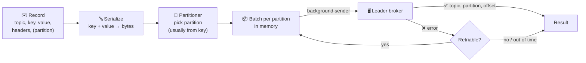

# 📤 Sending Messages

[[Brokers/Kafka/Kafka The Definitive Guide/README|📬 Kafka: The Definitive Guide]] · Book Ch.3

> [!toc]- 📑 Contents
>
> - [[#🎯 What Does the Producer Need to Guarantee?|🎯 What Does the Producer Need to Guarantee?]]
> - [[#⚙️ Inside the Producer|⚙️ Inside the Producer]]
> - [[#🔧 Creating a Producer|🔧 Creating a Producer]]
> - [[#📨 Three Ways to Send|📨 Three Ways to Send]]
> - [[#🚨 Errors: Retriable or Not|🚨 Errors: Retriable or Not]]
> - [[#🛒 In the Project|🛒 In the Project]]
> - [[#🔨 Hands-On Practice|🔨 Hands-On Practice]]
> - [[#📋 Quick Reference|📋 Quick Reference]]
> - [[#🧠 Things to Remember|🧠 Things to Remember]]
> - [[#💡 Pro Tips|💡 Pro Tips]]
> - [[#🔗 Related Topics|🔗 Related Topics]]

How does a message get from your Go code into Kafka, and how do you know it arrived? This lesson explains the producer's internals, the three ways to send, and which errors are worth retrying. The book uses Java's `KafkaProducer`; here everything uses Go's **franz-go**.

---

## 🎯 What Does the Producer Need to Guarantee?

Requirements decide configuration, so ask first:

| Question | Payments | Website clicks |
|---|---|---|
| Can we lose a message? | ❌ Never | ✅ A few is fine |
| Can we duplicate one? | ❌ Never | ✅ A few is fine |
| Latency budget | Low, up to ~500 ms | Seconds, as long as the page isn't slowed |
| Throughput | Up to a million per second | Depends on traffic |

The same API serves both; the settings in lesson 6 make the difference.

---

## ⚙️ Inside the Producer



1. ✉️ **You create a record** with a topic and value, optionally a key, partition, timestamp, and headers.

2. 🔤 **Serialization** turns key and value into bytes. In Go there's no serializer *class*: you pass `[]byte`, so marshalling (`proto.Marshal`, `json.Marshal`) is your step (lesson 7).

3. 🔑 **The partitioner** picks a partition if you didn't set one, usually by hashing the key (lesson 8).

4. 📦 **The record joins a batch** for that topic and partition.

5. 📮 **A background sender** ships batches to each partition's **leader** broker.

6. ✅ **The broker replies** with the partition and offset, or an error. Retriable errors are retried automatically before you see them.

---

## 🔧 Creating a Producer

Java's producer has three required settings. Here's how they map to franz-go:

| Java property | franz-go | Notes |
|---|---|---|
| `bootstrap.servers` | `kgo.SeedBrokers("kafka:19092", …)` | Only for the first connection; the client learns the rest of the cluster from metadata. List at least two brokers in production |
| `key.serializer` | — | You pass `[]byte` keys |
| `value.serializer` | — | You pass `[]byte` values |

```go
client, err := kgo.NewClient(
    kgo.SeedBrokers("localhost:9092"),
    kgo.DefaultProduceTopic("orders"), // used when a record has no Topic
)
if err != nil {
    return err
}
defer client.Close() // flushes nothing; call Flush first if you used Produce
```

- 🧵 **One client per service, shared by all goroutines.** It's safe for concurrent use, keeps connections open, and batches across callers.

- 🗂️ **`kgo.Client` does everything:** produce, consume, and admin requests. The project still uses separate clients for producing and consuming, to keep each simple.

---

## 📨 Three Ways to Send

### 🔥 Fire-and-Forget

```go
client.Produce(ctx, record, nil) // no callback: you never learn the result
```

Fast, but if the send finally fails (a non-retriable error or a timeout), the message is **lost silently**. Use it only where loss is acceptable.

### ⏳ Synchronous

```go
record := &kgo.Record{Key: []byte("1"), Value: []byte("paid")}
if err := client.ProduceSync(ctx, record).FirstErr(); err != nil {
    return err
}
fmt.Printf("partition=%d offset=%d\n", record.Partition, record.Offset)
```

```text
sync: topic=lesson5 partition=0 offset=0
```

- ✅ You know the result, and the record now holds its partition and offset.

- 🐢 Each call waits a full round trip. With a 10 ms round trip, 100 sequential sends take about **1 second**.

### ⚡ Asynchronous with a Callback

```go
var wg sync.WaitGroup
for _, record := range records {
    wg.Add(1)
    client.Produce(ctx, record, func(r *kgo.Record, err error) {
        defer wg.Done()
        if err != nil {
            slog.Error("send failed", "key", string(r.Key), "error", err)
        }
    })
}
wg.Wait() // or client.Flush(ctx)
```

- 🚀 Sends don't wait for each other, so they're batched together.

- 🧾 The callback still reports every failure.

- ⚠️ **Keep callbacks fast.** They run on the client's goroutines; blocking work there delays other sends. Hand slow work to your own goroutine.

**Measured on a local broker**, 200 records one at a time:

```text
200 sync sends: 101ms
200 async sends: 12ms errors: 0
```

Even locally, async is about 8× faster; over a real network, the gap grows with every millisecond of latency.

---

## 🚨 Errors: Retriable or Not

| Kind | Examples | What happens |
|---|---|---|
| **Retriable** | Connection lost, `NOT_LEADER_OR_FOLLOWER` while a new leader is elected | The client retries automatically; you see the error only when time runs out (lesson 6) |
| **Not retriable** | `MESSAGE_TOO_LARGE`, authorization failure, invalid record | Returned at once; retrying can't help |

```go
err := client.ProduceSync(ctx, &kgo.Record{Value: make([]byte, 2<<20)}).FirstErr()
errors.Is(err, kerr.MessageTooLarge) // true
kerr.IsRetriable(err)                // false
```

```text
MESSAGE_TOO_LARGE: The request included a message larger than the max message size the server will accept (uncompressed_bytes=2097152)
```

Errors can also happen **before** sending: the record can't be serialized, or the client's buffer is full and the context ends while waiting for space.

### 🧪 Interview Q&A

**Q1:** Why is `ProduceSync` usually a poor choice for high-volume producers?

**Q2:** What does fire-and-forget lose that async-with-callback keeps?

**Q3:** Name one retriable and one non-retriable producer error.

**Q4:** Why should a callback not write to a slow database?

> [!answer]- 📋 Answers
>
> **A1:** Each call waits a full round trip before the next send, so records can't be batched and throughput collapses.
>
> **A2:** Knowledge of failures. Both are fast, but only the callback tells you a record was finally lost.
>
> **A3:** Retriable: `NOT_LEADER_OR_FOLLOWER` during a leader change. Not retriable: `MESSAGE_TOO_LARGE`.
>
> **A4:** Callbacks run on the client's goroutines, so blocking there delays other sends and their callbacks.

---

## 🛒 In the Project

The outbox relay publishes a batch of outbox rows **synchronously**, because it must know they were stored before marking the rows as published:

```go
// order/internal/adapters/events/relay.go
func (r *Relay) publish(ctx context.Context, events []db.OutboxEvent) error {
    records := make([]*kgo.Record, 0, len(events))
    for _, e := range events {
        records = append(records, &kgo.Record{
            Context: parentContext(ctx, e.Headers),
            Topic:   e.Topic,
            Key:     []byte(e.Key),
            Value:   e.Payload,
            Headers: []kgo.RecordHeader{{Key: "event-type", Value: []byte(e.EventType)}},
        })
    }
    return r.producer.ProduceSync(ctx, records...).FirstErr()
}
```

- 📦 **Synchronous, but not one at a time.** `ProduceSync(ctx, records...)` sends up to 100 records together and waits once, so it batches well *and* knows the outcome.

- 🔁 **Failure = retry later.** An error rolls back the outbox transaction; the rows stay unpublished and the relay tries again in 500 ms.

- 🏗️ **Created once at startup** in `order/cmd/main.go` with `events.NewProducer(brokers, tracer)` and closed on shutdown.

---

## 🔨 Hands-On Practice

1. **Publish by hand and read it back.** With `make up` running:

    ```bash
    printf '42:hello\n' | docker compose exec -T kafka /opt/kafka/bin/kafka-console-producer.sh \
      --bootstrap-server localhost:9092 --topic shipping.dlq \
      --reader-property parse.key=true --reader-property key.separator=:
    make dlq
    ```

    ✅ `make dlq` prints the record with `key=42` (shown as an unknown type, since it has no `event-type` header).

2. **Measure sync vs async.** In a scratch Go module, send 200 records with `ProduceSync` in a loop, then 200 with `Produce` + callbacks, timing both.

    ✅ The async run is several times faster; neither reports errors.

---

### 📋 Quick Reference

| Style | franz-go | Knows outcome? | Throughput |
|---|---|---|---|
| Fire-and-forget | `client.Produce(ctx, r, nil)` | ❌ | ⚡ |
| Sync | `client.ProduceSync(ctx, rs...).FirstErr()` | ✅ | 🐢 one at a time, ✅ in batches |
| Async + callback | `client.Produce(ctx, r, func(*kgo.Record, error){…})` | ✅ | ⚡ |
| Wait for async sends | `client.Flush(ctx)` | — | — |
| Check an error | `errors.Is(err, kerr.MessageTooLarge)`, `kerr.IsRetriable(err)` | — | — |

### 🧠 Things to Remember

- A record is serialized, partitioned, batched, then sent to the partition leader.

- In Go you serialize yourself and pass bytes.

- Sync sends know the outcome but wait a round trip each; send in batches or use callbacks.

- Retriable errors are retried for you; non-retriable ones come back at once.

- One shared client per service.

### 💡 Pro Tips

- **Never use fire-and-forget for business events** → a lost `OrderPaid` means an order that's never shipped.

- **Send related records in one `ProduceSync` call** → you get batching and a single result to act on.

- **Close producers on shutdown** → after `Flush`, so buffered records aren't dropped.

### 🔗 Related Topics

- ⬅️ Previous: [[4. Running Kafka with KRaft]]

- ➡️ Next: [[6. Producer Configuration]]

- 🔤 Serializing events: [[7. Serialization and Event Contracts]]

- 📦 Why the relay uses an outbox: [[17. Event-Driven Order, Payment, and Shipping]]

- 💻 Codebase: [[Go/gRPC Microservices in Go - Refactored/microservices/README|Order + Payment + Shipping]]
