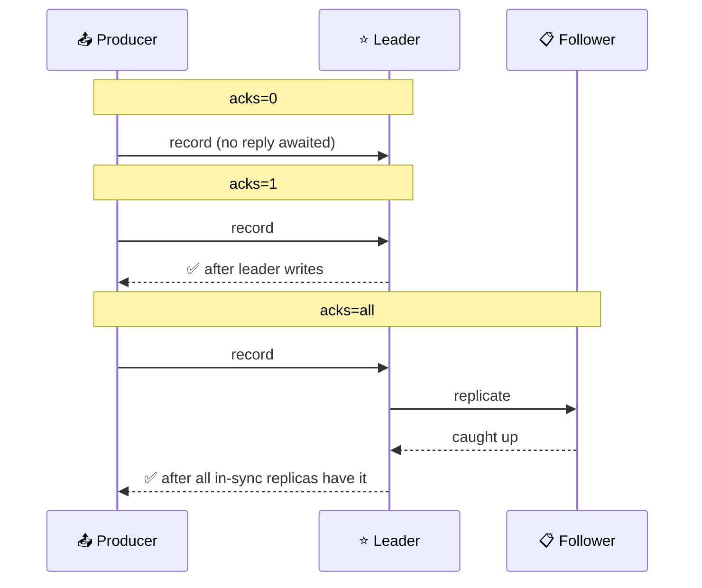
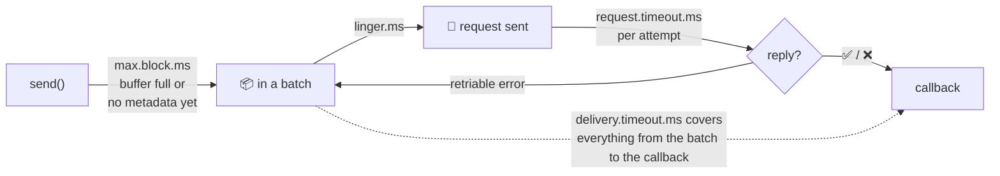
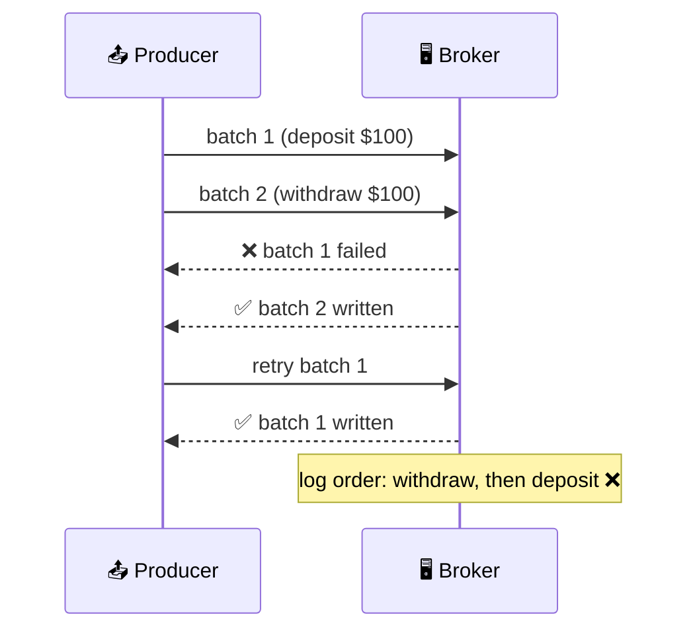

# 🎛️ Producer Configuration

[[Brokers/Kafka/Kafka The Definitive Guide/README|📬 Kafka: The Definitive Guide]] · Book Ch.3

> [!toc]- 📑 Contents
>
> - [[#🏷️ client.id|🏷️ client.id]]
> - [[#✅ acks|✅ acks]]
> - [[#⏱️ How Long Until Success or Failure|⏱️ How Long Until Success or Failure]]
> - [[#📦 Batching and Compression|📦 Batching and Compression]]
> - [[#🔀 In-Flight Requests and Ordering|🔀 In-Flight Requests and Ordering]]
> - [[#🛡️ Idempotence|🛡️ Idempotence]]
> - [[#🗺️ Java Property → franz-go|🗺️ Java Property → franz-go]]
> - [[#🛒 In the Project|🛒 In the Project]]
> - [[#🔨 Hands-On Practice|🔨 Hands-On Practice]]
> - [[#📋 Quick Reference|📋 Quick Reference]]
> - [[#🧠 Things to Remember|🧠 Things to Remember]]
> - [[#💡 Pro Tips|💡 Pro Tips]]
> - [[#🔗 Related Topics|🔗 Related Topics]]

The producer has dozens of settings, but a handful decide **durability**, **latency**, **throughput**, and **ordering**. This lesson covers those few, with the Kafka property name, the franz-go option, and measured effects.

---

## 🏷️ client.id

A free-text name the broker uses in logs, metrics, and quotas. It turns *"lots of auth failures from 104.27.155.134"* into *"the Order Validation service is failing to authenticate"*.

```go
kgo.ClientID("order-producer") // franz-go default: "kgo"
```

---

## ✅ acks

How many replicas must have a record before the write counts as successful.



| `acks` | Lost if… | Producer latency |
|---|---|---|
| `0` | Anything goes wrong; the producer never knows | Lowest |
| `1` | The leader crashes before followers copy the record | Medium |
| `all` | All in-sync replicas are lost at once | Highest |

> 💡 **End-to-end latency is the same for all three.** Consumers can only read a record once every in-sync replica has it. Lower `acks` only makes the *producer* faster, not delivery to consumers.

> 🆕 **Current Kafka:** the book says the default is `acks=1`. Since Kafka 3.0 the Java default is `acks=all` with idempotence on; franz-go also defaults to all.

---

## ⏱️ How Long Until Success or Failure

A send passes through two waits: **getting into the buffer**, then **getting acknowledged**.



- 🧱 **`max.block.ms`** — how long `send` may block when the buffer is full or topic metadata is missing. In franz-go, `Produce` waits for buffer space until its `ctx` ends.

- ⏳ **`delivery.timeout.ms`** — the **total** time for a record, retries included. This is the setting to tune.

- 📮 **`request.timeout.ms`** — one attempt's wait for a broker reply.

- 🔁 **`retries` / `retry.backoff.ms`** — the book advises **not** tuning these. Leave retries effectively unlimited and set `delivery.timeout.ms` instead.

> 🧮 **Example:** leader election after a broker crash takes about 30 s in your cluster. Allow 120 s of delivery time and the producer rides through it.

---

## 📦 Batching and Compression

| Setting | What it does |
|---|---|
| `linger.ms` | Wait this long for more records before sending a batch |
| `batch.size` | Max bytes per partition batch; a batch is sent when full **or** when linger expires, so a large value only costs memory |
| `buffer.memory` | Total memory for unsent records; when full, `send` blocks |
| `compression.type` | `none`, `gzip`, `snappy`, `lz4`, `zstd`, applied per batch |

**Measured** with `kafka-producer-perf-test.sh` on the project's local broker, 200,000 records of 200 bytes, `acks=all`:

```text
linger.ms=0  batch.size=16384  compression=none  →  246,002 rec/s  avg latency 98.38 ms
linger.ms=20 batch.size=65536  compression=none  →  321,027 rec/s  avg latency  1.89 ms
linger.ms=20 batch.size=65536  compression=lz4   →  263,157 rec/s  avg latency  2.25 ms
```

- 📦 **Bigger batches won on both counts.** With tiny batches the producer floods the broker with requests and records queue up, so latency *rises*.

- 🗜️ **Compression cost CPU here** because localhost has no network bottleneck. On a real network or with expensive storage, it usually pays: snappy and lz4 are cheap and fast, gzip and zstd compress harder.

> 🆕 **Defaults changed:** Kafka 4.0 raised Java's `linger.ms` default from 0 to 5 ms. franz-go uses 10 ms linger and snappy compression by default.

---

## 🔀 In-Flight Requests and Ordering

**`max.in.flight.requests.per.connection`** is how many batches can be sent before earlier ones are acknowledged. More in flight → more throughput, but a risk:



With retries on and more than one request in flight, a retry can **reorder** records. The fix isn't to turn either off; it's **idempotence**.

---

## 🛡️ Idempotence

With `acks=all` and retries, a record can be **written twice**: the broker stores and replicates it, then crashes before replying; the producer retries and the new leader already has it.

With **`enable.idempotence=true`**, the producer numbers each record. A broker that sees the same producer ID and sequence number again drops the copy, and out-of-order sequences are rejected. That gives:

- 🚫 **No duplicates from retries**

- 🔀 **Order kept** with up to 5 requests in flight

It requires `acks=all`, retries > 0, and at most 5 in flight. It's on by default in Java since 3.0 and in franz-go. Lesson 16 covers how it works.

### 🧪 Interview Q&A

**Q1:** Does `acks=1` deliver records to consumers faster than `acks=all`?

**Q2:** Which single setting should you tune to control how long a producer keeps retrying?

**Q3:** Why can retries reorder records, and what prevents it?

**Q4:** Why did `linger.ms=20` lower average latency in the measurement?

> [!answer]- 📋 Answers
>
> **A1:** No. Consumers only see records that all in-sync replicas have, so end-to-end latency is the same; only the producer's wait is shorter.
>
> **A2:** `delivery.timeout.ms` (`kgo.RecordDeliveryTimeout`), the total time including retries.
>
> **A3:** With several batches in flight, a failed earlier batch can be retried after a later one succeeded. Idempotence's sequence numbers make the broker keep the order.
>
> **A4:** Under heavy load, tiny batches mean many requests that queue up. Waiting 20 ms to fill bigger batches cut the number of requests, so records waited less overall.

---

## 🗺️ Java Property → franz-go

| Kafka property | Java default (4.x) | franz-go option | franz-go default |
|---|---|---|---|
| `client.id` | generated (`producer-1`) | `kgo.ClientID` | `"kgo"` |
| `acks` | `all` | `kgo.RequiredAcks(kgo.AllISRAcks())` | all |
| `enable.idempotence` | `true` | `kgo.DisableIdempotentWrite()` to turn off | on |
| `delivery.timeout.ms` | 120 s | `kgo.RecordDeliveryTimeout` | unlimited |
| `request.timeout.ms` | 30 s | `kgo.ProduceRequestTimeout` | 10 s |
| `retries` | unlimited | `kgo.RecordRetries` | unlimited |
| `linger.ms` | 5 ms | `kgo.ProducerLinger` | 10 ms |
| `batch.size` / `max.request.size` | 16 KiB / 1 MiB | `kgo.ProducerBatchMaxBytes` | 1,000,012 B |
| `buffer.memory` | 32 MiB | `kgo.MaxBufferedRecords` / `kgo.MaxBufferedBytes` | 50,000 records |
| `compression.type` | `none` | `kgo.ProducerBatchCompression(...)` | snappy, else none |
| `max.in.flight.requests.per.connection` | 5 | `kgo.MaxProduceRequestsInflightPerBroker` | 5 with idempotence |

franz-go batches up to its max size per partition rather than using a separate `batch.size`, so its one byte limit covers both rows.

---

## 🛒 In the Project

```go
// order/internal/adapters/events/kafka.go (same in shipping)
func NewProducer(brokers []string, clientID string, tracer *kotel.Tracer) (*kgo.Client, error) {
    return kgo.NewClient(
        kgo.SeedBrokers(brokers...),
        kgo.ClientID(clientID), // shows up in broker logs, metrics, and quotas
        // Give up on a record after 30 s (delivery.timeout.ms). Retries are
        // otherwise unlimited, and the outbox relay holds row locks while it waits.
        kgo.RecordDeliveryTimeout(30*time.Second),
        kgo.WithHooks(kotel.NewKotel(kotel.WithTracer(tracer)).Hooks()...),
    )
}
```

- ✅ **`acks=all` and idempotence** come from the defaults: losing or duplicating an `OrderPaid` is never acceptable.

- ⏳ **30 s delivery timeout:** if Kafka is down, the relay's `ProduceSync` fails after 30 s, the outbox transaction rolls back, and the rows are retried. The events wait safely in MySQL instead of in memory.

- 🏷️ **Client IDs** `order-producer` and `shipping-producer` make broker-side logs readable.

- 🗜️ **Default batching** (10 ms linger, snappy) suits these small, low-volume events.

---

## 🔨 Hands-On Practice

1. **Benchmark batching.** With `make up` running:

    ```bash
    docker compose exec kafka /opt/kafka/bin/kafka-topics.sh --bootstrap-server localhost:9092 \
      --create --topic perf --partitions 3 --replication-factor 1
    docker compose exec kafka /opt/kafka/bin/kafka-producer-perf-test.sh --topic perf \
      --num-records 200000 --record-size 200 --throughput -1 \
      --producer-props bootstrap.servers=localhost:9092 linger.ms=0 batch.size=16384
    ```

    Repeat with `linger.ms=20 batch.size=65536`.

    ✅ The second run reports more records/sec and a much lower average latency.

2. **Watch the delivery timeout.** Stop Kafka with `docker compose stop kafka`, create an order, wait 40 s, and check `docker compose logs order`.

    ✅ The order is created (the outbox holds the event), and the relay logs `outbox relay failed` after about 30 s. After `docker compose start kafka`, the event is published and the order becomes `Shipped`.

---

### 📋 Quick Reference

```go
kgo.NewClient(
    kgo.SeedBrokers("kafka:19092"),
    kgo.ClientID("order-producer"),
    kgo.RequiredAcks(kgo.AllISRAcks()),       // default
    kgo.RecordDeliveryTimeout(2*time.Minute), // total time incl. retries
    kgo.ProducerLinger(20*time.Millisecond),  // bigger batches
    kgo.ProducerBatchCompression(kgo.Lz4Compression()),
)
```

### 🧠 Things to Remember

- `acks=all` + idempotence is the safe default; lower `acks` only speeds up the producer.

- Tune `delivery.timeout.ms`, not retry counts.

- Batching (`linger.ms`) raises throughput and can lower latency under load.

- Compression trades CPU for network and storage.

- Idempotence prevents duplicates and reordering from retries.

### 💡 Pro Tips

- **Set the delivery timeout above your cluster's worst failover time** → otherwise the producer gives up during a normal leader election.

- **Benchmark with your real message size and network** → localhost numbers say little about compression.

- **Always set a client ID** → it's free and saves hours in incident reviews.

### 🔗 Related Topics

- ⬅️ Previous: [[5. Sending Messages]]

- ➡️ Next: [[7. Serialization and Event Contracts]]

- 🛡️ Idempotence in depth: [[16. Exactly-Once Semantics]]

- ✅ `acks` and in-sync replicas: [[15. Reliable Data Delivery]]

- 💻 Codebase: [[Go/gRPC Microservices in Go - Refactored/microservices/README|Order + Payment + Shipping]]
