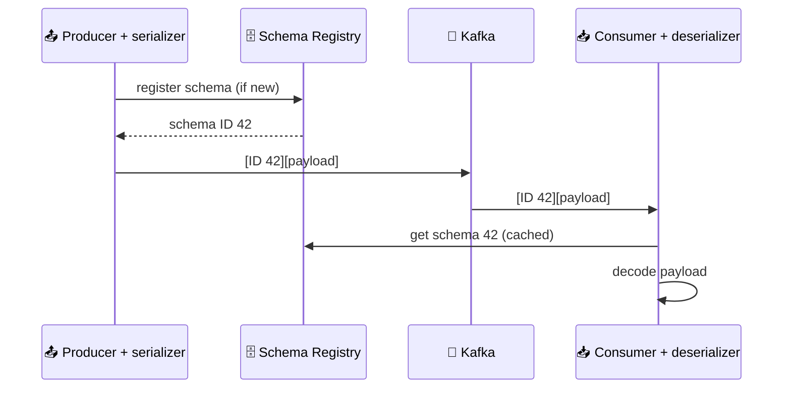

# 📜 Serialization and Event Contracts

[[Brokers/Kafka/Kafka The Definitive Guide/README|📬 Kafka: The Definitive Guide]] · Book Ch.3

> [!toc]- 📑 Contents
>
> - [[#❌ Why Not Write Your Own Format|❌ Why Not Write Your Own Format]]
> - [[#🗜️ Schema Libraries: Avro and Protobuf|🗜️ Schema Libraries: Avro and Protobuf]]
> - [[#🗄️ Schema Registry|🗄️ Schema Registry]]
> - [[#📜 Events as Protobuf in Go|📜 Events as Protobuf in Go]]
> - [[#🔁 Evolving Events Safely|🔁 Evolving Events Safely]]
> - [[#🏷️ Headers|🏷️ Headers]]
> - [[#🪝 Interceptors and Hooks|🪝 Interceptors and Hooks]]
> - [[#🔨 Hands-On Practice|🔨 Hands-On Practice]]
> - [[#📋 Quick Reference|📋 Quick Reference]]
> - [[#🧠 Things to Remember|🧠 Things to Remember]]
> - [[#💡 Pro Tips|💡 Pro Tips]]
> - [[#🔗 Related Topics|🔗 Related Topics]]

Kafka moves bytes. What turns an `OrderPaid` into bytes, and how do you change its shape later without breaking every consumer? This lesson covers serializers, schemas and registries, headers, and interceptors, using the project's Protobuf events.

---

## ❌ Why Not Write Your Own Format

The book shows a hand-written serializer for a `Customer`:

```text
4 bytes  customerId (int)
4 bytes  length of customerName in UTF-8 (0 if null)
N bytes  customerName
```

It works until the format changes:

- 💥 **Adding a field** (say, a start date) means old readers misread new bytes, and new readers misread old bytes.

- 🔒 **Every producer and consumer must upgrade at the same moment**, and old records already in the topic stay in the old format.

- 🐛 **Every language needs its own copy** of the same fragile byte layout.

The book's advice: **use a generic serialization library** such as Avro, Protobuf, or Thrift, never a custom one.

---

## 🗜️ Schema Libraries: Avro and Protobuf

Both give a compact binary format, strong types, and rules for **schema evolution**.

The book's Avro example replaces a `faxNumber` field with an optional `email`:

```json
{"name": "email", "type": ["null", "string"], "default": "null"}
```

- 👴 **Old readers** reading new records: `getFaxNumber()` returns null; no crash.

- 👶 **New readers** reading old records: `getEmail()` returns null; no crash.

Protobuf does the same with **field numbers**: unknown fields are skipped, missing fields read as zero values. Two caveats apply to both:

- ✅ **Writer and reader schemas must be compatible** under the library's rules.

- 🔎 **The reader needs the writer's schema**, or at least to know which one was used. That's what a schema registry is for.

| | Avro (book) | Protobuf (this project) |
|---|---|---|
| Schema file | JSON `.avsc` | `.proto` |
| Code generation | Optional (generic records) | Usual (`buf generate`) |
| Field identity | Name | Number |
| Compatibility checks | Schema Registry | `buf breaking` and/or a registry |

The project uses Protobuf because its services already share `.proto` contracts and Buf for gRPC.

---

## 🗄️ Schema Registry

Putting the full schema into every record would waste space. Instead, a **Schema Registry** stores schemas, and each record carries a small **schema ID**.



- 🛡️ **The registry also enforces compatibility:** a producer can't register a schema that would break existing readers.

- 🏢 **Options:** Confluent Schema Registry (the book's), Apicurio, or the Buf Schema Registry for Protobuf.

> 🛒 **The project skips the registry.** All services build from one `proto` module, every record has an **`event-type`** header naming its message (`order.v1.OrderPaid`), and `buf breaking` blocks incompatible changes. A registry becomes worth it when many teams or languages publish to shared topics.

---

## 📜 Events as Protobuf in Go

Go has no serializer classes: you marshal to `[]byte` yourself and put the result in the record.

```protobuf
// proto/order/v1/events.proto
message OrderPaid {
  // event_id is unique per event; consumers use it to drop duplicates.
  string event_id = 1;
  // order_id is the paid order. It is also the Kafka record key.
  int64 order_id = 2;
  int64 user_id = 3;
  float total_price = 4;
  repeated OrderItem order_items = 5;
  google.protobuf.Timestamp paid_at = 6;
}
```

**Serializing** (Order's DB adapter, when it writes the outbox row):

```go
// order/internal/adapters/db/outbox.go
payload, err := proto.Marshal(&orderv1.OrderPaid{
    EventId:    uuid.NewString(),
    OrderId:    order.ID,
    UserId:     order.CustomerID,
    TotalPrice: order.TotalPrice(),
    OrderItems: items,
    PaidAt:     timestamppb.Now(),
})
```

**Deserializing** (Shipping's consumer):

```go
// shipping/internal/adapters/events/handlers.go
var event orderv1.OrderPaid
if err := proto.Unmarshal(record.Value, &event); err != nil {
    return fmt.Errorf("%w: decode OrderPaid: %v", ErrPermanent, err)
}
```

- 🧾 **Decoding failures are permanent.** Retrying the same bytes fails the same way, so the record goes straight to the dead-letter topic (lesson 17).

- 🆔 **`event_id`** lets consumers recognize duplicates; **`order_id`** doubles as the key.

---

## 🔁 Evolving Events Safely

Records stay in a topic for the whole retention period, and the outbox may republish old ones, so **old and new versions will meet**.

| Change | Safe? | Why |
|---|---|---|
| Add a field with a new number | ✅ | Old readers skip it; new readers see zero for old records |
| Remove a field and `reserved` its number | ✅ | Number can't be reused by accident |
| Rename a field (same number) | ✅ on the wire | Binary uses numbers, but JSON views change |
| Change a field's type | ❌ | Old bytes decode wrongly |
| Reuse a number | ❌ | Old data is read as the new field |

`buf breaking` catches the unsafe ones. Changing `total_price` from `float` to `double`:

```text
order/v1/events.proto:18:3:Field "4" with name "total_price" on message "OrderPaid" changed type from "float" to "double".
```

For a redesign that can't be compatible, publish a **new message type** (`order.v2.OrderPaid`) alongside the old one until all consumers move.

---

## 🏷️ Headers

**Headers** are ordered key/value pairs carried next to the key and value. Kafka never reads them.

- 🧭 **Routing** without parsing the payload (it might even be encrypted).

- 🧬 **Lineage** — where a record came from.

- 🧵 **Tracing** — the trace context.

The project's records carry three kinds:

| Header | Set by | Purpose |
|---|---|---|
| `event-type` | Outbox relay | Which Protobuf message the value holds |
| `traceparent` | franz-go `kotel` hook | Continues the request's trace in the consumer |
| `dlq-error`, `dlq-source` | Consumer, on dead-lettering | Why and where a record failed |

```go
&kgo.Record{
    Key:     []byte(e.Key),
    Value:   e.Payload,
    Headers: []kgo.RecordHeader{{Key: "event-type", Value: []byte(e.EventType)}},
}
```

---

## 🪝 Interceptors and Hooks

Java producers accept **interceptors**: code run on every send (`onSend`) and every acknowledgement (`onAcknowledgement`), for metrics, standard headers, tracing, or redaction, without touching application code.

franz-go's equivalent is **hooks**: any type that implements hook interfaces, passed with `kgo.WithHooks`. Here's the book's counting interceptor in Go:

```go
type countingHook struct{ sent, acked, failed atomic.Int64 }

func (h *countingHook) OnProduceRecordBuffered(*kgo.Record) { h.sent.Add(1) }

func (h *countingHook) OnProduceRecordUnbuffered(_ *kgo.Record, err error) {
    if err != nil {
        h.failed.Add(1)
        return
    }
    h.acked.Add(1)
}

client, err := kgo.NewClient(kgo.SeedBrokers("localhost:9092"), kgo.WithHooks(&countingHook{}))
```

```text
sent=5 acked=5 failed=0
```

The project's tracing is exactly this: `kotel.NewKotel(...).Hooks()` adds hooks that start spans and inject `traceparent` headers.

### 🧪 Interview Q&A

**Q1:** Why is a hand-written byte format a bad idea for Kafka events?

**Q2:** What does a schema registry store, and what goes into each record?

**Q3:** How does the project know which Protobuf type a record holds without a registry?

**Q4:** Why must event schemas stay compatible even after all services are upgraded?

> [!answer]- 📋 Answers
>
> **A1:** Any change breaks old readers or old data, every producer and consumer must change together, and every language needs its own fragile implementation.
>
> **A2:** The schemas, with IDs and compatibility rules. Each record carries only the small schema ID.
>
> **A3:** The `event-type` header names the message, and every service compiles the same `proto` module.
>
> **A4:** Old records remain in the topic until retention removes them and can be replayed, so new code still reads old data.

---

## 🔨 Hands-On Practice

1. **Decode events.** With `make up` running and an order placed:

    ```bash
    make events
    ```

    ✅ Each record prints as `order.v1.OrderPaid {...}` or `shipping.v1.ShipmentCreated {...}`, decoded through its `event-type` header.

2. **Catch a breaking change.** In the codebase's `proto/` folder:

    ```bash
    cp -r . /tmp/proto-base
    sed -i 's/  float total_price = 4;/  double total_price = 4;/' order/v1/events.proto
    go run github.com/bufbuild/buf/cmd/buf@v1.75.0 breaking --against /tmp/proto-base
    cp /tmp/proto-base/order/v1/events.proto order/v1/events.proto   # undo the change
    ```

    ✅ Buf reports `changed type from "float" to "double"` and exits with code 100.

---

### 📋 Quick Reference

| Need | Go |
|---|---|
| Serialize | `value, err := proto.Marshal(event)` |
| Deserialize | `err := proto.Unmarshal(record.Value, &event)` |
| Header | `kgo.RecordHeader{Key: "event-type", Value: []byte("order.v1.OrderPaid")}` |
| Hook (interceptor) | `kgo.WithHooks(myHook)` implementing `kgo.HookProduceRecordBuffered`, … |
| Compatibility check | `buf breaking --against <previous version>` |

### 🧠 Things to Remember

- Use a schema library (Avro, Protobuf), not a custom byte layout.

- Compatible evolution: add fields with new numbers, reserve removed ones, never change types.

- A schema registry stores schemas; records carry only IDs.

- Headers carry metadata such as event type and trace context.

- Hooks are franz-go's interceptors.

### 💡 Pro Tips

- **Include an event ID and a timestamp in every event** → duplicates can be detected and events ordered by time.

- **Version the package, not a field** → `order.v1` / `order.v2` is clearer than a `"version": 2` field (Shuiskov's JSON approach).

- **Run `buf breaking` in CI** → incompatible events are caught before they reach a topic that keeps them for days.

### 🔗 Related Topics

- ⬅️ Previous: [[6. Producer Configuration]]

- ➡️ Next: [[8. Partitioning and Ordering]]

- 🧰 Buf in depth: [[Go/gRPC Microservices in Go - Refactored/3. Getting Up and Running with gRPC and Golang|gRPC Ch.3: Generating Stubs with Buf]]

- ☠️ What happens to undecodable records: [[17. Event-Driven Order, Payment, and Shipping]]

- 💻 Codebase: [[Go/gRPC Microservices in Go - Refactored/microservices/README|Order + Payment + Shipping]]
