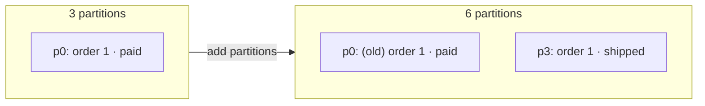

# 🔑 Partitioning and Ordering

[[Brokers/Kafka/Kafka The Definitive Guide/README|📬 Kafka: The Definitive Guide]] · Book Ch.3

> [!toc]- 📑 Contents
>
> - [[#🔑 What Keys Are For|🔑 What Keys Are For]]
> - [[#⚖️ The Default Partitioner|⚖️ The Default Partitioner]]
> - [[#➕ Adding Partitions Moves Keys|➕ Adding Partitions Moves Keys]]
> - [[#🍌 Custom Partitioners|🍌 Custom Partitioners]]
> - [[#🔥 Hot Keys|🔥 Hot Keys]]
> - [[#🚦 Quotas and Throttling|🚦 Quotas and Throttling]]
> - [[#🛒 In the Project|🛒 In the Project]]
> - [[#🔨 Hands-On Practice|🔨 Hands-On Practice]]
> - [[#📋 Quick Reference|📋 Quick Reference]]
> - [[#🧠 Things to Remember|🧠 Things to Remember]]
> - [[#💡 Pro Tips|💡 Pro Tips]]
> - [[#🔗 Related Topics|🔗 Related Topics]]

Kafka only orders records **within a partition**, so the choice of key decides what stays in order. This lesson covers how producers pick partitions, why adding partitions is risky, custom partitioners, and the broker quotas that throttle fast producers.

---

## 🔑 What Keys Are For

A key does two jobs:

- 🏷️ **Extra data stored with the record**, such as an order ID.

- 🎯 **Partition choice:** all records with the same key go to the same partition, so **one consumer reads all of them, in order**.

Keys also matter for **compacted topics**, which keep only the latest record per key (lesson 14).

> 💡 **Choose the key by what must stay in order.** Payments for the same account, events for the same order, updates to the same user. Records with different keys may interleave freely.

---

## ⚖️ The Default Partitioner

| Record | Where it goes |
|---|---|
| **No key** | **Sticky**: fill a batch for one partition, then switch. Fewer, fuller requests than strict round-robin |
| **With key** | `murmur2(key) mod partitionCount`, using Kafka's own hash, so every Kafka client agrees |

- 🔢 **All partitions count**, not just the healthy ones. If the target partition is unavailable, the write fails rather than silently moving. Replication makes that rare (lesson 15).

- 🧮 **Java alternatives:** `RoundRobinPartitioner` and `UniformStickyPartitioner` ignore keys, for when keys exist (say, a database primary key used downstream) but load must be spread evenly.

> 🆕 **franz-go:** the default is `UniformBytesPartitioner`, which hashes keyed records with Kafka's murmur2 (compatible with Java) and spreads unkeyed records in sticky 64 KiB chunks. `kgo.StickyKeyPartitioner(nil)` and `kgo.RoundRobinPartitioner()` are the other built-ins.

---

## ➕ Adding Partitions Moves Keys

`mod 3` and `mod 6` are different functions, so growing a topic sends many keys elsewhere. **Old records stay** in their old partition; **new ones** go to the new partition.

Computed with franz-go's Kafka-compatible hash:

```text
key  1: 3 partitions → p0, 6 partitions → p3
key  2: 3 partitions → p2, 6 partitions → p2
key  3: 3 partitions → p2, 6 partitions → p5
key  4: 3 partitions → p1, 6 partitions → p1
key  5: 3 partitions → p0, 6 partitions → p0
key  6: 3 partitions → p1, 6 partitions → p4
…
moved: 8 of 12
```



A consumer of p3 may handle `order 1 · shipped` before another consumer handles `order 1 · paid` on p0. The book's advice: **create topics with enough partitions and never add more** when key order matters.

---

## 🍌 Custom Partitioners

The book's example: customer **"Banana"** is over 10% of all traffic. Hashing puts Banana on a partition shared with others, which then grows far bigger than the rest. Better: **Banana gets its own partition**, everyone else is hashed over the remaining ones.

In franz-go, wrap a function with `BasicConsistentPartitioner`:

```go
// vipPartitioner gives the biggest customer (key "1") partition 0 and hashes
// every other key over the remaining partitions.
func vipPartitioner() kgo.Partitioner {
    hash := kgo.StickyKeyPartitioner(nil) // Kafka-compatible murmur2 for the rest
    return kgo.BasicConsistentPartitioner(func(topic string) func(*kgo.Record, int) int {
        rest := hash.ForTopic(topic)
        return func(r *kgo.Record, n int) int {
            if string(r.Key) == "1" {
                return 0
            }
            return 1 + rest.Partition(r, n-1)
        }
    })
}

client, err := kgo.NewClient(
    kgo.SeedBrokers("localhost:9092"),
    kgo.RecordPartitioner(vipPartitioner()),
)
```

```text
vip partitioner: key 1 → p0
vip partitioner: key 1 → p0
vip partitioner: key 2 → p3
vip partitioner: key 3 → p3
vip partitioner: key 4 → p2
vip partitioner: key 5 → p1
```

- 🧮 **`n`** is the topic's partition count (4 here): key 1 owns p0; the rest hash over p1–p3.

- ⚠️ **Every producer to the topic must use the same partitioner**, or the same key lands in different partitions depending on who wrote it.

---

## 🔥 Hot Keys

One key with far more traffic than others overloads its partition, and the one consumer that owns it.

| Fix | Trade-off |
|---|---|
| Dedicated partition (above) | Custom code in every producer |
| Composite key, e.g. `customer + (orderID mod 4)` | Order kept only within each sub-key |
| No key / uniform partitioner | No ordering at all |

---

## 🚦 Quotas and Throttling

Brokers can cap how fast clients send and receive:

- 📤 **Produce quota** — bytes/s a client may write (`producer_byte_rate`).

- 📥 **Consume quota** — bytes/s a client may read (`consumer_byte_rate`).

- ⏱️ **Request quota** — share of broker time a client's requests may use.

Quotas apply to a **client ID**, an authenticated **user**, both, or as a default for everyone. Set them dynamically:

```bash
kafka-configs.sh --bootstrap-server localhost:9092 --alter \
  --add-config 'producer_byte_rate=1048576' --entity-type clients --entity-name order-producer
kafka-configs.sh --bootstrap-server localhost:9092 --describe \
  --entity-type clients --entity-name order-producer
```

```text
Completed updating config for client order-producer.
Quota configs for client-id 'order-producer' are producer_byte_rate=1048576.0
```

A client over its quota isn't rejected: the broker **delays its responses** (and mutes the connection), which slows the client down. If a producer keeps sending faster than it's allowed, its buffer fills, sends block, and records eventually time out. That's another reason to set a meaningful `client.id`.

### 🧪 Interview Q&A

**Q1:** Why does the project key events by `order_id` and not by `user_id`?

**Q2:** What happens to existing records when a topic grows from 3 to 6 partitions?

**Q3:** Why must all producers of a topic use the same partitioner?

**Q4:** How does a broker enforce a produce quota?

> [!answer]- 📋 Answers
>
> **A1:** What must stay in order is one order's events (paid before shipped). Keying by user would also work for that, but a heavy user would become a hot key, and ordering across a user's different orders isn't needed.
>
> **A2:** They stay where they are. Only new records use the new mapping, so a key's records can end up split across two partitions.
>
> **A3:** Otherwise the same key maps to different partitions depending on the writer, breaking per-key ordering.
>
> **A4:** It delays responses to the client (and mutes its connection) until its rate is back under the quota.

---

## 🛒 In the Project

Every event uses the order ID as its key, set when the outbox row is written:

```go
// order/internal/adapters/db/outbox.go
return tx.Create(&OutboxEvent{
    Topic:     TopicOrders,
    Key:       strconv.FormatInt(order.ID, 10),
    EventType: "order.v1.OrderPaid",
    Payload:   payload,
    Headers:   headers,
}).Error
```

- 🔁 **Both topics use the same key**, so `OrderPaid` and `ShipmentCreated` for an order land on the same partition number in `orders` and `shipments` (both have 3 partitions and use the default partitioner).

- 🔢 **3 partitions** allow up to 3 instances each of Shipping and Order to share the work.

- 📏 **Never grow them casually:** both topics are keyed, so adding partitions would split orders across partitions.

---

## 🔨 Hands-On Practice

1. **Predict partitions.** Place orders until IDs 1–6 exist, then run `make events`.

    ✅ Orders 1 and 5 are on `p0`, 4 and 6 on `p1`, 2 and 3 on `p2`, matching `murmur2(key) mod 3`; the same key has the same partition in both topics.

2. **Set and remove a quota.** Apply the `kafka-configs.sh` commands above to `order-producer`, describe it, then remove it with `--alter --delete-config producer_byte_rate`.

    ✅ Describe shows `producer_byte_rate=1048576.0`; after removal it's no longer listed.

---

### 📋 Quick Reference

| Need | How |
|---|---|
| Keep related records ordered | Same key |
| Default (Kafka-compatible) | `kgo.UniformBytesPartitioner` (franz-go default) |
| Only hash keys | `kgo.StickyKeyPartitioner(nil)` |
| Ignore keys | `kgo.RoundRobinPartitioner()` |
| Custom rule | `kgo.BasicConsistentPartitioner(...)` + `kgo.RecordPartitioner(...)` |
| Quota | `kafka-configs.sh --alter --add-config producer_byte_rate=… --entity-type clients --entity-name …` |

### 🧠 Things to Remember

- Same key → same partition → ordered, while the partition count is unchanged.

- Unkeyed records are spread in sticky batches.

- Adding partitions remaps keys; size keyed topics up front.

- Custom partitioners fix hot keys but must be shared by every producer.

- Quotas throttle by delaying responses, not by rejecting.

### 💡 Pro Tips

- **Write down each topic's key** next to its schema → "keyed by order_id" is part of the contract.

- **Check key skew before going live** → count records per key in a sample; one key at 10% needs a plan.

- **Use the same key across related topics** → a stream processor can then join them partition by partition (lesson 20).

### 🔗 Related Topics

- ⬅️ Previous: [[7. Serialization and Event Contracts]]

- ➡️ Next: [[9. Consumers and Consumer Groups]]

- 🔢 Choosing partition counts: [[4. Running Kafka with KRaft]]

- 🗜️ Keys in compacted topics: [[14. Storage, Retention, and Compaction]]

- 💻 Codebase: [[Go/gRPC Microservices in Go - Refactored/microservices/README|Order + Payment + Shipping]]
