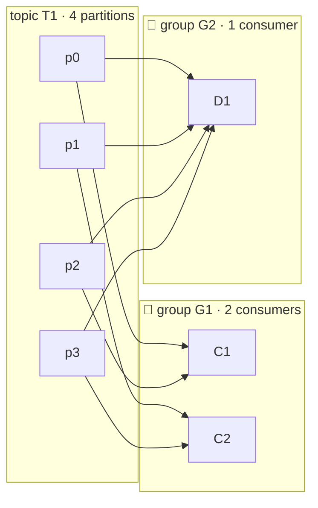
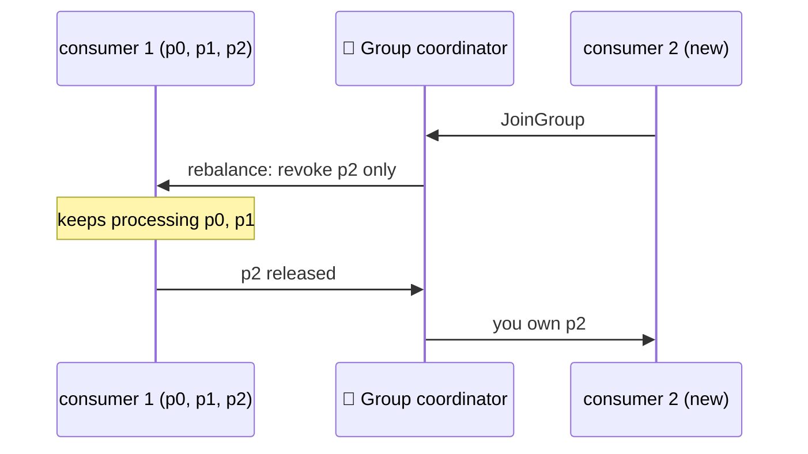
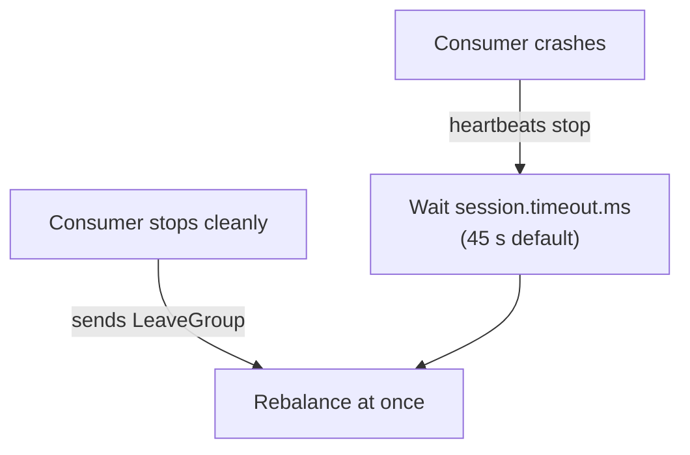

# 👥 Consumers and Consumer Groups

[[Brokers/Kafka/Kafka The Definitive Guide/README|📬 Kafka: The Definitive Guide]] · Book Ch.4

> [!toc]- 📑 Contents
>
> - [[#👥 Scaling with a Group|👥 Scaling with a Group]]
> - [[#🔄 Rebalances|🔄 Rebalances]]
> - [[#💓 Heartbeats and the Group Coordinator|💓 Heartbeats and the Group Coordinator]]
> - [[#📌 Static Group Membership|📌 Static Group Membership]]
> - [[#🔁 The Poll Loop|🔁 The Poll Loop]]
> - [[#🧵 One Consumer per Goroutine|🧵 One Consumer per Goroutine]]
> - [[#🛒 In the Project|🛒 In the Project]]
> - [[#🔨 Hands-On Practice|🔨 Hands-On Practice]]
> - [[#📋 Quick Reference|📋 Quick Reference]]
> - [[#🧠 Things to Remember|🧠 Things to Remember]]
> - [[#💡 Pro Tips|💡 Pro Tips]]
> - [[#🔗 Related Topics|🔗 Related Topics]]

How do several instances of Shipping share the `orders` topic, and what happens when one starts, stops, or crashes? This lesson covers consumer groups, rebalances, heartbeats, static membership, and the poll loop.

---

## 👥 Scaling with a Group

When one consumer can't keep up, you add more to the **same group**. Kafka splits the topic's partitions among them; each partition has exactly **one** owner in the group.



| Consumers in G1 | Result |
|---|---|
| 1 | C1 reads all 4 partitions |
| 2 | 2 partitions each |
| 4 | 1 partition each |
| 5 | 1 partition each, **one consumer idle** |

- 📈 **Add consumers** to a group to scale one application, up to the partition count.

- 🆕 **Add a group** for a new application that needs *all* the messages. G2 reads everything, independent of G1. Kafka handles many groups without slowing down.

---

## 🔄 Rebalances

Moving partition ownership between consumers is a **rebalance**. It happens when a consumer joins, leaves or crashes, or when the subscribed topics change (for example, partitions are added).

| | 🛑 Eager | 🤝 Cooperative (incremental) |
|---|---|---|
| **How** | Everyone stops, gives up **all** partitions, rejoins, gets a new assignment | Only the partitions that must move are revoked and reassigned, in several rounds |
| **Effect** | Short "stop-the-world" for the whole group | Other partitions keep flowing |
| **Best for** | Small groups, simple setups | Large groups, frequent scaling |



> 🆕 **Current Kafka:** Kafka 4.x also offers the server-driven protocol of **KIP-848**, where the broker computes assignments and there's no group-wide sync barrier. franz-go supports it with `kgo.ServerSideBalancer()` and recommends it from Kafka 4.3. The classic protocol with franz-go's default **cooperative-sticky** balancer remains the default.

---

## 💓 Heartbeats and the Group Coordinator

Each group has a **group coordinator**: a broker that tracks members. Consumers send **heartbeats** from a background goroutine; while heartbeats arrive, the member is alive.



- ✅ **Clean shutdown** → the consumer tells the coordinator it's leaving → its partitions move **immediately**.

- 💥 **Crash** → nobody says goodbye → its partitions sit **unprocessed until the session times out**.

**Who assigns partitions?** In the classic protocol, the first member to join becomes the **group leader**. It receives the member list, computes the assignment with its balancer, and sends it to the coordinator, which tells each member only its own share.

---

## 📌 Static Group Membership

Normally a restarted consumer gets a **new member ID**, and its partitions move twice: away, then back. With a unique **`group.instance.id`** the consumer becomes a **static member**:

- 🔁 On shutdown it **doesn't leave** the group; on restart it gets **the same partitions back** without a rebalance.

- ⏳ While it's down, **nobody reads its partitions**; they're reassigned only after `session.timeout.ms`.

- 🚫 Two consumers with the same instance ID can't both join.

Use it when a consumer keeps **expensive local state or caches** per partition, and set `session.timeout.ms` above a normal restart but below a real outage.

```go
kgo.InstanceID("shipping-0") // group.instance.id, e.g. from a StatefulSet pod name
```

---

## 🔁 The Poll Loop

> *"The same way that sharks must keep moving or they die, consumers must keep polling Kafka."*: the book

```go
for {
    fetches := client.PollFetches(ctx) // also joins the group and handles rebalances
    if fetches.IsClientClosed() || ctx.Err() != nil {
        return
    }
    fetches.EachRecord(func(r *kgo.Record) {
        process(r) // topic, partition, offset, key, value, headers
    })
}
```

- 🧭 **Polling does more than fetch:** the first poll finds the coordinator and joins the group; rebalances and their callbacks happen around polls.

- ⏰ **Don't stall between polls.** A Java consumer that doesn't poll within **`max.poll.interval.ms`** (5 minutes) is considered stuck and removed from the group. franz-go heartbeats in the background, but when a rebalance starts, a member that doesn't finish its work and rejoin within the **rebalance timeout** (60 s) is removed instead.

- 🧯 **Errors surface in the poll**, via `fetches.Errors()` / `fetches.EachError(...)`.

**Subscribing:** a fixed list (`kgo.ConsumeTopics("orders")`) or a **regex** (`kgo.ConsumeRegex()` with patterns like `"orders\\..*"`), which also picks up matching topics created later. On clusters with tens of thousands of partitions, regex subscription is costly: the client must keep fetching metadata for *all* topics, and needs permission to describe them all.

---

## 🧵 One Consumer per Goroutine

Java's rule is **one consumer per thread**. A franz-go client *is* safe to use from several goroutines, but **one poll loop per client** keeps the ordering and commit logic simple. To scale within one process:

- 🧩 **Several clients, same group** — each with its own loop, each owning some partitions.

- 🏭 **One poller, several workers** — the loop hands records to workers. Keep per-key ordering by sending each partition (or key) to the same worker, and commit only what's finished.

### 🧪 Interview Q&A

**Q1:** A topic has 6 partitions and a group has 4 consumers. How are partitions split, and what happens when you add 3 more consumers?

**Q2:** Why do cooperative rebalances hurt less than eager ones?

**Q3:** A consumer crashes. How long until its partitions are processed again, and why?

**Q4:** When is static membership worth using?

> [!answer]- 📋 Answers
>
> **A1:** Two consumers get 2 partitions and two get 1. With 7 consumers, 6 get one partition each and 1 sits idle.
>
> **A2:** Only partitions that must move are revoked; consumers keep processing the rest instead of the whole group stopping.
>
> **A3:** Up to `session.timeout.ms` (45 s by default): no heartbeats arrive, and the coordinator waits that long before declaring it dead and rebalancing.
>
> **A4:** When a consumer builds costly per-partition state or caches, so a quick restart shouldn't move its partitions away and back.

---

## 🛒 In the Project

Each service is one group, named after itself, reading one topic:

```go
// shipping/internal/adapters/events/consumer.go
client, err := kgo.NewClient(
    kgo.SeedBrokers(cfg.Brokers...),
    kgo.ClientID(cfg.Group+"-consumer"),
    kgo.ConsumerGroup(cfg.Group),  // "shipping"
    kgo.ConsumeTopics(cfg.Topic),  // "orders"
    // ...
)
```

A second Shipping instance was started with `docker compose run -d --no-deps --name shipping-2 shipping`. `make lag` (columns trimmed):

```text
GROUP     TOPIC   PARTITION  LAG  CONSUMER-ID                                             CLIENT-ID
shipping  orders  0          0    shipping-consumer-b7458b11-0f07-4df3-995b-14c72a82c492  shipping-consumer
shipping  orders  1          0    shipping-consumer-b7458b11-0f07-4df3-995b-14c72a82c492  shipping-consumer
shipping  orders  2          0    shipping-consumer-1c4eb251-750d-43f6-8715-11559024de59  shipping-consumer
```

Three seconds after `docker stop shipping-2` (a clean shutdown), all three partitions were back with the first instance. When the second instance was **killed** instead, partition 2 stayed assigned to the dead member until the 45 s session timeout expired.

---

## 🔨 Hands-On Practice

1. **Scale and shrink a group.** With `make up` running:

    ```bash
    docker compose run -d --no-deps --name shipping-2 shipping
    sleep 8 && make lag
    docker stop shipping-2 && sleep 3 && make lag
    docker rm shipping-2
    ```

    ✅ Two consumer IDs share the `shipping` group's 3 partitions, then one owns all 3 again within seconds.

2. **Compare a crash.** Repeat, but replace `docker stop` with `docker kill shipping-2`, and run `make lag` every 10 s.

    ✅ The killed member keeps partition 2 for about 45 s; then it moves to the surviving instance.

---

### 📋 Quick Reference

| Setting | franz-go | Default |
|---|---|---|
| `group.id` | `kgo.ConsumerGroup("shipping")` | — |
| Subscribe | `kgo.ConsumeTopics(...)`, `kgo.ConsumeRegex()` | — |
| `partition.assignment.strategy` | `kgo.Balancers(...)` | cooperative-sticky |
| `group.instance.id` | `kgo.InstanceID("shipping-0")` | dynamic member |
| `session.timeout.ms` | `kgo.SessionTimeout(...)` | 45 s |
| `max.poll.interval.ms` / `rebalance.timeout.ms` | `kgo.RebalanceTimeout(...)` | 60 s (franz-go); Java: 5 min poll interval |
| KIP-848 protocol | `kgo.ServerSideBalancer()` | off |

### 🧠 Things to Remember

- One owner per partition per group; every group gets everything.

- Consumers beyond the partition count sit idle.

- Clean shutdown rebalances immediately; a crash waits for the session timeout.

- Cooperative rebalancing moves only the partitions that must move.

- Keep polling: slow processing between polls gets the consumer removed.

### 💡 Pro Tips

- **Always shut consumers down cleanly** → catching SIGTERM and closing the client saves a 45 s processing gap on every deploy.

- **Keep per-record work short, or hand it to workers** → long work between polls stalls rebalances and can get the member removed.

- **Use static membership only with a plan for outages** → a dead static member blocks its partitions until the session expires.

### 🔗 Related Topics

- ⬅️ Previous: [[8. Partitioning and Ordering]]

- ➡️ Next: [[10. Offsets and Commits]]

- ⚙️ Timeouts and rebalance callbacks: [[11. Consumer Configuration and Rebalance Handling]]

- 🏢 Groups introduced: [[3. Producers, Consumers, Brokers, and Clusters]]

- 💻 Codebase: [[Go/gRPC Microservices in Go - Refactored/microservices/README|Order + Payment + Shipping]]
