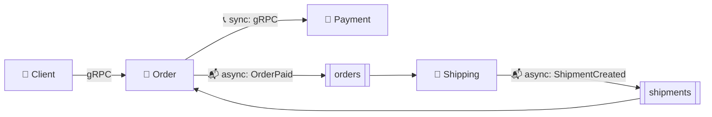

# 📬 Kafka: The Definitive Guide

Short lessons, basic to intermediate, from *Kafka: The Definitive Guide, 2nd Edition* (Shapira, Palino, Sivaram, Petty), updated for **Kafka 4.x** and taught in **Go** with franz-go.

Every lesson uses the same project: Babal's **Order + Payment** services, extended with **Shipping** and Kafka in the [[Go/gRPC Microservices in Go - Refactored/microservices/README|codebase]]. So the series covers both halves of microservice communication:

The sync side is taught in [[Go/gRPC Microservices in Go - Refactored/README|📚 gRPC Microservices in Go]]. These lessons teach the async side.

Written with [[Brokers/Kafka/Kafka The Definitive Guide/AI Prompt - Kafka The Definitive Guide|this folder's prompt]].

---

## 🗺️ Lessons

### 🌱 Part 1 — Foundations (Book Ch.1–2)

| # | Lesson | You'll learn |
|---|---|---|
| 1 | [[1. Sync vs Async and Publish-Subscribe]] | When to call (gRPC) and when to publish (Kafka); pub/sub; why one central broker |
| 2 | [[2. Messages, Topics, and Partitions]] | Messages, keys, batches, schemas, topics, partitions, offsets |
| 3 | [[3. Producers, Consumers, Brokers, and Clusters]] | The roles, consumer groups, leaders and replicas, retention, why Kafka |
| 4 | [[4. Running Kafka with KRaft]] | A KRaft broker in Docker, listeners, key broker and topic settings, how many partitions |

### 📤 Part 2 — Producers (Book Ch.3)

| # | Lesson | You'll learn |
|---|---|---|
| 5 | [[5. Sending Messages]] | How a producer works; sync vs async sends; errors; franz-go |
| 6 | [[6. Producer Configuration]] | `acks`, delivery timeout, batching, compression, in-flight requests, idempotence |
| 7 | [[7. Serialization and Event Contracts]] | Serializers, Protobuf + Buf instead of Avro, schema evolution, headers |
| 8 | [[8. Partitioning and Ordering]] | Default and custom partitioners, keys, hot keys, changing partition counts, quotas |

### 📥 Part 3 — Consumers (Book Ch.4)

| # | Lesson | You'll learn |
|---|---|---|
| 9 | [[9. Consumers and Consumer Groups]] | Groups, partition assignment, rebalances, static membership, the poll loop |
| 10 | [[10. Offsets and Commits]] | Auto, sync, async, and specific commits; what each risks |
| 11 | [[11. Consumer Configuration and Rebalance Handling]] | Fetch and poll settings, timeouts, `auto.offset.reset`, rebalance callbacks, seeking, shutdown |

### ⚙️ Part 4 — Operating Kafka (Book Ch.5, 12)

| # | Lesson | You'll learn |
|---|---|---|
| 12 | [[12. Managing Kafka with Code and CLI]] | Admin API (`kadm`), topic and config management, consumer group tools, resetting offsets |

### 🔬 Part 5 — Internals and Guarantees (Book Ch.6–8)

| # | Lesson | You'll learn |
|---|---|---|
| 13 | [[13. Inside a Kafka Cluster]] | Controller, KRaft, replication, ISR, how produce and fetch requests work |
| 14 | [[14. Storage, Retention, and Compaction]] | Segments, indexes, retention, log compaction, tombstones, tiered storage |
| 15 | [[15. Reliable Data Delivery]] | Replication factor, `min.insync.replicas`, unclean election, reliable producers and consumers |
| 16 | [[16. Exactly-Once Semantics]] | Idempotent producer, transactions, fencing, what they don't solve |

### 🛒 Part 6 — Kafka in Microservices (Book Ch.9, 13, 14 + the project)

| # | Lesson | You'll learn |
|---|---|---|
| 17 | [[17. Event-Driven Order, Payment, and Shipping]] | The whole project flow: outbox, idempotent consumers, dead letters, one trace across Kafka |
| 18 | [[18. Data Pipelines and Kafka Connect]] | Pipeline concerns, Connect, CDC with Debezium, Connect vs your own code |
| 19 | [[19. Monitoring Kafka]] | SLOs, key broker metrics, client metrics, consumer lag, end-to-end checks |
| 20 | [[20. Stream Processing Concepts]] | Time, state, windows, joins, common patterns, Kafka Streams and Go options |

---

## 🧭 How to Use These Lessons

1. **Start the project:** `cd Go/gRPC Microservices in Go - Refactored/microservices && make up`.

2. **Read lessons 1–4**, then try `make topics` and `make events`.

3. **Lessons 5–11** explain the producer and consumer code in `order/` and `shipping/internal/adapters/events/`.

4. **Lessons 13–16** explain *why* the code commits and retries the way it does.

5. **Lesson 17** puts it all together with the project's full flow.

The book's chapters 10 (cross-cluster mirroring) and 11 (security) are advanced operations topics and aren't part of this series.

---

## 🔗 Related

- 📚 Sync side: [[Go/gRPC Microservices in Go - Refactored/README|gRPC Microservices in Go]]

- 💻 Code: [[Go/gRPC Microservices in Go - Refactored/microservices/README|Order + Payment + Shipping codebase]]

- 📡 Another broker: [[Brokers/MQTT/HiveMQ 3.1.1/0. MQTT Table of Contents|MQTT]]
