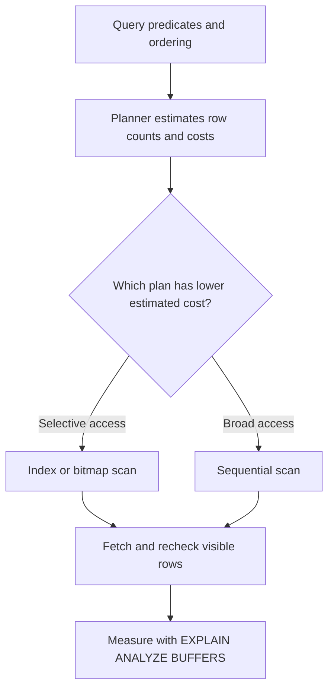

# Chapter 9 — Indexing Strategy

> [🧑‍🏫 Interactive lesson](lessons/0008-indexing-strategy.html)

> [!info] Source and scope
> Individual learning reference for *The Art of PostgreSQL*, following the publisher's 2026 chapter numbering. The local vault contains no copy of the book text; this note teaches the chapter's listed subject using the public contents and general PostgreSQL knowledge.

> [!info] Edition note
> Indexing Strategy was Chapter 8 in the older edition represented by the empty local stub; the publisher numbers it Chapter 9 in the 2026 contents.

**Book part:** Part III — Writing SQL Queries  
**Official contents:** [The Art of PostgreSQL](https://theartofpostgresql.com/book/contents/)

## 📖 Chapter Summary

Indexes trade storage and write work for faster access patterns. Choose them from real constraints and important queries, then validate with plans and measurements. PostgreSQL offers B-tree, GiST, SP-GiST, GIN, BRIN, hash, and extension-provided methods; partial, covering, and expression indexes target particular workloads.

The index column order follows the filter and ordering pattern. `INCLUDE` stores payload columns for possible index-only scans, but visibility checks can still require heap access.

## 🧭 Key Ideas

- **Problem:** Identify the application or data-management need before choosing a SQL construct or PostgreSQL feature.
- **Mechanics:** Follow how inputs become rows, how PostgreSQL applies operators/constraints, and what result or state change the database guarantees.
- **Trade-off:** Consider correctness, query shape, write cost, operational burden, and the server version together.

## 🌐 Practical Application

When applying this chapter, write down one real query or invariant from your application. State the expected rows or state transition, include boundary cases, and check the result against representative data. For performance-related behavior, inspect the plan and measure; for integrity behavior, try invalid and concurrent writes.

## 🧭 Index Selection Guide

| Index method | Useful when | Main trade-off |
|---|---|---|
| B-tree | Equality, ranges, ordered results, uniqueness | General-purpose; still costs storage and write work |
| GIN | JSONB containment, arrays, token membership | Larger index and more write maintenance |
| GiST | Ranges, geometric operators, nearest-neighbor search | Operator support and index behavior depend on the type |
| SP-GiST | Partitioned search spaces such as tries or spatial partitions | Specialized access patterns |
| BRIN | Huge tables with values correlated to physical row order | Lossy block summaries may require rechecking rows |
| Hash | Equality lookup | Narrower use than B-tree |

```sql
CREATE INDEX orders_customer_created_idx
    ON orders (customer_id, created_at DESC, id DESC);
```

A composite B-tree can support a customer filter followed by newest-first ordering. Column order matters: a leading `customer_id` does not generally serve a query that filters only by `created_at` equally well.

```sql
CREATE INDEX open_orders_created_idx
    ON orders (created_at DESC)
    WHERE status = 'open';
```

A partial index stores only rows matching its predicate. The planner must be able to prove that a query predicate implies the index predicate.

```sql
CREATE INDEX users_lower_email_idx ON users (lower(email));
SELECT id FROM users WHERE lower(email) = lower($1);
```

An expression index supports the matching expression. Keep the query expression aligned with the indexed expression.

```sql
CREATE INDEX events_payload_gin_idx ON events USING gin (payload);
SELECT id FROM events WHERE payload @> '{"kind":"payment"}';
```

GIN supports containment-style searches over JSONB. Choose the operator class for the operators the workload uses.

```sql
EXPLAIN (ANALYZE, BUFFERS)
SELECT id, created_at
FROM orders
WHERE customer_id = 42
ORDER BY created_at DESC, id DESC
LIMIT 20;
```

Compare estimated rows with actual rows, loops, buffers, and elapsed time. `EXPLAIN ANALYZE` executes the statement; use care with writes.



An index is a candidate access path, not a command to the planner. On a small table or a query returning many rows, a sequential scan can be cheaper.

## 🧪 Check Your Understanding

**Q1:** What practical problem does this chapter help solve?

**Q2:** What assumption would make an example from this chapter incorrect or unsafe in production?

**Q3:** What evidence would you collect to decide whether this technique is working?

> [!answer]- 📋 Answers
> **A1:** Indexes trade storage and write work for faster access patterns. Choose them from real constraints and important queries, then validate with plans and measurements. PostgreSQL offers B-tree, GiST, SP-GiST, GIN, BRIN, hash, and extension-provided methods; partial, covering, and expression indexes target particular workloads.
>
> **A2:** The answer depends on the data shape, workload, transaction boundaries, PostgreSQL version, and invariants. Make the assumption explicit and test the edge case that could violate it.
>
> **A3:** Check correctness with representative and boundary-case data. For performance, inspect `EXPLAIN (ANALYZE, BUFFERS)` and workload measurements; for integrity, verify PostgreSQL accepts valid cases and rejects invalid ones.

## 🔨 Hands-On Practice

**Goal:** Apply one idea from this chapter to a small, disposable schema or the book's companion dataset.

**Steps:**

1. State the expected result or invariant before writing SQL.
2. Implement the simplest query or schema rule that expresses it.
3. Try normal, boundary, and invalid inputs.
4. Record what PostgreSQL guarantees and what the application must still handle.

**Done when:** You can explain the result and its limitations without relying on an unexplained ORM behavior or a single happy-path example.

## 🧠 Things to Remember

- Start with the requirement and expected result, then choose the SQL feature.
- Make ordering, null behavior, cardinality, and transaction assumptions explicit where relevant.
- Validate the behavior with realistic data and your deployed PostgreSQL version.

## 🔗 Related Chapters

- [[8 - SQL is Code]]
- [[10 - Interview with Yohann Gabory]]
- [[Art of PostgreSQL - All Chapters Reference]]

*Chapter 9 learning reference; concise companion, not a reproduction of the book.*
