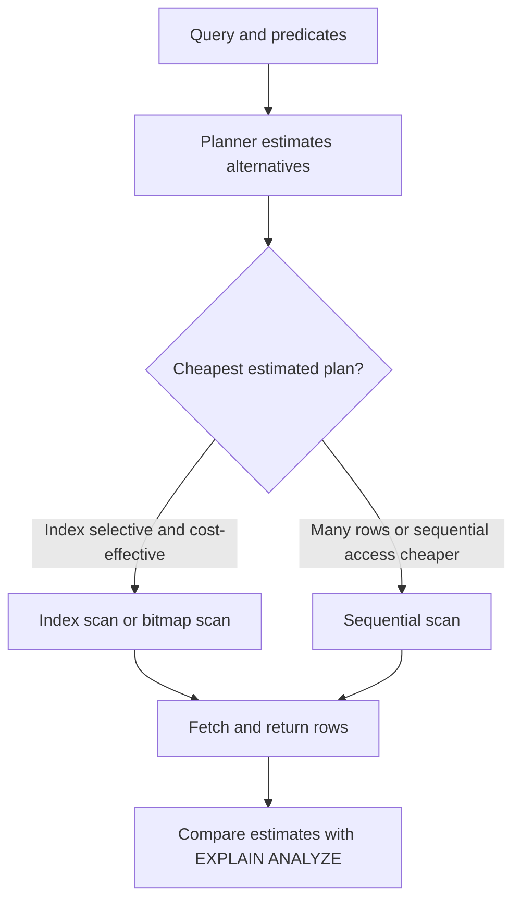

# 📚 The Art of PostgreSQL — All Chapters Reference

> [!tip] Interactive course
> Start at [Course Contents](lessons/index.html) for a short interactive lesson for each chapter. The course serves both application development and DBA/performance goals.

> [!info] Edition and scope
> This master reference follows the publisher's 2026 table of contents: 8 parts and 52 numbered chapters (Ch. 2–53). The older local stub `CH 8 Indexing Strategy.md` reflects earlier numbering; indexing is Chapter 9 in this edition. The descriptions below are an original learning companion based on the public contents and PostgreSQL knowledge, not a substitute for the book's explanations or examples.

**Author:** Dimitri Fontaine  
**Primary source:** [Official table of contents](https://theartofpostgresql.com/book/contents/) · [2026 edition updates](https://theartofpostgresql.com/book/updates/)  
**Useful companion:** [Book query repository](https://github.com/dimitri/TheArtOfPostgreSQL)

## 🧭 How the book builds skill


The progression moves work toward the data: express set-based operations in SQL, make queries maintainable, learn the language's richer tools, encode rules in types and constraints, then reason about concurrency and extensions. Data modeling comes after query skills because a model should make real application questions easy to express.

## Part II — Introduction

### Chapter 2 — Structured Query Language

SQL describes the result set you want; PostgreSQL chooses an execution plan to produce it. This shifts filtering, grouping, and joining close to the data and avoids moving unnecessary rows into application memory. The chapter's themes include loading data, safe parameter handling, prepared statements, and calculating time-based comparisons.

**Remember:** Use bound parameters for values; never build SQL by concatenating untrusted input. A prepared statement separates query structure from data.

### Chapter 3 — Software Architecture

Choosing PostgreSQL is an architectural decision about data ownership, consistency, operations, and application boundaries. Learn to use the official documentation as a technical reference and evaluate trade-offs against the system's requirements instead of choosing a database by fashion.

**Remember:** A database is part of the application architecture. Its guarantees and operational costs shape the design.

### Chapter 4 — Getting Ready to Read This Book

Set up a repeatable way to run queries, inspect the book's examples, and use its companion lab. A fast feedback loop matters: SQL is learned by changing a query, observing its result, and checking assumptions against real data.

**Remember:** Keep experiments reproducible and distinguish sample data from production data.

## Part III — Writing SQL Queries

### Chapter 5 — Business Logic

Business rules can live in application code, SQL statements, constraints, or stored routines. The right boundary depends on correctness, reuse, transaction needs, and team ownership. Set-based SQL can make a rule both more direct and more efficient when it applies to many rows.

**Remember:** Put an invariant at the narrowest shared boundary that can enforce it reliably. A rule duplicated across application paths is easy to violate.

### Chapter 6 — A Small Application

Follow a small music-catalog application from its README and schema to real queries such as listing albums by artist or finding top artists by genre. It demonstrates how application requirements become parameterized SQL over related tables.

**Remember:** Start from a user-visible question, identify the required result shape, and then write the query.

### Chapter 7 — The SQL REPL: An Interactive Setup

`psql` is a practical development and operations tool, not just a place to type SQL. Learn its startup configuration, transactions, schema discovery, reporting features, and editor integration.

```sql
-- In psql, inspect objects in the current database.
\dt
\d+ public.example_table
```

Meta-commands such as `\dt` are interpreted by `psql`; they are not SQL sent to the server.

### Chapter 8 — SQL is Code

Queries deserve the same care as application code: readable style, useful comments, version control, unit tests, and regression tests. Stable named queries are easier to review and maintain than SQL assembled invisibly across many code paths.

**Remember:** Test result semantics and edge cases, not only whether a statement executes.

### Chapter 9 — Indexing Strategy

Indexes trade storage and write work for faster access patterns. Choose them from real constraints and important queries, then validate with plans and measurements. PostgreSQL offers B-tree, GiST, SP-GiST, GIN, BRIN, hash, and extension-provided methods; partial, covering, and expression indexes target particular workloads.

```sql
CREATE INDEX orders_customer_created_idx
    ON orders (customer_id, created_at DESC)
    INCLUDE (status);

EXPLAIN (ANALYZE, BUFFERS)
SELECT created_at, status
FROM orders
WHERE customer_id = 42
ORDER BY created_at DESC
LIMIT 20;
```

The index column order follows the filter and ordering pattern. `INCLUDE` stores payload columns for possible index-only scans, but visibility checks can still require heap access.

| Index method | Common fit |
|---|---|
| B-tree | Equality, ranges, ordering, uniqueness |
| GIN | Multiple components such as JSONB keys, arrays, and full-text tokens |
| GiST | Geometric, range, nearest-neighbor, and extensible operators |
| SP-GiST | Partitioned search structures such as tries or space partitions |
| BRIN | Very large tables whose physical row order correlates with the indexed value |
| Hash | Equality searches; less general than B-tree |



**Remember:** An index existing does not mean the planner should use it. Verify selectivity, estimates, buffers, and end-to-end latency.

### Chapter 10 — Interview with Yohann Gabory

The interview examines practical choices around Django's ORM, raw SQL, and PostgreSQL-specific features. Treat an ORM as a useful abstraction whose boundaries should be understood; use explicit SQL when it makes a complex query clearer or exposes needed database capabilities.

**Remember:** Measure and inspect generated SQL before blaming or bypassing an ORM.

## Part IV — SQL Toolbox

### Chapters 11–13 — Foundations

These chapters establish how to retrieve data and distinguish the SQL command families: querying (DQL), data manipulation (DML), schema definition (DDL), transaction control (TCL), and access control (DCL). The central idea is that a relation is a set-like result with named attributes, while SQL implementations also expose ordering and duplicate behavior that must be requested explicitly.

```sql
SELECT customer_id, count(*) AS order_count
FROM orders
WHERE created_at >= DATE '2026-01-01'
GROUP BY customer_id;
```

**Remember:** Rows have no guaranteed order until `ORDER BY` is specified.

### Chapter 14 — Select, From, Where

Understand the core query shape: choose source relations, combine rows, filter them, and project output columns or computed expressions. A join changes row cardinality; inspect keys and expected multiplicity before adding aggregates.

**Remember:** `WHERE` filters input rows; `HAVING` filters groups after aggregation.

### Chapter 15 — Order By, Limit, No Offset

Ordering is a real operation with a cost. `LIMIT` can enable top-N plans; deep `OFFSET` pagination still requires the server to find and skip earlier rows. Keyset pagination uses a stable ordering key to continue from the last seen row.

```sql
SELECT id, created_at, title
FROM articles
WHERE (created_at, id) < ($1, $2)
ORDER BY created_at DESC, id DESC
LIMIT 25;
```

The unique `id` breaks timestamp ties so pagination has a deterministic continuation point.

### Chapter 16 — Group By, Having, With, Union All

Aggregates reduce rows into groups; grouping sets compute several grouping levels together. CTEs name intermediate relations, recursive CTEs traverse hierarchies, and set operations combine query results. PostgreSQL also offers `DISTINCT ON` for a concise first-row-per-group pattern when ordering is explicit.

```sql
WITH monthly AS (
    SELECT date_trunc('month', created_at)::date AS month,
           sum(total) AS revenue
    FROM orders
    GROUP BY 1
)
SELECT month, revenue
FROM monthly
WHERE revenue > 0
ORDER BY month;
```

**Remember:** A CTE is a query structuring tool. Do not assume it is always a materialization barrier; planner behavior depends on version and query shape.

### Chapter 17 — Understanding Nulls

`NULL` represents missing or unknown information, so ordinary comparisons can yield `UNKNOWN` rather than true or false. This affects filters, joins, constraints, aggregates, and application decoding. Use `IS NULL` and `IS NOT NULL`; use `COALESCE` only when substituting a value is semantically correct.

**Remember:** `COUNT(column)` skips null values; `COUNT(*)` counts rows.

### Chapter 18 — Understanding Window Functions

Window functions calculate across related rows without collapsing them into one row per group. `PARTITION BY` defines independent groups; `ORDER BY` defines sequence; the frame determines which nearby rows participate. They support ranking, running totals, moving averages, gaps-and-islands, sessions, and cohort analysis.

```sql
SELECT account_id, occurred_at, amount,
       sum(amount) OVER (
           PARTITION BY account_id
           ORDER BY occurred_at, id
           ROWS BETWEEN UNBOUNDED PRECEDING AND CURRENT ROW
       ) AS running_total
FROM ledger_entries;
```

**Remember:** Specify a frame when the default frame would not match the intended calculation.

### Chapter 19 — Understanding Relations and Joins

Joins combine relations according to matching conditions. One-to-many joins multiply rows, which can inflate aggregates; outer joins can introduce nulls; semi-joins ask whether a match exists; anti-joins ask whether one does not. `LATERAL` lets a subquery refer to preceding `FROM` items, useful for per-parent top-N lookups.

**Remember:** Before counting after a join, determine whether the join preserves one row per entity.

### Chapter 20 — Interview with Markus Winand

The discussion connects SQL performance, standard SQL, and index-aware query design. Use the interview as a prompt to explain why a query is correct and what access pattern an index supports, rather than memorizing index recipes.

## Part V — Data Types

### Chapter 21 — Serialization and Deserialization

Moving values between application and database representations is a serialization boundary. Type choices influence validation, precision, timezone behavior, and the amount of conversion logic needed in application code.

**Remember:** Avoid silently converting values in ways that lose precision or meaning.

### Chapter 22 — Some Relational Theory

Attribute values and domains shape what a relation can represent. A type is more than storage: it defines valid operations and comparison behavior. Better domain choices can move correctness checks from convention into the schema.

### Chapter 23 — PostgreSQL Data Types

Use types that represent the domain: booleans for truth values, numeric types for exact quantities, UUIDs for identifiers when appropriate, timestamp types with deliberate timezone semantics, network types for addresses, and ranges or multiranges for intervals.

```sql
CREATE TABLE reservations (
    room_id bigint NOT NULL,
    occupied daterange NOT NULL,
    EXCLUDE USING gist (room_id WITH =, occupied WITH &&)
);
```

This exclusion constraint prevents overlapping reservations for the same room. It requires the appropriate GiST operator support.

**Version note:** The official 2026 contents call out multiranges (PostgreSQL 14+) and `C.UTF-8` collation support in PostgreSQL 17. Confirm server-version availability before adopting a feature.

### Chapter 24 — Denormalized Data Types

Arrays, composite types, XML, JSON/JSONB, and enums can represent structured or constrained values. JSONB is useful for flexible attributes and operators, but it does not remove the need to model stable relationships and frequently queried fields deliberately.

```sql
CREATE TABLE events (
    id bigint GENERATED ALWAYS AS IDENTITY PRIMARY KEY,
    payload jsonb NOT NULL,
    tags text[] NOT NULL DEFAULT '{}'
);

CREATE INDEX events_payload_gin_idx ON events USING gin (payload);
CREATE INDEX events_tags_gin_idx ON events USING gin (tags);
```

**Remember:** Denormalization is a design choice with consistency and indexing costs, not a shortcut around data modeling.

### Chapter 25 — PostgreSQL Extensions

PostgreSQL's type and operator system can be extended with custom types and operators. This chapter introduces extension mechanisms and the idea that new data behavior should integrate with SQL's planner and type semantics.

**Remember:** Evaluate extension support, upgrade path, security, and operational ownership before depending on one.

### Chapter 26 — Interview with Grégoire Hubert

The discussion focuses on the POMM project, business logic boundaries, and relational constraints. Consider how a data-access layer can make queries expressive while leaving durable invariants enforced by PostgreSQL.

## Part VI — Data Modeling

### Chapter 27 — Object Relational Mapping

ORMs map application objects to relational data and handle routine persistence. They can obscure generated SQL, join cardinality, query count, and PostgreSQL-specific features. Use the abstraction where it improves consistency and productivity, while retaining the ability to inspect and write SQL directly.

### Chapter 28 — Tooling for Database Modeling

A model is a hypothesis about entities, identifiers, constraints, and time. Tooling and generated sample data help test that hypothesis early. Include awkward cases—timezones, missing values, duplicates, and boundaries—rather than only happy-path rows.

### Chapter 29 — Normalization

Normalization reduces update, insertion, and deletion anomalies by representing each fact in a coherent place. Keys and constraints then define identity and valid relationships. PostgreSQL constraints include primary keys, foreign keys, `NOT NULL`, `CHECK`, domains, exclusion constraints, and row-level security policies.

```sql
CREATE TABLE customers (
    id bigint GENERATED ALWAYS AS IDENTITY PRIMARY KEY,
    email text NOT NULL UNIQUE,
    credit_limit numeric(12, 2) NOT NULL CHECK (credit_limit >= 0)
);

CREATE TABLE orders (
    id bigint GENERATED ALWAYS AS IDENTITY PRIMARY KEY,
    customer_id bigint NOT NULL REFERENCES customers(id),
    total numeric(12, 2) NOT NULL CHECK (total >= 0)
);
```

**Remember:** Constraints protect data regardless of which application, job, or operator writes it.

### Chapter 30 — Practical Use Case: Geonames

Apply modeling ideas to geographic names, countries, administrative areas, and location data. The example connects entity classification and geographic queries to GiST indexing, showing how a realistic data model enables useful spatial operations.

### Chapter 31 — Modelization Anti-Patterns

Entity-attribute-value tables, multiple values packed into one column, and careless UUID choices can make querying and enforcing rules harder. These are not universally forbidden patterns; their costs should be justified by actual requirements and balanced against typed relational structures.

### Chapter 32 — Denormalization

Materialized views, history tables, validity ranges, precomputed values, enums, sparse matrices, and partitioning solve different problems. Denormalize for a measured access or retention need, and plan how derived data stays correct as source rows change.

### Chapter 33 — Not Only SQL

JSONB and other flexible approaches can support evolving or document-shaped data inside PostgreSQL. Flexibility changes where validation and indexing happen; it does not eliminate durability, consistency, or scaling trade-offs.

### Chapter 34 — Interview with Álvaro Hernández Tortosa

The interview compares relational and document models and discusses PostgreSQL as a NoSQL target through ToroDB. Use it to examine when one model fits the application's access patterns and where the models can coexist.

## Part VII — Data Manipulation and Concurrency Control

### Chapter 35 — Another Small Application

Use tweet normalization as a practical bridge into data manipulation. The key skill is translating a change request into a transactional set of writes while maintaining the relationships and constraints established by the model.

### Chapter 36 — Insert, Update, Delete

Learn the DML lifecycle: insert rows, update selected rows, delete rows, and use `RETURNING` to retrieve affected data. `INSERT ... SELECT` and `MERGE` support set-based synchronization patterns; `TRUNCATE` has distinct locking and trigger behavior from row-by-row deletion.

```sql
INSERT INTO orders (customer_id, total)
VALUES ($1, $2)
RETURNING id, created_at;
```

**Version note:** `MERGE` arrived in PostgreSQL 15. Check the current documentation for version-specific `MERGE` behavior and concurrency requirements.

### Chapter 37 — Isolation and Locking

Transactions group operations into an atomic unit. Isolation levels control which concurrent changes a transaction can observe; locks coordinate conflicting operations. PostgreSQL's Serializable Snapshot Isolation detects dangerous dependency patterns and may abort a transaction, so applications must be prepared to retry serialization failures.

**Remember:** A transaction is not automatically safe from every race. State the invariant, choose a concurrency strategy, and test competing transactions.

### Chapter 38 — Computing and Caching in SQL

Views express reusable queries; materialized views store results for faster reads but require refresh or maintenance. Cache invalidation is a data correctness problem: define when cached values become stale and how updates propagate.

### Chapter 39 — Triggers

Triggers run database logic in response to table events and can enforce or record behavior close to writes. They can also hide side effects and create fragile counter-maintenance patterns. Keep trigger behavior narrow, transactional, documented, and tested.

### Chapter 40 — Listen and Notify

`LISTEN` and `NOTIFY` provide lightweight notifications between sessions. They are useful as wake-up signals, but notifications are not a durable message queue: consumers can be disconnected and payloads are limited. Persist business events when loss is unacceptable.

### Chapter 41 — Batch Update: MoMA Collection

Work through loading and updating an open dataset while considering concurrency and conflict handling. `ON CONFLICT` supports idempotent upserts, but the conflict target and update semantics must match the data's identity rules.

### Chapter 42 — Interview with Kris Jenkins

The interview explores functional programming, concurrency by design, and YeSQL. Consider how pure transformations and explicit database operations can make data flows easier to reason about.

## Part VIII — PostgreSQL Extensions

### Chapter 43 — What's a PostgreSQL Extension?

Extensions package PostgreSQL functions, types, operators, and other database objects for installation and upgrades. The chapter surveys extensions such as `hstore`, `pg_trgm`, PostGIS, `ltree`, Citus, and others.

**Remember:** Extension installation and upgrade are deployment concerns. Pin versions and test upgrades against the target PostgreSQL major version.

### Chapter 44 — Auditing Changes with hstore

Use `hstore` to represent key/value change snapshots and record audit history with triggers. Audits need a clear policy for which changes are captured, how records are retained, and who can alter or read them.

### Chapter 45 — Last.fm Million Song Dataset

Load a million-row music dataset and explore analytical schema design and realistic query patterns. Large sample data exposes performance and cardinality behavior that tiny fixtures hide.

### Chapter 46 — Using Trigrams for Typos

`pg_trgm` breaks text into trigrams to support similarity search, typo tolerance, autocomplete, and fuzzy matching. GIN or GiST indexes can accelerate supported operations; thresholds and ranking should be tuned against real queries.

```sql
CREATE EXTENSION IF NOT EXISTS pg_trgm;
CREATE INDEX artists_name_trgm_idx
    ON artists USING gin (name gin_trgm_ops);

SELECT name, similarity(name, $1) AS score
FROM artists
WHERE name % $1
ORDER BY score DESC
LIMIT 10;
```

### Chapter 47 — Denormalizing Tags with intarray

Represent and search integer tag identifiers using PostgreSQL's `intarray` extension. Compare the compact representation with a normalized join table: write complexity, referential integrity, and query patterns determine which is suitable.

### Chapter 48 — The Most Popular Pub Names

Model pub names and geographic data, then find nearby locations with spatial techniques and k-nearest-neighbor search. The query's distance operator and index type must work together for an efficient nearest-neighbor plan.

### Chapter 49 — How Far Is the Nearest Pub?

Use the `earthdistance` contrib extension and great-circle distance to find nearby places. Understand coordinate representation, units, approximation limits, and whether PostGIS is a better fit for a production geospatial system.

### Chapter 50 — Geolocation with PostgreSQL ip4r

The `ip4r` extension represents IP addresses and ranges for tasks such as mapping an address to a GeoLite range. Correct range boundaries and data refreshes matter as much as query speed.

### Chapter 51 — Counting Distinct Users with HyperLogLog

HyperLogLog estimates cardinality using a compact probabilistic sketch. It trades exactness for low memory and can combine estimates across time windows. Use it for approximate analytics, not billing or other decisions that require exact counts.

### Chapter 52 — Vector Search with pgvector

`pgvector` stores embeddings and supports distance operators for semantic retrieval. HNSW and IVFFlat indexes trade build/storage cost and recall/latency differently. Evaluate recall against representative queries; hybrid search can combine vector ranking with lexical signals.

```sql
-- Example shape; install pgvector and create an appropriate vector column first.
SELECT id, content
FROM documents
ORDER BY embedding <=> $1
LIMIT 10;
```

**Remember:** Similarity search retrieves candidates; application relevance, access control, freshness, and evaluation still matter.

### Chapter 53 — Interview with Craig Kerstiens

The closing interview covers extensions in cloud environments, Citus, Heroku, and the extension ecosystem. Consider how managed database platforms affect extension availability, operational control, and distributed data design.

## 🔨 Hands-On Tasks

### Task 1 — Query, constraints, and index

**Goal:** Build a small order lookup that is correct and inspect its plan.

**Schema:** Use the `customers` and `orders` tables from Chapter 29, adding `created_at timestamptz NOT NULL DEFAULT now()` to `orders`.

**Steps:**

1. Insert representative customers and orders, including several orders for one customer.
2. Write a query for the latest 10 orders for a customer, ordered by `created_at DESC, id DESC`.
3. Capture `EXPLAIN (ANALYZE, BUFFERS)` before creating an index.
4. Add a composite index on `(customer_id, created_at DESC, id DESC)` and compare the plan and timings.

**Done when:** The query returns deterministic results, invalid foreign keys are rejected, and you can explain the measured plan difference without assuming the index must win on a tiny table.

### Task 2 — Concurrency invariant

**Goal:** Prevent overlapping room reservations in the database.

**Schema:** Use the `reservations` table and GiST exclusion constraint from Chapter 23; ensure required GiST equality operator support is installed for `room_id`.

**Steps:**

1. Insert two non-overlapping date ranges for one room.
2. Attempt an overlapping range and observe the constraint rejection.
3. Repeat the conflicting inserts from two sessions and observe that the invariant still holds.
4. Explain how the application should report the conflict to the user.

**Done when:** No pair of committed rows overlaps for the same room, including when competing transactions write concurrently.

## 🧠 Things to Remember

- SQL operates on sets of rows; move filtering and aggregation to the database when that expresses the requirement clearly.
- Constraints are shared correctness rules; indexes are workload-specific access structures.
- Query plans are estimates and execution evidence. Read row estimates, actual rows, loops, and buffers together.
- Types and relational modeling affect correctness as much as storage.
- Transactions coordinate changes, but application code must still handle conflicts and retryable failures.
- Extensions add capabilities and operational dependencies; confirm availability and upgrade paths.
- Version-check every PostgreSQL feature before deploying it.

## 💡 Pro Tips

1. Keep important SQL named, version-controlled, reviewed, and covered by regression tests.
2. Use explicit `ORDER BY` whenever result order affects application behavior.
3. Inspect ORM-generated SQL and query counts on real application paths.
4. Add indexes to serve measured queries or constraints; reassess unused and duplicative indexes.
5. Treat `EXPLAIN ANALYZE` as execution: it runs the statement, so take care with writes.
6. Prefer keyset pagination for deep, continuously changing result sets when a stable key is available.
7. Choose `timestamp with time zone`/`timestamptz` semantics deliberately and store instants consistently.
8. Test concurrency with separate sessions; single-session tests cannot reveal many race conditions.
9. Keep approximate analytics separate from exact financial or authorization decisions.
10. Validate extension and server-version requirements in the same environment used for deployment.

## 📋 Quick Reference

| Need | Start with |
|---|---|
| Inspect schema in `psql` | `\dt`, `\d+ table_name` |
| Return inserted values | `INSERT ... RETURNING ...` |
| Diagnose a slow query | `EXPLAIN (ANALYZE, BUFFERS)` |
| Search JSONB/arrays | GIN, after checking the operators and query shape |
| Prevent invalid references | Foreign key constraint |
| Prevent invalid values | `NOT NULL`, `CHECK`, domain, or exclusion constraint |
| Find nearest spatial results | GiST-compatible operator and k-NN plan |
| Notify connected sessions | `LISTEN` / `NOTIFY` as a signal, with durable state elsewhere |

## 🔗 Related Topics

- [[Database/Postgresql/AI Prompt - PostgreSQL]]
- [[Database/Postgresql/Password]]
- [[Database/Postgresql/Art of PostgreSQL/CH 8 Indexing Strategy]]
- [Official book table of contents](https://theartofpostgresql.com/book/contents/)

*Learning companion for Dimitri Fontaine's The Art of PostgreSQL; chapter labels follow the publisher's 2026 contents page.*

## 📑 Individual Chapter Notes

- [[2 - Structured Query Language]]
- [[3 - Software Architecture]]
- [[4 - Getting Ready to Read This Book]]
- [[5 - Business Logic]]
- [[6 - A Small Application]]
- [[7 - The SQL REPL - An Interactive Setup]]
- [[8 - SQL is Code]]
- [[9 - Indexing Strategy]]
- [[10 - Interview with Yohann Gabory]]
- [[11 - Getting Data]]
- [[12 - SQL Language Overview]]
- [[13 - SQL Command Families]]
- [[14 - Select, From, Where]]
- [[15 - Order By, Limit, No Offset]]
- [[16 - Group By, Having, With, Union All]]
- [[17 - Understanding Nulls]]
- [[18 - Understanding Window Functions]]
- [[19 - Understanding Relations and Joins]]
- [[20 - Interview with Markus Winand]]
- [[21 - Serialization and Deserialization]]
- [[22 - Some Relational Theory]]
- [[23 - PostgreSQL Data Types]]
- [[24 - Denormalized Data Types]]
- [[25 - PostgreSQL Extensions]]
- [[26 - Interview with Gregoire Hubert]]
- [[27 - Object Relational Mapping]]
- [[28 - Tooling for Database Modeling]]
- [[29 - Normalization]]
- [[30 - Practical Use Case - Geonames]]
- [[31 - Modelization Anti-Patterns]]
- [[32 - Denormalization]]
- [[33 - Not Only SQL]]
- [[34 - Interview with Alvaro Hernandez Tortosa]]
- [[35 - Another Small Application]]
- [[36 - Insert, Update, Delete]]
- [[37 - Isolation and Locking]]
- [[38 - Computing and Caching in SQL]]
- [[39 - Triggers]]
- [[40 - Listen and Notify]]
- [[41 - Batch Update - MoMA Collection]]
- [[42 - Interview with Kris Jenkins]]
- [[43 - What's a PostgreSQL Extension?]]
- [[44 - Auditing Changes with hstore]]
- [[45 - Last.fm Million Song Dataset]]
- [[46 - Using Trigrams for Typos]]
- [[47 - Denormalizing Tags with intarray]]
- [[48 - The Most Popular Pub Names]]
- [[49 - How Far Is the Nearest Pub?]]
- [[50 - Geolocation with PostgreSQL ip4r]]
- [[51 - Counting Distinct Users with HyperLogLog]]
- [[52 - Vector Search with pgvector]]
- [[53 - Interview with Craig Kerstiens]]
