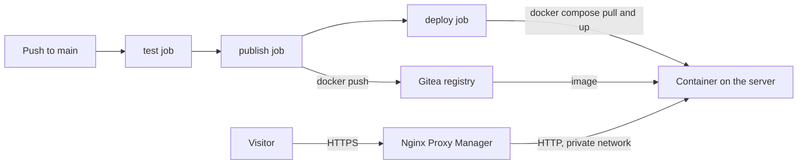

# 🚀 Deploy a Registry Image Behind a Reverse Proxy

[[DevOps/NaNa/Artifact Management/0. Artifact Management|📚 Artifact Management]]

> [!toc]- 📑 Contents
>
> - [[#🌐 The Full Pipeline|🌐 The Full Pipeline]]
> - [[#🔑 Registry Username and Token|🔑 Registry Username and Token]]
> - [[#📍 Where Secrets and Variables Live|📍 Where Secrets and Variables Live]]
> - [[#📦 Building Where npm Is Blocked|📦 Building Where npm Is Blocked]]
> - [[#🧩 The Deploy Compose File|🧩 The Deploy Compose File]]
> - [[#📝 The Three-Job Workflow|📝 The Three-Job Workflow]]
> - [[#🔒 Connect the Reverse Proxy|🔒 Connect the Reverse Proxy]]
> - [[#🛡️ Security Trade-Offs|🛡️ Security Trade-Offs]]
> - [[#🩺 Troubleshooting|🩺 Troubleshooting]]
> - [[#🧪 Understanding Check|🧪 Understanding Check]]
> - [[#🔨 Hands-On Practice|🔨 Hands-On Practice]]
> - [[#📋 Quick Reference|📋 Quick Reference]]
> - [[#🧠 Things to Remember|🧠 Things to Remember]]
> - [[#💡 Pro Tips|💡 Pro Tips]]
> - [[#🔗 Related Topics|🔗 Related Topics]]

## 🌐 The Full Pipeline

The previous note stopped after publication. This one finishes the job: the server runs the published image, and a reverse proxy serves it over HTTPS.

> 💡 **Real-World Example**
>
> A static browser game, `Hamed/vending-machine-game`, is tested and built on `git.example.com`. Its image is pushed to the Gitea registry and started on the same server that hosts Gitea, the runner, and Nginx Proxy Manager (NPM).
>
> The server never receives the source code. It only receives an image reference.



Three jobs, one direction:

| Job | Does | Needs |
|---|---|---|
| `test` | Install, run tests, build | Nothing secret |
| `publish` | Build image, push, link package | Registry token |
| `deploy` | Pull that exact image, start it | Registry token, Docker access |

Gitea's `NPM` in this note means **Nginx Proxy Manager**, the reverse proxy. Node's package manager is written as **npm** in lowercase, and the two are unrelated.

## 🔑 Registry Username and Token

Docker needs two values to log in to the registry. They are two halves of one credential.

| Secret | What it is | Secret? |
|---|---|---|
| `REGISTRY_USERNAME` | Login name of a Gitea account | No, but it must match the token's owner |
| `REGISTRY_TOKEN` | A personal access token (PAT) that account created | Yes |

```bash
printf '%s' "$REGISTRY_TOKEN" |
  docker login git.example.com \
    --username "$REGISTRY_USERNAME" \
    --password-stdin
```

The username is the login name; the token takes the password's place.

Create the token in **Profile → Settings → Applications → Generate New Token** and grant package **Read and Write**. Gitea shows the token string **once**. That string is the secret value. The name you typed is only a label in your token list.

- 🔐 **Why a token and not the password:** a token has limited scope, can be revoked alone, and never exposes the account password.

- 🚫 **Why not `GITEA_TOKEN`:** the token Actions provides automatically cannot publish packages. A personal token is required.

- 🔤 **Three different names:**

  | Item | Example | Case |
  |---|---|---|
  | Login account | `Hamed` | Any |
  | Image owner in the path | `hamed` | Lowercase |
  | Package name | `vending-machine-game` | Lowercase |

  The final reference is `git.example.com/hamed/vending-machine-game:build-...`. The login account may differ from the owner only if it has permission to publish under that owner.

## 📍 Where Secrets and Variables Live

A secret or variable belongs to a **scope**. A job sees only values from its repository's scope or its owner's scope.

| Scope | Applies to |
|---|---|
| Repository settings | That repository |
| Organization settings | Repositories of that organization, if shared |
| User settings | Repositories **owned by that user** |

> [!warning] A common trap
>
> A variable created in user `robot-market`'s settings does **not** apply to `Hamed/vending-machine-game`. The repository belongs to `Hamed`, so the job never sees the value and falls back to defaults.
>
> Being an admin or collaborator does not change this. Scope is decided by where the value is stored.

Create the values at **Repository → Settings → Actions**:

| Where | Name | Value |
|---|---|---|
| Secrets | `REGISTRY_USERNAME` | Account that owns the token |
| Secrets | `REGISTRY_TOKEN` | The token string |
| Variables | `NPM_REGISTRY` | npm mirror address, if needed |
| Variables | `HEALTH_URL` | Optional URL to check after deploy |

Secrets hide their values after saving. Variables are plain text, so never store tokens as variables.

## 📦 Building Where npm Is Blocked

The Dockerfile runs `npm ci`, which downloads packages from `registry.npmjs.org`. Some servers cannot reach that address, and the build times out on the first package.

Test candidate mirrors **from the server**:

```bash
for r in https://registry.npmjs.org https://registry.npmmirror.com https://registry.yarnpkg.com; do
  printf '%s -> ' "$r"
  curl -sS -o /dev/null -w '%{http_code} in %{time_total}s\n' --max-time 20 "$r/three" 2>&1 | tail -1
done
```

`200` means the registry answers. `000` or a timeout means it is blocked.

An answering registry is not enough. Package files often come from a different host through a redirect, so test a real tarball and follow redirects with `-L`:

```bash
curl -sSL --max-time 60 -o /dev/null -w '%{http_code} %{url_effective}\n' \
  "$(curl -sS --max-time 20 https://registry.npmmirror.com/three/0.180.0 \
     | grep -o '"tarball":"[^"]*"' | head -1 | cut -d'"' -f4)"
```

- ↪️ **`302`** without `-L` is a redirect, not an error. With `-L`, the final `200` shows the CDN host works.

- 🔗 **Lockfile:** `package-lock.json` stores `resolved` URLs pointing at `registry.npmjs.org`. npm rewrites them to the configured registry, so you do not edit the lockfile.

Set the working mirror in the variable `NPM_REGISTRY`, with a trailing slash:

```text
https://registry.npmmirror.com/
```

The workflow passes it to every `npm` command and to `docker build --build-arg`, and the Dockerfile uses it for `npm ci`.

## 🧩 The Deploy Compose File

The deployment definition lives in the repository, in `deploy/docker-compose.yml`:

```yaml
services:
  game:
    image: ${IMAGE:?set IMAGE}
    container_name: vending-machine-game
    restart: unless-stopped
    environment:
      SITE_ADDRESS: ":80"
    networks:
      - frontend_proxy

networks:
  frontend_proxy:
    external: true
```

- 🏷️ **`image: ${IMAGE:?...}`** takes the full registry reference from the environment. Compose fails clearly if it is missing.

- 🔌 **No `ports:`.** Nothing is published on the host. The proxy reaches the container over a Docker network.

- 🌐 **`frontend_proxy` is `external`:** it already exists and the proxy is attached to it. Compose joins it instead of creating a new one.

- 🔓 **`SITE_ADDRESS: ":80"`** makes the web server inside the image listen on plain HTTP. HTTPS is handled by the proxy, so the container does not request certificates.

- 📛 **`container_name`** gives a stable DNS name inside the network. The proxy forwards to it.

Because the file is in git, deploy configuration is reviewed and rolled back like code. The server does not need its own copy.

## 📝 The Three-Job Workflow

The workflow is `.gitea/workflows/ci-cd.yml`. These are the important parts.

**`publish`** builds, pushes, and links, as in the previous note, with two additions: the build gets the npm mirror, and it exports the image reference to the next job.

```yaml
  publish:
    needs: test
    if: github.event_name != 'pull_request' && github.ref == 'refs/heads/main'
    outputs:
      image: ${{ steps.push.outputs.image }}
    steps:
      - name: Build, push and link the image
        id: push
        run: |
          # ...login, build with --build-arg NPM_REGISTRY=..., push...
          echo "image=$IMAGE" >> "$GITEA_OUTPUT"
```

- 📤 **`outputs` and `$GITEA_OUTPUT`** pass the exact reference to later jobs. Deployment does not guess the newest tag.

- 🔗 **Linking is tolerant.** Gitea answers HTTP **400** when the package is already linked, which happens on every run after the first. The image is published either way, so the step prints a warning and continues:

  ```bash
  status="$(curl --silent --output /dev/null --write-out '%{http_code}' --request POST \
    --header "Authorization: token $REGISTRY_TOKEN" \
    "https://$REGISTRY/api/v1/packages/$OWNER/container/${REPO,,}/-/link/$REPO")"
  ```

**`deploy`** applies the compose file through the runner's Docker daemon:

```yaml
  deploy:
    needs: publish
    steps:
      - uses: actions/checkout@v4
      - name: Deploy the published image
        env:
          IMAGE: ${{ needs.publish.outputs.image }}
        run: |
          set -euo pipefail
          DOCKER_CONFIG="$(mktemp -d)"
          export DOCKER_CONFIG
          trap 'rm -rf "$DOCKER_CONFIG"' EXIT

          printf '%s' "$REGISTRY_TOKEN" |
            docker login git.example.com --username "$REGISTRY_USERNAME" --password-stdin
          docker compose -p vending-machine-game -f deploy/docker-compose.yml pull
          docker compose -p vending-machine-game -f deploy/docker-compose.yml up -d --remove-orphans
          docker image prune -f
```

- 🧭 **Why this works:** the runner runs on the same server and mounts `/var/run/docker.sock`. Docker commands in a job therefore talk to the server's daemon directly, with no SSH.

- 🔑 **Where credentials go:** the pull happens through the daemon but with the client's credentials, so a temporary login in the job is enough. The server needs no saved `docker login`.

- 🏷️ **`-p vending-machine-game`** fixes the Compose project name, so repeated runs update the same stack.

- 🧹 **`image prune -f`** removes dangling layers only. Tagged older builds stay available for rollback.

- 🧪 **Pull-request runs** skip `publish` and `deploy` because of the `if:` on `publish` and `needs`.

## 🔒 Connect the Reverse Proxy

In Nginx Proxy Manager, add a **Proxy Host**.

**Details**

| Field | Value |
|---|---|
| Domain Names | The domains pointed at the server |
| Scheme | `http` |
| Forward Hostname / IP | `vending-machine-game` |
| Forward Port | `80` |
| Cache Assets | Off |
| Block Common Exploits | On |
| Websockets Support | Off |

**SSL**

- 🔐 Request a Let's Encrypt certificate, or pick an existing one.
- ↪️ Turn on **Force SSL** and **HTTP/2**.
- 📌 Enable **HSTS** only after HTTPS is confirmed working, because browsers remember it.

> [!question] Why `http` and port 80 if the site must be HTTPS?
>
> Visitors always use HTTPS. The proxy terminates TLS and forwards the request over the private Docker network. The `http` scheme in the proxy settings describes only that inner hop. No port is published, so nothing outside the host can reach it.
>
> Re-encrypting the inner hop adds certificate management and little protection on a private bridge network.

Before saving: the domain's DNS A record must point at the server, and the container and the proxy must share the `frontend_proxy` network. Check name resolution from the proxy container:

```bash
docker exec nginx-proxy-manager-npm-1 getent hosts vending-machine-game
```

PWA install and GPS features require HTTPS, so test on a phone after saving.

## 🛡️ Security Trade-Offs

Giving a job access to the host Docker socket is convenient and powerful. It is also **root on the host**.

| Risk | Why it matters |
|---|---|
| Socket access | A job can start containers that mount the host filesystem and reach other apps on the same server |
| Workflow guards are not security | A same-repository branch can edit the workflow file and remove an `if:` condition |
| Deploy options share the code's trust level | Anyone who can merge to `main` can change ports, volumes, or privileges in the compose file |

Practical defenses, cheapest first:

- 🔒 **Protect `main`:** require a pull request and review, and disable direct pushes.
- 👥 **Review changes** to `.gitea/workflows/` and `deploy/` more strictly, for example through code owners.
- 🔑 **Keep the token package-only** and rotate it when collaborators change.
- 🚫 **Do not run workflows from untrusted contributors** without approval.

Stronger designs when the stakes are higher:

- 🗂️ **Separate repositories:** the application repository only publishes images; a smaller ops repository holds the deploy configuration.
- 🏃 **Dedicated deploy runner** with its own label, not the runner that builds untrusted code.
- 🧱 **A Docker socket proxy** that allows only the calls a deployment needs.
- 🔐 **SSH with a forced command:** a restricted key that can run one fixed deploy script on one path. This can be narrower than socket access.

For a small trusted team the socket approach is acceptable with branch protection. Move to one of the stronger designs when outside contributors get write access.

## 🩺 Troubleshooting

| Symptom | Likely cause | Fix |
|---|---|---|
| `npm error FETCH_ERROR` on `registry.npmjs.org` | Variable not seen by the job | Create `NPM_REGISTRY` at repository scope, then start a **new** run |
| Mirror works for `/three` but build still fails | Tarball host blocked | Test a tarball with `curl -L` |
| `401` on push | Wrong username/token pair, or token lacks package scope | Re-create the token with Read and Write |
| `403` on push | Account cannot publish under that owner | Use the owner account, or grant access |
| Login works, push fails | Image path has uppercase letters | Lowercase owner and name |
| Link step: HTTP `400` | Package already linked | Harmless; the step only warns |
| `docker: command not found` | Job has no Docker access | Check the runner's socket and `config.yaml` |
| `'compose' is not a docker command` | Compose plugin missing in the job environment | Install the plugin or use `docker run` |
| Proxy returns `502` | Name not resolving, or wrong network | Check `frontend_proxy` and the forward hostname |
| Certificate request fails | DNS not pointing at the server | Fix the A record, then retry |

Variables are read **when a run starts**. After changing one, start a fresh run; re-running with old data is not enough in every case.

## 🧪 Understanding Check

**Q1:** Why is `REGISTRY_TOKEN` a personal token rather than the built-in `GITEA_TOKEN`?

**Q2:** A variable exists in user `robot-market`'s settings, but a repository owned by `Hamed` does not see it. Why?

**Q3:** Why does the compose file have no `ports:` section, yet the site is reachable?

**Q4:** The link call returns HTTP 400 on the second run. Is the pipeline broken?

**Q5:** Why does `deploy` receive the image reference from `publish` instead of pulling `latest`?

**Q6:** What is the main risk of giving a job the Docker socket?

> [!answer]- 📋 Answers
>
> **A1:** The built-in token cannot publish registry packages. A personal token with package Read and Write permission can.
>
> **A2:** Scope follows ownership. User-level values apply only to repositories owned by that user.
>
> **A3:** The proxy reaches the container over a shared Docker network by its container name. Nothing needs to be published on the host.
>
> **A4:** No. The package is already linked and the image is published. The step reports the status and continues.
>
> **A5:** An exact reference deploys the tested artifact and makes rollback possible. `latest` can point at something else.
>
> **A6:** Socket access is root on the host, so a job can reach every other container and file on that server.

## 🔨 Hands-On Practice

1. 🔑 **Verify a credential pair.**

   Run `docker login git.example.com` with the username and token. Confirm `Login Succeeded`, then run `docker logout git.example.com`.

2. 📍 **Find a scope mistake.**

   Create a harmless variable in your **user** settings and another in the **repository** settings. Print both in a test workflow and observe which one the job sees.

3. 📦 **Prove a mirror works.**

   Run the tarball test with `curl -L` against a mirror and explain what the redirect target shows.

4. 🚀 **Trace a deploy.**

   After a run, check `docker compose -p vending-machine-game ps` and `docker inspect vending-machine-game`. Match the image reference to the tag shown in the `publish` log.

5. ⏪ **Practice a rollback.**

   Re-run the workflow on an older commit, or edit the image tag, and describe which job changes the running container.

### 📋 Quick Reference

| Item | Purpose |
|---|---|
| `REGISTRY_USERNAME` / `REGISTRY_TOKEN` | Account name and its package token |
| `NPM_REGISTRY` | npm mirror for blocked networks |
| `deploy/docker-compose.yml` | Server deployment definition, kept in git |
| `$GITEA_OUTPUT` | Pass values to later jobs |
| `frontend_proxy` | Network shared with the reverse proxy |
| `docker compose -p NAME ps` | Check a stack without its file |
| `docker image prune -f` | Remove dangling layers only |

### 🧠 Things to Remember

- Username identifies; the token authenticates.

- Scope decides which job sees a secret or variable.

- Deploy the exact published reference, never a guessed tag.

- Visitors use HTTPS; the proxy handles TLS, and the inner hop is private.

- Docker socket access is root on the host.

### 💡 Pro Tips

- Protect `main` before giving others write access.

- Keep one source of truth for deploy configuration and avoid unmanaged copies on the server.

- Use separate Read and Read-and-Write tokens when deployment and publishing are different jobs.

- Test mirrors and registries from the machine that will use them.

### 🔗 Related Topics

- [[DevOps/NaNa/Artifact Management/Gitea/2 - Docker Container Registry|Docker Container Registry]]

- [[DevOps/NaNa/Artifact Management/Gitea/3 - Build and Publish Images with CI|Build and Publish Images with CI]]

- [[DevOps/NaNa/Artifact Management/Gitea/4 - Storage Cleanup and Troubleshooting|Storage, Cleanup, and Troubleshooting]]

- [[DevOps/NaNa/Docker/6. Dockerfile|Dockerfile]]
