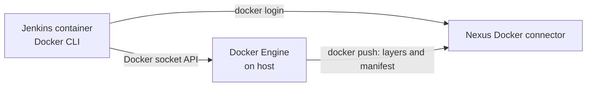
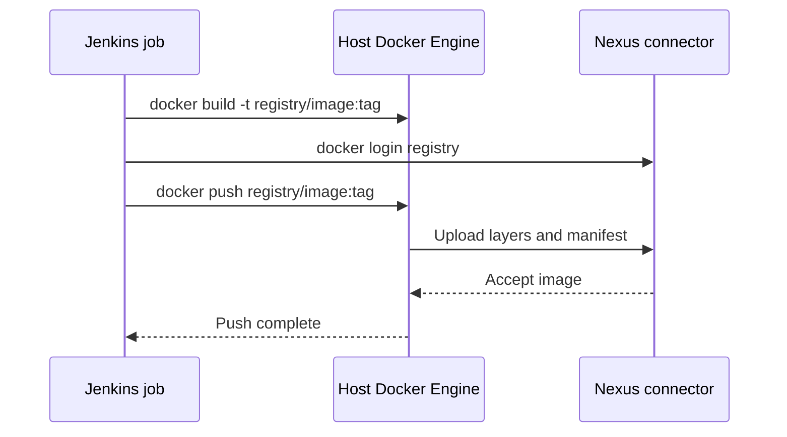
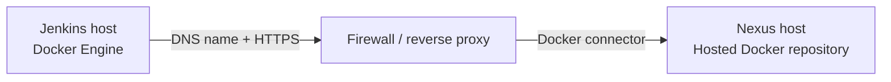

# 🚀 Pushing Docker Images to Nexus from Jenkins

[[DevOps/NaNa/0. Nana DevOps Table of Contents|📚 Nana DevOps Table of Contents]]

> [!toc]- 📑 Contents
>
> - [[#🧭 The Important Boundary|🧭 The Important Boundary]]
> - [[#🏠 Nexus on the Jenkins Docker Host|🏠 Nexus on the Jenkins Docker Host]]
> - [[#🌍 Nexus on Another Host|🌍 Nexus on Another Host]]
> - [[#🔐 Credentials and Registry Security|🔐 Credentials and Registry Security]]
> - [[#🧪 Troubleshooting the Connection|🧪 Troubleshooting the Connection]]
> - [[#🧪 Interview Q&A|🧪 Interview Q&A]]
> - [[#🔨 Hands-On Practice|🔨 Hands-On Practice]]
> - [[#📋 Quick Reference|📋 Quick Reference]]
> - [[#🧠 Things to Remember|🧠 Things to Remember]]
> - [[#💡 Pro Tips|💡 Pro Tips]]
> - [[#🔗 Related Topics|🔗 Related Topics]]

## 🧭 The Important Boundary

When Jenkins mounts `/var/run/docker.sock`, its Docker CLI talks to the **Docker Engine running on the host**. The CLI asks that Engine to build and push images; the Engine needs network access to the registry for the push. See Docker's [Engine API](https://docs.docker.com/reference/api/engine/) for the client-to-daemon relationship.

This creates two networking perspectives:

- 🧰 **Jenkins container:** runs the `docker` CLI and needs to contact Nexus for registry login.

- 🐳 **Host Docker Engine:** builds the image and sends its layers and manifest to Nexus during `docker push`.

The registry address used in the job must work from both perspectives. Container DNS names such as `nexus` may resolve inside a shared Docker network, but they are not automatically host DNS names for the Docker Engine.



Use Nexus's **Docker connector address** in the image name. With a port connector, the port selects the Nexus Docker repository, so an image path is usually `registry-host:port/image:tag`; `/repository/<name>` is the Nexus web content URL pattern, not the Docker image name.

---

## 🏠 Nexus on the Jenkins Docker Host

When Nexus and Jenkins run as containers on the same Linux host, a user-defined bridge network allows the containers to communicate and resolve each other by name. However, because the Docker Engine is on the host, a durable setup should give the registry a stable host address and published connector port rather than relying on Nexus's changing container IP. See Docker's [bridge networking](https://docs.docker.com/engine/network/drivers/bridge/) and [port publishing](https://docs.docker.com/engine/network/port-publishing/) guides.

### 📡 Publish the connector port

Suppose the Nexus Docker hosted repository has an HTTP or HTTPS connector on **container port `8083`**. Publish it on a host port, for example `18083`:

```text
Host port 18083 → Nexus container port 8083
```

Port publishing is set when the container is created. If the Nexus container was started without this mapping, recreate it with the mapping and keep its existing `/nexus-data` volume so Nexus configuration and data persist. Check the current mount before recreating the container:

```bash
docker inspect nexus --format '{{json .Mounts}}'
```

For example, a `docker run` setup might include:

```bash
docker run -d \
  --name nexus \
  --network ci-network \
  -p 18083:8083 \
  -p 8081:8081 \
  -v nexus-data:/nexus-data \
  sonatype/nexus3:<pinned-version>
```

- `18083:8083` maps the host's port `18083` to Nexus's connector port `8083`.

- `nexus-data:/nexus-data` preserves Nexus data in a named volume. Use the actual existing volume name and image configuration from your deployment.

- Pin the Nexus image version to the version you intend to run; avoid `latest` for repeatable deployments.

Choose a hostname or address for the Docker host that Jenkins can reach, such as its private LAN IP or a DNS name. Do not use `127.0.0.1` from inside Jenkins: that points to the Jenkins container itself. The selected host address must also be reachable by the Docker Engine.

### 📦 Build and push

If the host is reachable as `docker-host.example.net` and its published port is `18083`:

```bash
REGISTRY=docker-host.example.net:18083
IMAGE="$REGISTRY/mqtt-test:1.0"

docker build -t "$IMAGE" .

echo "$NEXUS_PASSWORD" | docker login "$REGISTRY" \
  -u "$NEXUS_USERNAME" --password-stdin

docker push "$IMAGE"
```

The image name used by `docker build` must match the name passed to `docker push`. The Nexus repository is selected by the connector configuration, not by adding `/repository/mqtt-test/` to the image path.



---

## 🌍 Nexus on Another Host

When Nexus runs on a different server, Docker bridge networks do not span the two Docker hosts. Give Nexus a stable DNS name and TLS endpoint, route traffic from the Jenkins host to it, and restrict the Nexus connector through firewalls to the required clients.

For example, if Nexus is available at `nexus.example.net` over HTTPS on port `443`:

```bash
REGISTRY=nexus.example.net
IMAGE="$REGISTRY/mqtt-test:1.0"

docker build -t "$IMAGE" .

echo "$NEXUS_PASSWORD" | docker login "$REGISTRY" \
  -u "$NEXUS_USERNAME" --password-stdin

docker push "$IMAGE"
```

If the Docker connector uses a nonstandard port, include it in the registry address, for example `nexus.example.net:18083`. Configure DNS, TLS, firewall rules, and any reverse proxy to route that address to the Docker connector. Do not use a Docker bridge IP or `localhost` to refer to another server.



---

## 🔐 Credentials and Registry Security

Store the Nexus username and password in **Jenkins Credentials**, then bind them to environment variables for the job. Avoid putting credentials in a Jenkinsfile, repository, or command-line URL.

- 🔒 Prefer **HTTPS** with a certificate trusted by the Docker Engine host. Sonatype recommends handling SSL with a reverse proxy when appropriate; see [Nexus Docker Registry](https://help.sonatype.com/en/docker-registry.html).

- 🧪 For a private certificate authority, install its CA certificate for the registry on the Docker host's Engine trust configuration.

- ⚠️ Use an **insecure registry** setting only for a controlled lab using HTTP. Configure it on the host Docker Engine, because that Engine performs the image push. HTTP does not protect credentials or image data in transit. For example, the host's `/etc/docker/daemon.json` can include:

  ```json
  {
    "insecure-registries": ["docker-host.example.net:18083"]
  }
  ```

  Merge this key into existing JSON settings, then restart Docker for the change to take effect. A restart can interrupt running containers.

- 🧱 Limit the connector's network exposure with host firewall rules. Port publishing may make a service reachable beyond the Docker network, depending on its bind address and firewall.

---

## 🧪 Troubleshooting the Connection

| Symptom | Likely cause | Check |
|---|---|---|
| `lookup nexus ...` fails | The name is not resolvable from the process or Docker Engine making the request | Use a stable host DNS name/IP, or verify the relevant network's DNS alias |
| `connection refused` | Nothing is listening on the address and port, or the connector is not published/reachable | Check the Nexus connector and `docker ps` port mappings |
| `HTTP response to HTTPS client` | The endpoint is HTTP while the client expects HTTPS | Configure HTTPS, or allow HTTP only for a controlled lab |
| `tag does not exist` | The local image tag differs from the tag being pushed | Use the same complete `registry/image:tag` for build and push |
| `unauthorized` or `denied` | Credentials, Docker Bearer Token Realm, or repository privileges are wrong | Check Nexus authentication and the account's repository upload rights |

---

## 🧪 Interview Q&A

**Q1:** Why does connecting Jenkins and Nexus to the same Docker network not always make `nexus` a valid registry address for a socket-mounted Jenkins job?

**Q2:** Why should a pipeline tag the image with the registry hostname and connector port before pushing?

**Q3:** Where should an HTTP registry's insecure-registry setting be configured when Jenkins mounts the host Docker socket?

**Q4:** Why is `127.0.0.1` usually the wrong Nexus address inside the Jenkins container?

> [!answer]- 📋 Answers
>
> **A1:** The shared network gives containers name-based connectivity, but the host Docker Engine has its own network and DNS context. A push is performed by that Engine, so its registry address must be reachable from the host too.
>
> **A2:** Docker uses the registry hostname and optional port in the image reference to determine where to push. The pushed local tag must match that full reference.
>
> **A3:** On the host Docker Engine configuration. The Engine performs the push and must be configured to allow an HTTP registry; HTTPS with a trusted certificate is preferred.
>
> **A4:** From inside Jenkins, loopback refers to the Jenkins container's own network namespace, not the Nexus container or Docker host.

---

## 🔨 Hands-On Practice

1. 🔎 **Check the Nexus container's published ports.**

   ```bash
   docker ps --filter name=nexus --format 'table {{.Names}}\t{{.Ports}}'
   ```

   Confirm the host port maps to the connector port configured in Nexus.

2. 🌐 **Check the stable registry address from Jenkins.**

   ```bash
   getent hosts docker-host.example.net
   ```

   Replace the example name with the host name used in the pipeline. Confirm it resolves to an address Jenkins can reach.

3. 📦 **Build, log in, and push a test tag.**

   Use the matching `REGISTRY` value in the relevant example above. Confirm that the Nexus repository shows the pushed image and tag.

---

## 📋 Quick Reference

| Situation | Registry address | Network requirement |
|---|---|---|
| Nexus container on same host | Host DNS/IP plus published connector port | Jenkins container and host Engine both reach the host address |
| Nexus on another host | Nexus DNS name plus connector port, preferably HTTPS | Route and firewall permit Jenkins host access |
| Docker image upload | `docker login` + `docker push` | Use the Docker connector, not `/repository/...` |
| Standalone binary upload | Raw repository URL or format-specific package tool/API | Use the matching Nexus repository format |

```bash
docker build -t "$REGISTRY/mqtt-test:1.0" .
echo "$NEXUS_PASSWORD" | docker login "$REGISTRY" -u "$NEXUS_USERNAME" --password-stdin
docker push "$REGISTRY/mqtt-test:1.0"
```

---

## 🧠 Things to Remember

- A mounted Docker socket points Jenkins' Docker CLI at the host Docker Engine.

- The host Engine performs the image build and push; registry addressing and trust must work from the Engine's host.

- A bridge network connects containers on one Docker host. It does not create a multi-host network.

- Use a stable hostname and published connector port. Avoid dynamic container IPs for long-lived job configuration.

- Docker images use the Docker Registry protocol. Use `docker login` and `docker push`; use Raw upload paths for standalone files instead.

---

## 💡 Pro Tips

- Give each release an immutable tag, such as a Git commit SHA or release version, so a later build does not silently replace the same `1.0` tag.

- Prefer HTTPS and a trusted certificate; insecure-registry configuration is a lab workaround, not a production transport.

- Keep Nexus credentials in Jenkins Credentials and grant the publishing account only the repository permissions it needs.

- Verify the Nexus `/nexus-data` volume before recreating the container to add a port mapping.

---

## 🔗 Related Topics

[[DevOps/NaNa/Artifact Management/Nexus/1. Artifact and Artifact Repo|Artifact and Artifact Repo]]

[[DevOps/NaNa/Artifact Management/Nexus/2. Nexus Repository Manager — Raw Repositories, Users Roles, and REST API|Nexus Raw Repositories and REST API]]

[[DevOps/NaNa/Artifact Management/Nexus/3. Blob|Nexus Blob Stores]]

[[DevOps/NaNa/Ci-CD/Jenkins/2. Docker in Jenkins|Docker in Jenkins]]

[[DevOps/NaNa/Docker/5. Docker Compose|Docker Compose]]
