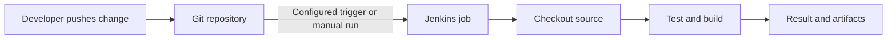
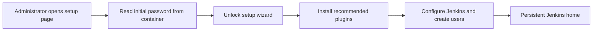
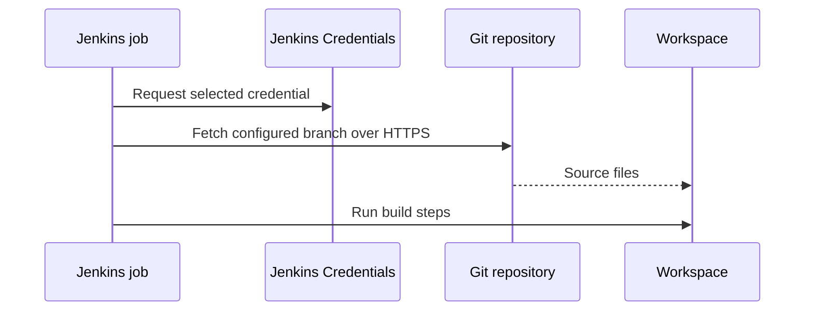

# ⚙️ Jenkins Basics

[[DevOps/NaNa/0. Nana DevOps Table of Contents|📚 Nana DevOps Table of Contents]]

> [!toc]- 📑 Contents
>
> - [[#🚀 What Jenkins Does|🚀 What Jenkins Does]]
> - [[#👥 Jenkins Administrators and Job Users|👥 Jenkins Administrators and Job Users]]
> - [[#🔐 First-Time Setup in Docker|🔐 First-Time Setup in Docker]]
> - [[#🧰 Give Jobs the Tools They Need|🧰 Give Jobs the Tools They Need]]
> - [[#🛠️ Choose a Job Type|🛠️ Choose a Job Type]]
> - [[#🌿 Connect a Git Repository|🌿 Connect a Git Repository]]
> - [[#📜 Run a Repository Script|📜 Run a Repository Script]]
> - [[#🧪 Interview Q&A|🧪 Interview Q&A]]
> - [[#🔨 Hands-On Practice|🔨 Hands-On Practice]]
> - [[#📋 Quick Reference|📋 Quick Reference]]
> - [[#🧠 Things to Remember|🧠 Things to Remember]]
> - [[#💡 Pro Tips|💡 Pro Tips]]
> - [[#🔗 Related Topics|🔗 Related Topics]]

## 🚀 What Jenkins Does

Jenkins is an automation server. It checks out project files and runs the steps a team defines, such as tests, builds, and packaging. A **job** is a configured task; a **pipeline** describes a series of tasks that Jenkins can run and report on.

> 💡 **Real-World Example**
>
> A developer pushes a Go API change to Git. Jenkins checks out the selected branch, runs `go test ./...`, builds the application, and reports whether the run succeeded.



Jenkins only starts from a push automatically when a trigger is configured, such as a webhook or polling. A job can also be started manually.

---

## 👥 Jenkins Administrators and Job Users

Jenkins work commonly divides into **server administration** and **pipeline authoring**. In a small team, the same DevOps engineer may do both, but the permissions and responsibilities are distinct.

| Role | Typical responsibilities |
|---|---|
| Jenkins administrator | Configure Jenkins and its agents, manage plugins and credentials, control access, and plan backups of Jenkins data. |
| Job or pipeline user | Create and maintain jobs that check out code and run project workflows. |

Administrators should grant each user only the permissions their work requires. Creating a job does not necessarily require permission to install plugins or change global Jenkins settings.

---

## 🔐 First-Time Setup in Docker

The official Jenkins container image's initial setup presents an administrator unlock step. Its page explains where to read the initial password from inside the running container; the exact path depends on the image setup and is shown by Jenkins. After unlocking, the setup wizard offers recommended plugins, which provide a useful starting set for a basic installation.

Keep Jenkins' home data in persistent storage. It contains configuration, installed plugins, job data, and credentials; removing a container without preserving that data can remove the Jenkins setup.



Treat the initial password as a secret. Do not paste it into a shared terminal transcript, source file, or chat.

---

## 🧰 Give Jobs the Tools They Need

A job can use only the tools available in the environment where its steps run. A Node.js build may need Node and a package manager such as npm or pnpm; a Java build may need a JDK and Maven; a Go build needs the Go toolchain.

There are several ways to provide tools:

- 🔌 **Jenkins plugins** can integrate tool installation or configuration into Jenkins.

- ⚙️ **Global Tool Configuration** lets an administrator configure supported tools for jobs.

- 📦 **The agent or container image** can include tools directly. This gives control over versions and multiple toolchains, but you must manage image updates and ensure jobs run on an agent that has those tools.

Installing software manually in a running container is useful for a short experiment, but it is usually ephemeral: a replacement container may not contain the changes. For repeatable jobs, use a maintained image or configured tool installation, and run the job on the matching agent.

### 🐳 Install and Inspect a Tool in a Container

For a disposable learning container, enter as root and identify its operating system before choosing package commands:

```bash
docker exec -u 0 -it <jenkins-container> sh
cat /etc/issue
```

- **`docker exec`** runs a command in an existing container.

- **`-u 0`** runs it as user ID 0 (root), which is normally needed to install system packages.

- **`-it`** provides an interactive terminal.

- **`<jenkins-container>`** is a placeholder; replace it with the actual container name or ID.

Use the package manager that matches the container's base image. For example, a Debian-based image uses `apt-get`; other distributions may use a different manager. Install only what the job needs, and remember that a manual change to a running container may disappear when it is recreated.

> ⚠️ Root access can modify the whole container. Do not run copied installation commands until you have confirmed the image's operating system and package manager.

### 🛠️ Example: Make Go Available to Jenkins Jobs

Suppose Go is installed at `/usr/local/go`, so its executable is `/usr/local/go/bin/go`. A job that runs `go version` can still fail if that directory is not in the **environment of the Jenkins process/job**.

Adding the path to root's `~/.profile` does not reliably configure Jenkins jobs: jobs do not necessarily start a login shell for root. Configure Jenkins' global environment instead, under **Manage Jenkins → System → Global properties → Environment variables**:

| Name | Value |
|---|---|
| `PATH+GO` | `/usr/local/go/bin` |

The `PATH+` prefix tells Jenkins to add the directory to the existing `PATH`; `GO` is just a label. Check the executable and version in the job environment:

```bash
command -v go
go version
```

✅ `command -v go` should print the executable path, and `go version` should print the installed Go version. These checks confirm that the job can find Go; they do not confirm that the project builds successfully.

---

## 🛠️ Choose a Job Type

Jenkins offers different ways to define work. **Freestyle** jobs configure build steps through the UI and are handy for learning or a small one-off task. For source-controlled workflows, teams commonly use **Pipeline** or **Multibranch Pipeline** jobs so the workflow can live alongside the project and be reviewed like code.

| Type | What it is useful for |
|---|---|
| Freestyle project | Learning Jenkins and configuring a straightforward job in the UI. |
| Pipeline | Running a pipeline definition for a repository or configured branch. |
| Multibranch Pipeline | Discovering branches in a repository and running the pipeline definition found on each branch. |

For Pipeline jobs, the workflow is commonly defined in a `Jenkinsfile` in the repository. Multibranch Pipeline is useful when several branches should be discovered and built independently.

---

## 🌿 Connect a Git Repository

A job can fetch source from a Git repository and then run its build steps against the checked-out files. Configure the repository URL, the credentials Jenkins should use (when needed), and the branch or branch pattern to build.



Use Jenkins' **Credentials** store and select the credential in the job configuration. Avoid embedding a username and password or token in the repository URL, job script, or a committed file. Prefer a scoped token or other supported credential with only the access Jenkins needs.

The configured branch determines which revision Jenkins checks out. A successful checkout confirms Jenkins can access that repository and branch; it does not mean the build or tests passed.

---

## 📜 Run a Repository Script

A build script keeps project commands in the repository, so developers can review and change them with the code. For example, a repository might contain `ci/build.sh`, and a Jenkins shell step can invoke it from the checked-out workspace.

On Linux, the executable bit can be set with:

```bash
chmod +x ci/build.sh
```

Then run it from the repository root:

```bash
./ci/build.sh
```

Commit the executable permission along with the script when the job relies on `./ci/build.sh`. Alternatively, Jenkins can invoke an interpreter explicitly, such as `sh ci/build.sh`, when the file is readable and compatible with that shell. Scripts should fail with a non-zero exit status when a required build step fails, so Jenkins can mark the run as failed.

> ⚠️ Do not put credentials directly in the script. Bind credentials through Jenkins' credential mechanisms and keep access limited to the steps that need them.

---

## 🧪 Interview Q&A

**Q1:** Why might `go version` work in an interactive container shell but fail in a Jenkins job?

**Q2:** When is a Multibranch Pipeline useful compared with a Freestyle job?

**Q3:** Why should a Git token be stored in Jenkins Credentials instead of the repository URL?

**Q4:** What can a successful Git checkout tell you, and what does it not prove?

> [!answer]- 📋 Answers
>
> **A1:** The job has its own environment. Go's `bin` directory may not be in the `PATH` inherited by Jenkins, even if it is available in an interactive shell.
>
> **A2:** Multibranch Pipeline discovers branches and runs the pipeline definition in each branch. Freestyle is useful for learning or simple UI-configured work.
>
> **A3:** Jenkins Credentials keeps secrets out of source code, URLs, and logs more effectively and allows access to be scoped.
>
> **A4:** It shows Jenkins could fetch the configured repository and branch. It does not prove that the project's tests or build succeeded.

## 🔨 Hands-On Practice

Use a disposable Jenkins learning instance and a repository you are allowed to access.

1. 🔎 **Check the container environment.**

   Open a shell in the Jenkins container and inspect `/etc/issue`.

   ✅ Identify the distribution before selecting any package installation command.

2. 🧰 **Check a job's Go environment.**

   Add `command -v go` and `go version` as job steps.

   ✅ If the executable is missing, confirm Go is installed on the agent and add its `bin` directory to the job's `PATH` configuration.

3. 🌿 **Fetch a test repository.**

   Configure a job with its HTTPS URL, a Jenkins-managed credential if required, and an existing branch.

   ✅ Confirm the log shows checkout of the expected branch. Do not use a personal or administrator password for this exercise.

4. 📜 **Run a repository script.**

   Add a small build script to the test repository and invoke it from the job. If running it directly, make it executable and commit that permission.

   ✅ A non-zero exit from a failing required command should cause the Jenkins step and run to fail.

---

### 📋 Quick Reference

| Need | Where / command |
|---|---|
| Unlock initial setup | Follow the setup page's instructions for reading the password inside the container |
| Inspect container OS | `cat /etc/issue` |
| Enter as root for a lab install | `docker exec -u 0 -it <jenkins-container> sh` |
| Add Go to Jenkins job PATH | Global properties: `PATH+GO` = `/usr/local/go/bin` |
| Verify Go in a job | `command -v go` then `go version` |
| Set a script executable | `chmod +x ci/build.sh` |
| Store Git access | Jenkins Credentials; select it in the job configuration |
| Common source-controlled job types | Pipeline and Multibranch Pipeline |

### 🧠 Things to Remember

- **Jenkins runs commands in a job environment.** A tool installed somewhere on the host or container may not be on the job's `PATH`.

- **A running-container change may be temporary.** Use a maintained image or repeatable tool configuration for jobs that need the tool consistently.

- **Pipelines can be stored with the source code.** A `Jenkinsfile` makes workflow changes reviewable alongside project changes.

- **Keep credentials in Jenkins Credentials.** Do not commit secrets or place them in repository URLs.

### 💡 Pro Tips

- Pin tool versions in agent images or Jenkins tool configuration so different builds do not silently use different toolchains.

- Use a dedicated, limited-access Git credential for Jenkins rather than a personal administrator credential.

- Keep project build commands in a version-controlled script or `Jenkinsfile`; this makes local reproduction and review easier.

### 🔗 Related Topics

- [[DevOps/NaNa/Docker/1. Container|Docker Containers and Images]]

- [[DevOps/NaNa/Docker/4. Docker Workflow in Real projects|Docker Workflow in Real Projects]]

- [[DevOps/NaNa/Git NANA/5. Git Remote Branches and Syncing|Git Remote Branches and Syncing]]

- [[DevOps/NaNa/Artifact Management/Gitea/3 - Build and Publish Images with CI|Build and Publish Images with CI]]

- [[DevOps/NaNa/Artifact Management/Nexus/1. Artifact and Artifact Repo|Artifacts and Artifact Repositories]]
