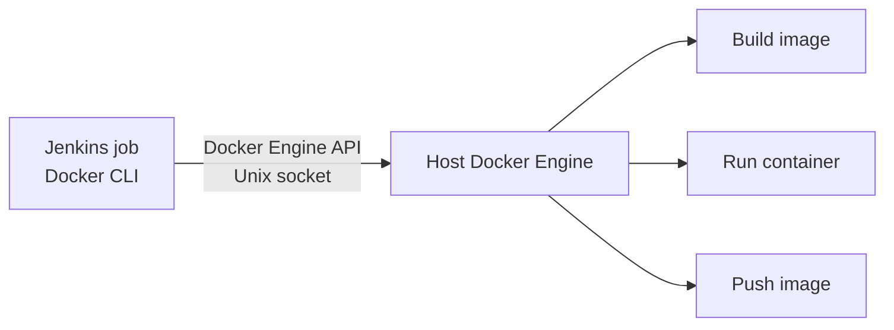
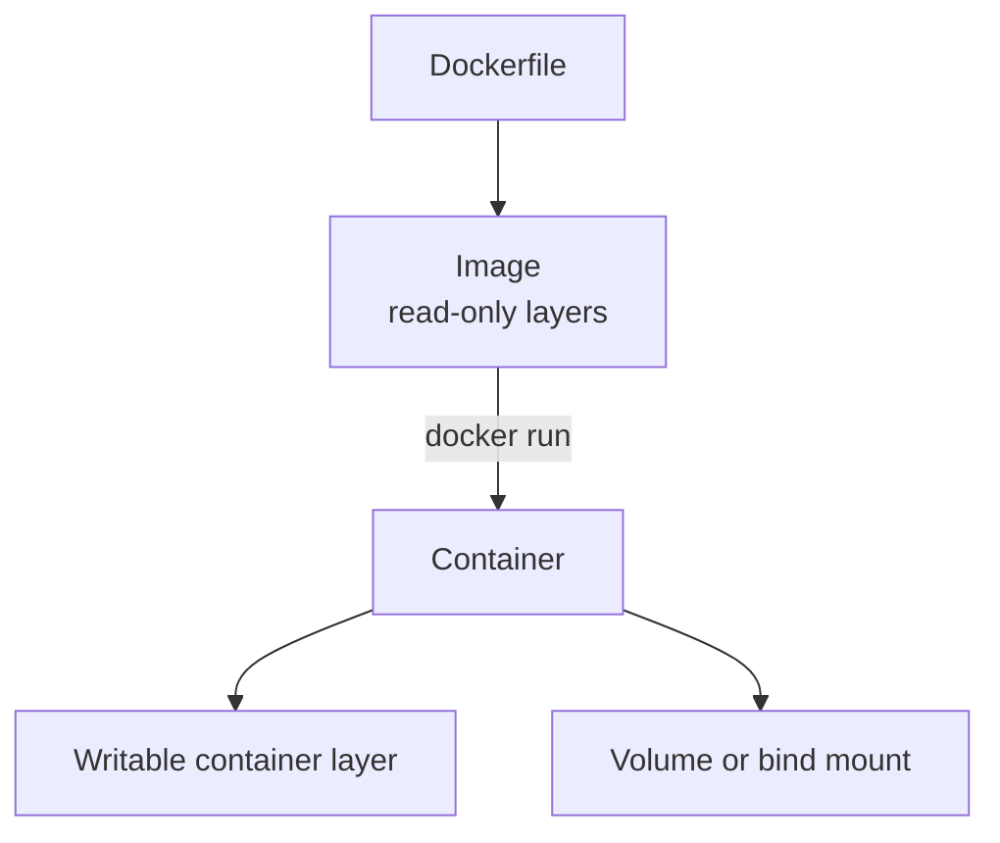
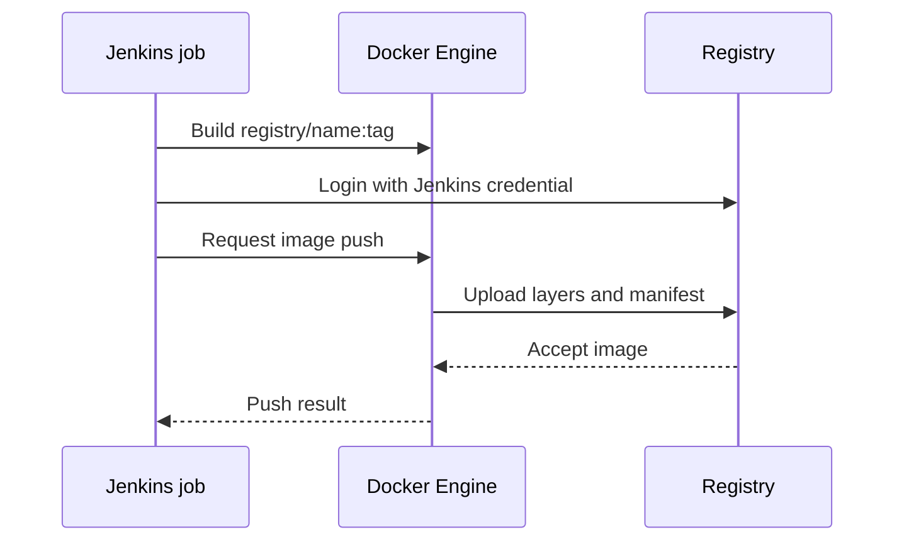
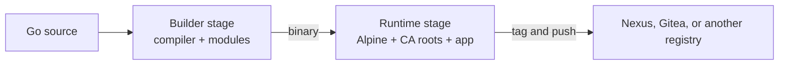
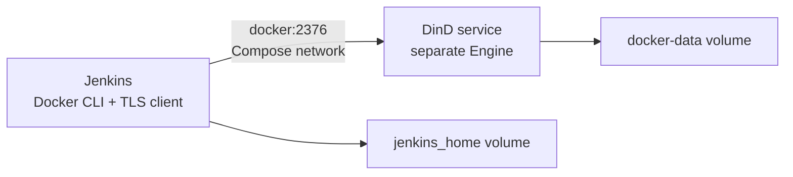

# 🐳 Docker in Jenkins

[[DevOps/NaNa/0. Nana DevOps Table of Contents|📚 Nana DevOps Table of Contents]]

> [!toc]- 📑 Contents
>
> - [[#🧭 Docker CLI and Docker Engine|🧭 Docker CLI and Docker Engine]]
> - [[#⚙️ Choose Where Docker Runs|⚙️ Choose Where Docker Runs]]
> - [[#🧰 Build a Jenkins Image with Docker CLI|🧰 Build a Jenkins Image with Docker CLI]]
> - [[#🔌 Mount the Host Docker Socket|🔌 Mount the Host Docker Socket]]
> - [[#📦 Build and Push an Application Image|📦 Build and Push an Application Image]]
> - [[#🧱 Multi-Stage Application Build|🧱 Multi-Stage Application Build]]
> - [[#🐳 Alternative: Docker-in-Docker with Compose|🐳 Alternative: Docker-in-Docker with Compose]]
> - [[#💾 Named Volume vs Bind Mount|💾 Named Volume vs Bind Mount]]
> - [[#🧪 Interview Q&A|🧪 Interview Q&A]]
> - [[#🔨 Hands-On Tasks|🔨 Hands-On Tasks]]
> - [[#📋 Quick Reference|📋 Quick Reference]]
> - [[#🧠 Things to Remember|🧠 Things to Remember]]
> - [[#💡 Pro Tips|💡 Pro Tips]]
> - [[#🔗 Related Topics|🔗 Related Topics]]

## 🧭 Docker CLI and Docker Engine

Jenkins can run Docker commands from a job, but it needs a **Docker CLI** and access to a **Docker Engine**. The CLI sends API requests; the Engine builds images, starts containers, and pushes images to registries.

With a mounted `/var/run/docker.sock`, the CLI runs inside Jenkins but controls the Docker Engine on the host. This is often called Docker-outside-of-Docker (DooD). It does **not** mean Docker Engine is installed inside the Jenkins container.



The daemon receives the build context from the job and performs the build. For commands that create bind mounts, host paths are interpreted by the **host daemon**, not automatically by the Jenkins container.

> ⚠️ A rootful Docker socket grants powerful control over the host. A job with socket access can create containers with host mounts and effectively gain host-level access. Only trusted jobs and users should receive it. See [Docker Engine security](https://docs.docker.com/engine/security/) and [Jenkins' Docker guide](https://www.jenkins.io/doc/book/installing/docker/).

---

## ⚙️ Choose Where Docker Runs

| Setup | Where the Engine runs | Main trade-off |
|---|---|---|
| Host socket (DooD) | Docker host | Simple for a lab; Jenkins jobs gain powerful host control |
| Docker-in-Docker (DinD) | Separate Docker container | Separate image store; typically requires privileged mode and TLS setup |
| Dedicated build agent | Agent or managed builder | Better isolation from the controller; requires agent management |

For production, run builds on a dedicated, access-controlled agent or builder rather than the Jenkins controller. The socket setup below is useful for learning and trusted workloads.

An image is a packaged template made from read-only layers. A container is an instance of an image with a writable layer and optional persistent mounts.



---

## 🧰 Build a Jenkins Image with Docker CLI

The official Jenkins image does not include Docker CLI. Make a custom image that installs **only the CLI**; the host socket supplies the Engine. Do not run `get.docker.com` inside Jenkins for this setup because that installs Docker Engine components you do not need.

📁 **`Dockerfile.jenkins`** — Debian-based example using a pinned Jenkins base tag. Verify and update the versions as part of image maintenance.

```dockerfile
FROM jenkins/jenkins:2.580.1-jdk21

USER root
RUN apt-get update \
    && apt-get install -y --no-install-recommends ca-certificates curl \
    && install -m 0755 -d /etc/apt/keyrings \
    && curl -fsSL https://download.docker.com/linux/debian/gpg \
       -o /etc/apt/keyrings/docker.asc \
    && chmod a+r /etc/apt/keyrings/docker.asc \
    && echo "deb [arch=$(dpkg --print-architecture) signed-by=/etc/apt/keyrings/docker.asc] https://download.docker.com/linux/debian $(. /etc/os-release && echo \"$VERSION_CODENAME\") stable" \
       > /etc/apt/sources.list.d/docker.list \
    && apt-get update \
    && apt-get install -y --no-install-recommends docker-ce-cli \
    && apt-get clean \
    && rm -rf /var/lib/apt/lists/*

USER jenkins
```

Build the custom Jenkins image on the Docker host:

```bash
docker build -f Dockerfile.jenkins -t my-jenkins-docker:2.580.1 .
```

The final `USER jenkins` avoids running Jenkins as root. Socket access is granted separately at container start.

---

## 🔌 Mount the Host Docker Socket

Before recreating Jenkins, identify the current `/var/jenkins_home` volume. It contains job configuration, plugins, credentials, and other Jenkins data.

```bash
docker inspect jenkins_new --format '{{json .Mounts}}'
```

If the existing named volume is `jenkins_home`, keep it when replacing the container. Stop and remove the old **container**, not the volume:

```bash
docker stop jenkins_new
docker rm jenkins_new

DOCKER_GID=$(stat -c '%g' /var/run/docker.sock)

docker run -d \
  --name jenkins_new \
  --restart unless-stopped \
  -p 8085:8080 \
  -p 50000:50000 \
  --group-add "$DOCKER_GID" \
  -v jenkins_home:/var/jenkins_home \
  -v /var/run/docker.sock:/var/run/docker.sock \
  my-jenkins-docker:2.580.1
```

- `--group-add` adds the numeric group that owns the host socket, so the `jenkins` user can access it when socket group permissions allow.

- `-v jenkins_home:/var/jenkins_home` reuses persistent Jenkins data. Substitute the exact volume name you inspected.

- `-v /var/run/docker.sock:/var/run/docker.sock` exposes the host Docker API socket in Jenkins.

- `-p 8085:8080` makes Jenkins' UI available on host port `8085`; use your configured port.

Do not use `chmod 777` on the socket. It grants broad access and Docker may recreate the socket with its normal permissions. Group access is narrower, but still gives jobs powerful Docker host control.

Check the connection:

```bash
docker exec jenkins_new docker version
```

The output should include **Client** and **Server** sections. This confirms the CLI can reach an Engine; it does not verify registry access or credentials.

---

## 📦 Build and Push an Application Image

Store registry credentials in **Jenkins Credentials** and bind them to job environment variables. Do not put secrets in the Jenkinsfile, source repository, or registry URL.

Example Freestyle shell step, assuming Jenkins binds `USERNAME` and `PASSWORD`:

```bash
REGISTRY=git.my-rm.com
IMAGE="$REGISTRY/robot-market/mqtt-test:1.0"

docker build -t "$IMAGE" .

echo "$PASSWORD" | docker login "$REGISTRY" \
  -u "$USERNAME" --password-stdin

docker push "$IMAGE"
```

- `docker build -t "$IMAGE" .` tags the image with the full registry path and version.

- `docker login` authenticates; `--password-stdin` avoids putting the password in the command arguments.

- `docker push "$IMAGE"` publishes the same tag. The build and push references must match.

For Nexus, connector ports, same-host networking, and remote-host access have additional details. See [[DevOps/NaNa/Artifact Management/Nexus/5. Pushing Docker Images to Nexus|Pushing Docker Images to Nexus from Jenkins]].



---

## 🧱 Multi-Stage Application Build

A multi-stage Dockerfile uses one stage to compile the program and a smaller stage to run it. This keeps compilers and source files out of the runtime image.

📁 **`Dockerfile`** — example for a Go application with `./cmd/app` as its entry point. Adapt the command path and pinned versions for your project.

```dockerfile
FROM golang:1.27.1-alpine AS build
WORKDIR /src

COPY go.mod go.sum ./
RUN go mod download
COPY . .
RUN CGO_ENABLED=0 go build -trimpath -ldflags="-s -w" \
    -o /out/app ./cmd/app

FROM alpine:3.22
RUN addgroup -S app \
    && adduser -S -D -H -G app app \
    && apk add --no-cache ca-certificates
COPY --from=build --chown=app:app /out/app /app
USER app
ENTRYPOINT ["/app"]
```

The final stage has the application and its runtime certificate bundle, and runs as a non-root user. Use a `.dockerignore` file to keep irrelevant files and secrets out of the build context:

```dockerignore
.git
build/
*.log
.env
```

Do not copy registry credentials into image layers. Use Jenkins Credentials for login and BuildKit secret mounts if a build step needs a secret temporarily.



---

## 🐳 Alternative: Docker-in-Docker with Compose

DinD gives Jenkins a separate Docker Engine rather than mounting the host socket. This Compose template uses TLS between Jenkins and the Docker service. Replace version placeholders with reviewed, pinned image tags before running it.

📁 **`compose.yaml`**:

```yaml
services:
  docker:
    image: docker:<approved-version>-dind
    privileged: true
    environment:
      DOCKER_TLS_CERTDIR: /certs
    volumes:
      - docker-certs:/certs/client
      - docker-data:/var/lib/docker
    networks:
      jenkins:
        aliases:
          - docker

  jenkins:
    build:
      context: .
      dockerfile: Dockerfile.jenkins
    depends_on:
      - docker
    environment:
      DOCKER_HOST: tcp://docker:2376
      DOCKER_CERT_PATH: /certs/client
      DOCKER_TLS_VERIFY: "1"
    ports:
      - "8085:8080"
    volumes:
      - jenkins_home:/var/jenkins_home
      - docker-certs:/certs/client:ro
    networks:
      - jenkins

volumes:
  jenkins_home:
  docker-certs:
  docker-data:

networks:
  jenkins:
    driver: bridge
```

Start the services and inspect them with Compose v2:

```bash
docker compose up -d --build
docker compose ps
docker compose logs -f jenkins docker
```

Compose creates a shared network, so Jenkins reaches the Docker Engine at service name `docker`. The daemon uses its own image store and the host socket is not mounted.



DinD usually requires privileged mode, so it still needs careful isolation and access control. This is an alternative architecture, not a reason to run untrusted jobs on a shared privileged daemon. See the [Jenkins Docker guide](https://www.jenkins.io/doc/book/installing/docker/) for its example setup.

---

## 💾 Named Volume vs Bind Mount

Both mount types persist Jenkins data outside the container's writable layer.

| Named volume | Bind mount |
|---|---|
| `jenkins_home:/var/jenkins_home` | `/srv/jenkins:/var/jenkins_home` |
| Managed by Docker | Maps a specific host directory |
| Easy to reuse when replacing a container | Convenient when host tools need a known path |
| Inspect with `docker volume inspect jenkins_home` | Check host path ownership, permissions, and backups |

Keep `/var/jenkins_home` on persistent storage. Removing a container does not remove a retained named volume; removing the volume deletes its Jenkins data.

---

## 🧪 Interview Q&A

**Q1:** What is the difference between Docker CLI and Docker Engine?

**Q2:** What access does Jenkins gain when the host Docker socket is mounted?

**Q3:** Why must the full image tag match between `docker build` and `docker push`?

**Q4:** Why use a multi-stage Dockerfile?

> [!answer]- 📋 Answers
>
> **A1:** The CLI sends Docker API requests. The Engine runs the daemon that builds and starts containers. With a mounted socket, Jenkins' CLI uses the host Engine.
>
> **A2:** It can control the host daemon. With a rootful Engine, that can enable host-level operations, so only trusted jobs should receive socket access.
>
> **A3:** Docker pushes the locally stored image reference. If the name or tag differs, the requested image reference may not exist locally.
>
> **A4:** It separates build tools and source from the runtime image, which can reduce image size and attack surface.

---

## 🔨 Hands-On Tasks

### Task 1: Connect Jenkins to a Docker Engine

- **Goal:** Run a Docker CLI command from Jenkins through the chosen Engine.

- **Files:** `Dockerfile.jenkins` and the Jenkins container or Compose configuration.

- **Steps:** Build the custom CLI image, retain the existing Jenkins home volume, configure either the host socket or DinD connection, and run `docker version` from Jenkins.

- **Done when:** Output shows Docker Client and Server sections, and Jenkins data remains after container recreation.

### Task 2: Push a test image

- **Goal:** Publish an application image with Jenkins-managed credentials.

- **Files:** Project `Dockerfile`, `.dockerignore`, and Jenkins job configuration.

- **Steps:** Bind a registry credential in Jenkins, build with the full registry/image:tag, log in with `--password-stdin`, and push the same tag.

- **Done when:** The registry shows the image and tag, and the Jenkins log does not reveal the secret.

---

## 📋 Quick Reference

| Need | Command or setting |
|---|---|
| Inspect Jenkins mounts | `docker inspect <container> --format '{{json .Mounts}}'` |
| Read socket group ID | `stat -c '%g' /var/run/docker.sock` |
| Verify CLI and Engine | `docker exec <container> docker version` |
| Build image | `docker build -t "$REGISTRY/name:tag" .` |
| Login | `echo "$PASSWORD" \| docker login "$REGISTRY" -u "$USERNAME" --password-stdin` |
| Push | `docker push "$REGISTRY/name:tag"` |
| Nexus publishing guidance | [[DevOps/NaNa/Artifact Management/Nexus/5. Pushing Docker Images to Nexus|Pushing Docker Images to Nexus from Jenkins]] |

---

## 🧠 Things to Remember

- A Docker socket connects to a daemon; it does not install the daemon.

- The host socket gives Jenkins access to the host Docker Engine and carries host-level security risk.

- Reuse the correct Jenkins home volume when recreating its container.

- Store registry credentials in Jenkins Credentials and use `--password-stdin`.

- Keep the registry/image/tag identical in build and push commands.

---

## 💡 Pro Tips

- Use a dedicated build agent rather than the controller for sustained or untrusted builds.

- Maintain a custom tool image with pinned versions; manual installs in a running container disappear on recreation.

- Do not make the Docker socket world-writable. Treat socket access as powerful host access.

- Use `.dockerignore` to reduce build context and avoid including secrets or local build output.

- Prefer immutable release or commit tags so builds remain traceable.

---

## 🔗 Related Topics

- [[DevOps/NaNa/Ci-CD/Jenkins/1. Basics|Jenkins Basics]]

- [[DevOps/NaNa/Docker/1. Container|Docker Containers and Images]]

- [[DevOps/NaNa/Docker/4. Docker Workflow in Real projects|Docker Workflow in Real Projects]]

- [[DevOps/NaNa/Docker/5. Docker Compose|Docker Compose]]

- [[DevOps/NaNa/Artifact Management/Gitea/3 - Build and Publish Images with CI|Build and Publish Images with CI]]

- [[DevOps/NaNa/Artifact Management/Nexus/5. Pushing Docker Images to Nexus|Pushing Docker Images to Nexus from Jenkins]]
