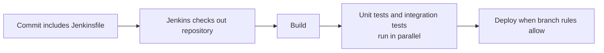
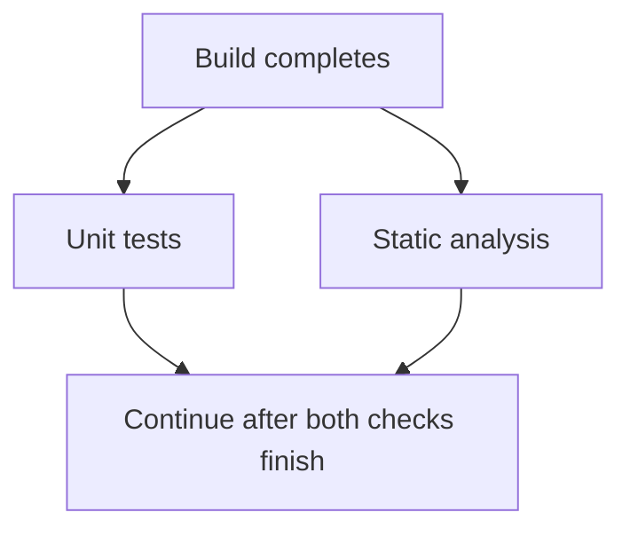

# ⚙️ Jenkins Pipeline

[[DevOps/NaNa/0. Nana DevOps Table of Contents|📚 Nana DevOps Table of Contents]]

> [!toc]- 📑 Contents
>
> - [[#🧭 What a Pipeline Adds|🧭 What a Pipeline Adds]]
> - [[#📄 The Jenkinsfile|📄 The Jenkinsfile]]
> - [[#🧱 Read a Declarative Pipeline|🧱 Read a Declarative Pipeline]]
> - [[#🔀 Run Independent Work in Parallel|🔀 Run Independent Work in Parallel]]
> - [[#🧠 Groovy Ideas Used in Pipelines|🧠 Groovy Ideas Used in Pipelines]]
> - [[#🚀 Create a Pipeline Job from SCM|🚀 Create a Pipeline Job from SCM]]
> - [[#🧪 Interview Q&A|🧪 Interview Q&A]]
> - [[#🔨 Hands-On Practice|🔨 Hands-On Practice]]
> - [[#📋 Quick Reference|📋 Quick Reference]]
> - [[#🧠 Things to Remember|🧠 Things to Remember]]
> - [[#💡 Pro Tips|💡 Pro Tips]]
> - [[#🔗 Related Topics|🔗 Related Topics]]

## 🧭 What a Pipeline Adds

A Jenkins **Pipeline** describes the steps that take code from checkout through testing, packaging, and deployment. A **Freestyle** job is mainly configured through Jenkins' UI; a Pipeline can keep its workflow in the same repository as the application.

That source-controlled workflow is useful when a process has branches, conditions, approvals, or parallel checks. Freestyle jobs can still use plugins and do useful work; Pipelines also use plugins for many integrations and steps. The benefit is that the workflow itself can be reviewed, versioned, and reused as code.

> 💡 **Real-World Example**
>
> When a team changes its API, Jenkins can build it, run unit and integration tests at the same time, and deploy only from the release branch. The `Jenkinsfile` records that flow for the team.



## 📄 The Jenkinsfile

A `Jenkinsfile` is a text file containing a Pipeline definition. Teams commonly commit it at the repository root so changes to the workflow can be reviewed with application changes. Jenkins can also hold a script in its UI, but SCM keeps the pipeline alongside the code.

Jenkins supports **Declarative Pipeline** and **Scripted Pipeline**. The example below uses Declarative syntax: a structured, readable form built on Jenkins Pipeline's Groovy-based DSL. You can start with Declarative syntax without knowing all of Groovy.

## 🧱 Read a Declarative Pipeline

```groovy
pipeline {
    agent any

    stages {
        stage('Build') {
            steps {
                echo 'Building the application...'
            }
        }

        stage('Test') {
            steps {
                echo 'Testing the application...'
            }
        }

        stage('Deploy') {
            steps {
                echo 'Deploying the application...'
            }
        }
    }
}
```

- **`pipeline { ... }`** contains the whole Declarative Pipeline.

- **`agent any`** asks Jenkins to run it on any available agent. An agent is the machine or execution environment that runs the job's steps.

- **`stages { ... }`** groups the major parts of the workflow.

- **`stage('Build')`** gives one part a name that appears in Jenkins' build view.

- **`steps { ... }`** lists the actions for that stage. `echo` is a Jenkins Pipeline step that prints a message to the build log.

Stages run in order by default, so Jenkins completes `Build` before starting `Test`, then completes `Test` before `Deploy`. In a real project, replace the example messages with the project's build and test commands.

## 🔀 Run Independent Work in Parallel

Some tasks do not depend on each other. For example, unit tests and a static check can run at the same time after the build. A Declarative Pipeline can group these tasks under `parallel`:

```groovy
stage('Quality checks') {
    parallel {
        stage('Unit tests') {
            steps {
                echo 'Running unit tests...'
            }
        }

        stage('Static analysis') {
            steps {
                echo 'Checking code quality...'
            }
        }
    }
}
```

This runs both child stages concurrently when Jenkins has enough available execution capacity. A `parallel` block does not create extra capacity by itself; agents and executors must be available. Keep dependent tasks sequential: if one task needs the output of another, it must wait for that output.



## 🧠 Groovy Ideas Used in Pipelines

Declarative Pipeline gives the workflow a clear structure. Within it, Jenkins steps such as `echo`, `sh`, and plugin-provided steps do the work. Groovy becomes more visible when a pipeline needs variables or custom decisions.

```groovy
pipeline {
    agent any

    environment {
        APP_NAME = 'inventory-api'
    }

    stages {
        stage('Build') {
            steps {
                echo "Building ${APP_NAME}"
            }
        }

        stage('Deploy') {
            when {
                branch 'main'
            }
            steps {
                echo "Deploying ${APP_NAME} from main"
            }
        }
    }
}
```

- **Variables and interpolation:** `APP_NAME` is an environment variable declared for the Pipeline. Double-quoted Groovy strings expand `${APP_NAME}`; single-quoted strings do not.

- **Conditions:** `when { branch 'main' }` skips the stage unless the branch is `main`. This branch condition is intended for a **Multibranch Pipeline**, where Jenkins knows the branch being built.

- **Steps and shell commands:** use `sh 'command'` to run a shell command on a Unix-like agent. The command must exist in that agent's environment. Use Jenkins Credentials to supply secrets; do not write passwords or tokens in the `Jenkinsfile`.

Declarative syntax allows a focused structure, but it is not the same as writing an unrestricted Groovy program. When you need ordinary Groovy statements such as a custom `if` block, put them in a `script { ... }` step and keep that logic small.

## 🚀 Create a Pipeline Job from SCM

For a regular Pipeline job, configure Jenkins to load the `Jenkinsfile` from the repository:

1. 📁 Add a `Jenkinsfile` to the repository, usually at its root, and commit it.

2. 🛠️ In Jenkins, select **New Item**, enter a job name, choose **Pipeline**, then select **OK**.

3. 🔗 In the job configuration's **Pipeline** section, set **Definition** to **Pipeline script from SCM**.

4. 🌿 Choose the source control type, enter the repository URL and branch, and select Jenkins-managed credentials if the repository is private.

5. 📄 Set **Script Path** to `Jenkinsfile` if it is at the repository root, then save and run the job.

Jenkins checks out the configured source and reads that path as the pipeline definition. Keep credentials in Jenkins' credential store rather than embedding them in the repository URL or pipeline code. For a job that should discover and build multiple branches, use **Multibranch Pipeline** instead.

### 🧪 Interview Q&A

**Q1:** Why might a team choose a Pipeline over a Freestyle job?

**Q2:** What does `agent any` mean, and does it guarantee a build starts immediately?

**Q3:** When do stages run in parallel, and what else is required for that to help?

**Q4:** What is the difference between a Jenkins Pipeline and Groovy?

> [!answer]- 📋 Answers
>
> **A1:** A Pipeline can keep the workflow in source control, making it easier to review and manage complex or branching workflows. Freestyle remains suitable for simple UI-configured jobs.
>
> **A2:** Jenkins may select any available agent for the Pipeline. It still has to wait if no matching executor is available.
>
> **A3:** Stages inside a `parallel` block run concurrently. Jenkins also needs enough available agent and executor capacity, and the tasks must be independent.
>
> **A4:** Pipeline is Jenkins' workflow DSL, available in Declarative and Scripted forms. It uses Groovy syntax or Groovy-based constructs, but a Declarative Pipeline is not simply an unrestricted Groovy script.

## 🔨 Hands-On Practice

1. 📄 Create a `Jenkinsfile` in a learning repository using the three sequential stages above.

2. 🔗 Configure a Pipeline job to read that file from SCM, then run the job.

3. 🔀 Add the two-stage `parallel` block inside the `stages` section. Confirm in the Jenkins stage view that both checks start after `Build` and finish before `Deploy`.

4. ✅ Replace one `echo` with a real project command, such as its test command. Confirm that Jenkins marks the run as failed when the command exits unsuccessfully.

### 📋 Quick Reference

| Need | Pipeline element |
|---|---|
| Choose where steps run | `agent any` or an agent label |
| Group work | `stages { stage('Name') { steps { ... } } }` |
| Run independent checks concurrently | `parallel { stage(...) { ... } }` |
| Run a stage only on a branch | `when { branch 'main' }` in a Multibranch Pipeline |
| Load the pipeline from Git | **Pipeline script from SCM**; script path `Jenkinsfile` |
| Run a Unix command | `sh 'command'` on a Unix-like agent |

### 🧠 Things to Remember

- A `Jenkinsfile` stores a pipeline definition; it does not install the tools that its steps require.

- Stages are sequential unless you explicitly define parallel work.

- Parallel stages need independent work and available execution capacity.

- Pipeline features and steps may come from Jenkins plugins; using a Pipeline does not eliminate plugin management.

### 💡 Pro Tips

- Start with Declarative Pipeline and add Groovy logic only when the workflow needs it.

- Keep build and test commands reproducible outside Jenkins where practical; this makes failures easier to investigate.

- Use branch conditions in Multibranch Pipelines so the `Jenkinsfile` can describe branch-aware behavior.

- Keep credentials in Jenkins Credentials and scope them to the steps that need access.

### 🔗 Related Topics

- [[DevOps/NaNa/Ci-CD/Jenkins/1. Basics|Jenkins Basics]]

- [[DevOps/NaNa/Ci-CD/Jenkins/2. Docker in Jenkins|Docker in Jenkins]]

- [[DevOps/NaNa/Artifact Management/Gitea/3 - Build and Publish Images with CI|Build and Publish Images with CI]]

- [Jenkins Pipeline: Getting Started](https://www.jenkins.io/doc/book/pipeline/getting-started/)

- [Jenkins Pipeline Syntax](https://www.jenkins.io/doc/book/pipeline/syntax/)
