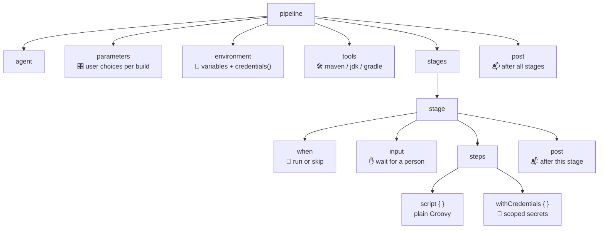
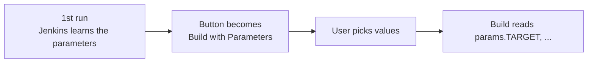
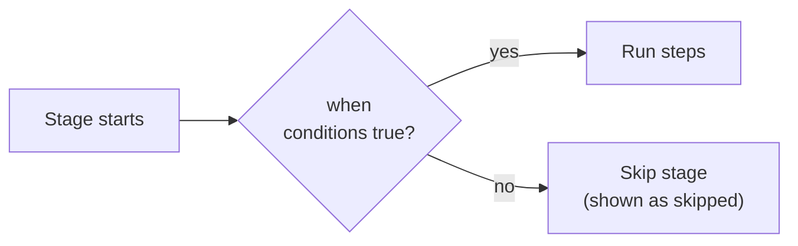
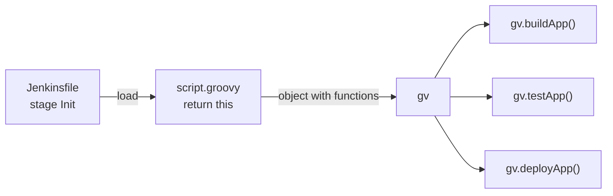
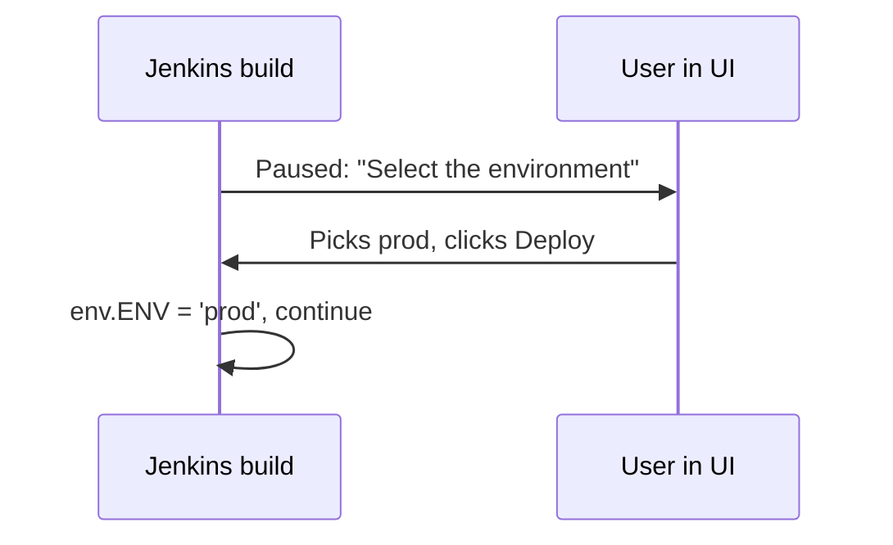

# 🧾 Jenkins Syntax

[[DevOps/NaNa/0. Nana DevOps Table of Contents|📚 Nana DevOps Table of Contents]]

> [!toc]- 📑 Contents
>
> - [[#🗺️ Where Each Block Lives|🗺️ Where Each Block Lives]]
> - [[#🎛️ Parameters|🎛️ Parameters]]
> - [[#🌱 Environment Variables|🌱 Environment Variables]]
> - [[#🔐 Credentials|🔐 Credentials]]
> - [[#🛠️ Tools|🛠️ Tools]]
> - [[#🚦 Conditions with when|🚦 Conditions with when]]
> - [[#📬 post — Run After the Stages|📬 post — Run After the Stages]]
> - [[#📜 Move Logic into script.groovy|📜 Move Logic into script.groovy]]
> - [[#✋ Ask for Input Mid-Pipeline|✋ Ask for Input Mid-Pipeline]]
> - [[#🔁 Replay a Build|🔁 Replay a Build]]
> - [[#🧩 Everything Together|🧩 Everything Together]]
> - [[#🧪 Interview Q&A|🧪 Interview Q&A]]
> - [[#🔨 Hands-On Practice|🔨 Hands-On Practice]]
> - [[#📋 Quick Reference|📋 Quick Reference]]
> - [[#🧠 Things to Remember|🧠 Things to Remember]]
> - [[#💡 Pro Tips|💡 Pro Tips]]
> - [[#🔗 Related Topics|🔗 Related Topics]]
> - [[#🌍 Appendix — Built-in Environment Variables|🌍 Appendix — Built-in Environment Variables]]

## 🗺️ Where Each Block Lives

The previous lesson covered `pipeline`, `agent`, `stages`, `stage`, `steps`, `echo`, and `sh`. This lesson adds the blocks that make a pipeline **configurable**, **secure**, and **conditional**.

Each block has a fixed place. Pipeline-level blocks sit directly under `pipeline`; `when`, `input`, and `post` can also sit inside a stage.



Every example below is a small, complete pipeline. Paste it into a Pipeline job (**Pipeline script** in the job config) or commit it as a `Jenkinsfile`.

---

## 🎛️ Parameters

**Parameters** let the person starting a build choose values, such as which version to deploy or whether to run tests. Declare them in a `parameters` block and read them with `params.NAME`.

```groovy
pipeline {
    agent any

    parameters {
        string(name: 'APP_VERSION', defaultValue: '1.0.0', description: 'Version to deploy')
        choice(name: 'TARGET', choices: ['dev', 'staging', 'prod'], description: 'Where to deploy')
        booleanParam(name: 'executeTests', defaultValue: true, description: 'Run the test stage?')
    }

    stages {
        stage('Show') {
            steps {
                echo "Version: ${params.APP_VERSION}"
                echo "Target:  ${params.TARGET}"
                echo "Tests:   ${params.executeTests}"
            }
        }
    }
}
```

- 🔤 **`string`** → free text with a `defaultValue`.

- 📋 **`choice`** → a dropdown; the **first** item is the default.

- ☑️ **`booleanParam`** → a checkbox; `params.executeTests` is a real `true`/`false`.

- ➕ **Others** → `text` (multi-line), `password` (masked input).

- ⚠️ **Each `name` must be unique.** Two parameters called `VERSION` would clash.

After the **first** run, Jenkins reads the `parameters` block and the job's **Build Now** button becomes **Build with Parameters**. The first run itself uses the default values.



---

## 🌱 Environment Variables

The `environment` block defines variables available to every stage. Jenkins also provides **built-in** variables such as `BUILD_NUMBER`, `JOB_NAME`, and `BRANCH_NAME`.

```groovy
pipeline {
    agent any

    environment {
        NEW_VERSION = '1.3.0'
    }

    stages {
        stage('Build') {
            steps {
                echo "Building version ${NEW_VERSION}"
                echo 'Building version ${NEW_VERSION}'
                echo "Build #${env.BUILD_NUMBER} of ${env.JOB_NAME}"
                sh 'echo "Shell sees $NEW_VERSION"'
            }
        }
    }
}
```

- 💬 **Double quotes `"..."`** → Groovy replaces `${NEW_VERSION}` with `1.3.0`.

- 🔒 **Single quotes `'...'`** → printed literally: `Building version ${NEW_VERSION}`.

- 🐚 **Inside `sh '...'`** → environment variables are real shell variables, so `$NEW_VERSION` is expanded by the **shell**, not Groovy.

- 📦 **`env.NAME`** → the explicit form. Use it inside `script { }` and in `script.groovy`; it also lets you set values at runtime: `env.TARGET = 'prod'`.

💻 To see every built-in variable your Jenkins offers, open:

```text
http://localhost:8085/env-vars.html
```

The list grows with installed plugins (for example, the Git plugin adds `GIT_COMMIT`). A full table is in the [[#🌍 Appendix — Built-in Environment Variables|appendix]].

---

## 🔐 Credentials

Secrets such as server passwords live in **Manage Jenkins → Credentials**, each with an **ID** like `server-credentials`. A pipeline refers to the ID, never the secret itself. Jenkins masks the value as `****` in logs.

There are two ways to use them.

### 🌱 `credentials()` in `environment`

`credentials('id')` is a helper that only works inside `environment`. For a **Username with password** credential it creates three variables:

- `SERVER_CREDENTIALS` → `username:password`

- `SERVER_CREDENTIALS_USR` → the username

- `SERVER_CREDENTIALS_PSW` → the password

```groovy
pipeline {
    agent any

    environment {
        SERVER_CREDENTIALS = credentials('server-credentials')
    }

    stages {
        stage('Deploy') {
            steps {
                sh 'echo "Deploying as $SERVER_CREDENTIALS_USR"'
            }
        }
    }
}
```

For a **Secret text** credential, the variable holds the text directly. The secret is available to **every** stage.

### 🎯 `withCredentials` — Scoped to a Few Steps

`withCredentials` binds a secret only for the steps inside its braces. It comes from the **Credentials Binding** plugin (installed with the suggested plugins).

```groovy
pipeline {
    agent any

    stages {
        stage('Deploy') {
            steps {
                withCredentials([
                    usernamePassword(
                        credentialsId: 'server-credentials',
                        usernameVariable: 'USER',
                        passwordVariable: 'PWD'
                    )
                ]) {
                    sh 'echo "Logging in to the server as $USER"'
                }
                echo 'USER and PWD no longer exist here'
            }
        }
    }
}
```

- 📋 **`[ ... ]`** → a **list** of bindings; you can bind several credentials at once.

- 🔑 **`usernamePassword(...)`** → splits a username/password credential into two variables.

    - `credentialsId` → the credential's ID in Jenkins.

    - `usernameVariable` / `passwordVariable` → **names** (strings) of the variables to create.

- 🧩 **Other binding types** → `string(credentialsId: 'api-token', variable: 'TOKEN')`, `sshUserPrivateKey(...)`, `file(...)`.

> ⚠️ Use **single quotes** for `sh` commands that contain secrets: `sh 'login -p "$PWD"'`. With double quotes, Groovy inserts the secret into the command string first, and Jenkins warns about insecure interpolation.

| | `credentials()` | `withCredentials` |
|---|---|---|
| Where | `environment` block | inside `steps` |
| Lifetime | whole pipeline or stage | only inside its braces |
| Variable names | fixed: `_USR`, `_PSW` | you choose |
| Best for | secrets used in many stages | one login or deploy step |

---

## 🛠️ Tools

The `tools` block puts a build tool such as Maven, a JDK, or Gradle on the `PATH` for the pipeline. The name must match a tool configured in **Manage Jenkins → Tools**.

```groovy
pipeline {
    agent any

    tools {
        maven 'maven-3.9'
    }

    stages {
        stage('Check Maven') {
            steps {
                sh 'mvn -v'
            }
        }
    }
}
```

1. 🛠️ **Configure the tool once.**

    In **Manage Jenkins → Tools → Maven installations**, add one named `maven-3.9` and tick **Install automatically**.

2. 📄 **Reference it by that name.**

    `maven 'maven-3.9'` → Jenkins installs it on the agent if needed and adds its `bin` to `PATH`.

3. ✅ **Result:** `sh 'mvn -v'` prints the Maven version. Supported types are `maven`, `jdk`, and `gradle`. For Node.js, Go, and others, use a plugin or a Docker agent.

---

## 🚦 Conditions with when

`when` decides whether a stage **runs or is skipped**. The previous lesson used `when { branch 'main' }`; `expression` accepts any Groovy condition that returns `true` or `false`.

```groovy
pipeline {
    agent any

    parameters {
        booleanParam(name: 'executeTests', defaultValue: true, description: 'Run tests?')
    }

    stages {
        stage('Test') {
            when {
                expression { params.executeTests }
            }
            steps {
                echo 'Testing the application...'
            }
        }
    }
}
```

Untick **executeTests** and the stage shows as skipped in the stage view.

### 🔗 Combining Conditions

Several conditions inside one `when` must **all** be true. Use `anyOf`, `allOf`, and `not` to be explicit, or use `&&` and `||` inside one `expression`.

```groovy
when {
    allOf {
        anyOf {
            branch 'dev'
            branch 'main'
        }
        expression { params.executeTests }
    }
}
```

This runs tests only on `dev` or `main` **and** only when the checkbox is ticked.

- 🌿 **`BRANCH_NAME`** → a built-in variable holding the branch being built. Only **Multibranch Pipeline** jobs set it; in a regular Pipeline job it is empty, so `BRANCH_NAME == 'dev'` is false.

- ✍️ **Your own variables** → you can compute a value and test it, for example `CODE_CHANGES` set from a Groovy function you write. Jenkins has no built-in `getGitChanges()`.

### 📂 Run Only When Files Changed

For "build only if code changed", Jenkins already has the `changeset` condition. It matches files changed in the commits since the last build:

```groovy
pipeline {
    agent any

    stages {
        stage('Build') {
            when {
                changeset 'src/**'
            }
            steps {
                echo 'Source changed, building...'
            }
        }
    }
}
```



---

## 📬 post — Run After the Stages

`post` runs **after** the stages finish, based on the result. It is the place for notifications, cleanup, and reports. Put it directly under `pipeline` (after `stages`) or inside a single `stage`.

```groovy
pipeline {
    agent any

    stages {
        stage('Build') {
            steps {
                echo 'Building...'
                // sh 'exit 1'   // uncomment to see the failure branch
            }
        }
    }

    post {
        always {
            echo 'Runs whatever the result is'
        }
        success {
            echo 'Build succeeded ✅'
        }
        failure {
            echo 'Build failed — send an email here'
        }
    }
}
```

| Condition | Runs when |
|---|---|
| `always` | every time |
| `success` | the build passed |
| `failure` | the build failed |
| `unstable` | tests failed but the build ran (yellow) |
| `aborted` | someone stopped the build |
| `changed` | result differs from the previous build |
| `fixed` | previous build failed, this one passed |
| `cleanup` | last of all, after every other `post` block |

> 💡 **Real-World Example**
>
> A team sends a Slack or email message in `failure`, and only says "back to green" in `fixed`, so the channel is not flooded with a message for every passing build.

---

## 📜 Move Logic into script.groovy

As stages grow, the `Jenkinsfile` becomes hard to read. You can move the step logic into a separate **Groovy** file and keep the `Jenkinsfile` as a short outline.

Pipeline files are written in **Groovy**, a JVM language similar to Java but with lighter syntax. `script.groovy` is plain Groovy: it defines functions and can use Jenkins steps such as `echo`, plus `params` and `env`.

📄 **`script.groovy`** (repository root, next to the `Jenkinsfile`):

```groovy
def buildApp() {
    echo 'Building the application...'
}

def testApp() {
    echo 'Testing the application...'
}

def deployApp() {
    echo 'Deploying the application...'
    echo "Deploying version ${params.VERSION}"
}

return this
```

- 🔧 **`def buildApp() { ... }`** → defines a function. `def` declares functions and untyped variables in Groovy.

- ↩️ **`return this`** → returns the script object itself, so the `Jenkinsfile` can call its functions. Without it, `load` returns nothing useful.

📄 **`Jenkinsfile`**:

```groovy
def gv

pipeline {
    agent any

    parameters {
        choice(name: 'VERSION', choices: ['v1.0', 'v1.1', 'v1.2'], description: 'Version to deploy')
        booleanParam(name: 'executeTests', defaultValue: true, description: 'Execute tests?')
    }

    stages {
        stage('Init') {
            steps {
                script {
                    gv = load 'script.groovy'
                }
            }
        }

        stage('Build') {
            steps {
                script { gv.buildApp() }
            }
        }

        stage('Test') {
            when {
                expression { params.executeTests }
            }
            steps {
                script { gv.testApp() }
            }
        }

        stage('Deploy') {
            steps {
                script { gv.deployApp() }
            }
        }
    }
}
```

- 🌐 **`def gv`** → declared **outside** `pipeline`, so every stage can use it.

- 📥 **`load 'script.groovy'`** → reads the file from the **workspace** and runs it. The job must use **Pipeline script from SCM** so the repository is checked out first.

- 🧱 **`script { }`** → required because assigning `gv = ...` and calling `gv.buildApp()` are plain Groovy statements, not Declarative steps.



---

## ✋ Ask for Input Mid-Pipeline

The `input` step **pauses** the build and waits for a person to click a button in the Jenkins UI. It can also ask for values, such as which environment to deploy to.

```groovy
pipeline {
    agent any

    stages {
        stage('Deploy') {
            steps {
                script {
                    env.ENV = input(
                        message: 'Select the environment to deploy to',
                        ok: 'Deploy',
                        parameters: [
                            choice(name: 'ENV', choices: ['dev', 'staging', 'prod'], description: '')
                        ]
                    )
                    echo "Deploying to ${env.ENV}"
                }
            }
        }
    }
}
```

- 💬 **`message`** → the question shown on the paused build.

- ✅ **`ok`** → the label of the approve button. **Abort** is always offered and stops the build.

- 🎛️ **`parameters: [ ... ]`** → fields shown only in this prompt; they are **not** added to `params`.

- ↩️ **Return value** → with **one** parameter, `input` returns its value (`'prod'`). With several, it returns a map: `result.ENV`, `result.OTHER`.

- 🌱 **`env.ENV = ...`** → stores the answer so later stages can read `${env.ENV}`.

To answer, open the running build and click the paused stage, or the **Paused for Input** link in the console output.

### 🧱 Stage-Level `input` Directive

Declarative also has an `input` **directive** at stage level. Jenkins asks **before** the stage's steps start, and the answer becomes a variable in that stage:

```groovy
pipeline {
    agent any

    stages {
        stage('Deploy') {
            input {
                message 'Select the environment to deploy to'
                ok 'Deploy'
                parameters {
                    choice(name: 'ENV', choices: ['dev', 'staging', 'prod'], description: '')
                }
            }
            steps {
                echo "Deploying to ${ENV}"
            }
        }
    }
}
```

No `script { }` is needed, but `ENV` exists only inside this stage.



---

## 🔁 Replay a Build

**Replay** reruns a finished build with a pipeline you edit in the browser. It is handy for testing a small change without committing to the repository.

1. 📂 Open a finished build from the job's **Build History**.

2. 🔁 Select **Replay** in the left menu.

    Jenkins shows the `Jenkinsfile` and any files loaded with `load`, such as `script.groovy`.

3. ✏️ Edit the script, then select **Run**.

4. ✅ A new build runs with the edited version. The repository is unchanged, so commit the fix once it works.

---

## 🧩 Everything Together

This combines the lesson's blocks into one working pipeline. It needs a `maven-3.9` tool and a `server-credentials` username/password credential; `BRANCH_NAME` conditions only match in a Multibranch Pipeline.

```groovy
pipeline {
    agent any

    parameters {
        choice(name: 'VERSION', choices: ['1.1.0', '1.2.0', '1.3.0'], description: 'Version to deploy on prod')
        booleanParam(name: 'executeTests', defaultValue: true, description: 'Run tests?')
    }

    environment {
        NEW_VERSION = '1.3.0'
        SERVER_CREDENTIALS = credentials('server-credentials')
    }

    tools {
        maven 'maven-3.9'
    }

    stages {
        stage('Build') {
            when {
                anyOf {
                    branch 'dev'
                    changeset 'src/**'
                }
            }
            steps {
                echo "Building version ${NEW_VERSION}"
                sh 'mvn -v'
            }
        }

        stage('Test') {
            when {
                expression {
                    (env.BRANCH_NAME == 'dev' || env.BRANCH_NAME == 'main') && params.executeTests
                }
            }
            steps {
                echo 'Testing the application...'
            }
        }

        stage('Deploy') {
            steps {
                withCredentials([
                    usernamePassword(credentialsId: 'server-credentials', usernameVariable: 'USER', passwordVariable: 'PWD')
                ]) {
                    sh 'echo "Deploying as $USER"'
                }
                echo "Deploying version ${params.VERSION}"
            }
        }
    }

    post {
        always {
            echo 'Pipeline finished'
        }
        failure {
            echo 'Send failure notification here'
        }
    }
}
```

`SERVER_CREDENTIALS` and `withCredentials` use the same credential here only to show both styles; in a real pipeline, pick one.

---

### 🧪 Interview Q&A

**Q1:** Why does the first run of a new parameterized pipeline not show **Build with Parameters**?

**Q2:** What is the difference between `echo "${NEW_VERSION}"` and `echo '${NEW_VERSION}'`?

**Q3:** When would you choose `withCredentials` over `credentials()` in `environment`?

**Q4:** A `when { expression { BRANCH_NAME == 'dev' } }` stage is always skipped. Why might that be?

**Q5:** Why must `script.groovy` end with `return this`?

**Q6:** Where can a `post` block go, and when does `always` run?

> [!answer]- 📋 Answers
>
> **A1:** Jenkins learns the `parameters` block by running the pipeline. After the first run it saves the parameters to the job and shows the button.
>
> **A2:** Double quotes let Groovy substitute the value (`1.3.0`); single quotes print the text `${NEW_VERSION}` literally.
>
> **A3:** When only one or two steps need the secret. `withCredentials` keeps it bound only inside its braces and lets you name the variables.
>
> **A4:** `BRANCH_NAME` is set only in Multibranch Pipeline jobs. In a regular Pipeline job it is empty, so the comparison is always false.
>
> **A5:** `load` returns whatever the script returns. `return this` returns the script object, so the `Jenkinsfile` can call `gv.buildApp()`.
>
> **A6:** Directly under `pipeline` after `stages`, or inside a `stage`. `always` runs after the stages regardless of success, failure, or abort.

## 🔨 Hands-On Practice

1. 🎛️ **Parameters.** Create a Pipeline job with the [[#🎛️ Parameters|parameters example]] and run it once.

    ✅ The button changes to **Build with Parameters**; run again with `prod` and see it in the log.

2. 🚦 **Skip a stage.** Add the `executeTests` `when` condition and run with the box unticked.

    ✅ The stage view shows **Test** as skipped.

3. 🔐 **Credentials.** In **Manage Jenkins → Credentials**, add a **Username with password** credential with ID `server-credentials` and dummy values. Run the `withCredentials` example.

    ✅ The log prints the username; printing `$PWD` shows `****`.

4. 📬 **post.** Run the post example, then uncomment `sh 'exit 1'`.

    ✅ The first run prints the `success` message; the second prints `failure`. Both print `always`.

5. ✋ **Input + Replay.** Run the `input` example, choose `staging`, then **Replay** it and add `'qa'` to the choices.

    ✅ The replayed build offers `qa` without any commit.

### 📋 Quick Reference

| Need | Syntax |
|---|---|
| Build-time choices | `parameters { string(...) choice(...) booleanParam(...) }` |
| Read a parameter | `params.VERSION` |
| Pipeline variable | `environment { NEW_VERSION = '1.3.0' }` |
| Read a variable | `"${NEW_VERSION}"`, `env.BUILD_NUMBER` |
| Secret for all stages | `environment { CREDS = credentials('id') }` → `CREDS_USR`, `CREDS_PSW` |
| Secret for a few steps | `withCredentials([usernamePassword(credentialsId: 'id', usernameVariable: 'USER', passwordVariable: 'PWD')]) { ... }` |
| Put Maven on PATH | `tools { maven 'maven-3.9' }` |
| Conditional stage | `when { expression { params.executeTests } }` |
| Combine conditions | `when { allOf { ... } }`, `anyOf`, `not` |
| Only if files changed | `when { changeset 'src/**' }` |
| After the stages | `post { always { } success { } failure { } }` |
| External script | `gv = load 'script.groovy'` + `return this` |
| Pause for a person | `input(message: '...', ok: '...', parameters: [...])` |
| Test without committing | Build → **Replay** |
| List built-in variables | `http://localhost:8085/env-vars.html` |

### 🧠 Things to Remember

- `params.X` comes from the `parameters` block; `env.X` comes from `environment`, built-ins, or runtime assignment.

- Groovy expands `${}` only in **double-quoted** strings.

- `credentials()` works only in `environment`; `withCredentials` works only in `steps`.

- `tools` names must match **Manage Jenkins → Tools**.

- Several conditions in one `when` are combined with AND.

- `post` belongs under `pipeline` or a `stage`, not inside `stages`.

- `input` parameters are local to that prompt; save the answer to `env` if later stages need it.

### 💡 Pro Tips

- Keep secrets in single-quoted `sh` commands, so Groovy never builds a string containing the password.

- Put the risky option last in a `choice` list, such as `['dev', 'staging', 'prod']`; the first item is the default.

- Use **Replay** for quick experiments, then commit the final version so the repository stays the source of truth.

- Avoid long `input` waits on busy agents: a paused build inside `steps` holds its executor until someone answers.

### 🔗 Related Topics

- [[DevOps/NaNa/Ci-CD/Jenkins/3. Jenkins pipeline|Jenkins Pipeline]]

- [[DevOps/NaNa/Ci-CD/Jenkins/2. Docker in Jenkins|Docker in Jenkins]]

- [[DevOps/NaNa/Ci-CD/Jenkins/1. Basics|Jenkins Basics]]

- [[DevOps/NaNa/Artifact Management/Nexus/5. Pushing Docker Images to Nexus|Pushing Docker Images to Nexus from Jenkins]]

- [Jenkins Pipeline Syntax](https://www.jenkins.io/doc/book/pipeline/syntax/)

- [Using Credentials in Pipelines](https://www.jenkins.io/doc/book/pipeline/jenkinsfile/#handling-credentials)

- [Credentials Binding Plugin](https://plugins.jenkins.io/credentials-binding/)

---

## 🌍 Appendix — Built-in Environment Variables

These are the variables listed on `http://localhost:8085/env-vars.html` for a typical install. Read them as `env.NAME` in Groovy or `$NAME` in `sh`. Plugins add more, so check your own page for the exact list.

### 🏗️ Build and Job

| Variable | Value | Typical use |
|---|---|---|
| `BUILD_NUMBER` | current build number, e.g. `42` | version tags, image tags like `app:1.0-42` |
| `BUILD_ID` | same as `BUILD_NUMBER` | legacy scripts |
| `BUILD_DISPLAY_NAME` | name shown in history, default `#42` | notifications |
| `BUILD_TAG` | `jenkins-${JOB_NAME}-${BUILD_NUMBER}` | unique labels for artifacts or containers |
| `BUILD_URL` | full URL of this build | links in emails and chat messages |
| `JOB_NAME` | project name, including folders, e.g. `team/my-app/main` | logs, artifact paths |
| `JOB_BASE_NAME` | job name without folders, e.g. `main` | short labels |
| `JOB_URL` | URL of the job | links back to the job |
| `JENKINS_URL` | Jenkins base URL, e.g. `http://localhost:8085/` | building links |
| `JENKINS_HOME` | Jenkins data directory on the controller | admin scripts |
| `CI` | always `true` | tools that change behavior when run in CI |

### 🖥️ Agent and Workspace

| Variable | Value | Typical use |
|---|---|---|
| `NODE_NAME` | agent name, `built-in` for the controller | debugging where a build ran |
| `NODE_LABELS` | labels of that agent | checking agent capabilities |
| `EXECUTOR_NUMBER` | executor slot on that agent, from `0` | unique ports or temp names per parallel build |
| `WORKSPACE` | absolute path of the workspace | file paths in scripts |
| `WORKSPACE_TMP` | temp directory beside the workspace | scratch files that should not be archived |

### 🌿 Multibranch, Pull Requests, and Tags

Set only in **Multibranch Pipeline** jobs.

| Variable | Value | Typical use |
|---|---|---|
| `BRANCH_NAME` | branch being built, or `PR-12` for a pull request | `when` conditions, deploy only from `main` |
| `BRANCH_IS_PRIMARY` | `true` for the repository's default branch | publish only from the primary branch |
| `CHANGE_ID` | pull request number | comment on the PR, skip deploy for PRs |
| `CHANGE_URL` | pull request URL | links in notifications |
| `CHANGE_TITLE` | pull request title | notifications |
| `CHANGE_AUTHOR` | PR author's username | notify the author |
| `CHANGE_AUTHOR_DISPLAY_NAME` | PR author's display name | readable notifications |
| `CHANGE_AUTHOR_EMAIL` | PR author's email | email the author |
| `CHANGE_TARGET` | branch the PR merges into | run extra checks for PRs into `main` |
| `CHANGE_BRANCH` | source branch of the PR | logs, preview environments |
| `CHANGE_FORK` | fork name, if the PR comes from a fork | restrict secrets for untrusted forks |
| `TAG_NAME` | tag being built, e.g. `v1.3.0` | release builds |
| `TAG_TIMESTAMP` / `TAG_UNIXTIME` / `TAG_DATE` | when the tag was created | skip rebuilding old tags |

### 🔗 Blue Ocean Display URLs

| Variable | Value |
|---|---|
| `JOB_DISPLAY_URL` | job page in the display UI |
| `RUN_DISPLAY_URL` | this build's page |
| `RUN_ARTIFACTS_DISPLAY_URL` | this build's artifacts |
| `RUN_CHANGES_DISPLAY_URL` | this build's changes |
| `RUN_TESTS_DISPLAY_URL` | this build's test results |

Useful as links in chat or email notifications.

### 🧬 Added by the Git Plugin

Available after a Git checkout.

| Variable | Value | Typical use |
|---|---|---|
| `GIT_COMMIT` | SHA of the commit being built | image tags, traceability |
| `GIT_PREVIOUS_COMMIT` | SHA built by the previous build on this branch | diff what changed |
| `GIT_PREVIOUS_SUCCESSFUL_COMMIT` | SHA of the last successful build | diff since last green build |
| `GIT_BRANCH` | remote branch, e.g. `origin/main` | branch logic in non-multibranch jobs |
| `GIT_LOCAL_BRANCH` | local branch name, if configured | scripts that need a local branch |
| `GIT_URL` | repository URL | logs, notifications |
| `GIT_CHECKOUT_DIR` | checkout subdirectory, if configured | paths in scripts |
| `GIT_AUTHOR_NAME` / `GIT_AUTHOR_EMAIL` | author identity, if configured | commits made by the pipeline |
| `GIT_COMMITTER_NAME` / `GIT_COMMITTER_EMAIL` | committer identity, if configured | commits made by the pipeline |
