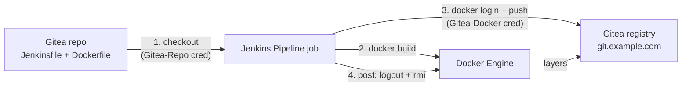
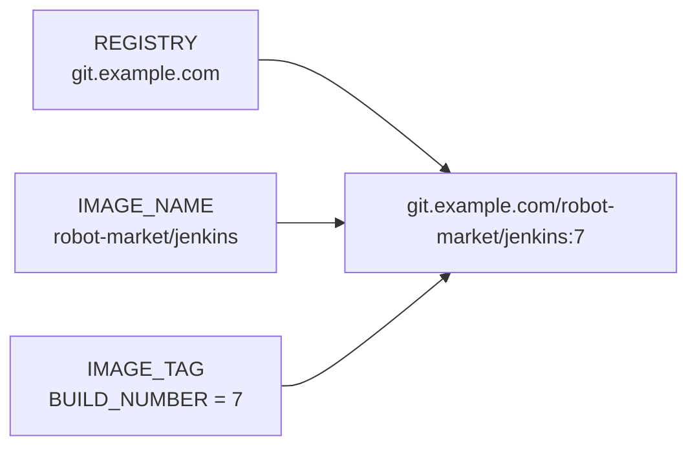
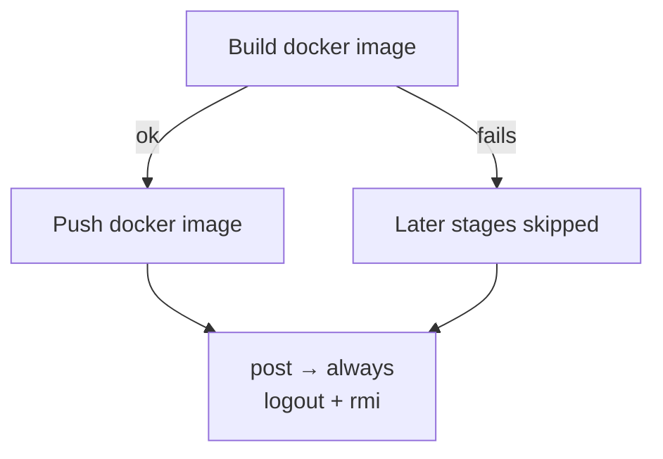

# 🚀 Create a Complete Pipeline

[[DevOps/NaNa/0. Nana DevOps Table of Contents|📚 Nana DevOps Table of Contents]]

> [!toc]- 📑 Contents
>
> - [[#🧭 What We Are Building|🧭 What We Are Building]]
> - [[#🔐 Prepare the Credentials|🔐 Prepare the Credentials]]
> - [[#🛠️ Create the Pipeline Job|🛠️ Create the Pipeline Job]]
> - [[#📄 The Jenkinsfile|📄 The Jenkinsfile]]
> - [[#🔍 Read It Block by Block|🔍 Read It Block by Block]]
> - [[#▶️ Run and Verify|▶️ Run and Verify]]
> - [[#🩺 Common Failures|🩺 Common Failures]]
> - [[#🧪 Interview Q&A|🧪 Interview Q&A]]
> - [[#🔨 Hands-On Practice|🔨 Hands-On Practice]]
> - [[#📋 Quick Reference|📋 Quick Reference]]
> - [[#🧠 Things to Remember|🧠 Things to Remember]]
> - [[#💡 Pro Tips|💡 Pro Tips]]
> - [[#🔗 Related Topics|🔗 Related Topics]]

## 🧭 What We Are Building

This lesson puts the earlier pieces together: a **Pipeline job** reads a `Jenkinsfile` from Git, **builds** a Docker image, **pushes** it to the Gitea container registry, then **cleans up**.

> 💡 **Real-World Example**
>
> A developer pushes code to `robot-market/jenkins` on Gitea. We click **Build Now**, and Jenkins:
>
> - 📥 Checks out the repository.
>
> - 🐳 Builds `git.example.com/robot-market/jenkins:7` (build #7).
>
> - ⬆️ Pushes it to the Gitea registry.
>
> - 🧹 Logs out and deletes the local image.



Two different credentials are involved: one to **read the Git repository**, one to **push to the registry**. Prepare both before creating the job.

> ⚠️ Jenkins must already be able to run `docker`. See [[DevOps/NaNa/Ci-CD/Jenkins/2. Docker in Jenkins#🔌 Mount the Host Docker Socket|Mount the Host Docker Socket]].

---

## 🔐 Prepare the Credentials

Create both in **Manage Jenkins → Credentials → System → Global credentials → Add Credentials**, kind **Username with password**.

- 📥 **Git repository** → ID `Gitea-Repo`

    - Username: your Gitea user.

    - Password: a Gitea access token with **repository Read** access.

- 🐳 **Container registry** → ID `Gitea-Docker`

    - Username: your Gitea user.

    - Password: a Gitea access token with **package Read and Write** access.

The **ID** is what the pipeline refers to. It must match exactly, including case: `credentialsId: 'Gitea-Docker'`.

💡 One token with both scopes works, but separate credentials make it clear which job can do what.

---

## 🛠️ Create the Pipeline Job

1. 🆕 **New Item** → enter a name (for example `robot-market-image`) → choose **Pipeline** → **OK**.

2. 🔗 In the **Pipeline** section, set **Definition** to **Pipeline script from SCM**.

3. 🌿 Fill in the source:

    - **SCM:** `Git`

    - **Repository URL:** `https://git.example.com/Robot-Market/jenkins.git`

    - **Credentials:** `Gitea-Repo`

    - **Branch Specifier:** `*/main`

4. 📄 Set **Script Path** to `Jenkinsfile`, then **Save**.

Jenkins now clones the repository at the start of every build and runs the `Jenkinsfile` it finds there. The repository also needs a `Dockerfile` at its root, because the build runs `docker build .`.

```text
jenkins/            ← repository root = Jenkins workspace
├── Jenkinsfile
├── Dockerfile
└── app source...
```

---

## 📄 The Jenkinsfile

Commit this as `Jenkinsfile` at the repository root:

```groovy
pipeline {
    agent any

    environment {
        REGISTRY   = 'git.example.com'
        IMAGE_NAME = 'robot-market/jenkins'
        IMAGE_TAG  = "${env.BUILD_NUMBER}"
    }

    stages {
        stage('Build docker image') {
            steps {
                echo 'building the docker image'
                sh 'docker build -t ${REGISTRY}/${IMAGE_NAME}:${IMAGE_TAG} .'
            }
        }

        stage('Push docker image') {
            steps {
                withCredentials([usernamePassword(
                    credentialsId: 'Gitea-Docker',
                    usernameVariable: 'USER',
                    passwordVariable: 'PASS'
                )]) {
                    echo 'pushing the docker image'
                    sh '''
                        echo "$PASS" | docker login "$REGISTRY" -u "$USER" --password-stdin
                        docker push ${REGISTRY}/${IMAGE_NAME}:${IMAGE_TAG}
                    '''
                }
            }
        }
    }

    post {
        always {
            sh 'docker logout ${REGISTRY} || true'
            sh 'docker rmi ${REGISTRY}/${IMAGE_NAME}:${IMAGE_TAG} || true'
        }
    }
}
```

---

## 🔍 Read It Block by Block

### 🌱 `environment` — One Image Name for Every Stage



- 🌐 **`REGISTRY`** → the Gitea host. No `https://`.

- 📦 **`IMAGE_NAME`** → `owner/image`, **lowercase**. Docker rejects uppercase paths.

- 🏷️ **`IMAGE_TAG`** → `"${env.BUILD_NUMBER}"` uses **double quotes**, so Groovy inserts the build number. Every build gets a new, traceable tag.

Defining the name once means the build, push, and cleanup always refer to the **same** image.

### 🐳 Build Stage

```groovy
sh 'docker build -t ${REGISTRY}/${IMAGE_NAME}:${IMAGE_TAG} .'
```

- **Single quotes** → Groovy leaves `${...}` alone; the **shell** expands the environment variables. Both work here, because `environment` values become real shell variables.

- `-t` → tag the image with its full registry path, so it can be pushed without re-tagging.

- `.` → build context is the workspace, where Jenkins checked out the repository.

### ⬆️ Push Stage

`withCredentials` binds the `Gitea-Docker` secret to `USER` and `PASS` **only inside its braces**. Jenkins masks both as `****` in the console log.

- 🔑 **`echo "$PASS" | docker login ... --password-stdin`** → passes the token through stdin, so it never appears in the process list or command arguments.

- 🔒 **`'''...'''`** → a multi-line shell script in **single quotes**. The shell, not Groovy, reads `$PASS`, so the secret is never inserted into the script text.

- ⬆️ **`docker push`** → uploads the exact tag built in the previous stage.

> ⚠️ Writing `sh """ ... $PASS ... """` with double quotes makes Groovy interpolate the secret into the command, and Jenkins warns about insecure interpolation.

### 🧹 `post { always { } }` — Clean Up Every Time

`always` runs after the stages, whether the build **succeeded or failed**.

- 🚪 **`docker logout ${REGISTRY}`** → `docker login` saves credentials in the Jenkins user's `~/.docker/config.json`. Logging out removes them, so later jobs don't silently reuse them.

- 🗑️ **`docker rmi ...`** → the image already lives in the registry. Removing the local copy stops the Docker host's disk filling up, one image per build.

- 🛟 **`|| true`** → if the build failed early, the image may not exist and `rmi` would fail. `|| true` keeps cleanup errors from changing the build result.



---

## ▶️ Run and Verify

1. ▶️ Open the job and select **Build Now**.

2. 📜 Open the build → **Console Output**. Look for:

    - `Successfully tagged git.example.com/robot-market/jenkins:1` (or the BuildKit `naming to ...` line).

    - `Login Succeeded`.

    - The push digest line: `1: digest: sha256:... size: ...`.

3. 📦 In Gitea, open the owner's **Packages** tab. The `jenkins` container image shows tag `1`.

4. 🔎 Confirm the local cleanup on the Docker host:

    ```bash
    docker images | grep robot-market/jenkins
    ```

    ✅ No output means `post` removed the local image.

---

## 🩺 Common Failures

| Symptom | Likely cause | Fix |
|---|---|---|
| `docker: not found` | Docker CLI not in the Jenkins container | Use the Jenkins image with Docker CLI installed |
| `permission denied ... docker.sock` | `jenkins` user can't reach the socket | Add the socket's group with `--group-add` |
| `Could not find credentials entry with ID` | ID typo or wrong scope | Match the ID exactly; use a Global credential |
| `unauthorized` on push | Token lacks package write, or wrong owner | Token with package **Read and Write**; check `IMAGE_NAME` owner |
| `repository name must be lowercase` | Uppercase in `IMAGE_NAME` | Use `robot-market`, not `Robot-Market` |
| `unable to prepare context` / no Dockerfile | `Dockerfile` not at repo root | Move it, or use `-f path/Dockerfile` |

---

### 🧪 Interview Q&A

**Q1:** Why does this job need two credentials?

**Q2:** Why is `BUILD_NUMBER` a good image tag here, and what would `latest` lose?

**Q3:** Why use single quotes in the `sh` step that contains `$PASS`?

**Q4:** Why put `docker logout` and `docker rmi` in `post { always }` instead of the last stage?

**Q5:** What does `|| true` do in the cleanup steps?

> [!answer]- 📋 Answers
>
> **A1:** One lets Jenkins clone the private Git repository; the other lets `docker login` push to the registry. They need different permissions.
>
> **A2:** Each build gets a unique tag that points back to a specific Jenkins run. `latest` is overwritten every time, so you can't tell which build is deployed or roll back to an older one.
>
> **A3:** With single quotes the shell expands `$PASS` at runtime. With double quotes Groovy inserts the secret into the command string first, which is the insecure interpolation Jenkins warns about.
>
> **A4:** A failed stage skips the stages after it, so cleanup there would not run. `post { always }` runs whatever the result.
>
> **A5:** It makes the command always exit successfully, so a missing image or an already-logged-out session doesn't mark the build as failed.

## 🔨 Hands-On Practice

1. 🔐 Create `Gitea-Repo` and `Gitea-Docker` credentials, then the Pipeline job from SCM.

2. ▶️ Run the job twice.

    ✅ Gitea shows two tags, `1` and `2`, for the same image.

3. 🏷️ Change `IMAGE_TAG` to `"1.0.${env.BUILD_NUMBER}"`, commit, and run again.

    ✅ The new tag is `1.0.3`.

4. ❌ Temporarily break the `Dockerfile` (for example, a bad `FROM` image) and run.

    ✅ The push stage is skipped, but `post` still runs `docker logout`, and the build is marked **FAILURE**, not changed by `|| true`.

5. ↩️ Revert the `Dockerfile` change.

### 📋 Quick Reference

| Need | How |
|---|---|
| Load pipeline from Git | **Pipeline script from SCM** + repo credential + `Jenkinsfile` |
| Unique tag per build | `IMAGE_TAG = "${env.BUILD_NUMBER}"` |
| Build image | `sh 'docker build -t ${REGISTRY}/${IMAGE_NAME}:${IMAGE_TAG} .'` |
| Registry login in Jenkins | `withCredentials([usernamePassword(...)])` + `--password-stdin` |
| Push | `docker push ${REGISTRY}/${IMAGE_NAME}:${IMAGE_TAG}` |
| Always clean up | `post { always { sh '... \|\| true' } }` |

### 🧠 Things to Remember

- The pipeline from SCM checks out the repository automatically; the workspace is the repo root.

- The image tag used for `build`, `push`, and `rmi` must be identical — define it once in `environment`.

- Registry image paths are lowercase and contain no `https://`.

- `post { always }` runs on success and failure; stages after a failed stage do not.

- Secrets go through `withCredentials`, single-quoted `sh`, and `--password-stdin`.

### 💡 Pro Tips

- Add the short Git commit to the tag (`${BUILD_NUMBER}-${GIT_COMMIT[0..6]}` inside `script { }`) to see exactly which code an image contains.

- Use a credential ID naming scheme like `gitea-repo` / `gitea-registry` so the purpose is obvious in every Jenkinsfile.

- Use **Replay** on a build to test `Jenkinsfile` edits before committing them.

- Run `docker image prune -f` occasionally on the Docker host; dangling build layers are not removed by `rmi` of the tag alone.

### 🔗 Related Topics

- [[DevOps/NaNa/Ci-CD/Jenkins/2. Docker in Jenkins|Docker in Jenkins]]

- [[DevOps/NaNa/Ci-CD/Jenkins/3. Jenkins pipeline|Jenkins Pipeline]]

- [[DevOps/NaNa/Ci-CD/Jenkins/4. Jenkins Syntax|Jenkins Syntax]]

- [[DevOps/NaNa/Artifact Management/Gitea/2 - Docker Container Registry|Gitea Docker Container Registry]]

- [[DevOps/NaNa/Artifact Management/Gitea/3 - Build and Publish Images with CI|Build and Publish Images with CI]]

- [[DevOps/NaNa/Artifact Management/Nexus/5. Pushing Docker Images to Nexus|Pushing Docker Images to Nexus from Jenkins]]
