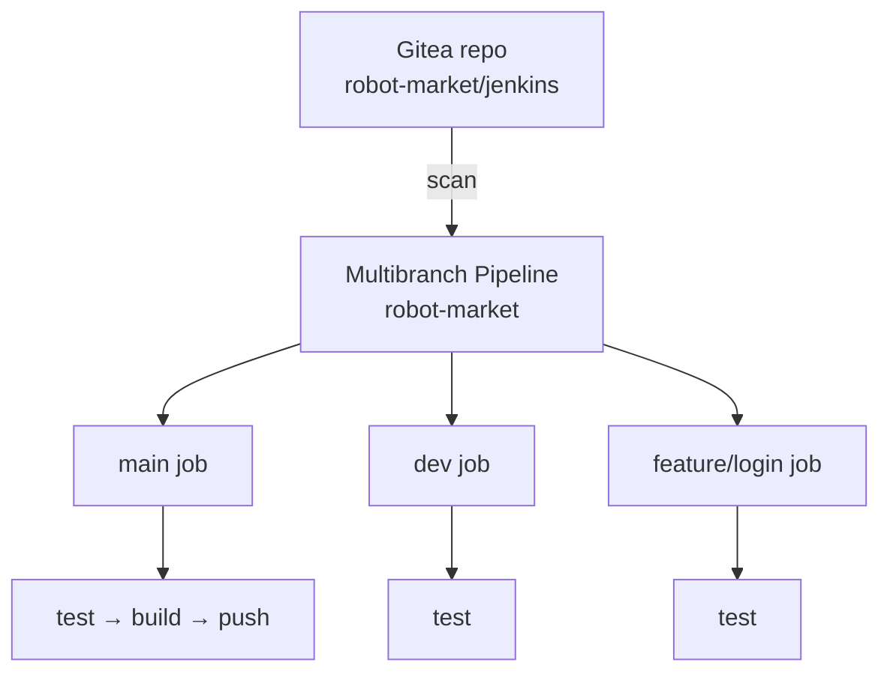
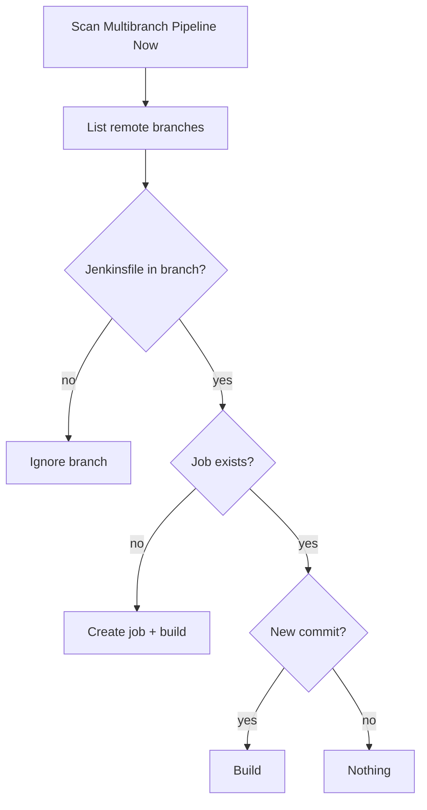
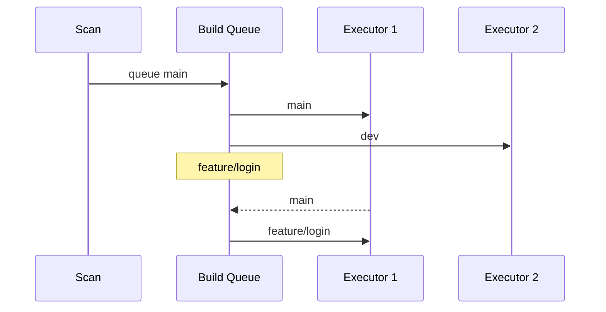
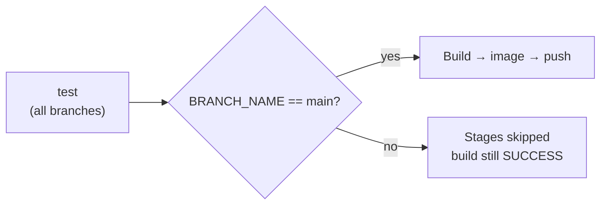

# 🌳 Multibranch Pipeline

[[DevOps/NaNa/0. Nana DevOps Table of Contents|📚 Nana DevOps Table of Contents]]

> [!toc]- 📑 Contents
>
> - [[#🧭 One Job per Branch|🧭 One Job per Branch]]
> - [[#🛠️ Create the Multibranch Pipeline|🛠️ Create the Multibranch Pipeline]]
> - [[#🔎 Scan Multibranch Pipeline Now|🔎 Scan Multibranch Pipeline Now]]
> - [[#🚦 How the Branch Builds Run|🚦 How the Branch Builds Run]]
> - [[#🌿 BRANCH_NAME and Branch Conditions|🌿 BRANCH_NAME and Branch Conditions]]
> - [[#📄 The Jenkinsfile|📄 The Jenkinsfile]]
> - [[#🧩 Useful Related Features|🧩 Useful Related Features]]
> - [[#🩺 Common Failures|🩺 Common Failures]]
> - [[#🧪 Interview Q&A|🧪 Interview Q&A]]
> - [[#🔨 Hands-On Practice|🔨 Hands-On Practice]]
> - [[#📋 Quick Reference|📋 Quick Reference]]
> - [[#🧠 Things to Remember|🧠 Things to Remember]]
> - [[#💡 Pro Tips|💡 Pro Tips]]
> - [[#🔗 Related Topics|🔗 Related Topics]]

## 🧭 One Job per Branch

A normal **Pipeline** job builds one branch, such as `*/main`. A **Multibranch Pipeline** watches a whole repository and creates a separate pipeline job for **every branch that contains a `Jenkinsfile`**.

All branches use the same `Jenkinsfile`, but the pipeline can behave differently per branch: test everything, but build and push images only from `main`.

> 💡 **Real-World Example**
>
> The `robot-market/jenkins` repository has three branches:
>
> - 🌿 **`main`** → test, build the Docker image, push it to the registry.
>
> - 🧪 **`dev`** → test only.
>
> - 🧪 **`feature/login`** → test only.
>
> A developer creates `feature/payment`. Jenkins discovers it on the next scan, creates a job for it, and runs its tests without anyone touching the Jenkins configuration.



The multibranch item is a **folder**. Each branch inside it is a real job with its own build history, workspace, logs, and build numbers.

| | Pipeline | Multibranch Pipeline |
|---|---|---|
| Branches | One, set in **Branch Specifier** | All matching branches with a `Jenkinsfile` |
| New branch | Edit the job or create a new one | Discovered automatically by a scan |
| Deleted branch | Job stays | Branch job is removed (orphaned item strategy) |
| `BRANCH_NAME` | Not set | Set to the branch name |

---

## 🛠️ Create the Multibranch Pipeline

1. 🆕 **New Item** → enter a name (for example `robot-market`) → choose **Multibranch Pipeline** → **OK**.

2. 🔗 **Branch Sources** → **Add source** → **Git**.

    - **Project Repository:** `https://git.example.com/Robot-Market/jenkins.git`

    - **Credentials:** `Gitea-Repo` (the repository Read token from [[DevOps/NaNa/Ci-CD/Jenkins/5. Create Complete Pipeline#🔐 Prepare the Credentials|Prepare the Credentials]]).

3. 🌿 **Behaviours** → keep **Discover branches**.

    - Optional: **Add** → **Filter by name (with wildcards)** → Include `main dev feature/*`.

    - Only matching branches get a job.

4. 📄 **Build Configuration** → Mode **by Jenkinsfile**, Script Path `Jenkinsfile`.

5. ⏱️ **Scan Multibranch Pipeline Triggers** → tick **Periodically if not otherwise run** → interval `5 minutes`.

    - Without a webhook, this is how Jenkins notices new branches and new commits.

6. 💾 **Save**. Jenkins starts the first scan immediately.

💡 With the **Gitea** plugin installed, choose **Gitea** as the source instead of **Git**. It also discovers pull requests and receives webhooks from Gitea, so periodic scanning becomes a fallback.

---

## 🔎 Scan Multibranch Pipeline Now

A **scan** (also called **branch indexing**) asks the repository which branches exist and compares them with the jobs Jenkins already has.

For each branch, the scan checks:

- 📄 **Does it contain the `Jenkinsfile`?**

    - No → the branch is ignored.

- 🆕 **Is it a new branch?**

    - Yes → create a job and start its first build.

- 🔁 **Has its latest commit changed since the last build?**

    - Yes → start a build. No → do nothing.

- 🗑️ **Has a branch disappeared?**

    - Its job is marked as orphaned and removed, based on **Orphaned Item Strategy**.



In the UI:

- 🔎 **Scan Multibranch Pipeline Now** → run a scan manually, for example right after pushing a new branch.

- 📜 **Scan Multibranch Pipeline Log** → shows what the scan found. Look for lines like `Checking branch feature/login` and `Met criteria` or `'Jenkinsfile' not found`.

- 📂 **Branches** tab (and **Pull Requests** with the Gitea source) → the list of branch jobs.

A scan does not run the stages itself. It only creates, triggers, or removes branch jobs.

---

## 🚦 How the Branch Builds Run

After a scan finds three branches, it **queues** three builds. They do not necessarily run at the same time.

Each build waits in the **Build Queue** until an **executor** is free. The built-in node has 2 executors by default, so with three queued builds, two run and the third waits.



Inside one branch build, the stages still run **in order**: `test` → `Build` → `Build docker image` → `Push docker image` → `post`.

Each branch job keeps separate state:

- 🔢 **Build numbers** → `main #4` and `dev #4` are different builds.

- 📁 **Workspace** → each branch checks out into its own directory.

- 📜 **History** → each branch has its own builds and console logs.

⚠️ Because build numbers are per branch, `IMAGE_TAG = BUILD_NUMBER` can collide: `main #4` and `dev #4` would both push tag `4`. Push only from `main`, or include the branch in the tag.

---

## 🌿 BRANCH_NAME and Branch Conditions

In a multibranch job, Jenkins sets `BRANCH_NAME` to the branch being built: `main`, `dev`, or `feature/login`. A normal Pipeline job does not set it.

```groovy
echo "Executing pipeline for branch ${env.BRANCH_NAME}"
```

Console output on the `dev` job:

```text
Executing pipeline for branch dev
```

For pull requests (Gitea source), `BRANCH_NAME` is `PR-12`, and Jenkins also sets:

- 🔢 **`CHANGE_ID`** → `12`, the pull request number.

- 🎯 **`CHANGE_TARGET`** → `main`, the branch the PR merges into.

- 🌿 **`CHANGE_BRANCH`** → `feature/login`, the PR's source branch.

### 🚦 Run a stage only on `main`

A `when` block decides whether a stage runs. If the condition is false, the stage is **skipped**, not failed.

```groovy
stage('Build') {
    when {
        expression {
            BRANCH_NAME == 'main'
        }
    }
    steps {
        echo 'Building the application'
    }
}
```

- 🧮 **`expression { ... }`** → runs Groovy and uses the result as true or false.

- 🌿 **`BRANCH_NAME == 'main'`** → true only on the `main` branch job.

The shorter built-in condition does the same thing:

```groovy
when {
    branch 'main'
}
```

- 🌿 **`branch 'feature/*'`** → matches with wildcards.

- 🔀 **`changeRequest()`** → true only for pull request builds.

- 🧩 **`anyOf { branch 'main'; branch 'dev' }`** → either branch.



In Blue Ocean and the stage view, skipped stages appear grey. More conditions: [[DevOps/NaNa/Ci-CD/Jenkins/4. Jenkins Syntax#🚦 Conditions with when|Conditions with when]].

---

## 📄 The Jenkinsfile

Commit this as `Jenkinsfile` on every branch that should be built. All branches run `test`; only `main` builds and pushes the image:

```groovy
pipeline {
    agent any

    environment {
        REGISTRY   = 'git.example.com'
        IMAGE_NAME = 'robot-market/jenkins'
        IMAGE_TAG  = "${env.BUILD_NUMBER}"
    }

    stages {
        stage('test') {
            steps {
                echo 'Testing the application...'
                echo "Executing pipeline for branch ${env.BRANCH_NAME}"
            }
        }

        stage('Build') {
            when {
                expression { BRANCH_NAME == 'main' }
            }
            steps {
                echo 'Building the application'
            }
        }

        stage('Build docker image') {
            when {
                expression { BRANCH_NAME == 'main' }
            }
            steps {
                echo 'building the docker image'
                sh 'docker build -t ${REGISTRY}/${IMAGE_NAME}:${IMAGE_TAG} .'
            }
        }

        stage('Push docker image') {
            when {
                expression { BRANCH_NAME == 'main' }
            }
            steps {
                withCredentials([usernamePassword(
                    credentialsId: 'Gitea-Docker',
                    usernameVariable: 'USER',
                    passwordVariable: 'PASS'
                )]) {
                    echo 'pushing the docker image'
                    sh '''
                        echo "$PASS" | docker login "$REGISTRY" -u "$USER" --password-stdin
                        docker push ${REGISTRY}/${IMAGE_NAME}:${IMAGE_TAG}
                    '''
                }
            }
        }
    }

    post {
        always {
            sh 'docker logout ${REGISTRY} || true'
            sh 'docker rmi ${REGISTRY}/${IMAGE_NAME}:${IMAGE_TAG} || true'
        }
    }
}
```

What changes per branch:

- 🌿 **`main`** → all four stages run, and the image is pushed as `git.example.com/robot-market/jenkins:<build>`.

- 🧪 **Other branches** → only `test` runs. The three guarded stages are skipped.

- 🧹 **`post { always }`** → runs on every branch. On non-main branches the image does not exist, so `|| true` keeps `rmi` from failing the build.

The `environment`, credentials, and cleanup are explained in [[DevOps/NaNa/Ci-CD/Jenkins/5. Create Complete Pipeline#🔍 Read It Block by Block|Read It Block by Block]].

---

## 🧩 Useful Related Features

- 🗑️ **Orphaned Item Strategy** → controls what happens to jobs of deleted branches.

    - **Discard old items** with **Days to keep old items** `7` keeps a deleted branch's job and logs for a week before removing it.

- 🔀 **Pull request discovery** (Gitea or GitHub source) → builds PRs as `PR-<number>` jobs, so a change is tested before merge.

    - **Merged with target** tests the result of merging into `main`; **current PR revision** tests the branch as-is.

- 🔕 **Suppress automatic SCM triggering** (Property strategy) → branches are still indexed, but builds start only manually. Useful for branches that should exist in Jenkins but not build on every commit.

- 🚫 **`disableConcurrentBuilds()`** → in `options { }`, stops two builds of the **same branch** running together, for example two quick pushes to `main` racing to push images.

    ```groovy
    options {
        disableConcurrentBuilds()
    }
    ```

- 🪝 **Webhooks** → Gitea notifies Jenkins on push, so builds start within seconds instead of waiting for the next periodic scan.

---

## 🩺 Common Failures

| Symptom | Likely cause | Fix |
|---|---|---|
| Branch missing from the job list | No `Jenkinsfile` on that branch, or excluded by the name filter | Check **Scan Multibranch Pipeline Log** for `'Jenkinsfile' not found` |
| New branch never builds | No webhook and no periodic scan trigger | Click **Scan Multibranch Pipeline Now**; enable periodic scanning |
| `BRANCH_NAME` is `null` | Running in a normal Pipeline job | Use a Multibranch Pipeline, or set the branch yourself |
| Push stage runs on every branch | Missing `when` on the image stages | Add `when { branch 'main' }` to build and push stages |
| Image tag overwritten by another branch | `BUILD_NUMBER` is per branch | Push only from `main`, or tag `${BRANCH_NAME}-${BUILD_NUMBER}` (replace `/` first) |
| Builds stuck `Waiting for next available executor` | More queued branch builds than executors | Normal; wait, or add executors/agents |

---

### 🧪 Interview Q&A

**Q1:** What does a Multibranch Pipeline create that a normal Pipeline job doesn't?

**Q2:** What happens during **Scan Multibranch Pipeline Now**, and does it run the stages?

**Q3:** Why don't all discovered branches start building at the same moment?

**Q4:** On a feature branch, what does the build result look like when the `Build` stage has `when { branch 'main' }`?

**Q5:** Why can `IMAGE_TAG = BUILD_NUMBER` cause problems in a multibranch job that pushes from every branch?

> [!answer]- 📋 Answers
>
> **A1:** One job per branch (and per PR) that has a `Jenkinsfile`, each with its own history, workspace, and build numbers, created and removed automatically as branches come and go.
>
> **A2:** Jenkins lists the repository's branches, creates jobs for new ones, triggers builds where the head commit changed, and removes deleted branches' jobs. It does not run the stages itself; it only queues builds.
>
> **A3:** Each build goes into the Build Queue and runs only when an executor is free. With 2 executors, at most 2 builds run at once and the rest wait.
>
> **A4:** The `Build` stage is shown as skipped, and the build still finishes as **SUCCESS** if the other stages pass.
>
> **A5:** Each branch counts its own build numbers, so `main #4` and `dev #4` push the same tag `4` and overwrite each other.

## 🔨 Hands-On Practice

1. 🆕 Create a Multibranch Pipeline `robot-market` pointing at your repository with the `Jenkinsfile` above.

    ✅ The first scan creates a `main` job and builds it; all four stages run.

2. 🌿 Create and push a `dev` branch:

    ```bash
    git checkout -b dev
    git push -u origin dev
    ```

    Then click **Scan Multibranch Pipeline Now**.

    ✅ A `dev` job appears; its console shows `Executing pipeline for branch dev`, and the image stages are skipped.

3. 📜 Open **Scan Multibranch Pipeline Log** and find the lines for `main` and `dev`.

4. 🚦 Push to both branches quickly and watch **Build Queue** and **Build Executor Status** on the dashboard.

    ✅ Builds wait when executors are busy.

5. 🗑️ Delete the branch, then scan again:

    ```bash
    git push origin --delete dev
    ```

    ✅ The `dev` job is removed or shown as orphaned, depending on the Orphaned Item Strategy.

### 📋 Quick Reference

| Need | How |
|---|---|
| Build every branch automatically | **New Item → Multibranch Pipeline** + branch source |
| Discover new branches now | **Scan Multibranch Pipeline Now** |
| See what the scan found | **Scan Multibranch Pipeline Log** |
| Scan on a schedule | **Scan Multibranch Pipeline Triggers → Periodically** |
| Limit branches | Behaviour **Filter by name (with wildcards)** |
| Current branch name | `env.BRANCH_NAME` |
| Stage only on `main` | `when { branch 'main' }` or `when { expression { BRANCH_NAME == 'main' } }` |
| Stage only for PRs | `when { changeRequest() }` |
| No parallel builds of one branch | `options { disableConcurrentBuilds() }` |

### 🧠 Things to Remember

- Only branches containing the `Jenkinsfile` get a job.

- A scan discovers branches and queues builds; executors decide how many run at once.

- Each branch job has its own build numbers, workspace, and history.

- `BRANCH_NAME` exists only in multibranch jobs; PRs appear as `PR-<number>`.

- A `when` that evaluates false skips the stage without failing the build.

### 💡 Pro Tips

- Guard **every** deploy or push stage with `when`, not just the first one; an unguarded later stage still runs.

- Prefer `when { branch 'main' }` over `expression`; it is shorter and reads clearly in the stage view.

- Set up a Gitea webhook and keep a long periodic scan (for example `1 hour`) as a safety net for missed events.

- Keep a few days of orphaned branch jobs so you can still read the logs of a branch that was just merged and deleted.

### 🔗 Related Topics

- [[DevOps/NaNa/Ci-CD/Jenkins/5. Create Complete Pipeline|Create a Complete Pipeline]]

- [[DevOps/NaNa/Ci-CD/Jenkins/4. Jenkins Syntax|Jenkins Syntax]]

- [[DevOps/NaNa/Ci-CD/Jenkins/3. Jenkins pipeline|Jenkins Pipeline]]

- [[DevOps/NaNa/Ci-CD/Jenkins/2. Docker in Jenkins|Docker in Jenkins]]

- [[DevOps/NaNa/Artifact Management/Gitea/3 - Build and Publish Images with CI|Build and Publish Images with CI]]
