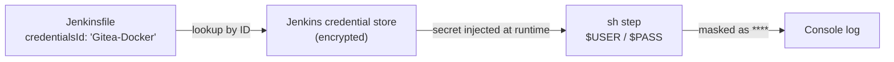
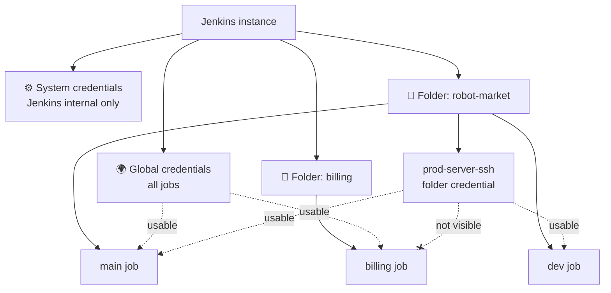

# 🔐 Credentials in Jenkins

[[DevOps/NaNa/0. Nana DevOps Table of Contents|📚 Nana DevOps Table of Contents]]

> [!toc]- 📑 Contents
>
> - [[#🗝️ What a Credential Is|🗝️ What a Credential Is]]
> - [[#🧭 The Three Scopes|🧭 The Three Scopes]]
> - [[#🧩 Credential Kinds|🧩 Credential Kinds]]
> - [[#🏷️ The ID|🏷️ The ID]]
> - [[#🛠️ Create a Credential|🛠️ Create a Credential]]
> - [[#📄 Use Credentials in a Jenkinsfile|📄 Use Credentials in a Jenkinsfile]]
> - [[#🩺 Common Failures|🩺 Common Failures]]
> - [[#🧪 Interview Q&A|🧪 Interview Q&A]]
> - [[#🔨 Hands-On Practice|🔨 Hands-On Practice]]
> - [[#📋 Quick Reference|📋 Quick Reference]]
> - [[#🧠 Things to Remember|🧠 Things to Remember]]
> - [[#💡 Pro Tips|💡 Pro Tips]]
> - [[#🔗 Related Topics|🔗 Related Topics]]

## 🗝️ What a Credential Is

A **credential** is a secret that Jenkins stores for you: a password, token, SSH key, or certificate. Jobs refer to it by **ID**, so the secret never appears in the `Jenkinsfile` or in Git.

Jenkins encrypts stored credentials on the controller (under `$JENKINS_HOME`) and masks their values as `****` in console logs.

> 💡 **Real-World Example**
>
> The `robot-market` pipeline needs to:
>
> - 📥 **Clone the Gitea repo** → credential `Gitea-Repo`
>
> - 📦 **Push images to the registry** → credential `Gitea-Docker`
>
> - 🚀 **SSH into the production server** → credential `prod-server-ssh`
>
> The `Jenkinsfile` only contains these IDs. Anyone reading the repo sees the names, never the secrets.



---

## 🧭 The Three Scopes

A credential's **scope** decides **who can use it**.

- ⚙️ **System**

    - Used only by **Jenkins itself**: connecting to agents over SSH, sending email, talking to an integration.

    - **Not available to jobs or pipelines.**

- 🌍 **Global**

    - Available to **Jenkins itself and every job** on the instance.

    - The normal choice for pipeline credentials.

- 📁 **Folder (project) scope**

    - Stored inside a **folder** item, including a **Multibranch Pipeline** (which is a folder).

    - Visible only to jobs **inside that folder**. Other jobs can't see or use it.



A job inside `robot-market` sees the folder's credentials **plus** all global ones. The `billing` job sees only global ones.

| | System | Global | Folder |
|---|---|---|---|
| Used by Jenkins itself | ✅ | ✅ | — |
| Used by pipelines | ❌ | ✅ all jobs | ✅ jobs in that folder |
| Where to create | Manage Jenkins → Credentials | Manage Jenkins → Credentials | Folder → **Credentials** |
| Typical use | Agent SSH key, SMTP login | Shared Git or registry token | Team- or project-specific secrets |

💡 Folder scope follows **least privilege**: the production SSH key belongs to the one project that deploys, not to every job on the server.

---

## 🧩 Credential Kinds

The **kind** is the type of secret. Pick the one that matches what the tool expects.

| Kind | Holds | Typical use |
|---|---|---|
| **Username with password** | Username + password or token | Git over HTTPS, `docker login` |
| **Secret text** | One string | API token, webhook secret, Slack token |
| **Secret file** | An uploaded file | `kubeconfig`, `.env`, service-account JSON |
| **SSH Username with private key** | Username + private key | Git over SSH, `ssh` to servers, agents |
| **Certificate** | PKCS#12 keystore + password | Client-certificate authentication |

Plugins add more kinds. For example, the **Gitea** plugin adds **Gitea Personal Access Token**, the **AWS Credentials** plugin adds **AWS Credentials**, and the **Kubernetes** plugin adds service-account types.

---

## 🏷️ The ID

The **ID** is how pipelines find a credential, so choose it deliberately.

```groovy
credentialsId: 'Gitea-Docker'
```

- 🔤 **Must match exactly**, including case. `gitea-docker` ≠ `Gitea-Docker`.

- 🎲 **Leave it blank and Jenkins generates a UUID**, such as `3f1c9a2e-...`. It works, but nobody can tell what it is from the `Jenkinsfile`.

- 🔒 **Can't be changed after creation.** To rename, create a new credential and update the pipelines.

- 📝 **Description** is free text shown in dropdowns. Use it for details like "Gitea token, packages Read/Write".

---

## 🛠️ Create a Credential

### 🌍 Global

1. **Manage Jenkins** → **Credentials**.

2. Under **Stores scoped to Jenkins**, click **System** → **Global credentials (unrestricted)** → **Add Credentials**.

    - The **System** store is the *location*. The **Scope** field in the form decides System vs Global.

3. Fill the form:

    - **Kind:** `Username with password`

    - **Scope:** `Global (Jenkins, nodes, items, all child items, etc)`

    - **Username:** `jenkins-bot`

    - **Password:** `<GITEA_TOKEN>`

    - **ID:** `Gitea-Docker`

    - **Description:** `Gitea registry push token`

4. **Create**.

### 📁 Folder

1. Open the folder or Multibranch Pipeline, for example `robot-market`.

2. Click **Credentials** in the left menu → the `robot-market` store → **Global credentials (unrestricted)** → **Add Credentials**.

    - "Global" here means global **within this folder**.

3. Fill the form, for example:

    - **Kind:** `SSH Username with private key`

    - **ID:** `prod-server-ssh`

    - **Username:** `deploy`

    - **Private Key:** **Enter directly** → paste the key.

4. **Create**. Only jobs in `robot-market` can use `prod-server-ssh`.

---

## 📄 Use Credentials in a Jenkinsfile

Two common ways: `withCredentials` for a few lines, or `credentials()` in `environment` for the whole pipeline or stage. Both come from the **Credentials Binding** plugin, installed with the suggested plugins.

### 🔑 `withCredentials` — scoped to a block

```groovy
stage('Push') {
    steps {
        withCredentials([usernamePassword(
            credentialsId: 'Gitea-Docker',
            usernameVariable: 'USER',
            passwordVariable: 'PASS'
        )]) {
            sh 'echo "$PASS" | docker login git.example.com -u "$USER" --password-stdin'
            sh 'docker push git.example.com/robot-market/app:${BUILD_NUMBER}'
        }
    }
}
```

- 🔐 **`USER` and `PASS` exist only inside the braces.** After the block, they're gone.

- 💬 **Single quotes on `sh`** → the shell expands `$PASS`, not Groovy. Double quotes would put the secret into the Groovy string, and Jenkins warns about it.

- 🚿 **`--password-stdin`** keeps the token out of the process list.

Other bindings for the other kinds:

```groovy
withCredentials([
    string(credentialsId: 'slack-token', variable: 'SLACK_TOKEN'),
    file(credentialsId: 'prod-kubeconfig', variable: 'KUBECONFIG'),
    sshUserPrivateKey(credentialsId: 'prod-server-ssh',
                      keyFileVariable: 'SSH_KEY',
                      usernameVariable: 'SSH_USER')
]) {
    sh 'kubectl get pods'
    sh 'ssh -i "$SSH_KEY" -o StrictHostKeyChecking=accept-new "$SSH_USER"@prod.example.com "docker ps"'
}
```

- 📄 **`file`** and **`sshUserPrivateKey`** write the secret to a temporary file and put its **path** in the variable. Jenkins deletes the file after the block.

### 🌱 `credentials()` in `environment`

```groovy
pipeline {
    agent any
    environment {
        REGISTRY_CREDS = credentials('Gitea-Docker')
    }
    stages {
        stage('Login') {
            steps {
                sh 'echo "$REGISTRY_CREDS_PSW" | docker login git.example.com -u "$REGISTRY_CREDS_USR" --password-stdin'
            }
        }
    }
}
```

For **Username with password**, Jenkins creates three variables:

- `REGISTRY_CREDS` → `user:password`

- `REGISTRY_CREDS_USR` → the username

- `REGISTRY_CREDS_PSW` → the password

For **Secret text**, the variable holds the text; for **Secret file**, it holds the file path.

| | `withCredentials` | `environment { credentials() }` |
|---|---|---|
| Lifetime | Only inside the block | The whole pipeline or stage |
| Kinds | All bindings, with custom variable names | Username/password, secret text, secret file |
| Best for | One or two commands that need the secret | Many stages using the same secret |

💡 Prefer the smallest lifetime: put `environment` inside the stage that needs it, or use `withCredentials`.

> ⚠️ Masking only hides the exact secret string in the log. Commands like `env`, `set -x`, or `echo $PASS | base64` can still leak it. Never print secrets.

---

## 🩺 Common Failures

| Symptom | Cause | Fix |
|---|---|---|
| `Could not find credentials entry with ID 'X'` | ID typo or different case | Copy the ID exactly from the credentials page |
| Same error, but the ID is correct | Credential has **System** scope, or is in another folder | Change the scope to **Global**, or move it to the job's folder |
| Credential missing in the job's dropdown | Folder credential used from a job outside the folder | Create it globally or in the right folder |
| `Warning: A secret was passed to "sh" using Groovy String interpolation` | Double quotes around a command with a secret | Use single quotes so the shell expands it |
| `unauthorized` / `authentication failed` | Expired or under-privileged token | Update the secret value; the ID and pipelines stay the same |

---

### 🧪 Interview Q&A

**Q1:** Why can't a pipeline use a credential with System scope?

**Q2:** When would you store a credential in a folder instead of globally?

**Q3:** Why does the credential ID matter more than its description?

**Q4:** What is the difference between `withCredentials` and `credentials()` in `environment`?

**Q5:** A token expired. What do you change in Jenkins, and what stays the same?

> [!answer]- 📋 Answers
>
> **A1:** System scope is reserved for Jenkins' own use, such as agent connections and email. Jobs only see Global and folder credentials.
>
> **A2:** When only one project should use it, such as a production deploy key. Other jobs can't see it, which limits the damage from a bad or compromised pipeline.
>
> **A3:** Pipelines look up credentials by ID. The description is only a label for humans, and the ID can't be changed later.
>
> **A4:** `withCredentials` exposes the secret only inside its block and supports every binding type. `credentials()` exposes it for the whole pipeline or stage and auto-creates `_USR` and `_PSW` for username/password.
>
> **A5:** Update the credential's secret value. The ID stays the same, so no `Jenkinsfile` changes are needed.

---

## 🔨 Hands-On Practice

1. 🌍 **Create a global Secret text credential** with ID `demo-token` and value `hello-secret`.

2. 📄 **Run a pipeline that uses it:**

    ```groovy
    pipeline {
        agent any
        stages {
            stage('Secret') {
                steps {
                    withCredentials([string(credentialsId: 'demo-token', variable: 'TOKEN')]) {
                        sh 'echo "Token is $TOKEN"'
                        sh 'echo "Length: ${#TOKEN}"'
                    }
                }
            }
        }
    }
    ```

    ✅ The log shows `Token is ****` and `Length: 12`. The secret is used but not printed.

3. ⚙️ **Change the scope to System** and run again.

    ✅ The build fails with `Could not find credentials entry with ID 'demo-token'`.

4. 📁 **Create a folder credential.** Inside your Multibranch Pipeline, add a Secret text with ID `folder-token`. Reference it from a job **outside** the folder.

    ✅ It fails outside the folder and works from a branch job inside it.

5. 🧹 Delete `demo-token` and `folder-token` when done.

---

### 📋 Quick Reference

| Need | How |
|---|---|
| Credential for all jobs | Manage Jenkins → Credentials → System → Global credentials → Scope **Global** |
| Credential for one project | Folder / Multibranch → **Credentials** → Add |
| Jenkins-internal only | Scope **System** |
| Username + token | `usernamePassword(credentialsId:, usernameVariable:, passwordVariable:)` |
| Single token | `string(credentialsId:, variable:)` |
| File (kubeconfig) | `file(credentialsId:, variable:)` → variable is a path |
| SSH key | `sshUserPrivateKey(credentialsId:, keyFileVariable:, usernameVariable:)` |
| Whole pipeline or stage | `environment { X = credentials('id') }` → `X_USR`, `X_PSW` |
| Safe `docker login` | `sh 'echo "$PASS" \| docker login ... --password-stdin'` |

### 🧠 Things to Remember

- Pipelines reference credentials **by ID**; the ID is case-sensitive and permanent.

- **System** = Jenkins only. **Global** = all jobs. **Folder** = jobs in that folder.

- A Multibranch Pipeline is a folder, so it can hold its own credentials.

- Plugins can add new credential kinds.

- Masking hides exact values in logs but doesn't stop deliberate or transformed leaks.

### 💡 Pro Tips

- Use readable IDs such as `Gitea-Docker` or `prod-server-ssh`. The `Jenkinsfile` then explains itself.

- Create one credential per purpose (read repo, push images, deploy). Revoking one doesn't break the others.

- Put production secrets in the deploying project's folder, not in Global.

- Use bot or service accounts with minimal token permissions, not your personal account.

- Rotate a token by updating its value under the same ID. No pipeline edits are needed.

### 🔗 Related Topics

- [[DevOps/NaNa/Ci-CD/Jenkins/5. Create Complete Pipeline|Create a Complete Pipeline]]

- [[DevOps/NaNa/Ci-CD/Jenkins/6. Multibranch Pipeline|Multibranch Pipeline]]

- [[DevOps/NaNa/Ci-CD/Jenkins/4. Jenkins Syntax|Jenkins Syntax]]

- [[DevOps/NaNa/Ci-CD/Jenkins/8. Shared Library|Shared Library]]

- [[DevOps/NaNa/Artifact Management/Nexus/5. Pushing Docker Images to Nexus|Pushing Docker Images to Nexus from Jenkins]]
