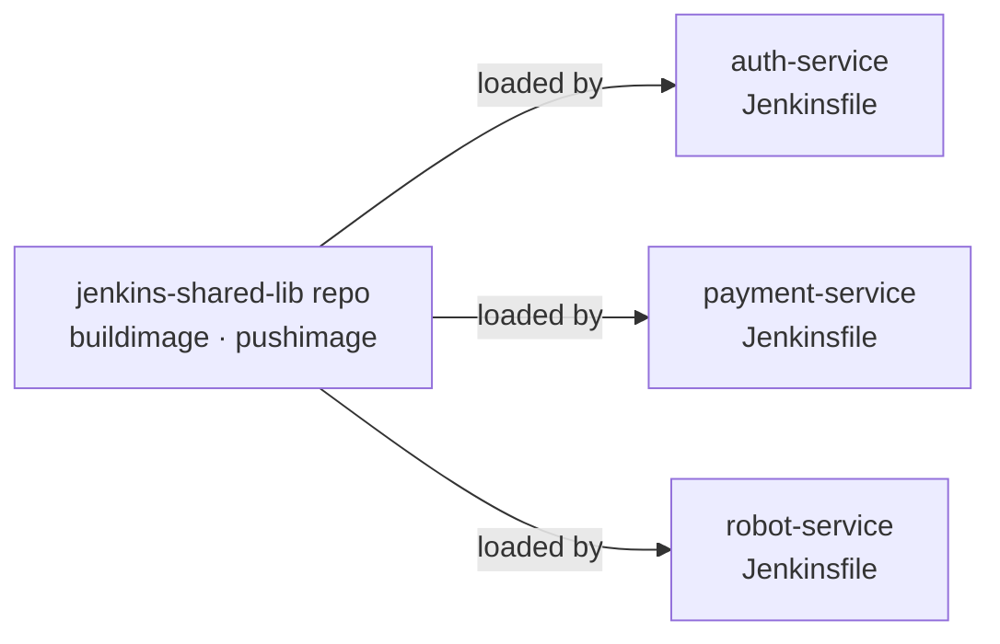
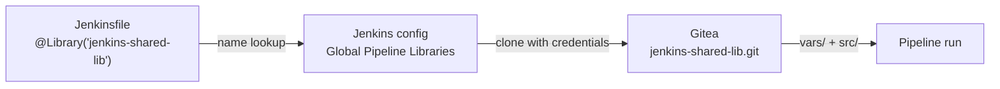
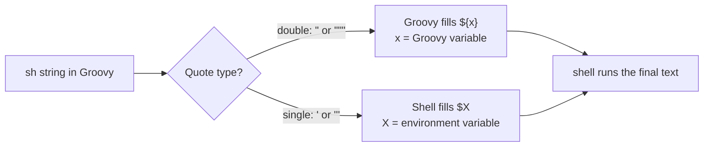
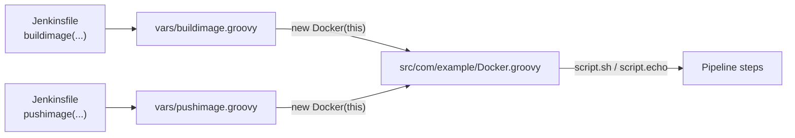

# 📚 Jenkins Shared Library

[[DevOps/NaNa/0. Nana DevOps Table of Contents|📚 Nana DevOps Table of Contents]]

> [!toc]- 📑 Contents
>
> - [[#🤔 Why a Shared Library|🤔 Why a Shared Library]]
> - [[#🗂️ Library Repo Structure|🗂️ Library Repo Structure]]
> - [[#🧱 Your First Step in `vars/`|🧱 Your First Step in vars/]]
> - [[#⚙️ Make the Library Available in Jenkins|⚙️ Make the Library Available in Jenkins]]
> - [[#📄 Use It in a Jenkinsfile|📄 Use It in a Jenkinsfile]]
> - [[#🔀 Passing Values: Env Vars vs Parameters|🔀 Passing Values: Env Vars vs Parameters]]
> - [[#💬 Quotes: Who Expands `$`?|💬 Quotes: Who Expands $?]]
> - [[#🏗️ Groovy Classes in `src/`|🏗️ Groovy Classes in src/]]
> - [[#📥 Loading Without Global Config|📥 Loading Without Global Config]]
> - [[#🩺 Common Failures|🩺 Common Failures]]
> - [[#🧪 Interview Q&A|🧪 Interview Q&A]]
> - [[#🔨 Hands-On Practice|🔨 Hands-On Practice]]
> - [[#📋 Quick Reference|📋 Quick Reference]]
> - [[#🧠 Things to Remember|🧠 Things to Remember]]
> - [[#💡 Pro Tips|💡 Pro Tips]]
> - [[#🔗 Related Topics|🔗 Related Topics]]

## 🤔 Why a Shared Library

With microservices, every service gets its own pipeline. Copying a `Jenkinsfile` from another service works at first, but the same logic, such as **build image → push to registry**, ends up duplicated in every repo.

A **Shared Library** moves that common logic into **its own Git repo**, written in **Groovy**. Pipelines load the library and call its steps like built-in ones.

> 💡 **Real-World Example**
>
> `robot-market` has several services. Each one builds a Docker image and pushes it to `git.example.com`.
>
> - ❌ **Without a library:** the build/push stages live in every `Jenkinsfile`. Changing the login command means editing every repo.
>
> - ✅ **With a library:** the stages live once in `jenkins-shared-lib`. Every `Jenkinsfile` calls `buildimage(...)` and `pushimage(...)`.



**Benefits:**

- ♻️ **Code reusability** → write a step once, call it from any pipeline.

- 🛠️ **Easy maintenance** → fix a bug in one place.

- 📏 **Consistency** → every service builds and pushes the same way.

- ⚡ **Faster pipeline creation** → a new service's `Jenkinsfile` is a few lines.

- 🤝 **Collaboration** → the library is reviewed and versioned like any other repo.

**The process has three steps:**

1. 📁 **Create the library repo.**

2. ⚙️ **Register it in Jenkins**, globally or for a folder/project.

3. 📄 **Load it in the `Jenkinsfile`** and call its steps.

---

## 🗂️ Library Repo Structure

Jenkins expects fixed top-level folders:

```text
jenkins-shared-lib/
├── vars/                       # global steps, callable from a Jenkinsfile
│   ├── buildJar.groovy         # → buildJar()
│   ├── buildimage.groovy       # → buildimage(...)
│   └── pushimage.groovy        # → pushimage(...)
├── src/                        # Groovy classes (helpers, logic)
│   └── com/example/
│       └── Docker.groovy       # package com.example
└── resources/                  # optional non-Groovy files (templates, JSON)
```

- 📁 **`vars/`**

    - Each file becomes a **step**. The **file name is the step name**.

    - Code runs as part of the pipeline, so `sh`, `echo`, `env` work directly.

- 📁 **`src/`**

    - Normal Groovy classes, laid out by package like Java.

    - Use it for logic shared between several steps.

- 📁 **`resources/`**

    - Static files read with `libraryResource('path/file')`.

> ⚠️ `package com.example` means **nested folders** `src/com/example/`. A single folder named `com.example` breaks the import.

---

## 🧱 Your First Step in `vars/`

A `vars/` file defines `call()`. Jenkins runs it when the pipeline calls the step.

📄 `vars/buildJar.groovy`:

```groovy
#!/usr/bin/env groovy

def call() {
    echo 'building the application'
}
```

From a `Jenkinsfile`, `buildJar()` now runs this code.

- `#!/usr/bin/env groovy` → optional; it helps editors detect the language.

- `def call(...)` → the step's entry point. Its parameters become the step's arguments.

---

## ⚙️ Make the Library Available in Jenkins

Register the repo once so pipelines can load it by name.

1. 🌍 **Global (all jobs):** **Manage Jenkins → System → Global Trusted Pipeline Libraries → Add**.

   Recent Jenkins versions also show **Global Untrusted Pipeline Libraries**, which run in the Groovy sandbox.

2. 📁 **Folder / project only:** open the folder or Multibranch Pipeline → **Configure → Pipeline Libraries**.

Fill in:

| Field | Example | Meaning |
|---|---|---|
| **Name** | `jenkins-shared-lib` | the name used in `@Library(...)` |
| **Default version** | `main` | branch, tag, or commit used when the `Jenkinsfile` doesn't specify one |
| **Allow default version to be overridden** | ✅ | lets a `Jenkinsfile` ask for `@v1.0` or a test branch |
| **Load implicitly** | ☐ | loads the library into every pipeline without `@Library` |
| **Retrieval method** | Modern SCM → Git | how Jenkins fetches it |
| **Project repository** | `https://git.example.com/Robot-Market/jenkins-shared-lib.git` | the library repo |
| **Credentials** | `Gitea-Repo` | needed for a private repo |



---

## 📄 Use It in a Jenkinsfile

Load the library at the top, then call its steps inside `script {}`.

```groovy
@Library('jenkins-shared-lib') _

pipeline {
    agent any
    environment {
        REGISTRY   = 'git.example.com'
        IMAGE_NAME = 'robot-market/jenkins'
        IMAGE_TAG  = "${env.BUILD_NUMBER}"
    }
    stages {
        stage('Build jar') {
            steps { script { buildJar() } }
        }
        stage('Build docker image') {
            steps { script { buildimage(env.REGISTRY, env.IMAGE_NAME, env.IMAGE_TAG) } }
        }
        stage('Push docker image') {
            steps { script { pushimage(env.REGISTRY, env.IMAGE_NAME, env.IMAGE_TAG) } }
        }
    }
    post {
        always {
            sh 'docker logout ${REGISTRY} || true'
            sh 'docker rmi ${REGISTRY}/${IMAGE_NAME}:${IMAGE_TAG} || true'
        }
    }
}
```

- 🏷️ **`@Library('jenkins-shared-lib') _`**

    - `@Library` is a Groovy **annotation**; it must annotate something, so `_` is a placeholder.

    - Pin a version with `@Library('jenkins-shared-lib@main') _` or `@v1.0`.

    - Load several: `@Library(['lib-a', 'lib-b@v2']) _`.

- 🧹 **`post { always { ... } }`** → cleanup can stay in the `Jenkinsfile`. Single quotes let the shell read the pipeline `environment`.

---

## 🔀 Passing Values: Env Vars vs Parameters

A library step runs **inside the calling pipeline**, so it sees the same `env`. That gives three ways to get `REGISTRY`, `IMAGE_NAME`, and `IMAGE_TAG` into the step.

### 1️⃣ Read pipeline env vars directly

```groovy
// vars/buildimage.groovy
def call() {
    sh "docker build -t ${env.REGISTRY}/${env.IMAGE_NAME}:${env.IMAGE_TAG} ."
}
```

Simple, but the step has a **hidden contract**: if a pipeline forgets one variable, the build fails in a confusing way.

### 2️⃣ Pass them as parameters ✅ recommended

```groovy
// vars/buildimage.groovy
def call(String registry, String imageName, String imageTag) {
    echo "building the docker image"
    sh "docker build -t ${registry}/${imageName}:${imageTag} ."
}
```

```groovy
// Jenkinsfile
buildimage(env.REGISTRY, env.IMAGE_NAME, env.IMAGE_TAG)
```

The signature says exactly what the step needs, so it works in any pipeline.

For many arguments, take a **Map** to get named arguments with defaults:

```groovy
def call(Map cfg = [:]) {
    def registry = cfg.registry ?: 'git.example.com'
    def imageTag = cfg.imageTag ?: env.BUILD_NUMBER
    sh "docker build -t ${registry}/${cfg.imageName}:${imageTag} ."
}
// usage: buildimage(imageName: 'robot-market/jenkins')
```

### 3️⃣ Set defaults from inside the library

```groovy
env.REGISTRY = env.REGISTRY ?: 'git.example.com'      // set only if missing

withEnv(["REGISTRY=git.example.com"]) {               // only inside the braces
    sh 'echo $REGISTRY'
}
```

| Approach | Pros | Cons |
|---|---|---|
| Read `env` directly | shortest code | hidden contract, breaks silently if names differ |
| Parameters | self-documenting, reusable anywhere | a bit more code |
| Defaults in library | works with no config | values hidden inside the library |

---

## 💬 Quotes: Who Expands `$`?

This is the most common shared-library bug. Two interpreters can expand `$`, and the **quote type decides which one**.



| Quote | Who expands `$` | `$x` must be... |
|---|---|---|
| `"..."` / `"""..."""` | Groovy, before the shell runs | a Groovy variable or parameter |
| `'...'` / `'''...'''` | the shell, at run time | an environment variable |

### Why the push step needs `withEnv`

The build step has no secrets, so double quotes are fine: Groovy fills in the parameters and the shell receives `docker build -t git.example.com/robot-market/jenkins:42 .`

The push step uses a **password**, so it must use **single quotes**. But then the shell can't see Groovy parameters like `registry`. `withEnv` copies them into env vars for the block:

```groovy
// vars/pushimage.groovy
def call(String registry, String imageName, String imageTag, String credsId = 'Gitea-Docker') {
    withEnv(["REGISTRY=${registry}", "IMAGE=${registry}/${imageName}:${imageTag}"]) {
        withCredentials([usernamePassword(credentialsId: credsId,
                usernameVariable: 'USER', passwordVariable: 'PASS')]) {
            echo "pushing the docker image"
            sh '''
                echo "$PASS" | docker login "$REGISTRY" -u "$USER" --password-stdin
                docker push "$IMAGE"
            '''
        }
    }
}
```

- 🔁 **`withEnv(["NAME=value", ...]) { }`**

    - Sets env vars **only inside the braces**. They're gone after the block.

    - The strings are double-quoted, so Groovy fills `${registry}` first: `REGISTRY=git.example.com`.

- 🔐 **`withCredentials`** → sets `$USER` and `$PASS` as env vars, masked in logs.

- 💻 **`sh '''...'''`** → Groovy changes nothing; the shell reads every `$` from the environment.

> ⚠️ Never put `$PASS` inside double quotes. Groovy would insert the secret into the command string, and Jenkins warns: *Groovy String interpolation of secrets*. It can leak into logs.

You *could* escape with `\$PASS` inside double quotes, but mixing `${...}` (Groovy) and `\$...` (shell) in one string is easy to get wrong. One missing backslash leaks the password.

> 💡 **Rule of thumb:** script with credentials → single quotes + `withEnv` for other values. Script without secrets → double quotes with `${...}` are fine.

---

## 🏗️ Groovy Classes in `src/`

When several steps share logic, put it in a class and keep `vars/` files as **thin wrappers**. This follows DRY: the Docker logic lives in one place.



📄 `src/com/example/Docker.groovy`:

```groovy
#!/usr/bin/env groovy
package com.example

class Docker implements Serializable {
    def script

    Docker(script) { this.script = script }

    def buildDockerImage(String registry, String imageName, String imageTag) {
        script.echo "building the docker image"
        script.sh "docker build -t ${registry}/${imageName}:${imageTag} ."
    }

    def pushDockerImage(String registry, String imageName, String imageTag,
                        String credsId = 'Gitea-Docker') {
        script.echo "pushing the docker image"
        script.withEnv(["REGISTRY=${registry}", "IMAGE_NAME=${imageName}", "IMAGE_TAG=${imageTag}"]) {
            script.withCredentials([script.usernamePassword(
                    credentialsId: credsId,
                    usernameVariable: 'USER',
                    passwordVariable: 'PASS')]) {
                script.sh '''
                    echo "$PASS" | docker login "$REGISTRY" -u "$USER" --password-stdin
                    docker push "$REGISTRY/$IMAGE_NAME:$IMAGE_TAG"
                '''
            }
        }
    }
}
```

📄 `vars/buildimage.groovy` and `vars/pushimage.groovy`:

```groovy
import com.example.Docker

def call(String registry, String imageName, String imageTag) {
    new Docker(this).buildDockerImage(registry, imageName, imageTag)
}
```

```groovy
import com.example.Docker

def call(String registry, String imageName, String imageTag) {
    new Docker(this).pushDockerImage(registry, imageName, imageTag)
}
```

- 🧩 **`this` in a `vars/` file** → the pipeline script. Passing it into the class gives the class access to `sh`, `echo`, `withCredentials`.

- 🎯 **`script.` prefix** → a class is not the pipeline, so it must reach every pipeline step through `script.`. Plain `sh "..."` or `$PASS` in a class throws `MissingMethodException` / `MissingPropertyException`.

- 💾 **`implements Serializable`** → Jenkins saves pipeline state so it can pause and resume; objects holding `script` must be serializable.

- 🔐 **Same quoting rules apply** → keep the credentials script in `'''` and feed other values via `script.withEnv`.

> ⚠️ `script.sh ''' echo '${script.PASS}' ... '''` is wrong: `'''` never interpolates, so the shell receives the literal text `${script.PASS}`. Interpolating `"${script.PASS}"` would work but leaks the secret into a Groovy string.

---

## 📥 Loading Without Global Config

The `library` step declares the library **inside the `Jenkinsfile`**, with no Jenkins admin config.

```groovy
library identifier: 'jenkins-shared-lib@main', retriever: modernSCM([
    $class: 'GitSCMSource',
    remote: 'https://git.example.com/Robot-Market/jenkins-shared-lib.git',
    credentialsId: 'Gitea-Repo'
])

pipeline {
    agent any
    // ...
}
```

| Part | Meaning |
|---|---|
| `identifier: 'name@version'` | local name + version (branch, tag, or commit) |
| `retriever: modernSCM([...])` | how to fetch it |
| `$class: 'GitSCMSource'` | the source is a Git repo |
| `remote` | library repo URL |
| `credentialsId` | credential to clone a private repo |

| | `@Library('lib@ver') _` | `library identifier: ...` |
|---|---|---|
| Jenkins config needed | yes | no |
| Config lives in | Jenkins UI | the `Jenkinsfile` (in Git) |
| Usable conditionally / mid-pipeline | no (annotation, top of file) | yes (normal step) |
| Trust level | global trusted libs run unsandboxed | runs in the sandbox |

- ✅ **Pros:** no admin access needed, config is reviewed in Git, easy to test a library branch.

- ❌ **Cons:** repo URL and credential ID repeated in every `Jenkinsfile`, sandbox may block some calls, typos only fail at run time.

> ⚠️ `import com.example.Docker` at the top of the `Jenkinsfile` can fail here, because the library isn't loaded yet when the file is compiled. Call the `vars/` wrappers instead, or use `def lib = library(...)` then `lib.com.example.Docker.new(this)`.

---

## 🩺 Common Failures

| Symptom | Cause | Fix |
|---|---|---|
| `No such DSL method 'buildimage'` | library not loaded, or file name differs from the call | check `@Library(...)` and that `vars/buildimage.groovy` exists (names are case-sensitive) |
| `unable to resolve class com.example.Docker` | folder named `com.example` instead of `com/example` | use nested folders matching the package |
| `MissingPropertyException: PASS` in a class | `"$PASS"` in a class interpolates a Groovy variable | use `'''` and let the shell read `$PASS` |
| `docker login` gets empty registry | Groovy parameter used in a single-quoted `sh` | wrap with `withEnv(["REGISTRY=${registry}"])` |
| `NotSerializableException` | class holding `script` isn't serializable | add `implements Serializable` |
| Library changes don't show up | pipeline pinned to an old tag or default version | bump `@Library('lib@...')` or the default version |
| Warning about secret interpolation | secret inside a double-quoted string | move it to a single-quoted script |

---

### 🧪 Interview Q&A

**Q1:** What's the difference between `vars/` and `src/` in a shared library?

**Q2:** Why does `@Library('jenkins-shared-lib') _` end with an underscore?

**Q3:** A library step reads `$REGISTRY` inside `sh '...'` and gets an empty value. What's wrong?

**Q4:** Why pass `this` into `new Docker(this)`?

**Q5:** When would you use `library identifier:` instead of `@Library`?

> [!answer]- 📋 Answers
>
> **A1:** `vars/` files become pipeline steps named after the file. `src/` holds Groovy classes that steps use for shared logic.
>
> **A2:** `@Library` is an annotation and must attach to something. `_` is a placeholder when there's no import to annotate.
>
> **A3:** `REGISTRY` is a Groovy parameter, not an env var. Single quotes make the shell expand it, so copy it into the environment with `withEnv`.
>
> **A4:** A class isn't the pipeline. `this` from `vars/` is the pipeline script, so the class calls `script.sh`, `script.echo`, and other steps through it.
>
> **A5:** When you can't or don't want to change Jenkins global config, or want to load a library conditionally or test a branch from the `Jenkinsfile`.

---

## 🔨 Hands-On Practice

1. 📁 **Create the library repo.**

   In Gitea, create `jenkins-shared-lib` with `vars/buildJar.groovy` printing a message.

2. ⚙️ **Register it.**

   **Manage Jenkins → System → Global Trusted Pipeline Libraries**, name `jenkins-shared-lib`, default version `main`.

3. 📄 **Call it.**

   Add `@Library('jenkins-shared-lib') _` to a `Jenkinsfile` and call `buildJar()`.

   ✅ The console log shows `building the application`.

4. 🐳 **Extract build and push.**

   Move the Docker build/push stages into `buildimage` and `pushimage` with parameters, then into a `Docker` class with thin wrappers.

   ✅ The image appears in the Gitea registry, and the log shows `****` instead of the password.

5. 🔀 **Test a branch.**

   Push a change to a `test` branch of the library and load `@Library('jenkins-shared-lib@test') _`.

   ✅ Only that pipeline uses the changed code.

---

### 📋 Quick Reference

| Task | Syntax |
|---|---|
| Load library (default version) | `@Library('jenkins-shared-lib') _` |
| Load a specific version | `@Library('jenkins-shared-lib@v1.0') _` |
| Load without global config | `library identifier: 'lib@main', retriever: modernSCM([...])` |
| Define a step | `vars/stepName.groovy` with `def call(...) { }` |
| Named arguments | `def call(Map cfg = [:])` → `step(key: 'value')` |
| Class in `src/` | `package com.example` in `src/com/example/Docker.groovy` |
| Use pipeline steps in a class | `script.sh`, `script.echo`, `script.withCredentials` |
| Groovy value → shell env | `withEnv(["NAME=${value}"]) { sh '...$NAME...' }` |
| Read a resource file | `libraryResource('templates/file.txt')` |

### 🧠 Things to Remember

- A shared library is a **separate Git repo** of Groovy code loaded by pipelines.

- **File name in `vars/` = step name.**

- Steps run inside the calling pipeline and can read its `env`.

- **Double quotes → Groovy expands. Single quotes → shell expands.**

- Classes reach pipeline steps through `script.` and must be `Serializable`.

### 💡 Pro Tips

- Pass values as parameters, not hidden env vars. The step then documents itself.

- Make the credential ID a parameter with a default (`credsId = 'Gitea-Docker'`) so other projects can reuse the step.

- Tag stable library releases (`v1.0`) and pin production pipelines to tags. A bad commit on `main` then can't break every service at once.

- Name Groovy parameters in camelCase (`imageName`). UPPERCASE looks like an env var and confuses the quoting rules.

- Keep `vars/` thin and logic in `src/`. One class change updates every step.

### 🔗 Related Topics

- [[DevOps/NaNa/Ci-CD/Jenkins/7. Credentials in Jenkins|Credentials in Jenkins]]

- [[DevOps/NaNa/Ci-CD/Jenkins/6. Multibranch Pipeline|Multibranch Pipeline]]

- [[DevOps/NaNa/Ci-CD/Jenkins/5. Create Complete Pipeline|Create a Complete Pipeline]]

- [[DevOps/NaNa/Ci-CD/Jenkins/4. Jenkins Syntax|Jenkins Syntax]]

- [[DevOps/NaNa/Ci-CD/Jenkins/2. Docker in Jenkins|Docker in Jenkins]]
