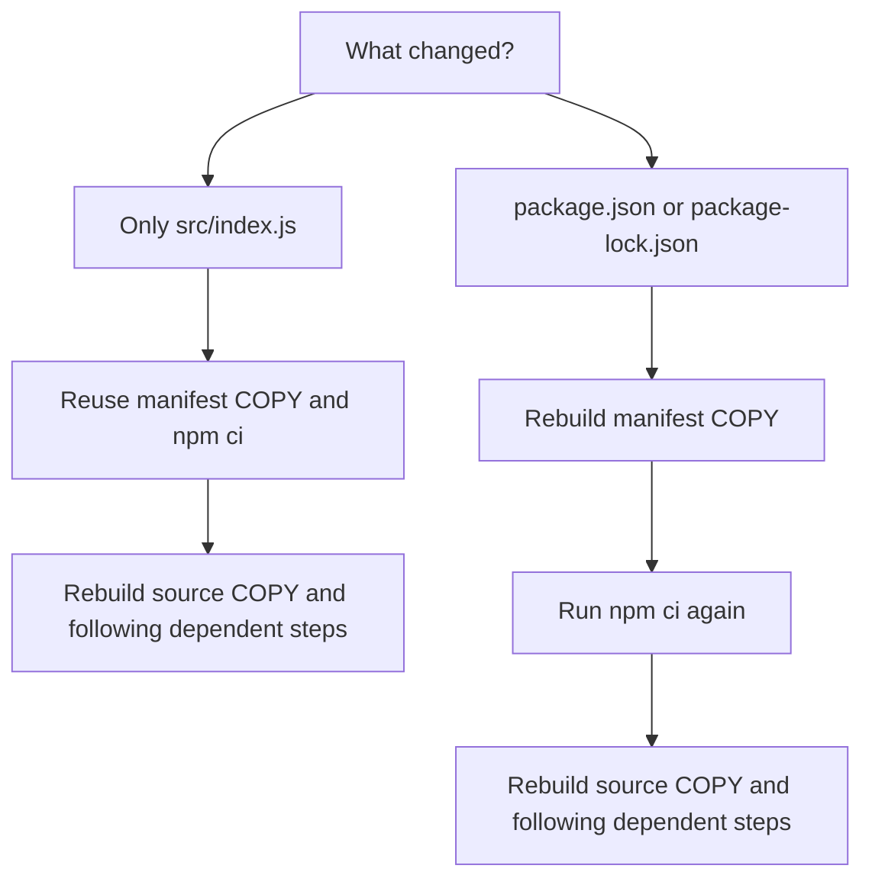
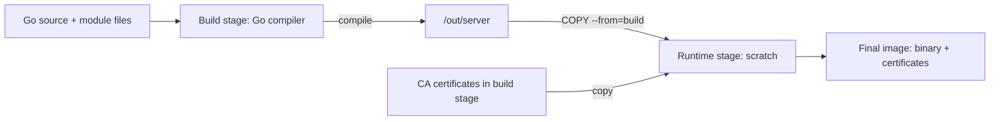

# 🐳 Docker Best Practices

[[DevOps/NaNa/0. Nana DevOps Table of Contents|📚 Nana DevOps Table of Contents]]

> [!toc]- 📑 Contents
>
> - [[#📦 Choose a Trusted Base Image|Choose a Trusted Base Image]]
> - [[#📌 Control Base Image Versions|Control Base Image Versions]]
> - [[#🪶 Choose a Small Compatible Runtime|Choose a Small Compatible Runtime]]
> - [[#⚡ Arrange Instructions for Better Caching|Arrange Instructions for Better Caching]]
> - [[#📁 Keep the Build Context Clean|Keep the Build Context Clean]]
> - [[#🏗️ Separate Build Tools from Runtime|Separate Build Tools from Runtime]]
> - [[#👤 Run the Application as a Non-root User|Run the Application as a Non-root User]]
> - [[#🔎 Scan the Image for Vulnerabilities|Scan the Image for Vulnerabilities]]
> - [[#🧪 Understanding Check|Understanding Check]]
> - [[#🔨 Hands-On Practice|Hands-On Practice]]
> - [[#📋 Quick Reference|Quick Reference]]
> - [[#🧠 Things to Remember|Things to Remember]]
> - [[#💡 Pro Tips|Pro Tips]]
> - [[#🔗 Related Topics|Related Topics]]

## 📦 Choose a Trusted Base Image

A **base image** supplies the starting filesystem and tools for your application image. For a Node.js application, an official `node` image already supplies Node and npm; starting with Ubuntu and installing them yourself adds maintenance work.

Prefer maintained **Docker Official Images** or trusted publisher images when they fit the application. Check their documentation, supported versions, and update history. Official status is a useful starting point, but does not guarantee an image has no vulnerabilities. See [Docker's base image guidance](https://docs.docker.com/build/building/base-images/).

```dockerfile
FROM node:24.21.0-bookworm-slim
```

This selects Node `24.21.0` on a slim Debian Bookworm base. The [official Node image page](https://hub.docker.com/_/node) lists available tags and variants.

---

## 📌 Control Base Image Versions

An image **tag** is a name pointing to an image. Publishers can move that name to a newer image, so `latest` can change what your next build uses without a Dockerfile change.

| Reference | What it controls |
|---|---|
| `node:latest` | No fixed Node release line |
| `node:24-bookworm-slim` | Node major version and Debian variant |
| `node:24.21.0-bookworm-slim` | Node patch version and variant; the tag can still be rebuilt |
| `node:24.21.0-bookworm-slim@sha256:<digest>` | Exact image content identified by a digest |

A **digest** is a content identifier. Replace `<digest>` with the real value from the registry; the table's placeholder is not runnable syntax.

> 💡 **Real-World Example**
>
> A team tests a payment API with one base image, then pins its digest. A security update becomes an explicit change: update the digest, rebuild, test, and deploy.
>
> Pinning gives control; regularly updating the pin supplies security fixes.

A build does not necessarily download a new base image every time. Docker may reuse local content. To check the registry for the current image behind the chosen tag, build with `--pull`:

```bash
docker build --pull -t payment-api:1.0 .
```

- **`--pull`** checks for updated base images.

- **`-t payment-api:1.0`** names and tags the resulting application image.

- **`.`** selects the current directory as the build context.

With a digest pin, `--pull` still uses that pinned content. For details, see [Docker's version pinning and rebuild guidance](https://docs.docker.com/build/building/best-practices/#pin-base-image-versions).

---

## 🪶 Choose a Small Compatible Runtime

A runtime image needs enough software to run the application. Extra compilers, editors, and package managers increase its size and the amount of software you must maintain.

Container images do **not** include their own Linux kernel. Even an Ubuntu image supplies user-space files and shares the host's kernel.

| Runtime choice | Useful when | Main consideration |
|---|---|---|
| Debian slim | You need common Linux library compatibility | Uses glibc; larger than some minimal alternatives |
| Alpine | Your application and dependencies support it | Uses musl instead of glibc |
| Distroless | You want a minimal runtime without ordinary shell tools | Choose a variant with the required runtime libraries |
| `scratch` | You have a self-contained Linux executable | Starts empty; add every required file yourself |

**Alpine is a compatibility choice as well as a size choice.** Native Node modules may expect glibc or need extra build tools. Test them before switching from Debian to Alpine. See the [Node image's Alpine guidance](https://hub.docker.com/_/node#nodealpine).

Smaller images can reduce the attack surface, but size alone does not establish security. A maintained Debian image can be a better choice than an outdated Alpine image. Choose a small image that works, then keep it updated and scan it.

---

## ⚡ Arrange Instructions for Better Caching

Docker can reuse earlier build results when their inputs have not changed. Put stable, expensive work before frequently changing application files.

For a Node project, dependencies usually change less often than source code. Copying everything before installing dependencies makes a source edit trigger dependency installation again.

### An inefficient order

Assume the project root contains `package.json`, `package-lock.json`, and `src/index.js`:

```dockerfile
FROM node:24.21.0-bookworm-slim
WORKDIR /app

COPY . .
RUN npm ci --omit=dev

CMD ["node", "src/index.js"]
```

`COPY . .` copies included files from the build context into `/app`. Changing any copied source file changes the input to the following `RUN` step.

### A better order

For a JavaScript application that runs directly without a compilation step:

```dockerfile
FROM node:24.21.0-bookworm-slim
WORKDIR /app

ENV NODE_ENV=production

COPY package.json package-lock.json ./
RUN npm ci --omit=dev

COPY src/ ./src/

USER node
EXPOSE 3000
CMD ["node", "src/index.js"]
```

- 📦 **Copy dependency manifests first.**

    The destination `./` means the current `WORKDIR`, `/app`. Both files must exist in the build context.

- 🔒 **Install from the lockfile.**

    `npm ci` requires a lockfile and fails if it disagrees with `package.json`. `--omit=dev` leaves development dependencies out of the installed tree. See [npm ci](https://docs.npmjs.com/cli/v11/commands/npm-ci/).

- 📁 **Copy source afterward.**

    An ordinary source edit can reuse the dependency installation result. Copy any additional runtime assets explicitly too.

- ▶️ **Start Node directly.**

    The JSON form of `CMD` avoids an extra shell. The server must listen on `0.0.0.0:3000` for published traffic to reach it; `EXPOSE` only documents the port.

> 💡 **Applications with a build step**
>
> TypeScript and bundlers often need development dependencies to produce runtime files. Install those in a build stage, run the build, then copy the output and production dependencies into a runtime stage.

### What happens after a change?

Assume the same base image and Dockerfile, with an available cache:



A cache miss affects the changed instruction and subsequent dependent steps in that stage. It does not mean Docker downloads the entire base image again. Instructions such as `USER` and `CMD` set metadata rather than adding filesystem content.

See [Docker's cache optimization guide](https://docs.docker.com/build/cache/optimize/).

---

## 📁 Keep the Build Context Clean

The **build context** is the set of files the builder can access. A `.dockerignore` file at its root excludes files before they enter that context.

For the Node example, use:

```text
node_modules
.git
.cache
coverage
*.log
*.md
.env
.env.*
*.key
settings.local.json
```

- 📦 **`node_modules`** prevents copying host-installed dependencies over dependencies installed inside the image.

- 🔐 **Environment files and private keys** should stay out of images.

- 📝 **`*.md`** excludes Markdown files; `.md` alone is not a pattern for all Markdown files.

Only exclude files the build does not need. For example, keep `settings.json` if it contains required non-secret defaults, or Markdown files if the build generates documentation from them. See [.dockerignore syntax](https://docs.docker.com/build/concepts/context/#dockerignore-files).

> ⚠️ **Do not copy a secret and delete it later.**
>
> It can remain recoverable from an earlier image layer. Use [BuildKit secret mounts](https://docs.docker.com/build/building/secrets/) for build credentials and supply application secrets at runtime. `ARG` and `ENV` are unsuitable for embedding build secrets.

---

## 🏗️ Separate Build Tools from Runtime

A **multi-stage build** uses more than one `FROM` instruction. One stage compiles the application; another receives only the files needed to run it.

A Go compiler is needed to create a binary, but usually does not need to accompany that binary into production.



The final image contains selected files, not the builder's compiler, source tree, or dependency cache. Builder data may still occupy local build-cache storage. See [multi-stage builds](https://docs.docker.com/build/building/multi-stage/).

### 💻 A complete Go practice application

Create these files in a new **`docker-best-practices-lab`** directory outside the vault. Run the commands later in this note from that directory. You need Docker Engine and `curl`; local Go is not required.

**`go.mod`** — this example uses only the standard library:

```go
module example.com/docker-best-practices

go 1.26.0
```

**`main.go`**:

```go
package main

import (
    "fmt"
    "log"
    "net/http"
    "time"
)

func main() {
    mux := http.NewServeMux()
    mux.HandleFunc("/", func(w http.ResponseWriter, r *http.Request) {
        fmt.Fprintln(w, "Hello from a small Go image")
    })

    server := &http.Server{
        Addr:              ":8080",
        Handler:           mux,
        ReadHeaderTimeout: 5 * time.Second,
    }
    log.Fatal(server.ListenAndServe())
}
```

The server listens on port `8080` on all interfaces. `ReadHeaderTimeout` limits how long it waits for incoming request headers.

**`Dockerfile`**:

```dockerfile
FROM golang:1.26.9-alpine3.23 AS build
WORKDIR /src

COPY go.mod ./
RUN go mod download

COPY main.go ./
RUN CGO_ENABLED=0 go build -trimpath -o /out/server .

FROM scratch

COPY --from=build /out/server /server
COPY --from=build /etc/ssl/certs/ca-certificates.crt /etc/ssl/certs/ca-certificates.crt

USER 10001:10001
EXPOSE 8080
ENTRYPOINT ["/server"]
```

The builder tag is listed in the [official Go image tags](https://hub.docker.com/_/golang). As with the Node example, a version tag is still mutable; use a digest for exact base content.

- 🏗️ **`AS build`** names the first stage.

    `COPY --from=build` reads files from that stage rather than from your host directory.

- 📦 **`go mod download`** places dependency preparation before source changes.

    This small app has no external dependencies, so there is nothing to download and no `go.sum`. For a real project with dependencies, copy both `go.mod` and `go.sum` before this step, then copy the required source directories afterward.

- ⚙️ **`CGO_ENABLED=0`** disables cgo.

    For this standard-library application, it produces a binary that does not require a separate C runtime. Applications that require cgo need a compatible runtime with the required libraries.

- 📁 **`-trimpath`** removes build filesystem paths from the executable.

    **`-o /out/server`** selects the output file; **`.`** selects the package in the current directory.

- 🔐 **The CA certificate bundle** allows certificate verification for outgoing HTTPS calls.

    This demo does not make those calls, but real APIs often do. `scratch` supplies no certificate store of its own.

- 👤 **`USER 10001:10001`** selects a numeric user ID and group ID.

    Linux can run the process with those IDs without `/etc/passwd`. Programs needing named-user lookup require additional files.

**`.dockerignore`** for this Go lab:

```text
.git
.env
.env.*
*.key
*.log
server
```

`scratch` has no shell or package manager. Add required templates, timezone data, or writable directories explicitly if your application uses them; do not assume an empty runtime supplies them.

---

## 👤 Run the Application as a Non-root User

An application normally needs access to its own files and network connections, not unrestricted control of the container filesystem. Running it as a **non-root user** reduces what it can change if compromised.

The official Node image includes a `node` user, but you must select it with `USER node` to run your application as that user. See [the Node image's non-root guidance](https://github.com/nodejs/docker-node/blob/main/docs/BestPractices.md#non-root-user).

Build steps can run as root to install dependencies, while the application runs as a less privileged user. In the Node Dockerfile above, ordinary read permissions let `node` use root-owned source and dependencies without permission to rewrite them.

If the application needs a writable directory, grant access to that directory specifically:

```dockerfile
RUN mkdir -p /app/data && chown node:node /app/data
USER node
```

`mkdir -p` creates the directory and any missing parents. `chown node:node` assigns its owner and group. A bind mount can replace the directory's image permissions, so check mounted data permissions separately.

### Create a dedicated user when the image has none

The account-management commands depend on the distribution:

| Base distribution | Example user and group creation |
|---|---|
| Debian / Ubuntu, with these tools installed | `groupadd --system app && useradd --system --gid app --no-create-home app` |
| Alpine | `addgroup -S app && adduser -S -G app app` |

Then select the account with `USER app`. The system-account flags create an account intended for a service; the group option associates it with its service group.

For files that really should belong to the application account, `COPY --chown=app:app ...` assigns ownership while copying. The named user and group must already exist in that stage. See [Dockerfile USER and COPY](https://docs.docker.com/reference/dockerfile/#user).

Non-root execution is one layer of protection. It does not remove the need for safe mounts, updated software, and appropriate container privileges.

---

## 🔎 Scan the Image for Vulnerabilities

A **CVE** identifies a publicly recorded vulnerability. Docker Scout examines the image's software inventory and matches components against known vulnerability information.

After building the Go example, scan it with:

```bash
docker scout cves local://go-best-practices:1.0
```

`local://` selects the image in the local Docker image store. Scout must be installed and available; follow [Docker Scout's installation instructions](https://docs.docker.com/scout/install/) if `docker scout` is not recognized.

Read the report for:

- 📦 **Affected component and version** — which dependency needs attention.

- ⚠️ **Severity and CVE identifier** — how the issue is classified and where to read its details.

- 🔧 **Fixed version, when available** — the version you can update to; some findings have no fix yet.

For a CI check that fails when critical or high findings are detected:

```bash
docker scout cves --only-severity critical,high --exit-code local://go-best-practices:1.0
```

`--only-severity` filters findings. `--exit-code` returns code `2` when matching vulnerabilities are found. See [docker scout cves](https://docs.docker.com/reference/cli/docker/scout/cves/).

Update the affected base image or application dependency, rebuild, test, and scan again. A report with no known findings does not prove the application is secure; scanning cannot establish that its business logic or runtime configuration is safe.

---

## 🧪 Understanding Check

**Q1:** Why can an exact version tag still produce different base image content later?

**Q2:** Why does copying dependency manifests before source code make builds faster?

**Q3:** Would switching every application to Alpine automatically improve security?

**Q4:** Why can the Go example run from `scratch`, while a normal Node application cannot?

**Q5:** Does a base image containing a non-root account automatically run your application as that account?

> [!answer]- 📋 Answers
>
> **A1:** Tags can move when publishers rebuild images. A digest identifies exact image content; update it deliberately to receive fixes.
>
> **A2:** Source-only edits leave the manifest input unchanged, so the dependency installation result can be reused. A manifest change rebuilds that step and later dependent steps.
>
> **A3:** No. Compatibility, installed dependencies, maintenance, and patch status matter. Alpine's musl library can also affect native dependencies.
>
> **A4:** This Go app compiles into a self-contained Linux executable with cgo disabled. A normal Node app needs the Node runtime, which `scratch` does not contain.
>
> **A5:** No. Select the account with `USER` or a runtime user override. The account must also have the permissions the application needs.

---

## 🔨 Hands-On Practice

These are exercises to run yourself; the commands are not recorded lab results.

### 1. Observe cache reuse

Use the Go lab files above, with Docker Engine running.

1. **Build the image twice.**

    ```bash
    docker build --progress=plain -t go-best-practices:1.0 .
    docker build --progress=plain -t go-best-practices:1.0 .
    ```

    `--progress=plain` prints build steps as text. On the second build, look for `CACHED` on reusable steps.

2. **Change the response string in `main.go`, then rebuild with the same command.**

    ✅ The `go.mod` copy and dependency step should remain cached. The source copy and compilation should run again.

    This app has no downloaded dependencies, but demonstrates where that expensive work belongs in a larger project.

### 2. Verify the runtime and scan it

1. **Check the configured runtime user.**

    ```bash
    docker image inspect go-best-practices:1.0 --format '{{.Config.User}}'
    ```

    `docker image inspect` reads image metadata; `--format` selects the user field. Expect `10001:10001`.

2. **Start the server on a local-only host port.**

    ```bash
    docker run -d --rm --name go-best-practices-lab -p 127.0.0.1:18080:8080 go-best-practices:1.0
    curl http://127.0.0.1:18080/
    docker logs go-best-practices-lab
    ```

    - **`-d`** starts the container in the background.

    - **`--rm`** removes the container when it exits; **`--name`** gives it a convenient name.

    - **`-p 127.0.0.1:18080:8080`** maps host port `18080` to container port `8080`, accessible through host loopback.

    - **`curl`** checks the HTTP response; **`docker logs`** reads the application's standard output and error. This demo does not log each successful request, so its logs may be empty.

    ✅ Expect the response text from `main.go`. The successful request proves the server is reachable through the published port.

3. **Run the Scout command from the scanning section, then stop the lab container.**

    ```bash
    docker stop go-best-practices-lab
    ```

    `docker stop` stops the named container; `--rm` removes it afterward. The image remains available for future builds and inspection.

---

## 📋 Quick Reference

| Practice | Useful pattern |
|---|---|
| Trusted base | Maintained official or trusted publisher image |
| Controlled version | Specific tag; digest for exact content |
| Compatible small runtime | Slim, Alpine, distroless, or `scratch` as requirements allow |
| Efficient cache | Dependency manifests → install dependencies → source |
| Clean context | `.dockerignore` at the context root |
| Separate build tools | Named builder stage → `COPY --from=build` |
| Non-root application | `USER node` or an appropriate UID:GID |
| Vulnerability scan | `docker scout cves local://IMAGE:TAG` |

## 🧠 Things to Remember

- Tags can change; digest pins need deliberate updates.

- A source edit should not force unrelated dependency installation.

- Multi-stage builds copy selected outputs into the final image.

- Small images still need compatible dependencies and security maintenance.

- Creating a user and selecting that user are separate operations.

## 💡 Pro Tips

- **Keep application code read-only to the runtime user** when it does not need to modify itself. Grant write access to specific data directories.

- **Use lockfiles alongside base image pinning.** Controlling the base alone does not control application dependencies.

- **Use normal cache reuse for daily builds.** `--no-cache` reruns build steps; it does not itself refresh the base image. Use `--pull` for that check.

- **Scan the final runtime image before publishing**, and keep checking it as new vulnerability information appears.

## 🔗 Related Topics

- [[DevOps/NaNa/Docker/6. Dockerfile|Dockerfile, instructions, and build context]]

- [[DevOps/NaNa/Docker/1. Container|Containers and images]]

- [[DevOps/NaNa/Docker/7. Docker Volume|Volumes and bind mounts]]

- [[DevOps/NaNa/Linux/Ownership Permission|Linux ownership and permissions]]

- [[DevOps/NaNa/Artifact Management/Gitea/3 - Build and Publish Images with CI|Build and publish images with CI]]
