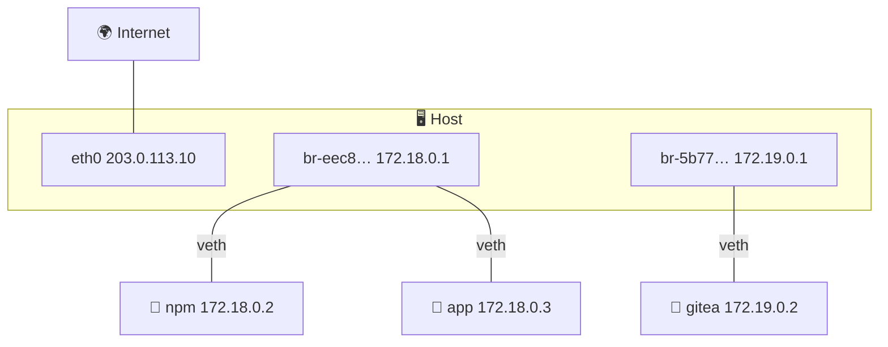
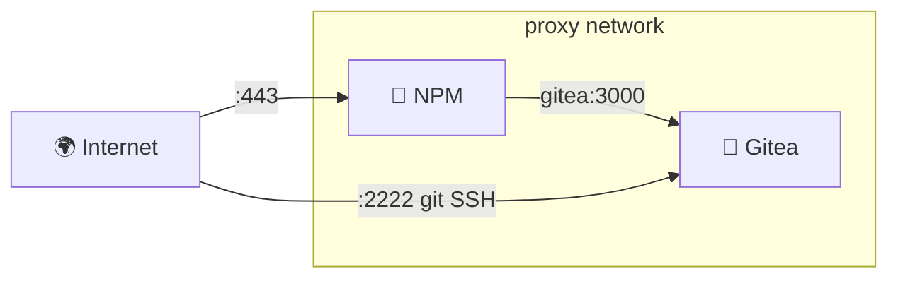
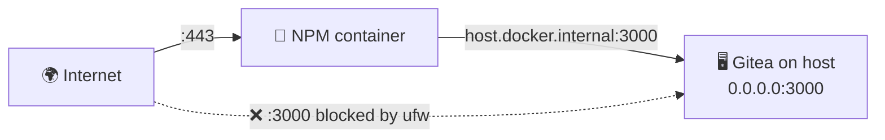

# 🌐 Docker Networking — Bridges, Host Access, and Reverse Proxies

[[DevOps/NaNa/0. Nana DevOps Table of Contents|📚 Nana DevOps Table of Contents]]

> [!toc]- 📑 Contents
>
> - [[#🧩 Every Docker Network Is a Bridge on the Host|🧩 Every Docker Network Is a Bridge on the Host]]
> - [[#🔎 Inspect Networks, Container IPs, and docker-proxy|🔎 Inspect Networks, Container IPs, and docker-proxy]]
> - [[#🔀 Who Can Reach Whom|🔀 Who Can Reach Whom]]
> - [[#🧱 Published Ports and the Firewall|🧱 Published Ports and the Firewall]]
> - [[#🧪 Interview Q&A — Docker Networks|🧪 Interview Q&A — Docker Networks]]
> - [[#🔁 Reverse Proxy Setups: NPM and Gitea|🔁 Reverse Proxy Setups: NPM and Gitea]]
> - [[#🧪 Interview Q&A — Reverse Proxy|🧪 Interview Q&A — Reverse Proxy]]
> - [[#🔨 Hands-On Practice|🔨 Hands-On Practice]]
> - [[#📋 Quick Reference|📋 Quick Reference]]
> - [[#🧠 Things to Remember|🧠 Things to Remember]]
> - [[#💡 Pro Tips|💡 Pro Tips]]
> - [[#🔗 Related Topics|🔗 Related Topics]]

## 🧩 Every Docker Network Is a Bridge on the Host

A Docker **bridge network** is a virtual switch inside the host. Docker creates one Linux interface per network, gives the **host** the first address on it (`.1`, the gateway), and plugs each container in with a virtual cable.

On a server running a few Compose projects, `ip -br addr` shows them all (illustrative, trimmed):

```text
lo               UNKNOWN  127.0.0.1/8 ::1/128
eth0             UP       203.0.113.10/24 2001:db8:0:4::1/64
docker0          DOWN     172.17.0.1/16
br-eec8dadb89e5  UP       172.18.0.1/16
br-5b77412a813e  UP       172.19.0.1/16
br-d69e15c58910  DOWN     172.23.0.1/16
vethe7bd5dc@if2  UP       fe80::28fa:ffff:fe52:549d/64
vethba622d0@if3  UP       fe80::42a:1cff:fe39:a54/64
```

- 🐳 **`docker0`** → Docker's **default** network, named `bridge`.

    - Used by containers started with plain `docker run` and no `--network`.

    - `DOWN` just means no running container is plugged in. Compose projects create their own networks instead.

- 🌉 **`br-<id>`** → a **user-defined network**, usually one per Compose project.

    - The hex is the start of the network ID.

    - `UP` = containers attached; `DOWN` = none running, often a leftover from an old project.

- 🔌 **`veth…@ifN`** → a virtual cable, **one per container connection**.

    - The host end is plugged into a bridge; the other end is `eth0` inside the container.

    - `@ifN` is the interface number on the container side. A container on two networks has two veths.

- 🏠 **`172.18.0.1/16`** → the host's address on that network.

    - Containers on it get `172.18.0.2`, `.3`, … and use `.1` as their gateway.



The host sits on **every** Docker network at once. That's why host programs can reach containers directly, and why containers can reach the host through their gateway.

---

## 🔎 Inspect Networks, Container IPs, and docker-proxy

Match a `br-` interface to its network:

```bash
docker network ls
```

```text
NETWORK ID     NAME              DRIVER    SCOPE
eec8dadb89e5   proxy_default     bridge    local
5b77412a813e   gitea_default     bridge    local
```

`br-eec8dadb89e5` is network `eec8dadb89e5`, so it belongs to the `proxy` Compose project.

See a network's subnet, gateway, and attached containers:

```bash
docker network inspect proxy_default
```

- 🧮 **`IPAM.Config`** → `Subnet` and `Gateway` (the host's `.1` address).

- 🐳 **`Containers`** → each attached container and its IP.

Show one container's IP on every network it joins:

```bash
docker inspect -f '{{range .NetworkSettings.Networks}}{{.IPAddress}} {{end}}' gitea
```

### 🔌 `docker-proxy` in `ss`

Publishing a port (`-p 443:443`) starts a small **`docker-proxy`** process on the host that listens on the host port and forwards to the container. That's what appears in `ss`, not the container itself:

```text
LISTEN  0.0.0.0:443     users:(("docker-proxy",pid=2484516,fd=8))
LISTEN  127.0.0.1:81    users:(("docker-proxy",pid=2484502,fd=8))
LISTEN  0.0.0.0:2222    users:(("docker-proxy",pid=2065318,fd=8))
```

Find which container owns each published port:

```bash
docker ps --format 'table {{.Names}}\t{{.Ports}}'
```

---

## 🔀 Who Can Reach Whom

| From → To | How | Notes |
|---|---|---|
| 💻 Host → container | `127.0.0.1:<published port>` | Container IPs also work but change on recreate |
| 🐳 Container → container, same network | `<service name>:<container port>` | Docker DNS; no `-p` needed |
| 🐳 Container → container, different networks | ❌ Blocked | Attach both to a shared network |
| 🐳 Container → host | `host.docker.internal:<port>` | Host service must not listen only on `127.0.0.1` |
| 🌍 Internet → container | `<public IP>:<published port>` | Only ports published on `0.0.0.0` |

### 💻 Host → container

The host has an address on every bridge, so a host program can call a container IP directly:

```bash
curl http://172.18.0.3:3000
```

Container IPs change when the container is recreated, so don't put them in config. The stable way is to **publish on loopback**:

```yaml
ports:
  - "127.0.0.1:5432:5432"
```

Host programs use `127.0.0.1:5432`; the internet can't reach it.

### 🐳 Container → container

On a **user-defined network**, Docker runs a DNS server (`127.0.0.11` inside each container) that resolves service and container names:

```text
app container ──▶ http://gitea:3000 ──▶ gitea container
```

- ✅ **Same network** → reach each other by name on the **container port**. Publishing isn't needed.

- ⚠️ **Default `bridge` network** → no name resolution. Use a user-defined network.

- ❌ **Different networks** → Docker's iptables rules isolate them. Connect both containers to a shared network when they must talk.

### 🏠 Container → host

Inside a container, `localhost` is **the container itself**. To reach a service on the host:

1. 🎯 **Make the host service listen where containers can reach it.**

    `0.0.0.0` (all interfaces) or a bridge IP like `172.17.0.1`. A service on `127.0.0.1` is unreachable from containers.

2. 🧱 **Allow it through the firewall.**

    Container → host traffic enters the host's INPUT chain, so **ufw applies** and its default deny blocks it.

    ```bash
    sudo ufw allow from 172.16.0.0/12 to any port 3000 proto tcp
    ```

    `172.16.0.0/12` covers every Docker network (`172.16.x`–`172.31.x`). Use one network's subnet to be stricter.

3. 🏷️ **Give the container a stable name for the host.**

    ```yaml
    extra_hosts:
      - "host.docker.internal:host-gateway"
    ```

    `host-gateway` resolves to the host's `docker0` address (`172.17.0.1` by default). It works from any Docker network, because the host accepts packets for any of its own addresses.

---

## 🧱 Published Ports and the Firewall

The two directions behave differently:

| Traffic | Firewall path | Does ufw filter it? |
|---|---|---|
| 🌍 Internet → **published container port** | Docker DNAT → FORWARD chain | ❌ No |
| 🐳 Container → **host service** | INPUT chain | ✅ Yes |
| 🌍 Internet → **host service** (e.g. Gitea on the host) | INPUT chain | ✅ Yes |

So `ufw deny 2222` does **not** close a published container port. Control exposure with the bind address instead:

```yaml
ports:
  - "127.0.0.1:81:81"   # NPM admin: host only
  - "443:443"           # public
```

Details and the `DOCKER-USER` chain: [[DevOps/Server Administration/3. Firewalls and Docker Port Publishing|Firewalls and Docker Port Publishing]].

---

### 🧪 Interview Q&A — Docker Networks

**Q1:** What is a `br-` interface in `ip addr`?

**Q2:** Why does `curl localhost:5432` inside an app container fail to reach the database container?

**Q3:** Two containers are on different Compose projects. Why can't they reach each other by name?

**Q4:** Why can a host program reach a container IP like `172.18.0.3` directly?

**Q5:** You ran `ufw deny 2222`, but port 2222 is still open. Why?

> [!answer]- 📋 Answers
>
> **A1:** A user-defined Docker bridge network. The hex suffix is the network ID, and the host holds the `.1` gateway address on it.
>
> **A2:** `localhost` inside a container is that container. Use the database's service name, such as `postgres:5432`.
>
> **A3:** Each project has its own network, and Docker isolates networks from each other. Attach both to a shared network.
>
> **A4:** The host has an address on every Docker bridge, so it's directly connected to each network.
>
> **A5:** 2222 is a published container port. Docker's DNAT sends it through the FORWARD chain, which ufw's INPUT rules don't filter.

---

## 🔁 Reverse Proxy Setups: NPM and Gitea

A reverse proxy like **Nginx Proxy Manager (NPM)** receives public HTTPS on 443 and forwards each domain to an app. The question is always the same: **which address can NPM use to reach the app?** It depends on where each one runs.

### 🐳🐳 Both in Docker (simplest)

Put both containers on one **shared network**. NPM reaches Gitea by name, and Gitea's web port isn't published at all.



1. 🌐 **Create the shared network once.**

    ```bash
    docker network create proxy
    ```

2. 🔀 **Attach NPM** (NPM's `compose.yaml`):

    ```yaml
    services:
      npm:
        image: jc21/nginx-proxy-manager:2.12.1
        ports:
          - "80:80"
          - "443:443"
          - "127.0.0.1:81:81"
        networks: [proxy]

    networks:
      proxy:
        external: true
    ```

3. 🐙 **Attach Gitea** (Gitea's `compose.yaml`):

    ```yaml
    services:
      gitea:
        image: gitea/gitea:1.22
        ports:
          - "2222:22"        # git over SSH; web goes through NPM
        networks: [proxy]

    networks:
      proxy:
        external: true
    ```

    - **`external: true`** → use the existing `proxy` network instead of creating a project-private one.

4. 🎛️ **NPM proxy host:** scheme `http`, forward hostname `gitea`, port `3000`.

### 🖥️🐳 NPM on the host, Gitea in Docker

Publish Gitea's web port **on loopback**, and host-level NPM uses `127.0.0.1`:

```yaml
ports:
  - "127.0.0.1:3000:3000"
  - "2222:22"
```

NPM proxy host: `http`, `127.0.0.1`, port `3000`. No firewall rule is needed, because loopback can't be reached from outside.

### 🐳🖥️ NPM in Docker, Gitea on the host (most work)

NPM's `127.0.0.1` is NPM's own container, so it has to reach the host through a bridge.



1. 🎯 **Gitea listens on all interfaces** (`/etc/gitea/app.ini`):

    ```ini
    [server]
    PROTOCOL  = http
    HTTP_ADDR = 0.0.0.0
    HTTP_PORT = 3000
    DOMAIN    = git.example.com
    ROOT_URL  = https://git.example.com/
    ```

    - **`HTTP_ADDR = 0.0.0.0`** → reachable from Docker bridges. `127.0.0.1` would not work.

    - **`ROOT_URL`** → the public HTTPS URL Gitea uses for links and clone URLs.

    - Binding to a bridge IP like `172.18.0.1` is fragile: if Gitea starts before Docker creates the bridge, it fails to bind.

2. 🧱 **Allow 3000 only from Docker networks.** Gitea is a host service, so ufw applies and blocks the internet by default:

    ```bash
    sudo ufw allow from 172.16.0.0/12 to any port 3000 proto tcp
    ```

3. 🏷️ **Give NPM a name for the host** (NPM's `compose.yaml`):

    ```yaml
    services:
      npm:
        extra_hosts:
          - "host.docker.internal:host-gateway"
    ```

4. 🎛️ **NPM proxy host:** `http`, `host.docker.internal`, port `3000`, plus a Let's Encrypt certificate with Force SSL.

5. 🔎 **Test from inside NPM:**

    ```bash
    docker exec -it <npm-container> curl -I http://host.docker.internal:3000
    ```

    - ✅ `HTTP/1.1 200 OK` → working.

    - ⏱️ Timeout → the ufw rule is missing.

    - ❌ Connection refused → Gitea is listening on `127.0.0.1`.

The alternative is `network_mode: host` for NPM, so `127.0.0.1:3000` works. NPM then loses network isolation and its admin port 81 sits directly on the host.

### ⚖️ Which setup to choose

| Setup | Effort | Notes |
|---|---|---|
| Both in Docker | Lowest | No published web port, no firewall rule, upgrades = change the image tag |
| NPM on host, Gitea in Docker | Low | Publish on `127.0.0.1` |
| NPM in Docker, Gitea on host | Highest | `0.0.0.0` bind, ufw rule, `host-gateway`, manual binary upgrades |

### 🔐 Git over SSH

NPM proxy hosts only handle HTTP(S), so git-over-SSH is separate:

- 🐳 **Gitea in Docker** → publish `2222:22` and clone with `ssh://git@git.example.com:2222/user/repo.git`.

- 🖥️ **Gitea on the host** → the host `sshd` already owns its port. Enable Gitea's built-in SSH server on another port (`START_SSH_SERVER = true`, `SSH_PORT = 2222`) and `sudo ufw allow 2222/tcp`, or pass git logins from the host's OpenSSH to Gitea.

---

### 🧪 Interview Q&A — Reverse Proxy

**Q1:** NPM and Gitea are both containers. What address does NPM forward to?

**Q2:** Gitea runs on the host with `HTTP_ADDR = 127.0.0.1`. Why does dockerized NPM get "connection refused"?

**Q3:** Gitea on the host listens on `0.0.0.0:3000`. What stops the internet from reaching it?

**Q4:** Why publish Gitea's web port on `127.0.0.1` when NPM runs on the host?

> [!answer]- 📋 Answers
>
> **A1:** `gitea:3000`, the service name on their shared network. Gitea's web port doesn't need publishing.
>
> **A2:** NPM's `localhost` is its own container, and the host's loopback is unreachable from containers. Listen on `0.0.0.0` and firewall the port.
>
> **A3:** ufw's default deny. Gitea is a host service, so ufw filters it, and only Docker subnets are allowed on 3000.
>
> **A4:** NPM reaches it on loopback, and loopback can't be reached from outside, so no firewall rule is needed.

---

## 🔨 Hands-On Practice

1. 🌐 **Create a network and a web container on it.**

    ```bash
    docker network create lab-net
    docker run -d --name web --network lab-net nginx:1.27-alpine
    ```

2. 🔎 **Find its bridge on the host.**

    ```bash
    docker network ls --filter name=lab-net
    ip -br addr | grep br-
    ```

    ✅ A new `br-<id>` matches the `lab-net` network ID.

3. 🐳 **Reach it by name from another container.**

    ```bash
    docker run --rm --network lab-net alpine wget -qO- http://web | head -n 4
    ```

    ✅ The nginx welcome HTML. Repeat **without** `--network lab-net`: it fails with `bad address 'web'`, because the default bridge has no DNS and isn't on `lab-net`.

4. 🏠 **Reach a host service from a container.** Bind it to the `docker0` address so the internet can't reach it:

    ```bash
    python3 -m http.server 8000 --bind 172.17.0.1 &
    docker run --rm --add-host host.docker.internal:host-gateway alpine wget -qO- http://host.docker.internal:8000 | head -n 3
    ```

    ✅ A directory listing. If it times out, ufw is blocking container → host traffic, which is exactly what the `ufw allow from 172.16.0.0/12` rule fixes.

5. 🧹 **Clean up.**

    ```bash
    kill %1
    docker rm -f web
    docker network rm lab-net
    ```

---

### 📋 Quick Reference

| Task | Command |
|---|---|
| Docker bridges on the host | `ip -br addr \| grep -E 'docker0\|br-'` |
| List networks | `docker network ls` |
| Subnet, gateway, attached containers | `docker network inspect <net>` |
| Container IPs | `docker inspect -f '{{range .NetworkSettings.Networks}}{{.IPAddress}} {{end}}' <ctr>` |
| Published ports per container | `docker ps --format 'table {{.Names}}\t{{.Ports}}'` |
| Create shared network | `docker network create proxy` |
| Unused networks | `docker network ls --filter dangling=true` |

| Client → target | Address |
|---|---|
| Host → container | `127.0.0.1:<published port>` |
| Container → container | `<service>:<container port>` (same network) |
| Container → host | `host.docker.internal:<port>` + `host-gateway` |

### 🧠 Things to Remember

- Each Docker network is a `br-` (or `docker0`) bridge, and the host owns its `.1` address.

- `localhost` always means the environment the client runs in.

- Name resolution works only on user-defined networks; different networks are isolated.

- Published container ports bypass ufw; container → host traffic does not.

- A host service bound to `127.0.0.1` is invisible to containers.

### 💡 Pro Tips

- Keep one external `proxy` network for the reverse proxy and every app behind it; apps then need no published web ports.

- Publish anything that only the host needs on `127.0.0.1:`, so the bind address protects it even if the firewall is wrong.

- Use `host.docker.internal` instead of hard-coding `172.17.0.1`; the name keeps working if the bridge subnet changes.

- `docker network ls --filter dangling=true` before `docker network prune`, so you see what will go.

### 🔗 Related Topics

- [[DevOps/NaNa/Linux/6. Networking Fundamentals|Networking Fundamentals]]

- [[DevOps/NaNa/Docker/4. Docker Workflow in Real projects|Docker Workflow in Real Projects]]

- [[DevOps/NaNa/Docker/5. Docker Compose|Docker Compose]]

- [[DevOps/Server Administration/3. Firewalls and Docker Port Publishing|Firewalls and Docker Port Publishing]]

- [[DevOps/Server Administration/10. TLS HTTPS and Reverse Proxy Exposure|TLS, HTTPS, and Reverse Proxy Exposure]]

- [[DevOps/NaNa/Artifact Management/Gitea/2 - Docker Container Registry|Gitea Docker Container Registry]]
