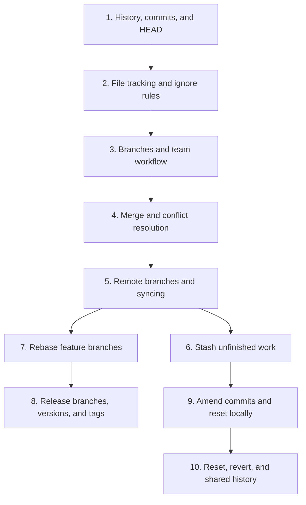

# 📚 Git Learning Path

[[DevOps/NaNa/0. Nana DevOps Table of Contents|🛠️ Nana DevOps Table of Contents]]

Follow these lessons from Git fundamentals to collaborative workflows and history repair. Each lesson focuses on one topic so you can read the course in smaller steps.

## 🧱 Foundations

Start with the commit history Git records, then learn what Git tracks in your working tree and index.

| Lesson | What you will learn |
|---|---|
| [[1. Git History, Commits, and HEAD]] | Read commit history, understand `HEAD`, inspect an older commit, and create a branch from it. |
| [[2. Git File Tracking and Ignore Rules]] | Remove files from Git, use `--cached`, and understand what `.gitignore` does. |

## 🤝 Everyday Team Workflow

Learn to isolate work, merge it safely, and keep your local view of the remote repository current.

| Lesson | What you will learn |
|---|---|
| [[3. Git Branches and Team Workflow]] | Create feature branches, push them, and send reviewed work into `develop`. |
| [[4. Git Merge and Conflict Resolution]] | Join branch histories and resolve conflicting edits. |
| [[5. Git Remote Branches and Syncing]] | Distinguish local and remote-tracking branches; use `fetch`, `pull`, and `push`. |
| [[6. Git Stash]] | Save unfinished changes temporarily and restore them later. |

## 🚀 Release Workflow

Once the collaboration basics make sense, learn how a team stabilizes and marks a release.

| Lesson | What you will learn |
|---|---|
| [[7. Git Rebase]] | Replay commits on an updated base, handle rebase conflicts, and understand rewritten history. |
| [[8. Git Release Branches, Versions, and Tags]] | Move a feature through `develop`, a release branch, `main`, and a version tag. |

## 🧯 History Repair

These lessons change or undo commits. Learn local cleanup first; use the shared-history lesson only after that foundation.

| Lesson | What you will learn |
|---|---|
| [[9. Git Amend and Local Reset]] | Correct the latest commit and compare `--soft`, `--mixed`, and `--hard` reset. |
| [[10. Git Reset, Revert, and Shared History]] | Understand reset of pushed commits, force-push risk, and how `git revert` preserves shared history. |

## 🧭 Suggested Study Order

1. Read lessons 1–6 to learn Git’s history model and the normal team workflow.

2. Read lessons 7–8 for release integration and version tagging.

3. Read lessons 9–10 when you need to repair or undo commit history.

[[DevOps/NaNa/0. Nana DevOps Table of Contents|Return to Nana DevOps]]
