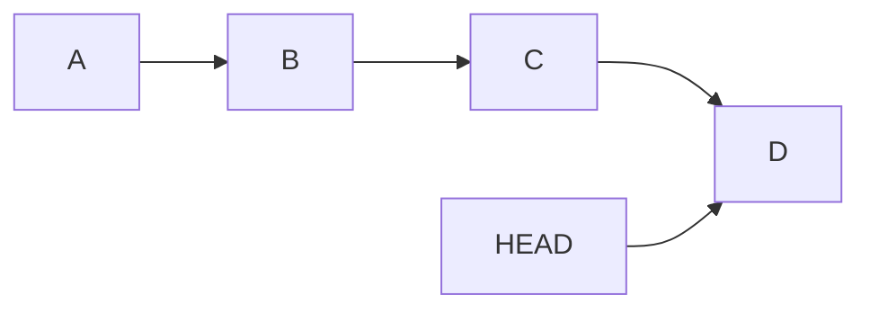
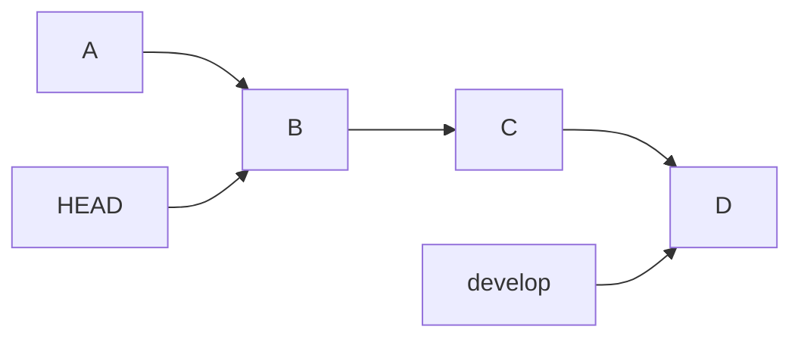
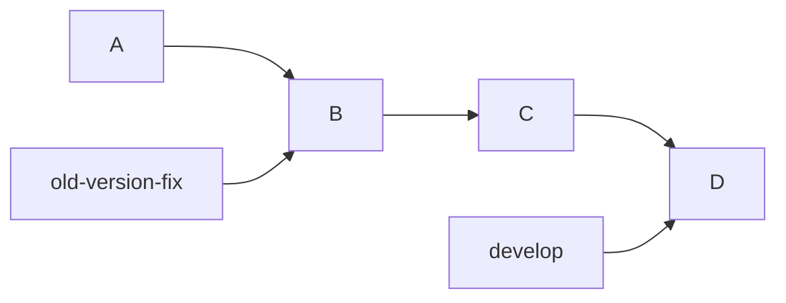
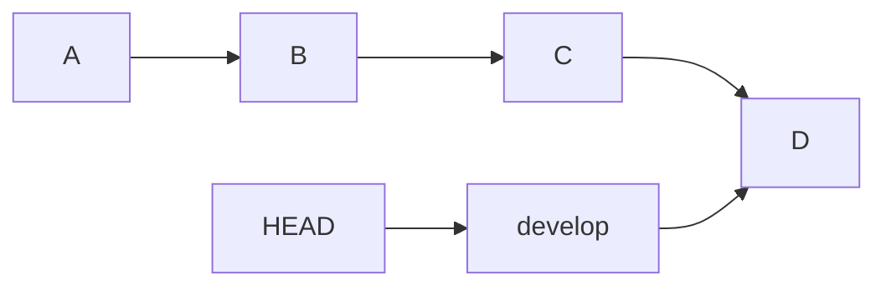
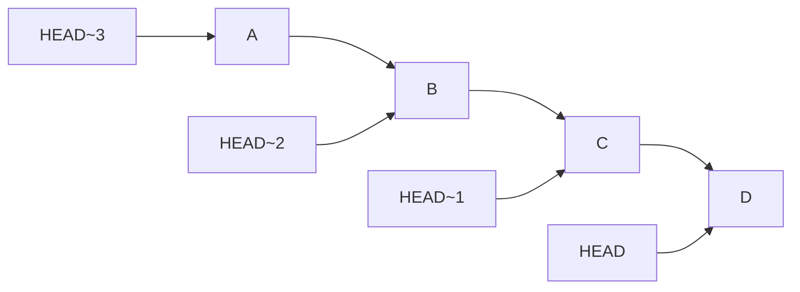

# 1. Git History, Commits, and HEAD

[[0. Git Learning Path|📚 Git Learning Path]]

Start by learning how to read commit history and identify the commit or branch you are currently viewing.

---

### 📜 `git log` — View Commit History

`git log` shows the history of commits.

```bash
git log
```

Example:

```text
commit a7f83c12e...
Author: Ryan
Date:   ...

    Fix user authentication

commit 41bc9832a...
Author: Ryan
Date:   ...

    Add login API

commit f82ba21c1...
Author: Ryan
Date:   ...

    Initial project
```

Each commit has a unique identifier called a **commit hash**:

```text
a7f83c12e...
```

You usually only need the first several characters:

```bash
git show a7f83c1
```

---

### 🌳 A Better Commit History View

A very useful command is:

```bash
git log --oneline --graph --decorate --all
```

Example:

```text
* 91a82cd (HEAD -> develop) Fix database bug
* 62bc177 Add user validation
| * b15ca20 (feature/product) Add products
|/
* 29ff313 Initial API
```

This makes branches and commits much easier to understand.

---

### ⏪ Checking an Old Commit

Suppose your history is:



You want to inspect commit `B`.

You can use:

```bash
git checkout <commit-hash>
```

Example:

```bash
git checkout 41bc983
```

However, modern Git makes the intention clearer with:

```bash
git switch --detach 41bc983
```

Now:



Your branch has **not moved**.

You are simply looking at an old snapshot.

This state is called:

```text
detached HEAD
```

---

### 🌿 Create a Branch from an Old Commit

If you inspect an old commit and decide:

> I want to start development from here.

Use:

```bash
git switch -c new-branch <commit-hash>
```

Example:

```bash
git switch -c old-version-fix 41bc983
```

Now you have:



You can safely make new commits from that point.

---

### 🎯 Understanding `HEAD`

`HEAD` represents your **current checked-out commit/reference**.

Normally:



So:

```text
HEAD
```

means:

```text
current commit
```

`HEAD~1` means:

```text
one commit before HEAD
```

`HEAD~2` means:

```text
two commits before HEAD
```

For example:



---

## 🧪 Check Your Understanding

**Q1:** Does `git switch --detach <commit>` move the branch you came from?

**Q2:** What does `HEAD~1` refer to?

> [!answer]- 📋 Answers
>
> **A1:** No. It checks out that commit without moving the branch pointer.
>
> **A2:** The commit one first-parent step before the current `HEAD`.

### 📋 Quick Reference

| Goal | Command |
|---|---|
| Show commit history | `git log --oneline` |
| See branches and graph | `git log --oneline --graph --decorate --all` |
| Inspect a commit | `git show <commit>` |
| Inspect old snapshot | `git switch --detach <commit>` |
| Start a branch there | `git switch -c <branch> <commit>` |

### 🧠 Things to Remember

- `HEAD` is your current checkout; normally it points to the current branch.
- Detached `HEAD` is useful for inspection; create a branch before committing work you want to keep.

### 💡 Pro Tips

Use the graph view before moving or resetting references; it makes the branch and commit relationships visible.

### 🔗 Related Topics

[[3. Git Branches and Team Workflow]] · [[9. Git Amend and Local Reset]]


---

## 🔗 Git Learning Path

Return to the [[0. Git Learning Path|📚 Git Learning Path]] for the full basic-to-advanced course map.
