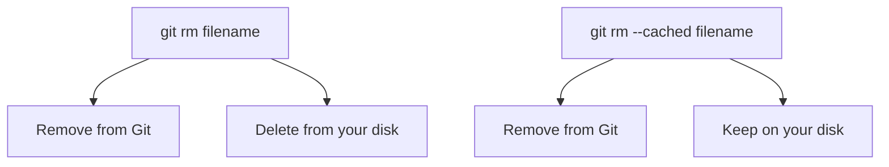

# 2. Git File Tracking and Ignore Rules

[[0. Git Learning Path|📚 Git Learning Path]]

Learn how Git tracks files, how `.gitignore` works, and how to stop tracking files without deleting local copies.

---

### 🗑️ `git rm` — Remove Files from Git

#### 💻 `git rm`

**What it does:**

Normally, `git rm` removes a file from **both**:

1. Git's tracked files
2. Your actual working directory

```bash
git rm filename
```

For example:

```bash
git rm config.txt
```

After this command:

```text
Git repository:   config.txt removed
Your disk:        config.txt removed
```

The removal is also automatically **staged**, so you can commit it:

```bash
git commit -m "Remove config file"
```

#### Removing a directory

Use `-r` for directories:

```bash
git rm -r directory/
```

---

### 🧠 `git rm --cached` — Stop Tracking Without Deleting

This is especially useful when you accidentally committed something that should have been in `.gitignore`.

```bash
git rm --cached filename
```

The important difference is:



#### 💡 Real-World Example

Suppose you accidentally committed:

```text
.env
```

Then later you add this to `.gitignore`:

```gitignore
.env
```

But Git **still tracks the file**.

Why?

Because `.gitignore` only prevents **untracked files** from being added. It does not automatically stop tracking files Git already knows about.

Use:

```bash
git rm --cached .env
git commit -m "Stop tracking .env"
```

Now:

```text
.env exists locally ✅
.env is ignored ✅
.env is no longer tracked by Git ✅
```

---

#### Stop Tracking a Directory

```bash
git rm -r --cached directory/
```

Example:

```bash
git rm -r --cached node_modules/
```

---

#### Reapply `.gitignore` to the Whole Repository

Sometimes many files are already tracked before you update `.gitignore`.

You can remove everything from the Git index:

```bash
git rm -r --cached .
```

Then add files again:

```bash
git add .
```

Git will now respect `.gitignore`.

Finally:

```bash
git commit -m "Apply gitignore rules"
```

> ⚠️ `--cached` is very important here. Without it:
>
> ```bash
> git rm -r .
> ```
>
> Git would also remove the files from your working directory.

---

### 📋 Quick Reference

| Goal | Command |
|---|---|
| Remove file from Git and disk | `git rm <file>` |
| Stop tracking but keep local file | `git rm --cached <file>` |
| Stop tracking a directory | `git rm -r --cached <directory>` |

### 🧠 Things to Remember

- `.gitignore` prevents matching untracked files from being added; it does not untrack files already committed.
- Review `git status` before committing index changes.

### 💡 Pro Tips

For secret files, remove them from tracking and rotate any credentials that were already committed; untracking does not erase old Git history.

### 🔗 Related Topics

[[6. Git Stash]] · [[1. Git History, Commits, and HEAD]]


---

## 🔗 Git Learning Path

Return to the [[0. Git Learning Path|📚 Git Learning Path]] for the full basic-to-advanced course map.
