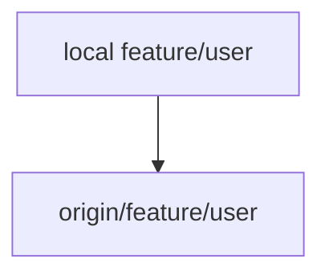
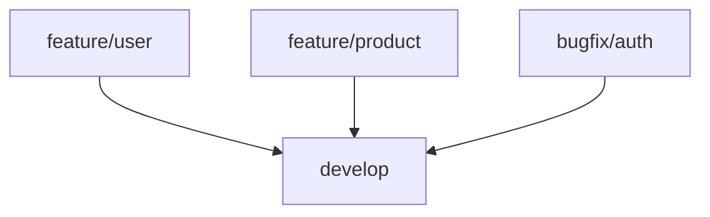
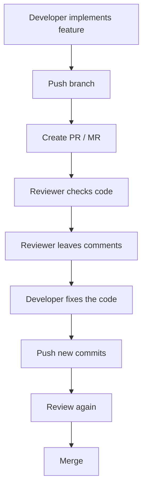

# 3. Git Branches and Team Workflow

[[0. Git Learning Path|📚 Git Learning Path]]

Create isolated feature branches, publish them, and move reviewed changes into the shared development branch.

---

## 🌿 One Branch per Feature or Bug Fix

Do not develop unrelated changes directly on `develop` or `main`.

Create a separate branch for each piece of work.

Examples:

```text
feature/user-login
feature/product-search
feature/payment-system

bugfix/user-auth-error
bugfix/payment-timeout
bugfix/product-price
```

For example:

```bash
git switch develop
git pull
git switch -c bugfix/user-auth-error
```

Now all commits related to the authentication bug stay isolated inside:

```text
bugfix/user-auth-error
```

This makes the branch easier to:

- review

- test

- merge

- revert

- understand later


> 💡 **Real-World Example**
>
> Imagine two developers are working simultaneously:
>
> ```mermaid
> flowchart LR
>     N0["Developer A"]
>     N1["feature/user"]
>     N2["Developer B"]
>     N3["feature/product"]
>     N0 --> N1
>     N2 --> N3
> ```
>
> Their unfinished work does not interfere with each other because each feature has its own branch.

---

## 🚀 Pushing a New Branch

When you create a branch locally:

```bash
git switch -c feature/user
```

the branch does not automatically exist on the remote repository.

If you run:

```bash
git push
```

Git usually tells you that the branch has no upstream branch and gives you a command similar to:

```bash
git push --set-upstream origin feature/user
```

or the shorter form:

```bash
git push -u origin feature/user
```

#### What `-u` means

`-u` means:

```text
--set-upstream
```

It connects:



After that, you can normally use:

```bash
git push
```

and:

```bash
git pull
```

without specifying the branch every time.

---

## 🔄 Our Development Flow

Features and bug fixes first go into `develop`.

For example:




## 🔎 Pull Request / Merge Request Review

Before a feature or bug fix is merged into `develop`, it should go through a:

```text
Pull Request (PR)
```

or:

```text
Merge Request (MR)
```

depending on the Git hosting platform.

The workflow is:



An important team rule is:

> When reviewing another developer's code, leave comments explaining the problem instead of silently changing their implementation yourself.

For example, instead of directly rewriting:

```cpp
if (user != nullptr) {
    login(user);
}
```

a reviewer might comment:

```text
Can this condition be moved into authenticateUser() so authentication
logic stays in one place?
```

The original developer then implements the change.

This helps the developer understand:

- what was wrong

- why it should change

- how the team expects the code to be structured


Code review therefore becomes part of the learning process, not only a gate before merging.

---


## 🌍 Practical Feature Workflow

Start from the latest shared `develop` branch, then create an isolated feature branch:

```bash
git switch develop
git pull origin develop
git switch -c feature/user-auth
```

Commit your work and publish the branch:

```bash
git add .
git commit -m "Add user authentication"
git push -u origin feature/user-auth
```

Open a PR/MR from `feature/user-auth` into `develop`. If `develop` changes while you work, update your feature branch using the team’s chosen merge or rebase policy. If you rebase a branch already pushed, publish the rewritten history with `git push --force-with-lease` only when it is your branch and teammates are not depending on its old commits.

### 🧪 Check Your Understanding

**Q1:** Why create one branch per feature or bug fix?

**Q2:** What does `git push -u` configure?

> [!answer]- 📋 Answers
>
> **A1:** It keeps changes isolated for review, testing, and merging.
>
> **A2:** It sets the remote branch as the local branch’s upstream for future push and pull commands.

### 📋 Quick Reference

| Task | Command or action |
|---|---|
| Update `develop` | `git switch develop` then `git pull` |
| Create feature branch | `git switch -c feature/name` |
| Publish first time | `git push -u origin feature/name` |
| Integrate feature | PR/MR from feature branch into `develop` |

### 🧠 Things to Remember

- Create the feature from current `develop`; keep unrelated work on separate branches.
- A local branch is not published until pushed.

### 💡 Pro Tips

Use a short name that describes one change, and keep PRs focused so reviewers can understand the change.

### 🔗 Related Topics

[[4. Git Merge and Conflict Resolution]] · [[5. Git Remote Branches and Syncing]]


---

## 🔗 Git Learning Path

Return to the [[0. Git Learning Path|📚 Git Learning Path]] for the full basic-to-advanced course map.
