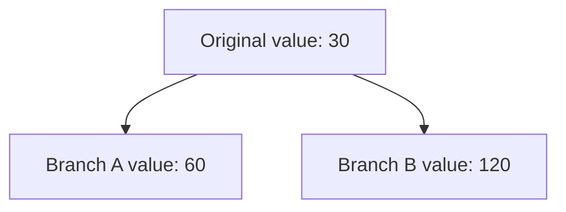
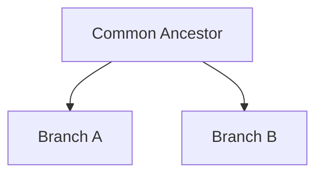
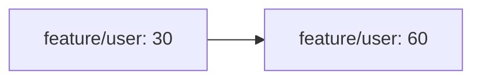
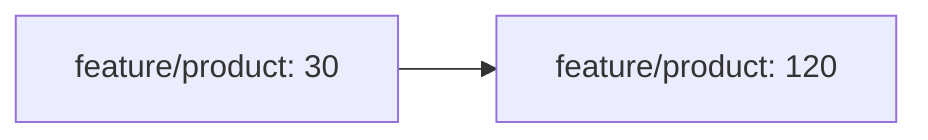

# 4. Git Merge and Conflict Resolution

[[0. Git Learning Path|📚 Git Learning Path]]

Learn how Git joins branch histories and how to resolve overlapping changes safely.

A merge brings the commits from another branch into the branch you are currently on. When Git can combine the changes, it completes automatically; when edits overlap in a way Git cannot decide, it pauses for you to resolve the conflict.

```bash
git switch develop
git merge feature/user
```

This merges `feature/user` into the current `develop` branch.

---

## ⚔️ Git Merge Conflicts

A Git merge conflict happens when Git cannot automatically decide which change should be kept.

Assume these branches exist:

```text
develop
feature/user
feature/product
```

Both feature branches originally came from the same `develop` commit:

```text
A---B   develop
     \
      feature/user
      feature/product
```

At commit `B`, suppose the code contains:

```go
timeout := 30
```

---

### 1️⃣ `feature/user` Changes the Code

Inside:

```text
feature/user
```

the developer changes:

```go
timeout := 30
```

to:

```go
timeout := 60
```

Then the branch is merged into `develop`.

```bash
git switch develop
git merge feature/user
```

There is no conflict because `develop` had not independently changed the same code.

Now:

```text
develop:

timeout := 60
```

Conceptually:

```text
A---B---------U---M   develop
     \
      P               feature/product
```

---

### 2️⃣ `feature/product` Also Changed the Same Code

Meanwhile, `feature/product` was created from the older commit `B`.

It changed:

```go
timeout := 30
```

to:

```go
timeout := 120
```

Now Git effectively sees:

```text
Common ancestor:

timeout := 30


develop:

timeout := 60


feature/product:

timeout := 120
```

Both branches changed the same original line differently.

---

### 3️⃣ `feature/product` Tries to Merge

Eventually:

```bash
git switch develop
git merge feature/product
```

Git compares three versions:

```text
Common ancestor
develop
feature/product
```

It sees:



Git cannot know which one is logically correct.

Therefore it produces a conflict:

```go
<<<<<<< HEAD
timeout := 60
=======
timeout := 120
>>>>>>> feature/product
```

A developer must decide the final code.

For example:

```go
timeout := 120
```

Then mark the conflict as resolved:

```bash
git add .
git commit
```

---

## 🧠 Why Three Versions Matter

A conflict is easier to understand when you realize Git is not simply comparing two files.

Git usually considers:



Example:

```text
Original:

timeout = 30
```

Then:



and:



Because both branches changed the same original content differently, Git needs a human decision.

---

## ✅ Changes That Usually Do Not Conflict

Suppose one branch changes:

```go
timeout := 30
```

while another changes:

```go
maxRetries := 5
```

If these changes do not overlap, Git can usually combine them automatically:

```go
timeout := 60
maxRetries := 10
```

So a merge conflict does **not** simply mean:

```text
two developers changed the same file
```

Two developers can modify the same file without creating a conflict.

The important issue is usually:

```text
overlapping incompatible changes
```

---

### 🧪 Check Your Understanding

**Q1:** Does changing the same file on two branches always cause a conflict?

**Q2:** What should you do after resolving conflict markers?

> [!answer]- 📋 Answers
>
> **A1:** No. Git can often combine non-overlapping edits in the same file.
>
> **A2:** Review the resolved file, stage it, then complete the merge as Git instructs.

### 📋 Quick Reference

| Task | Command |
|---|---|
| Merge branch into current branch | `git merge <branch>` |
| Inspect merge state | `git status` |
| Mark resolved files | `git add <file>` |
| View branch graph | `git log --oneline --graph --decorate --all` |

### 🧠 Things to Remember

- Git needs a human decision when it cannot safely combine overlapping edits.
- Do not remove conflict markers without choosing the intended final code.

### 💡 Pro Tips

Read the common ancestor and both branch versions before deciding how to resolve a conflict.

### 🔗 Related Topics

[[3. Git Branches and Team Workflow]] · [[5. Git Remote Branches and Syncing]] · [[7. Git Rebase]]


---

## 🔗 Git Learning Path

Return to the [[0. Git Learning Path|📚 Git Learning Path]] for the full basic-to-advanced course map.
