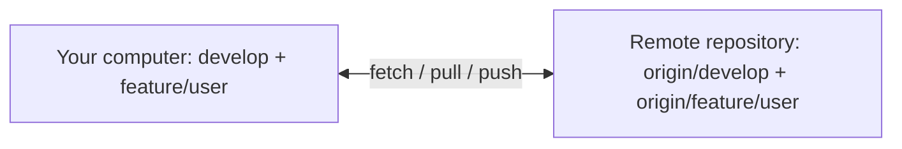

# 5. Git Remote Branches and Syncing

[[0. Git Learning Path|📚 Git Learning Path]]

Understand local and remote-tracking branches, fetch and pull, and why a push can be rejected.

---

## 🌐 Local and Remote Branches

Git usually has both local and remote-tracking branches.

For example:

```text
develop
```

is your local branch.

While:

```text
origin/develop
```

represents your local knowledge of the remote `develop` branch.

Conceptually:



---

## 🚫 Why `git push` Can Be Rejected

Imagine both your computer and the remote repository start here:

```text
A---B
```

You create a commit locally:

```text
A---B---L
        local
```

But another developer pushes first:

```text
A---B---R
        remote
```

Now the histories have diverged:

```text
        L   local
       /
A---B
       \
        R   remote
```

If you try:

```bash
git push
```

Git may reject the push because pushing `L` would not simply move the remote branch forward.

The remote contains commit `R`, which your local branch does not yet contain.

You first need to integrate the remote changes.

---

## 🔀 Option 1: `git pull` with Merge

You can run:

```bash
git pull
```

Conceptually, Git performs:

```text
git fetch
+
git merge
```

Before:

```text
        L
       /
A---B
       \
        R
```

After:

```text
        L
       / \
A---B     M
       \ /
        R
```

`M` is a merge commit.

Then you can push:

```bash
git push
```

---


## 🔄 `git fetch` vs `git pull`

These commands are related but not identical.

|Command|Downloads Remote Changes|Changes Current Branch|
|---|--:|--:|
|`git fetch`|✅|❌|
|`git pull`|✅|✅|
|`git pull --rebase`|✅|✅|

#### `git fetch`

```bash
git fetch origin
```

Updates your knowledge of branches such as:

```text
origin/develop
origin/main
```

but does not immediately modify your current branch.

This is useful because you can inspect remote changes first.

---

#### `git pull`

Usually behaves roughly like:

```text
git fetch
+
git merge
```

---

#### `git pull --rebase`

Behaves roughly like:

```text
git fetch
+
git rebase
```

---

### 📋 Quick Reference

| Goal | Command |
|---|---|
| Download remote references | `git fetch origin` |
| Download and integrate changes | `git pull` |
| Publish local commits | `git push` |
| See local and remote branches | `git branch -avv` |

### 🧠 Things to Remember

- `origin/develop` is your local remote-tracking reference, updated by fetch.
- `git fetch` downloads updates without integrating them into the current branch.
- A rejected push usually means the remote has commits you have not integrated yet.

### 💡 Pro Tips

Fetch first when you want to inspect remote changes before deciding how to integrate them.

### 🔗 Related Topics

[[3. Git Branches and Team Workflow]] · [[7. Git Rebase]]


---

## 🔗 Git Learning Path

Return to the [[0. Git Learning Path|📚 Git Learning Path]] for the full basic-to-advanced course map.
