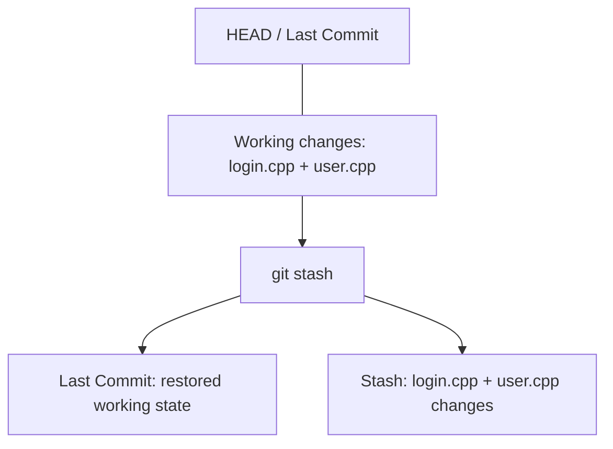
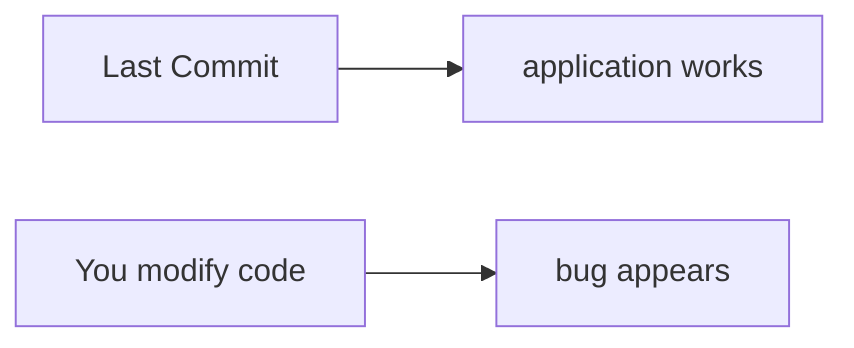
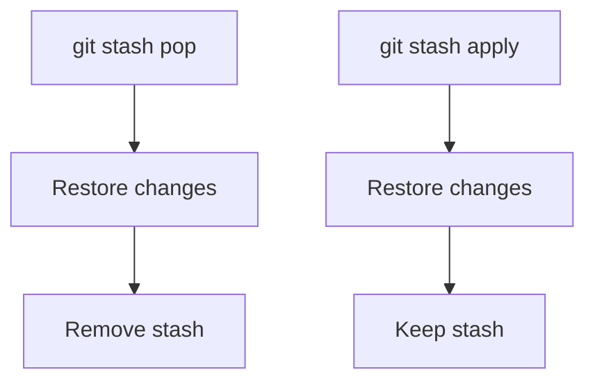

# 6. Git Stash

[[0. Git Learning Path|📚 Git Learning Path]]

Temporarily save unfinished changes so you can switch tasks or investigate a bug, then restore your work.

---

### 📦 `git stash` — Temporarily Store Changes

Imagine you are working on:

```text
feature/user-login
```

You changed several files, but the feature is not ready to commit.

Suddenly, you need to switch to:

```text
develop
```

to investigate a bug.

Instead of creating an unnecessary temporary commit, use:

```bash
git stash
```

Git temporarily stores your changes and returns your working directory close to the current `HEAD` state.



Now you can safely switch branches:

```bash
git switch develop
```

Later return:

```bash
git switch feature/user-login
```

and restore the changes:

```bash
git stash pop
```

---

### 🔍 Using Stash to Debug Your Own Changes

`git stash` is also useful when you want to check whether your recent **uncommitted changes** caused a bug.

Suppose:



You can run:

```bash
git stash
```

Then test the project again.

If the bug disappears, your uncommitted changes are probably related.

Restore them with:

```bash
git stash pop
```

> 💡 A stash does **not normally mean changes since some arbitrary earlier commit**.
>
> It primarily stores your current staged and unstaged modifications relative to `HEAD`.

---

### 💻 Important Stash Commands

#### Save changes

```bash
git stash
```

A clearer modern form is:

```bash
git stash push
```

With a description:

```bash
git stash push -m "User login work"
```

#### See saved stashes

```bash
git stash list
```

Example:

```text
stash@{0}: On feature/user: User login work
stash@{1}: On develop: Database test
```

#### Restore and remove the stash

```bash
git stash pop
```

#### Restore but keep the stash

```bash
git stash apply
```

Difference:



#### Include untracked files

By default, newly created untracked files are not included.

Use:

```bash
git stash -u
```

or:

```bash
git stash push -u
```

---

### 🧪 Check Your Understanding

**Q1:** What is the difference between `git stash pop` and `git stash apply`?

**Q2:** How do you include untracked files in a stash?

> [!answer]- 📋 Answers
>
> **A1:** Both restore changes; `pop` removes the stash after a successful apply, while `apply` keeps it.
>
> **A2:** Use `git stash push -u`.

### 📋 Quick Reference

| Goal | Command |
|---|---|
| Save changes with a label | `git stash push -m "description"` |
| Include untracked files | `git stash push -u` |
| List saved stashes | `git stash list` |
| Restore and remove entry | `git stash pop` |
| Restore and keep entry | `git stash apply` |

### 🧠 Things to Remember

- A stash is temporary storage for work relative to the current commit.
- Check the stash list before applying an older entry.

### 💡 Pro Tips

Use a descriptive stash message when keeping several unfinished tasks.

### 🔗 Related Topics

[[2. Git File Tracking and Ignore Rules]] · [[3. Git Branches and Team Workflow]]


---

## 🔗 Git Learning Path

Return to the [[0. Git Learning Path|📚 Git Learning Path]] for the full basic-to-advanced course map.
