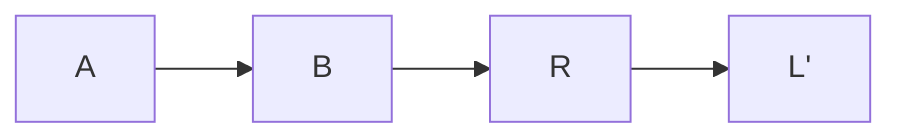
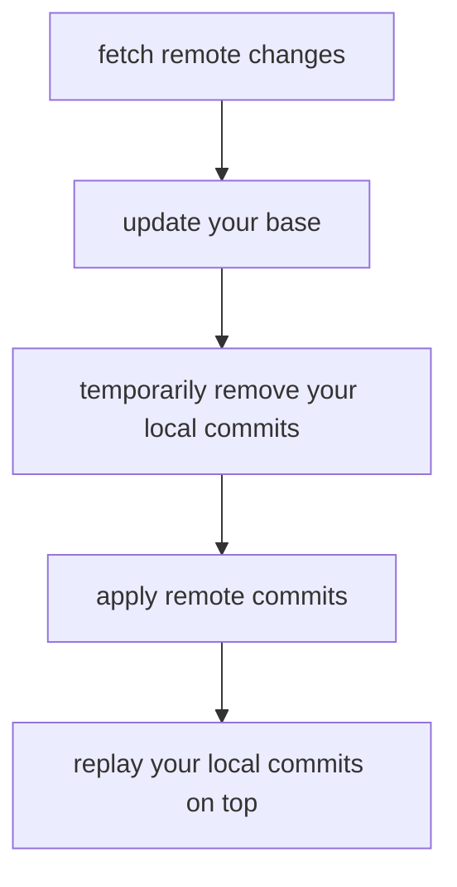
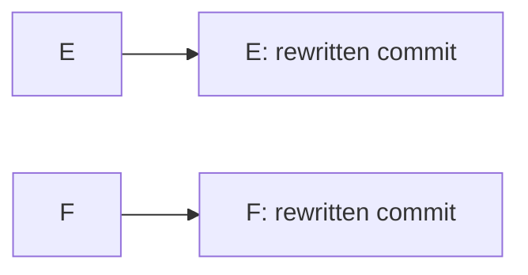
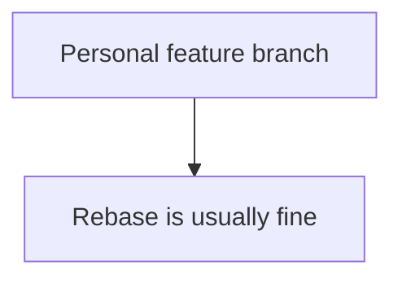
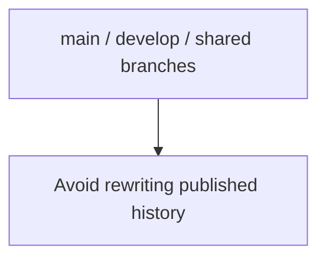

# 7. Git Rebase

[[0. Git Learning Path|📚 Git Learning Path]]

After learning merge and remote syncing, learn how rebase replays commits, handles conflicts, and affects shared history.

---

## 🧹 Option 2: `git pull --rebase`

A cleaner alternative for many personal feature branches is:

```bash
git pull --rebase
```

The short form is:

```bash
git pull -r
```

Instead of creating a merge commit, Git fetches the remote commits and replays your local commits on top.

Before:

```text
        L
       /
A---B
       \
        R
```

After rebase:

```text
A---B---R---L'
```

Your original commit:

```text
L
```

is recreated as:

```text
L'
```

because it now has a different parent.

The history stays linear:



instead of:

```text
      L
     / \
A---B   M
     \ /
      R
```

---

## 💻 `git pull -r`

#### What it does

```bash
git pull -r
```

is equivalent to:

```bash
git pull --rebase
```

Conceptually:



Example:

Before:

```text
Remote:

A---B---C


Local:

A---B---D---E
```

After:

```bash
git pull -r
```

you get:

```text
A---B---C---D'---E'
```

Instead of creating a merge commit.

---

## 🔀 Git Merge vs Rebase

Assume:

```text
A---B---C---D   develop
     \
      E---F     feature/product
```

`develop` has moved forward while the feature branch still comes from the older commit `B`.

---

### 🔀 Using Merge

From the feature branch:

```bash
git switch feature/product
git merge develop
```

Git combines the two histories.

```text
A---B---C---D
     \       \
      E---F---M
```

`M` is a merge commit.

Merge:

- preserves existing commit history

- does not rewrite `E` or `F`

- creates a merge commit

- clearly shows that two histories were joined


---

## 🧹 Using Rebase

Instead:

```bash
git switch feature/product
git rebase develop
```

Git temporarily takes:

```text
E
F
```

and replays them after `D`.

Before:

```text
A---B---C---D
     \
      E---F
```

After:

```text
A---B---C---D---E'---F'
```

Notice:



These are new commits.

Their changes may be the same, but their commit hashes change because their history changed.

---

## 🧠 Rebase Does Not Replace `develop`

One important point:

```bash
git switch feature/product
git rebase develop
```

does **not** erase or replace `develop`.

`develop` remains:

```text
A---B---C---D
```

Git changes the feature branch:

```text
Before:

A---B
     \
      E---F


develop:

A---B---C---D
```

into:

```text
A---B---C---D---E'---F'
                \
                 feature/product
```

Think of rebase as:

> Move my work so that it looks like I started from the latest version of `develop`.

---

## ⚔️ Rebase Conflicts

Rebase applies your commits one by one.

Suppose your feature has:

```text
E
F
G
```

Git starts replaying them:

```text
E ✅
F ❌ conflict
G not applied yet
```

The rebase pauses.

You resolve the file manually.

Then:

```bash
git add .
```

and continue:

```bash
git rebase --continue
```

This tells Git:

> The current conflict has been resolved. Continue replaying the remaining commits.

Git continues:

```text
E' ✅
F' ✅
G' ✅
```

If another conflict appears during `G`, Git pauses again.

Resolve it:

```bash
git add .
git rebase --continue
```

Repeat until the rebase finishes.

---

## 🛑 Cancel a Rebase

If the rebase becomes confusing or you want to return to the original state:

```bash
git rebase --abort
```

Git restores the branch to how it looked before the rebase started.

This is extremely useful when learning rebase.

---

## ⚠️ Rebase and Shared Branches

Because rebase recreates commits, commit hashes change.

For example:


Therefore rebasing a branch that multiple developers are already using can cause unnecessary confusion.

A useful rule is:



while:



For your own feature branch, this workflow is useful:

```bash
git switch feature/product
git fetch origin
git rebase origin/develop
```

This updates your feature branch using the latest remote `develop`.

---

### 🧪 Check Your Understanding

**Q1:** Why do commit hashes change during rebase?

**Q2:** What does `git rebase --abort` do?

**Q3:** Why avoid rebasing shared branches?

> [!answer]- 📋 Answers
>
> **A1:** Rebase gives each replayed commit a different parent, creating new commits with new hashes.
>
> **A2:** It stops the rebase and restores the branch to its pre-rebase state.
>
> **A3:** Other developers may already depend on the published commit history that rebase rewrites.

### 📋 Quick Reference

| Goal | Command |
|---|---|
| Update feature from remote `develop` | `git fetch origin` then `git rebase origin/develop` |
| Continue after resolving conflict | `git add <file>` then `git rebase --continue` |
| Cancel rebase | `git rebase --abort` |
| Update your rewritten feature branch | `git push --force-with-lease` |

### 🧠 Things to Remember

- Rebase changes the feature branch, not the base branch.
- Rebase is usually suitable for private feature work; avoid rewriting shared history.

### 💡 Pro Tips

Fetch before rebasing onto a remote-tracking branch so your local reference is current.

### 🔗 Related Topics

[[4. Git Merge and Conflict Resolution]] · [[5. Git Remote Branches and Syncing]] · [[8. Git Release Branches, Versions, and Tags]]


---

## 🔗 Git Learning Path

Return to the [[0. Git Learning Path|📚 Git Learning Path]] for the full basic-to-advanced course map.
