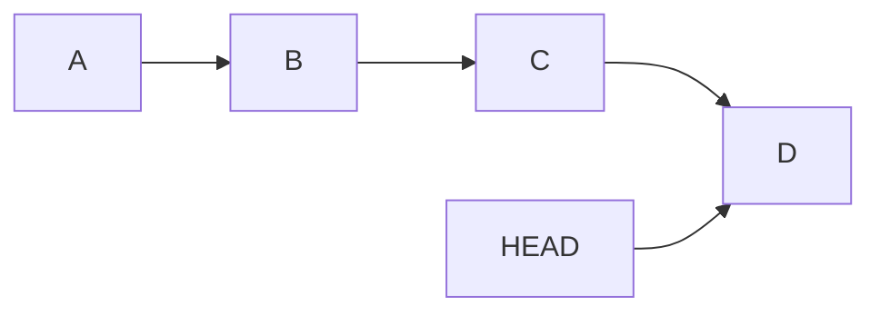
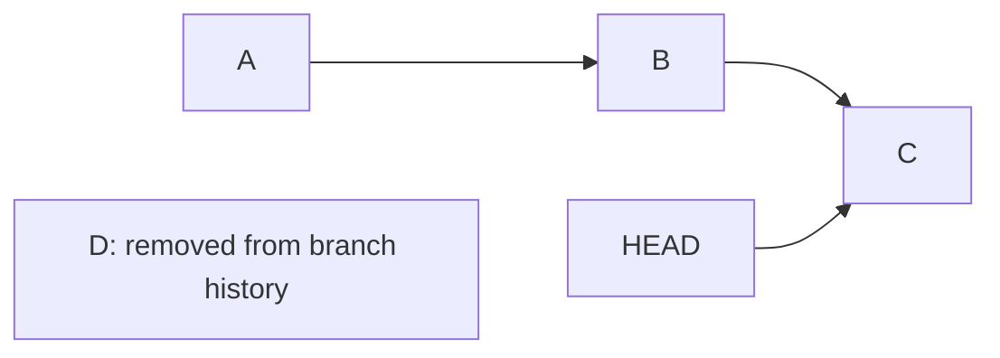
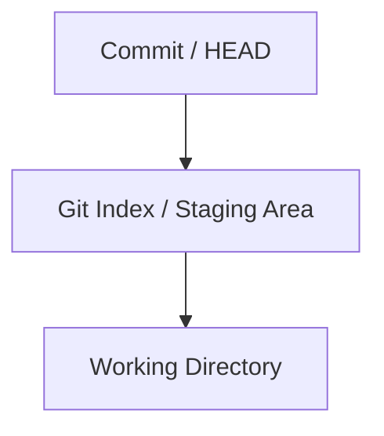
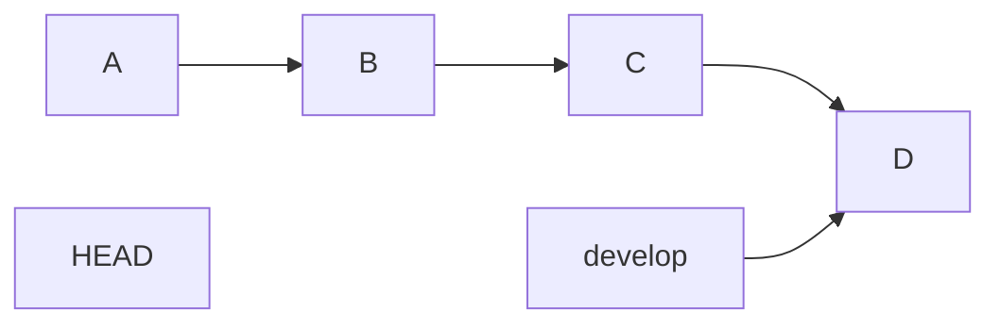

# 9. Git Amend and Local Reset

[[0. Git Learning Path|📚 Git Learning Path]]

Clean up recent private commits with amend or reset while understanding where changes remain: staged, unstaged, or discarded.

---

## 🌐 `git commit --amend` — Edit the Last Commit

Use `git commit --amend` when you just created a commit and realize you need to change something.

You can:

- change the commit message

- add forgotten files

- remove something from the commit

- modify files and include those changes


### 💻 `git commit --amend`

**What it does:**

Replaces the latest commit with a new corrected commit.

```bash
git commit --amend
```

For example:

```bash
git commit -m "Add login page"
```

Then you realize you forgot a file:

```bash
git add login.css
git commit --amend
```

Conceptually:

```text
Before:

A --- B --- C
            ↑
           HEAD

After amend:

A --- B --- C'
             ↑
            HEAD
```

`C` is replaced by a new commit `C'`.

Even if the contents look almost identical, the amended commit gets a **different commit hash**.

#### Change only the commit message

```bash
git commit --amend -m "Add user login page"
```

#### Add forgotten changes without changing the message

```bash
git add forgotten-file.cpp
git commit --amend --no-edit
```

> ⚠️ If the commit has already been pushed and other developers may have based work on it, amending it rewrites shared history.

---

## 🌐 `git reset --soft` — Remove Commits but Keep Their Changes Staged

`git reset --soft` moves your branch pointer backward but keeps the removed commits' file changes.

It also keeps those changes in the **staging area**.

### 💻 `git reset --soft`

**Structure:**

```bash
git reset --soft HEAD~<number>
```

Example:

```bash
git reset --soft HEAD~1
```

Suppose you have:

```text
A --- B --- C
            ↑
           HEAD
```

Run:

```bash
git reset --soft HEAD~1
```

Now:

```text
A --- B
      ↑
     HEAD

Changes from C:
✅ still exist
✅ still staged
❌ C is no longer part of the branch history
```

You can now modify the files and create a new commit:

```bash
vim file.cpp
git add file.cpp
git commit -m "Better implementation"
```

Result:

```text
A --- B --- C'
```

---

### 💡 Real-World Example

Imagine you made three small commits:

```text
A
|
B  Add login form
|
C  Fix login button
|
D  Fix login validation
```

You decide they should have been one clean commit.

Run:

```bash
git reset --soft HEAD~3
```

Git moves back before those three commits, but all their changes stay staged.

Now create one commit:

```bash
git commit -m "Implement login system"
```

Result:

```text
Before:

A --- B --- C --- D

After:

A --- E
```

`E` contains the combined changes.

---

## ⚠️ `--soft` Is Not the Default

The default mode of `git reset` is actually:

```bash
git reset --mixed
```

These two commands are equivalent:

```bash
git reset HEAD~1
```

```bash
git reset --mixed HEAD~1
```

But they are **not** equivalent to:

```bash
git reset --soft HEAD~1
```

The difference is the staging area.

|Command|Commit removed|Changes kept|Changes staged|
|---|--:|--:|--:|
|`git reset --soft`|✅|✅|✅|
|`git reset --mixed`|✅|✅|❌|
|`git reset --hard`|✅|❌|❌|

---

## 🌐 `git reset --mixed` — Keep Changes but Unstage Them

`--mixed` is the default `git reset` behavior.

```bash
git reset HEAD~1
```

is the same as:

```bash
git reset --mixed HEAD~1
```

Suppose:

```text
A --- B --- C
```

Run:

```bash
git reset HEAD~1
```

Now `C` is removed from the branch history, but its changes remain in your working directory.

They are **not staged**.

```text
Commit C:
❌ removed from history

Changes:
✅ remain in files
❌ not staged
```

You can inspect them:

```bash
git status
```

Then choose what to stage again:

```bash
git add file1.cpp
git add file2.cpp
```

---


## 💥 `git reset --hard`

`git reset --hard` is much more destructive than simply checking out an old commit.

Suppose:



Run:

```bash
git reset --hard HEAD~1
```

The branch moves back one commit:



Run:

```bash
git reset --hard HEAD~3
```

and the branch moves three commits backward.

---

### What Does `--hard` Mean?

Git conceptually has several areas:



`git reset --hard` changes all of them to match the target commit.

For example:

```bash
git reset --hard HEAD~1
```

means roughly:

```text
Move branch to HEAD~1
        +
Reset staging area
        +
Reset working directory
```

Therefore local modifications can be **permanently lost**.

> ⚠️ Before using `git reset --hard`, run:
>
> ```bash
> git status
> ```
>
> If you have important uncommitted work, consider:
>
> ```bash
> git stash
> ```
>
> first.

---

### `checkout` vs `reset --hard`

These are easy to confuse.

Assume:



If you run:

```bash
git switch --detach B
```

you are basically saying:

> Let me inspect the repository as it existed at B.

The `develop` branch remains at `D`.

But:

```bash
git reset --hard B
```

while on `develop` means:

> Move `develop` itself back to B and make my files match B.

So:

| Command                     | Main purpose                                |
| --------------------------- | ------------------------------------------- |
| `git switch --detach HASH`  | Inspect an old commit                       |
| `git switch -c branch HASH` | Start a branch from an old commit           |
| `git reset --hard HASH`     | Move the current branch back to that commit |

---

### 📋 Quick Reference

| Goal | Command |
|---|---|
| Correct latest commit | `git commit --amend` |
| Keep reset changes staged | `git reset --soft HEAD~1` |
| Keep reset changes unstaged | `git reset --mixed HEAD~1` |
| Reset commit, index, and files | `git reset --hard HEAD~1` |

### 🧠 Things to Remember

- `--soft` keeps changes staged; `--mixed` keeps them unstaged; `--hard` resets the working tree too.
- Amend and reset rewrite local commit history.

### 💡 Pro Tips

Run `git status` and inspect the target commit before resetting; practice destructive commands in a disposable repository.

### 🔗 Related Topics

[[1. Git History, Commits, and HEAD]] · [[10. Git Reset, Revert, and Shared History]]


---

## 🔗 Git Learning Path

Return to the [[0. Git Learning Path|📚 Git Learning Path]] for the full basic-to-advanced course map.
