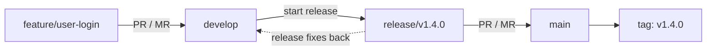
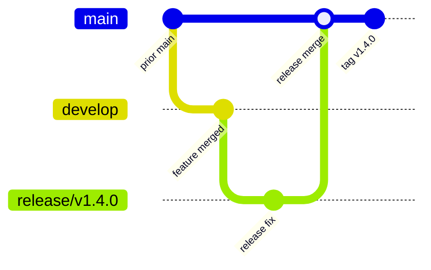

[[DevOps/NaNa/0. Nana DevOps Table of Contents|📚 Nana DevOps Table of Contents]]

This workflow takes a feature from `develop`, through release preparation, and onto `main` as a versioned release. The branch carries ongoing work; the final Git tag names the exact commit released.



---

## 🌿 1. Start a Feature from Updated `develop`

First update your local `develop` so your feature starts from the latest shared code:

```bash
git switch develop
git pull origin develop
git switch -c feature/user-login
```

- `git switch develop` moves you onto the development branch.
- `git pull origin develop` fetches and integrates the remote branch’s latest commits.
- `git switch -c ...` creates a new branch at the current commit and switches to it.

Use a name that describes the work, such as `feature/user-login` or `bugfix/payment-timeout`.

## 💻 2. Commit and Push the Feature

Make changes on the feature branch, then commit them:

```bash
git add .
git commit -m "Add user login"
```

Push the branch so teammates can review it and the remote keeps a copy:

```bash
git push -u origin feature/user-login
```

`-u` sets the upstream branch. After this first push, `git push` and `git pull` can refer to the same remote branch without repeating its name.

## 🔎 3. Review and Merge into `develop`

Open a pull request (PR) or merge request (MR) with:

```text
source: feature/user-login
target: develop
```

After review and required checks pass, merge it. The feature is now part of `develop`, where it can be integrated with other work. Repeat this process for the features included in the planned release.

## 🏷️ 4. Choose a Version and Create a Release Branch

When the planned features are ready to stabilize, update `develop` and branch from it:

```bash
git switch develop
git pull origin develop
git switch -c release/v1.4.0
git push -u origin release/v1.4.0
```

`release/v1.4.0` is a branch name. The `v1.4.0` part is the proposed release version; Git does not infer or enforce it. The team chooses a version that fits its release policy.

In Semantic Versioning, `MAJOR.MINOR.PATCH` generally means:

- **MAJOR** (`1`): incompatible changes.

- **MINOR** (`4`): new backwards-compatible functionality.

- **PATCH** (`0`): backwards-compatible fixes.

So `v1.4.0` means major version 1, minor version 4, patch version 0. Whether a change is breaking and which version to choose depends on the project’s compatibility policy.

## 🧪 5. Stabilize the Release

Use the release branch for final testing, release documentation, deployment preparation, and fixes needed for this release. Avoid adding unrelated new features at this stage; those can continue on `develop` for a later release.

If you make a fix on the release branch, commit and push it there, then run the release checks again. That fix must reach `main` before the release tag is created. Afterward, merge or cherry-pick the fix back into `develop` so it is not lost from future development.

## 🚀 6. Merge the Release into `main`

Open a PR/MR with:

```text
source: release/v1.4.0
target: main
```

After approval and release checks pass, merge it. Update your local `main` so you can tag the resulting release commit:

```bash
git switch main
git pull origin main
```

At this point, confirm that `main` contains the exact release commit you intend to ship.

## 📌 7. Create and Push the Release Tag

Create an annotated tag on the current `main` commit and push it to the remote:

```bash
git tag -a v1.4.0 -m "Release v1.4.0"
git push origin v1.4.0
```

- A **branch** such as `main` moves as new commits are added.

- A **tag** such as `v1.4.0` names one specific commit. It does not move forward as `main` changes.

- `-a` makes an annotated tag with a message and tag metadata.

- `git push origin v1.4.0` publishes that tag. A normal `git push` may not push tags, so push it explicitly.

The tag is the durable answer to “which exact source commit was release `v1.4.0`?” Build or deployment systems can use that tag to check out the released source.



The tag points to the release commit at the end of this path. Later commits on `main` do not change what `v1.4.0` identifies.

## 🔁 8. Carry Release Fixes Back to `develop`

If release preparation created commits on `release/v1.4.0`, bring those changes into `develop` after the `main` merge. For example, after merging the release into `main`, merge the release branch into `develop` through a PR/MR:

```text
source: release/v1.4.0
target: develop
```

This keeps release-only bug fixes in the next development line. Teams may instead merge `main` back into `develop`; follow the repository’s established policy.

## 🔎 Verify the Release Reference

Check which commit the tag names and confirm the tag exists locally:

```bash
git show --no-patch --decorate v1.4.0
git log -1 --oneline main
git ls-remote --tags origin v1.4.0
```

The first command shows the tagged commit and tag details, the second shows the current local `main` tip, and the third checks whether the remote has the tag. The tag’s commit should be the intended released commit.

> ⚠️ Do not reuse a published version tag for different code. If a release needs a correction after tagging, create a new commit and choose the next version according to the project’s versioning policy.

## 🧠 Remember the Difference

| Reference | Example | Purpose |
|---|---|---|
| Feature branch | `feature/user-login` | Isolated feature work, merged into `develop` |
| Release branch | `release/v1.4.0` | Stabilization and release-specific changes |
| Main branch | `main` | The project’s released history |
| Version tag | `v1.4.0` | A fixed label for the exact released commit |

### 🧪 Check Your Understanding

**Q1:** If `main` gets another commit next week, does tag `v1.4.0` move?

**Q2:** Why should a release fix be brought back into `develop`?

**Q3:** Does naming a branch `release/v1.4.0` automatically create a Git tag?

> [!answer]- 📋 Answers
>
> **A1:** No. The tag continues to identify the commit it was created for.
>
> **A2:** So future development includes the fix and does not reintroduce the same bug.
>
> **A3:** No. The branch name is just a name. Create and push the tag separately.

### 📋 Quick Reference

| Task | Command or action |
|---|---|
| Update `develop` | `git switch develop` then `git pull origin develop` |
| Start feature | `git switch -c feature/name` |
| Push new feature branch | `git push -u origin feature/name` |
| Start release branch | `git switch -c release/v1.4.0` from updated `develop` |
| Tag current release commit | `git tag -a v1.4.0 -m "Release v1.4.0"` |
| Publish tag | `git push origin v1.4.0` |
| Inspect tag | `git show --no-patch --decorate v1.4.0` |

### 🧠 Things to Remember

- Feature branches merge into `develop`; a release branch is cut from updated `develop`.

- The release branch is for stabilization; merge its finished changes into `main` before tagging.

- A branch can move. A tag identifies one exact commit.

- Push the tag explicitly so it is available on the remote.

### 💡 Pro Tips

- Create the tag only after the release merge and final checks, while on the intended `main` commit.

- Use an annotated tag for a human-readable release marker with a message.

- Keep the release version consistent across the branch name, tag, changelog, and published artifact.

### 🔗 Related Topics

[[🌿 Git Branching, Merge, Rebase, and Team Workflow]]

[[Git Tags]]

[[Semantic Versioning]]

[[CI-CD]]
