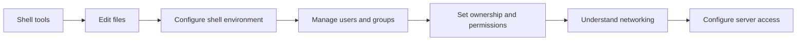

# 🐧 Linux Learning Path

[[DevOps/NaNa/0. Nana DevOps Table of Contents|📚 Nana DevOps Table of Contents]]

This section moves from everyday shell tools to the access, networking, and account setup used when preparing a Linux server.

> [!toc]- 📑 Contents
>
> - [[#🧭 Learning Order|🧭 Learning Order]]
> - [[#🗺️ How the Topics Build|🗺️ How the Topics Build]]

## 🧭 Learning Order

| # | Note | What you will learn |
|---:|---|---|
| 1 | [[1. Linux Pipes, `grep`, `less`, and Output Redirection\|Pipes, grep, less, and output redirection]] | Read command output, search text, combine commands, and save output. |
| 2 | [[2. Vim Cheat Sheet\|Vim cheat sheet]] | Move through a file and make common edits in Vim. |
| 3 | [[3. Environment Variables\|Environment variables]] | Set, inspect, and persist shell environment values. |
| 4 | [[4. Users and Groups\|Users and groups]] | Create and manage Linux accounts and groups. |
| 5 | [[5. Ownership and Permissions\|Ownership and permissions]] | Read and change file ownership and access permissions. |
| 6 | [[6. Networking Fundamentals\|Networking fundamentals]] | Understand IP addresses, routing, ports, firewalls, and core network flows. |
| 7 | [[7. Server Configuration\|Server configuration]] | Apply the account, sudo, and SSH basics when preparing a server. |

## 🗺️ How the Topics Build

The first topics help you work in a shell. The later topics build toward configuring a server with separate accounts, controlled privileges, and SSH access.
