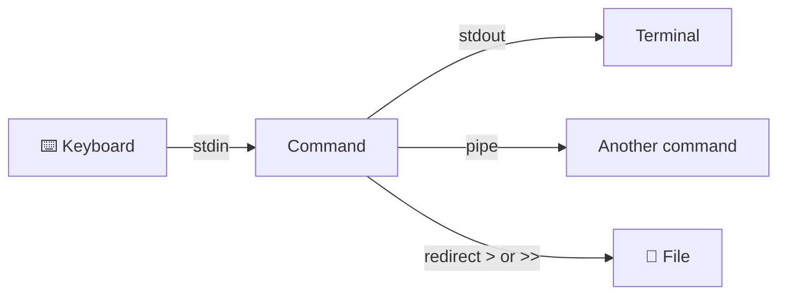
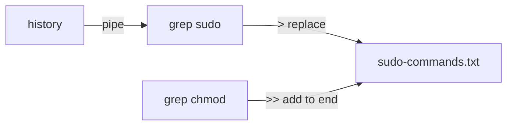

# 🔗 Pipes, `grep`, `less`, and Output Redirection

[[DevOps/NaNa/0. Nana DevOps Table of Contents|📚 Nana DevOps Table of Contents]]

> [!toc]- 📑 Contents
>
> - [[#🌊 Standard Streams|🌊 Standard Streams]]
> - [[#🔗 Pipes|🔗 Pipes]]
> - [[#📖 Read Long Output with less|📖 Read Long Output with less]]
> - [[#🔍 Search Text with grep|🔍 Search Text with grep]]
> - [[#➡️ Redirect Output to a File|➡️ Redirect Output to a File]]
> - [[#🌍 Real-World Patterns|🌍 Real-World Patterns]]
> - [[#🧪 Interview Q&A|🧪 Interview Q&A]]
> - [[#🔨 Hands-On Practice|🔨 Hands-On Practice]]
> - [[#📋 Quick Reference|📋 Quick Reference]]
> - [[#🧠 Things to Remember|🧠 Things to Remember]]
> - [[#💡 Pro Tips|💡 Pro Tips]]
> - [[#🔗 Related Topics|🔗 Related Topics]]

## 🌊 Standard Streams

Most Linux commands read text from **standard input** and write text to **standard output**. Pipes and redirection just change where those streams go.

- ⌨️ **`stdin` (0)** → input, normally the keyboard.

- 📤 **`stdout` (1)** → normal output, normally the terminal.

- ⚠️ **`stderr` (2)** → error messages, also the terminal by default.



Because so many tools speak plain text, small commands can be chained into useful pipelines.

---

## 🔗 Pipes

A **pipe** `|` sends the `stdout` of the left command into the `stdin` of the right command.

> 💡 **Real-World Example**
>
> `history` prints hundreds of commands, but we only want the ones with `sudo`:
>
> ```bash
> history | grep sudo
> ```
>
> `history` produces the data, `grep` filters it.

Pipes can be chained:

```bash
history | grep sudo | less
```


---

## 📖 Read Long Output with `less`

`less` is a **pager**: it shows text one screen at a time, with scrolling and search, instead of dumping everything into the terminal.

```bash
less /var/log/syslog
```

It also reads from a pipe:

```bash
journalctl -u nginx | less
```

- ⌨️ **Useful keys**

    - `Space` / `b` → next / previous page

    - `j` / `k` or arrows → line down / up

    - `g` / `G` → start / end of file

    - `/error` → search forward; `n` / `N` → next / previous match

    - `q` → quit

💡 For a file, `less file` is enough. `cat file | less` works but adds a needless process.

---

## 🔍 Search Text with `grep`

`grep` prints the lines that match a pattern. It reads a file directly or filters piped input.

```bash
grep [options] "pattern" [file...]
```

```bash
grep port config.txt              # search a file
ps aux | grep nginx               # filter another command's output
history | grep "sudo chmod"       # quote patterns that contain spaces
```

- 💬 **Quote multi-word patterns.** Without quotes, `grep sudo chmod` searches for `sudo` inside a file named `chmod`.

- 📄 **Skip `cat`.** `grep port config.txt` does the same as `cat config.txt | grep port`, with one less command.

### 🧰 Common options

| Option | Effect | Example |
|---|---|---|
| `-i` | Ignore case (`error`, `Error`, `ERROR`) | `grep -i error app.log` |
| `-n` | Show line numbers | `grep -n error app.log` → `34:Database error` |
| `-v` | Show lines that do **not** match | `grep -v debug app.log` |
| `-r` | Search all files under a directory | `grep -r "192.168.1.10" /etc` |
| `-c` | Count matching lines | `grep -c error app.log` |
| `-E` | Extended regex, e.g. alternatives | `grep -E "error\|fail" app.log` |

Short options combine: `grep -rin "error" ./project` → recursive, case-insensitive, with line numbers.

---

## ➡️ Redirect Output to a File

Redirection sends output to a file instead of the terminal.

- 📄 **`>` overwrites** the file (creates it if missing).

    ```bash
    history | grep sudo > sudo-commands.txt
    ```

- ➕ **`>>` appends** to the end, keeping existing content.

    ```bash
    history | grep chmod >> sudo-commands.txt
    ```



> ⚠️ `>` empties the file before the command even runs. `grep error app.log > app.log` destroys `app.log`. Write to a different file.

### 🚨 Redirecting errors

`>` only captures `stdout`. Errors still go to the terminal unless you redirect stream `2`.

```bash
find / -name "*.conf" 2> /dev/null        # hide permission-denied errors
./deploy.sh > deploy.log 2>&1             # stdout and stderr into one file
```

- `2>` → redirect `stderr`.

- `2>&1` → send `stderr` wherever `stdout` currently goes. Put it **after** `> file`.

- `/dev/null` → a sink that discards everything.

| Operator | Sends output to | Existing file |
|---|---|---|
| `\|` | Another command | — |
| `>` | File | Replaced |
| `>>` | File | Kept, new output appended |
| `2>` | File (errors only) | Replaced |

---

## 🌍 Real-World Patterns

- 📜 **Search a large log, then browse or save the result**

    ```bash
    grep -i "database error" app.log | less
    grep -i "database error" app.log > db-errors.txt
    grep -i "connection failed" app.log >> db-errors.txt
    ```

- 🕘 **Find a command you ran before**

    ```bash
    history | grep "sudo chmod"
    ```

    ```text
    103 sudo chmod 755 deploy.sh
    315 sudo chmod 600 /home/deploy/.ssh/authorized_keys
    ```

- ⚙️ **Check whether a process is running**

    ```bash
    ps aux | grep nginx
    ```

    The `grep nginx` line itself also appears in the output. `pgrep -a nginx` avoids that.

---

### 🧪 Interview Q&A

**Q1:** What does the pipe `|` connect?

**Q2:** What is the difference between `>` and `>>`?

**Q3:** Why doesn't `./script.sh > out.log` capture error messages?

**Q4:** What does `history | grep "sudo chmod" > chmod-history.txt` do?

**Q5:** Why is `grep port config.txt` preferred over `cat config.txt | grep port`?

> [!answer]- 📋 Answers
>
> **A1:** The `stdout` of the left command to the `stdin` of the right command.
>
> **A2:** `>` replaces the file's contents; `>>` adds the output to the end.
>
> **A3:** Errors go to `stderr`, and `>` only redirects `stdout`. Add `2>&1` to capture both.
>
> **A4:** It filters command history to lines containing `sudo chmod` and writes them to `chmod-history.txt`, replacing any old contents.
>
> **A5:** `grep` reads files directly, so `cat` is an unnecessary extra process.

---

## 🔨 Hands-On Practice

1. 📝 **Create a test file.**

    ```bash
    printf "HTTP port 80\nHTTPS port 443\nSSH port 22\ndebug: skip me\n" > ports.txt
    ```

2. 🔍 **Search it.**

    ```bash
    grep -n port ports.txt
    grep -v debug ports.txt
    ```

    ✅ The first shows three numbered lines; the second hides the `debug` line.

3. ➡️ **Overwrite, then append.**

    ```bash
    grep SSH ports.txt > result.txt
    grep HTTPS ports.txt >> result.txt
    cat result.txt
    ```

    ✅ `result.txt` contains the SSH line followed by the HTTPS line.

4. 🚨 **Split output and errors.**

    ```bash
    ls ports.txt missing.txt > out.txt 2> err.txt
    cat out.txt err.txt
    ```

    ✅ `out.txt` lists `ports.txt`; `err.txt` holds the "No such file" error.

5. 📖 **Browse history in `less`.** Run `history | less`, search with `/sudo`, press `n`, then `q`.

6. 🧹 Clean up: `rm ports.txt result.txt out.txt err.txt`.

---

### 📋 Quick Reference

| Task | Command |
|---|---|
| Pipe into another command | `cmd1 \| cmd2` |
| Page through a file | `less file` |
| Search a file | `grep pattern file` |
| Filter output | `cmd \| grep pattern` |
| Case-insensitive + line numbers | `grep -in pattern file` |
| Search a directory tree | `grep -r pattern dir` |
| Invert match | `grep -v pattern file` |
| Overwrite file | `cmd > file` |
| Append to file | `cmd >> file` |
| Errors to file | `cmd 2> err.log` |
| Everything to one file | `cmd > all.log 2>&1` |
| Discard errors | `cmd 2> /dev/null` |

### 🧠 Things to Remember

- `|` → command, `>` → file (replace), `>>` → file (append).

- `>` and `>>` redirect only `stdout`; use `2>` or `2>&1` for errors.

- Quote `grep` patterns that contain spaces or special characters.

- `>` truncates the file before the command runs.

### 💡 Pro Tips

- Build pipelines step by step: run `history`, then `history | grep sudo`, and only add `> file` once the output looks right.

- Add `| less` to any command whose output scrolls off the screen.

- Use `set -o noclobber` in your shell to make `>` refuse to overwrite existing files; force it with `>|`.

- Use `pgrep` or `ss -ltnp` instead of `ps aux | grep` when checking services.

### 🔗 Related Topics

- [[DevOps/NaNa/Linux/2. Vim Cheat Sheet|Vim Cheat Sheet]]

- [[DevOps/NaNa/Linux/3. Environment Variables|Environment Variables]]

- [[DevOps/NaNa/Linux/6. Networking Fundamentals|Networking Fundamentals]]

- [[DevOps/Server Administration/7. Logs and Disk Space|Logs and Disk Space]]
